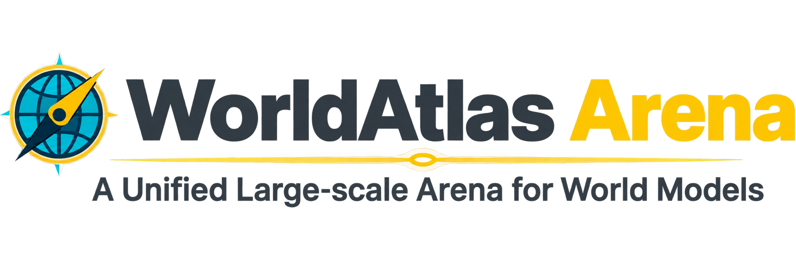

<p align="center">
  
</p>

<h1 align="center">
  WorldAtlas: A Unified Large-Scale Benchmark for<br>World Generation toward World Intelligence
</h1>

<p align="center">
  <a href="https://openenvision.github.io/index.html"><b>OpenEnvision</b></a>
</p>

<p align="center">
  <a href="https://github.com/OpenEnvision/WorldAtlas"></a>
  <a href="https://worldatlas.worldatlas-site.workers.dev/"></a>
  <a href="https://worldatlas.worldatlas-site.workers.dev/doc/benchmark/"></a>
  <a href="https://worldatlas.worldatlas-site.workers.dev/doc/zh/"></a>
  <a href="https://worldatlas.worldatlas-site.workers.dev/leaderboard/"></a>
  <a href="https://huggingface.co/datasets/OpenEnvisionLab/WorldAtlas"></a>
  <a href="https://modelscope.cn/datasets/OpenEnvision/WorldAtlas"></a>
  <a href="https://worldatlas.worldatlas-site.workers.dev/uncertain/"></a>
  <a href="LICENSE"></a>
</p>

<p align="center"><em>Is your world model a consistent, controllable, and physically plausible scene renderer?</em></p>

---

<p align="center"><b>TL;DR</b> — WorldAtlas evaluates the published world-model integrations on image-conditioned generation (<code>image_static</code>, <code>image_dynamic</code>, plus a closed-loop memory track at 60s and 30s) across 5 dimensions.</p>

## 📢 News

- **[2026/10/15]** 🚀 WorldAtlas is now open-sourcing as a preview! Released the dataset, evaluation code, model weights, leaderboard, and dataset gallery. 🌐

## ✨ Contributions

- **Unified Evaluation Protocol for World Generation.** We introduce WorldAtlas, the largest unified benchmark to date for video, 3D, 4D, and interactive world generation, which formulates the task as next-state generation and maps a single world specification onto each system's native interface, comparing heterogeneous models on task semantics rather than on a shared representation. 
- **Large-scale Diagnostic Suite for World Generation.** We curate 10,000 image and video evaluation instances spanning diverse scenes, viewpoint transformations, temporal dynamics, physical interactions, and action-conditioned transitions. The suite assesses whether a system can faithfully render a world, preserve its state across viewpoints and time, simulate plausible dynamics, and make targeted changes in response to interventions, enabling capability-specific diagnosis beyond aggregate perceptual scores.
- **Unified Evaluation of World Generation Paradigms.** We evaluate representative video, 3D, 4D, and interactive systems under a common capability framework, revealing a tradeoff between scalable visual synthesis and persistent world state. Visual fidelity does not establish a coherent, controllable world: state must persist across views and time, evolve plausibly, and change selectively in response to interventions.

## 🏆 Leaderboard

You're welcome to explore the latest results on our [hosted leaderboard](https://worldatlas.worldatlas-site.workers.dev/leaderboard/).

To submit your model, see the [Submission guide](https://worldatlas.worldatlas-site.workers.dev/doc/submission/) ([中文](https://worldatlas.worldatlas-site.workers.dev/doc/zh/submission/)).

## 🚀 Quick Start

See the [Getting Started guide](https://worldatlas.worldatlas-site.workers.dev/doc/getting-started/) for installation, data preparation, and runtime setup ([中文](https://worldatlas.worldatlas-site.workers.dev/doc/zh/getting-started/)).

Download the benchmark dataset from [Hugging Face](https://huggingface.co/datasets/OpenEnvisionLab/WorldAtlas) or [ModelScope](https://modelscope.cn/datasets/OpenEnvision/WorldAtlas).

## 🎮 Evaluate Your Model

1. Complete the setup in [Getting Started](https://worldatlas.worldatlas-site.workers.dev/doc/getting-started/).
2. Generate videos and score their content-bound evaluation manifest:

```bash
# End-to-end (generate + evaluate)
worldatlas run-model \
  --config config/benchmark.yaml \
  --model-config config/models/lingbot_world/lingbot_world.yaml \
  --suites image_static

# Evaluate a completed WorldAtlas generation run
worldatlas evaluate \
  --config config/benchmark.yaml \
  --manifest artifacts/predictions/my-model/evaluation_manifest.jsonl \
  --predictions-root artifacts/predictions/my-model \
  --model-name my_custom_model

# Sharded multi-GPU evaluation
python scripts/run_eval_shards.py --help
```

Reports land in `artifacts/benchmark/reports/<model>/` (`per_sample_scores.jsonl`, `per_metric_summary.json`, `per_dimension_summary.json`, `leaderboard.csv`).

**Generation suites** (what models produce and what the leaderboard scores)

| Suite | Conditioning | Typical control |
| --- | --- | --- |
| `image_static` | Single image | Camera path / pose, text prompt |
| `image_dynamic` | Image + mask / motion label | Dynamic prompt, object motion |
| `memory_loop` | Still image (interactive models) | Closed-loop 60s (`*_memory.yaml`) or 30s (`*_memory_30s.yaml`) rollout → long sequence |

**Reference video corpus**

| Collection | Role |
| --- | --- |
| `video_static` | Real-video reference corpus for `jedi`, `fvmd`, and `trajan` |
| `video_dynamic` | Real-video reference corpus for `jedi`, `fvmd`, and `trajan` |

These clips live under `data/video` and are indexed as `benchmark.reference_corpus`. Image-conditioned predictions are scored *against* that corpus.

**Dimensions** (headline official metrics; full list on each dimension page)

| Dimension | Representative metrics |
| --- | --- |
| [Action control](https://worldatlas.worldatlas-site.workers.dev/doc/benchmark/metrics/dimensions/action-control/) | prompt alignment, camera error, motion accuracy, keystroke action / trajectory |
| [3D/4D consistency](https://worldatlas.worldatlas-site.workers.dev/doc/benchmark/metrics/dimensions/consistency-3d-4d/) | MEt3R consistency, reprojection error, optical flow AEPE, geometric consistency, photometric consistency, FVMD, JEDi |
| [Physics](https://worldatlas.worldatlas-site.workers.dev/doc/benchmark/metrics/dimensions/physics/) | motion magnitude, motion smoothness, physical FPS error, physical FPS percent error, intra-video FPS variation, TRAJAN |
| [Quality](https://worldatlas.worldatlas-site.workers.dev/doc/benchmark/metrics/dimensions/quality/) | perceptual quality, style consistency, image quality, HPSv3 norm, background consistency, segment continuity |
| [Long sequence / memory](https://worldatlas.worldatlas-site.workers.dev/doc/benchmark/metrics/dimensions/long-sequence/) | long-sequence metrics, object permanence, scene memory F1, closed-loop memory family |

`experimental` is a supplemental slice and does **not** enter formal headline aggregates.

## 🔌 Implement Your Model

WorldAtlas supports several control interfaces through the same YAML adapter contract:

| Type | Input | Suites | Status |
| --- | --- | --- | --- |
| **Image-conditioned** | Reference image + prompt | `image_static`, `image_dynamic` | ✅ Adapters in `config/models/` |
| **Camera-conditioned** | First frame + camera path / 6-DoF pose | `image_static` | ✅ e.g. RealCam-I2V, LingBot-World |
| **Action-conditioned** | First frame + discrete action / keystroke | `image_static` | ✅ e.g. MatrixGame, AlayaWorld |
| **Interactive / memory** | Closed-loop rollout from a still image | `memory_loop` | ✅ `*_memory.yaml` (60s), `*_memory_30s.yaml` (30s) |

**Steps**

1. Place upstream code under `thirdparty/<Name>/` (or set `repo_root`).
2. Download weights to `ckpt/<name>/`.
3. Add `config/models/<family>/<name>.yaml`.
4. Implement or extend an adapter in `worldatlas/models/adapters/` and register it in `worldatlas/models/registry.py`.

Minimal local-repo template:

```yaml
model:
  name: my-world-model
  family: my_world_model
  repo_root: thirdparty/MyModel
  checkpoint_dir: ckpt/my-model
  python_bin: python          # or a dedicated env interpreter
  entrypoint: infer.py
  output_ext: .mp4
  supported_suites: [image_static, image_dynamic]
  prompt_mode: prompt_target
  reference_mode: first_frame
  generation: { num_frames: 81, fps: 24 }
```

HTTP API template: [`config/models/video_api/template_video_api.yaml.example`](config/models/video_api/template_video_api.yaml.example). Adapter contracts: [Getting Started](https://worldatlas.worldatlas-site.workers.dev/doc/getting-started/).

## 📝 Citation

If you use WorldAtlas in your research, please cite:

```bibtex
@article{worldatlas2026,
  title   = {WorldAtlas: A Unified Large-Scale Benchmark for World Generation toward World Intelligence},
  author  = {OpenEnvision},
  year    = {2026},
  url     = {https://github.com/OpenEnvision/WorldAtlas}
}
```

## 🙏 Acknowledgement

This project builds upon the following excellent works:

- [MEt3R](https://arxiv.org/abs/2501.06336) — multi-view consistency
- [Depth Anything 3](https://github.com/DepthAnything/Depth-Anything-V3) — geometric / photometric reconstruction
- [FVMD](https://github.com/DSL-Lab/FVMD-frechet-video-motion-distance) — Fréchet video motion distance
- [JEDi](https://github.com/oooolga/JEDi) — video distributional similarity
- [TRAJAN](https://github.com/google-deepmind/tapnet) / BootsTAPIR — trajectory reconstruction
- [MegaSAM](https://github.com/mega-sam/mega-sam) / DROID-SLAM — camera and reprojection
- [HPSv3](https://github.com/MizzenAI/HPSv3) — human preference score
- [SAM 2](https://github.com/facebookresearch/sam2) / [GroundingDINO](https://github.com/IDEA-Research/GroundingDINO) — motion-region supervision
- [RAFT](https://github.com/princeton-vl/RAFT) / SEA-RAFT — optical flow
- [TransNetV2](https://github.com/soCzech/TransNetV2) — scene-boundary detection
- [AMT](https://github.com/MCG-NKU/AMT) / VFIMamba — temporal interpolation
- … and the upstream world-model repositories listed under [`thirdparty/`](thirdparty/README.md)

## 📧 Contact

Open an [Issue](https://github.com/OpenEnvision/WorldAtlas/issues) or Pull Request, or email `jiadonghou3@gmail.com`.

## 📄 License

- **Code in this repository:** [MIT License](LICENSE)
- **Model weights:** subject to each upstream project's license
- **Benchmark media:** subject to the dataset license under which you obtained the assets

---

**WorldAtlas** · [Homepage](https://worldatlas.worldatlas-site.workers.dev/) · [GitHub](https://github.com/OpenEnvision/WorldAtlas) · [Documentation](https://worldatlas.worldatlas-site.workers.dev/doc/benchmark/)
