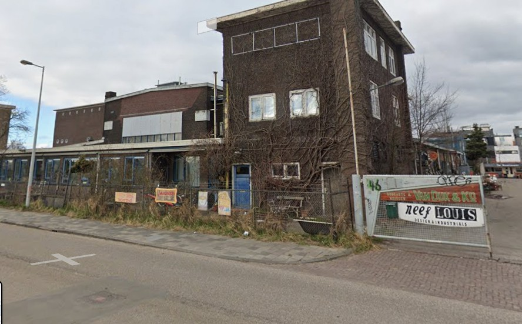
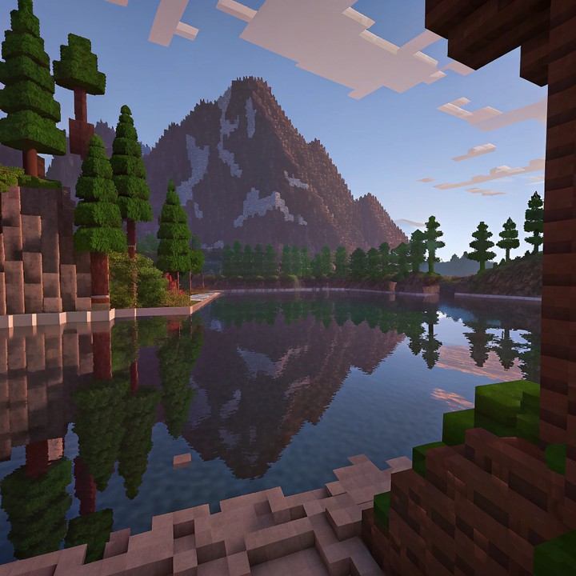

# Background Consistency

Background Consistency measures **temporal stability of scene appearance** in a generated video. Large shifts in background layout, texture, or global scene context between adjacent frames lower the score.

For each decoded frame $x_i$, CLIP ViT-B/32 extracts a normalized embedding $f_i$. The metric averages cosine similarity over consecutive frame pairs:

\[
S_{\mathrm{bg}}
=
\frac{1}{N-1}\sum_{i=1}^{N-1}\cos(f_i, f_{i+1})
\tag{1}
\]

where $N$ is the number of evaluated frames and $\cos(\cdot,\cdot)$ is cosine similarity between L2-normalized CLIP image features. WorldArena clamps $S_{\mathrm{bg}}$ to $[0, 1]$; higher values indicate more stable backgrounds. The metric is **prediction-only** and requires at least two frames.

## References {#reference}

!!! quote "CLIP — Learning Transferable Visual Models From Natural Language Supervision"

    Radford et al., ICML 2021.
    [https://arxiv.org/abs/2103.00020](https://arxiv.org/abs/2103.00020)

<!-- metric-examples:start -->
## Verified Same-Input Examples

Up to three cases are shown per metric. Within each case, both videos must belong to the same benchmark sample, and both first frames must pass SIFT + RANSAC geometric matching against that case's displayed input. Candidates that fail are not published. Labels compare this metric only, not overall model quality.

Audit manifest: `docs/assets/metric_examples/curated_same_case_manifest.json`.

<article class="metric-case-exhibit metric-case-exhibit--curated">
  

    <figure class="metric-input-card">
      
      <figcaption>Input image</figcaption>
    </figure>
    

      
Input verified · same benchmark case · gap 0.1517

      <h4><code>image_static_photorealistic_city_0043</code></h4>
      
Suite: image_staticScene: photorealistic / outdoor / city

      

        Benchmark prompt target
        
Camera orbit left. A narrow city street with historic buildings, street corner, and streetlights.

        <small>prompt source: prompt_target</small>
      

      
Both first frames passed geometric matching against the displayed input; labels compare this metric only.

    

  

  

    <figure class="metric-output-card metric-output-card--good">
      

        <video class="metric-output-video" controls muted loop playsinline preload="metadata" aria-label="Higher metric score: image_static_photorealistic_city_0043">
          <source src="../../../assets/metric_examples/curated_20260801/48e0a8e64f87__image_static_photorealistic_city_0043__high.mp4" type="video/mp4">
        </video>
        
Higher metric score · Score 0.9849

      

      <figcaption class="metric-output-caption"><strong>Higher metric score</strong>background_consistencyMean adjacent-frame similarity: 0.9849</figcaption>
    </figure>
    <figure class="metric-output-card metric-output-card--bad">
      

        <video class="metric-output-video" controls muted loop playsinline preload="metadata" aria-label="Lower metric score: image_static_photorealistic_city_0043">
          <source src="../../../assets/metric_examples/curated_20260801/cafc8cbd4022__image_static_photorealistic_city_0043__low.mp4" type="video/mp4">
        </video>
        
Lower metric score · Score 0.8333

      

      <figcaption class="metric-output-caption"><strong>Lower metric score</strong>background_consistencyMean adjacent-frame similarity: 0.8333</figcaption>
    </figure>
  

</article>
<article class="metric-case-exhibit metric-case-exhibit--curated">
  

    <figure class="metric-input-card">
      
      <figcaption>Input image</figcaption>
    </figure>
    

      
Input verified · same benchmark case · gap 0.1444

      <h4><code>image_static_photorealistic_city_0041</code></h4>
      
Suite: image_staticScene: photorealistic / outdoor / city

      

        Benchmark prompt target
        
Camera move right. An old industrial building with adjacent street, buildings, and parked cars.

        <small>prompt source: prompt_target</small>
      

      
Both first frames passed geometric matching against the displayed input; labels compare this metric only.

    

  

  

    <figure class="metric-output-card metric-output-card--good">
      

        <video class="metric-output-video" controls muted loop playsinline preload="metadata" aria-label="Higher metric score: image_static_photorealistic_city_0041">
          <source src="../../../assets/metric_examples/curated_20260801/346b0f1c5c3b__image_static_photorealistic_city_0041__high.mp4" type="video/mp4">
        </video>
        
Higher metric score · Score 0.9882

      

      <figcaption class="metric-output-caption"><strong>Higher metric score</strong>background_consistencyMean adjacent-frame similarity: 0.9882</figcaption>
    </figure>
    <figure class="metric-output-card metric-output-card--bad">
      

        <video class="metric-output-video" controls muted loop playsinline preload="metadata" aria-label="Lower metric score: image_static_photorealistic_city_0041">
          <source src="../../../assets/metric_examples/curated_20260801/49d5f2e01c18__image_static_photorealistic_city_0041__low.mp4" type="video/mp4">
        </video>
        
Lower metric score · Score 0.8437

      

      <figcaption class="metric-output-caption"><strong>Lower metric score</strong>background_consistencyMean adjacent-frame similarity: 0.8437</figcaption>
    </figure>
  

</article>
<article class="metric-case-exhibit metric-case-exhibit--curated">
  

    <figure class="metric-input-card">
      
      <figcaption>Input image</figcaption>
    </figure>
    

      
Input verified · same benchmark case · gap 0.1793

      <h4><code>image_static_stylized_aquatic_landscape_0063</code></h4>
      
Suite: image_staticScene: stylized / outdoor / aquatic_landscape

      

        Benchmark prompt target
        
Camera move right. A stylized lake with trees, hills, and clouds.

        <small>prompt source: prompt_target</small>
      

      
Both first frames passed geometric matching against the displayed input; labels compare this metric only.

    

  

  

    <figure class="metric-output-card metric-output-card--good">
      

        <video class="metric-output-video" controls muted loop playsinline preload="metadata" aria-label="Higher metric score: image_static_stylized_aquatic_landscape_0063">
          <source src="../../../assets/metric_examples/curated_20260801/a285b51b62d0__image_static_stylized_aquatic_landscape_0063__high.mp4" type="video/mp4">
        </video>
        
Higher metric score · Score 0.9933

      

      <figcaption class="metric-output-caption"><strong>Higher metric score</strong>background_consistencyMean adjacent-frame similarity: 0.9933</figcaption>
    </figure>
    <figure class="metric-output-card metric-output-card--bad">
      

        <video class="metric-output-video" controls muted loop playsinline preload="metadata" aria-label="Lower metric score: image_static_stylized_aquatic_landscape_0063">
          <source src="../../../assets/metric_examples/curated_20260801/85e93576194e__image_static_stylized_aquatic_landscape_0063__low.mp4" type="video/mp4">
        </video>
        
Lower metric score · Score 0.8140

      

      <figcaption class="metric-output-caption"><strong>Lower metric score</strong>background_consistencyMean adjacent-frame similarity: 0.8140</figcaption>
    </figure>
  

</article>

<!-- metric-examples:end -->
