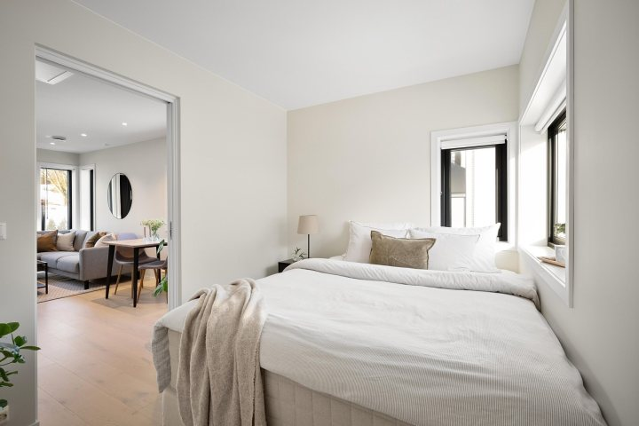
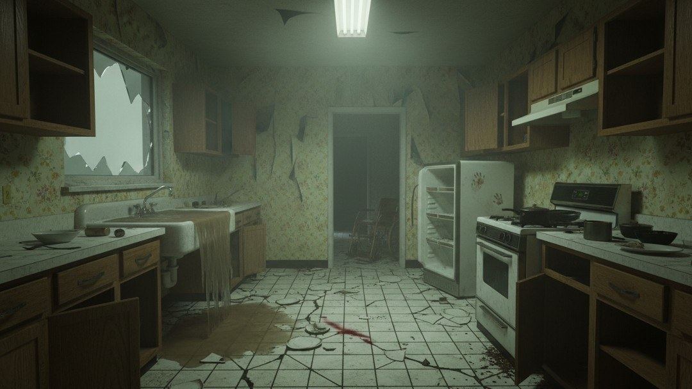
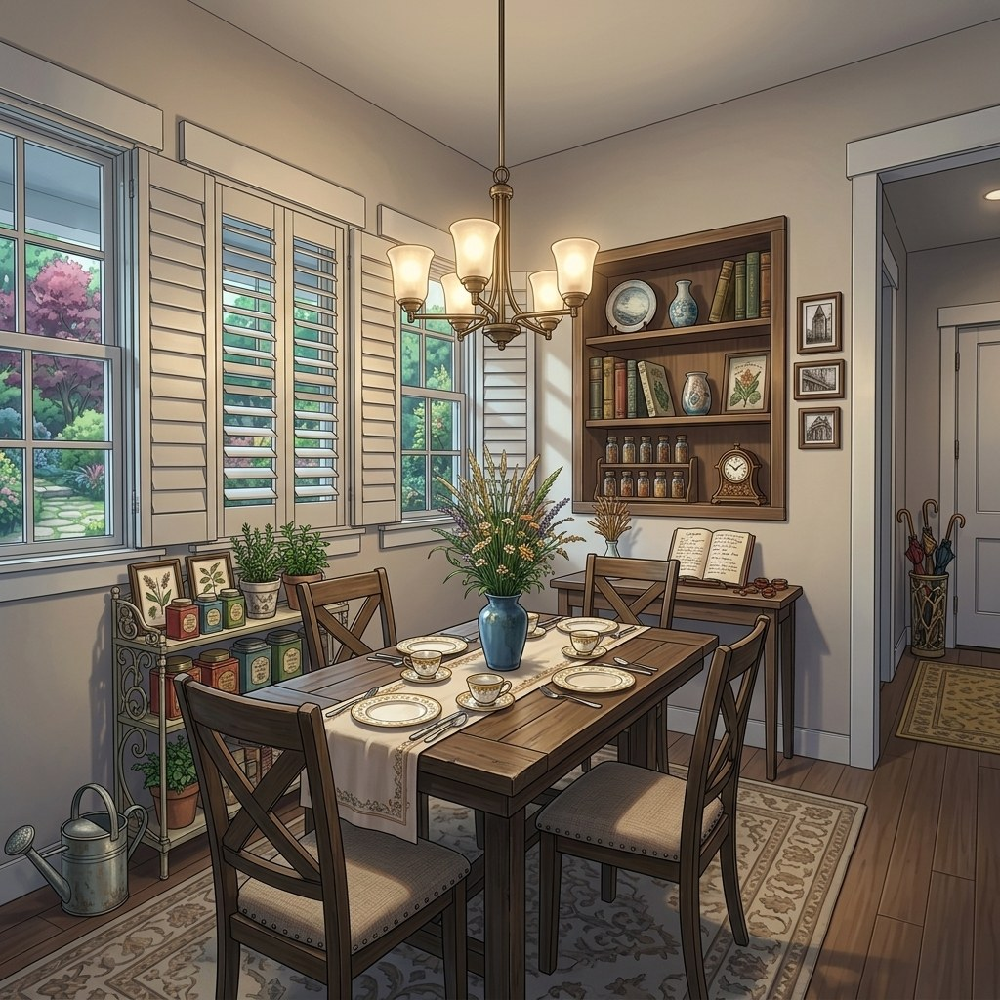
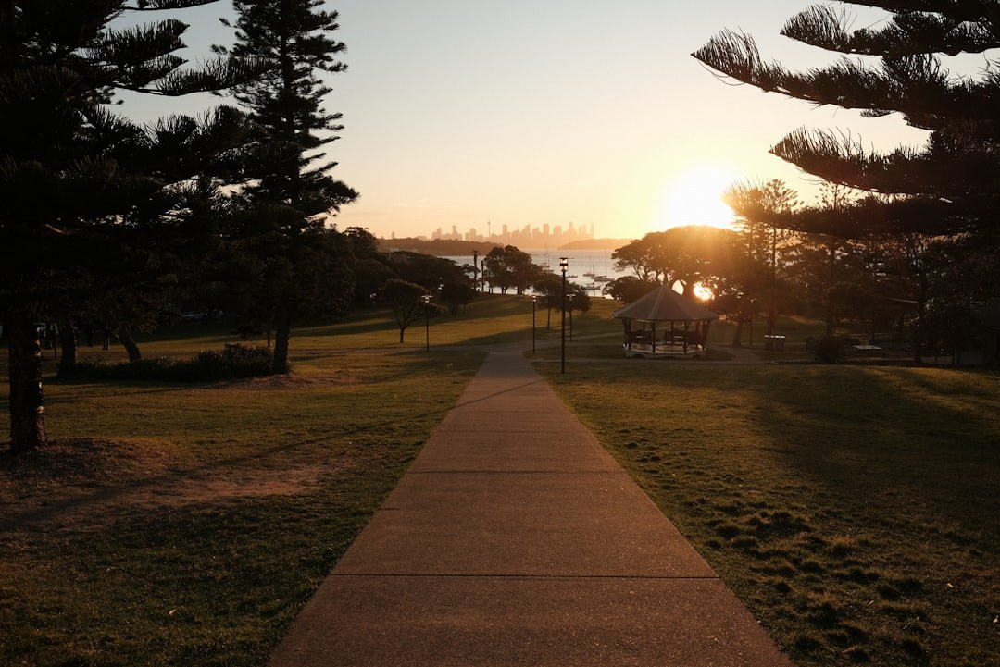
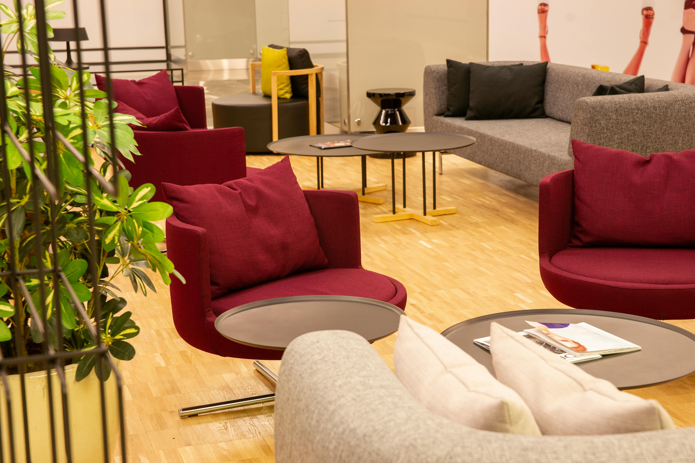

# Color Temperature Consistency

This metric evaluates the consistency of **environmental atmosphere (color-temperature logic)** in generated videos. We analyze the Hue channel in HSV color space: the hue spectrum $[0, 179]$ is divided into $7$ core intervals to construct a hue feature vector $\mathbf{h}_t \in \mathbb{R}^{7}$. We then compute a weighted perceptual similarity of the full sequence relative to the initial frame. To balance **global constancy** and **local transition**, the similarity at frame $t$ ($t \geq 2$) is the arithmetic mean of current-to-first and current-to-previous similarities. The similarity $S(\cdot, \cdot)$ follows the cosine inner product (same as Eq. (3) in the brightness-distribution metric):

\[
S(a, b)
=
\frac{a \cdot b}{\|a\|\,\|b\|}
=
\frac{\sum_{i=1}^{n} a_i b_i}{
    \sqrt{\sum_{i=1}^{n} a_i^2}\,\sqrt{\sum_{i=1}^{n} b_i^2}
}
\tag{3}
\]

\[
\bar{S}_t
=
\frac{
    S(\mathbf{h}_t, \mathbf{h}_1)
    +
    S(\mathbf{h}_t, \mathbf{h}_{t-1})
}{
    2
}
\tag{7}
\]

For each frame $I_t$, RGB is converted to HSV; a saturation-weighted histogram over $7$ hue bins on $[0, 180)$ is normalized to form $\mathbf{h}_t$ (WorldArena default `hue_bins=7`).

The final score uses a **normalized exponentially decaying weighted sum**, where weights $\hat{w}'(d)$ are an improved variant of $\hat{w}(d)$ with faster decay ($\beta > \alpha$), and similarities are passed through the modified Softmax transform $T(\cdot)$ (Eq. (4), default $\lambda = 4.0$):

\[
T(x)
=
\frac{e^{\lambda x} - 1}{e^{\lambda} - 1},
\quad \lambda > 0
\tag{4}
\]

\[
w'(d) = e^{-\beta \cdot d},
\qquad
\hat{w}'(d)
=
\frac{w'(d)}{\sum_{k=1}^{T-1} w'(k)}
\quad (\beta > 0)
\tag{8}
\]

Here $d \in [1, T-1]$ is the frame distance ($d=1$ for the second frame relative to the first), and $\beta$ is the decay coefficient. The default $\beta = 0.10$ exceeds the brightness metric's $\alpha = 0.05$, so $\hat{w}'(d)$ decays faster than $\hat{w}(d)$ and long-video color drift is penalized more strongly. The comprehensive score is:

\[
S_{\mathrm{Color}}
=
\sum_{d=1}^{T-1}
\hat{w}'(d) \cdot T\!\left(\bar{S}_{d+1}\right)
\tag{9}
\]

In WorldArena this algorithm is implemented as the official metric **`color_temperature_constraint`** (`hue_distribution` backend). Under the default normalization config, raw and normalized outputs lie in $[0,1]$ with **higher is better**. The legacy scalar alias `color_temperature_consistency` remains diagnostic and is not part of the seven-metric official quality total.

<!-- metric-examples:start -->
## Representative Same-Case Comparisons
Each exhibit first shows the input image and the exact displayed prompt for the case, then compares generated outputs. Paired exhibits require the same input image and the same prompt text, with one high-scoring and one low-scoring model output. Metrics without such a cross-model pair in the current formal snapshot are separated as high/low extrema rather than presented as same-case comparisons.
Machine-readable paired export: `docs/assets/metric_examples/paired_manifest.csv`.
### `color_temperature_constraint`

<article class="metric-case-exhibit">
  

    <figure class="metric-input-card">
      
      <figcaption>Input image</figcaption>
    </figure>
    

      
Case 1 · same input image + same prompt · score gap 0.9032

      <h4><code>image_static_photorealistic_living_spaces_0088</code></h4>
      
Suite: image_staticScene: photorealistic / indoor / living_spaces

      

        Prompt target
        
Camera move right. A living room with sofa, dining table, and mirror. Camera pan right. A dining area with dining table, chairs, and window. Camera pull out. A window view with plants and outdoor scenery.

        <small>prompt source: prompt_target</small>
      

    

  

  

<figure class="metric-output-card metric-output-card--good">
  

    <video class="metric-output-video" controls muted loop playsinline preload="metadata" aria-label="Good output: image_static_photorealistic_living_spaces_0088">
      <source src="../../../assets/metric_examples/527e53ab225d__longcat-video-image-static-8gpu-20260612_133950__image_static_photorealistic_living_spaces_0088.mp4" type="video/mp4">
    </video>
    
Good output · Score 1.0000

  

</figure>
<figure class="metric-output-card metric-output-card--bad">
  

    <video class="metric-output-video" controls muted loop playsinline preload="metadata" aria-label="Poor output: image_static_photorealistic_living_spaces_0088">
      <source src="../../../assets/metric_examples/3c83fb5cbc12__cosmos3-nano-image-static-8gpu-singleload-20260612_170108__image_static_photorealistic_living_spaces_0088.mp4" type="video/mp4">
    </video>
    
Poor output · Score 0.0968

  

</figure>
  

</article>
<article class="metric-case-exhibit">
  

    <figure class="metric-input-card">
      
      <figcaption>Input image</figcaption>
    </figure>
    

      
Case 2 · same input image + same prompt · score gap 0.9030

      <h4><code>image_static_stylized_passageways_0041</code></h4>
      
Suite: image_staticScene: stylized / indoor / passageways

      

        Prompt target
        
Camera orbit left. A stylized courtyard with arches, columns, and round table.

        <small>prompt source: prompt_target</small>
      

    

  

  

<figure class="metric-output-card metric-output-card--good">
  

    <video class="metric-output-video" controls muted loop playsinline preload="metadata" aria-label="Good output: image_static_stylized_passageways_0041">
      <source src="../../../assets/metric_examples/4203fbe1e26a__cameractrl__image_static_stylized_passageways_0041.mp4" type="video/mp4">
    </video>
    
Good output · Score 0.9994

  

</figure>
<figure class="metric-output-card metric-output-card--bad">
  

    <video class="metric-output-video" controls muted loop playsinline preload="metadata" aria-label="Poor output: image_static_stylized_passageways_0041">
      <source src="../../../assets/metric_examples/5063767b647a__astra__image_static_stylized_passageways_0041.mp4" type="video/mp4">
    </video>
    
Poor output · Score 0.0964

  

</figure>
  

</article>
<article class="metric-case-exhibit">
  

    <figure class="metric-input-card">
      
      <figcaption>Input image</figcaption>
    </figure>
    

      
Case 3 · same input image + same prompt · score gap 0.8989

      <h4><code>image_static_photorealistic_dining_spaces_0161</code></h4>
      
Suite: image_staticScene: photorealistic / indoor / dining_spaces

      

        Prompt target
        
Camera pan left. A dilapidated kitchen with wheelchair, dim lighting, and peeling wallpaper.

        <small>prompt source: prompt_target</small>
      

    

  

  

<figure class="metric-output-card metric-output-card--good">
  

    <video class="metric-output-video" controls muted loop playsinline preload="metadata" aria-label="Good output: image_static_photorealistic_dining_spaces_0161">
      <source src="../../../assets/metric_examples/267ff2365de7__dreamx_world__image_static_photorealistic_dining_spaces_0161.mp4" type="video/mp4">
    </video>
    
Good output · Score 1.0000

  

</figure>
<figure class="metric-output-card metric-output-card--bad">
  

    <video class="metric-output-video" controls muted loop playsinline preload="metadata" aria-label="Poor output: image_static_photorealistic_dining_spaces_0161">
      <source src="../../../assets/metric_examples/d9bbad493d2b__hy_worldplay_ar_rl_image_test_balanced_5000_5s__image_static_photorealistic_dining_spaces_0161.mp4" type="video/mp4">
    </video>
    
Poor output · Score 0.1011

  

</figure>
  

</article>
<article class="metric-case-exhibit">
  

    <figure class="metric-input-card">
      
      <figcaption>Input image</figcaption>
    </figure>
    

      
Case 4 · same input image + same prompt · score gap 0.8980

      <h4><code>image_static_stylized_dining_spaces_0167</code></h4>
      
Suite: image_staticScene: stylized / indoor / dining_spaces

      

        Prompt target
        
Camera pan right. Dining spaces with umbrella stand, coat rack, and door. Camera pull out. A living room with sofa, coffee table, and television. Camera move right. A living room with countertop, stove, and refrigerator.

        <small>prompt source: prompt_target</small>
      

    

  

  

<figure class="metric-output-card metric-output-card--good">
  

    <video class="metric-output-video" controls muted loop playsinline preload="metadata" aria-label="Good output: image_static_stylized_dining_spaces_0167">
      <source src="../../../assets/metric_examples/2a35a862ded7__echo-infinity-image-static__image_static_stylized_dining_spaces_0167.mp4" type="video/mp4">
    </video>
    
Good output · Score 0.9995

  

</figure>
<figure class="metric-output-card metric-output-card--bad">
  

    <video class="metric-output-video" controls muted loop playsinline preload="metadata" aria-label="Poor output: image_static_stylized_dining_spaces_0167">
      <source src="../../../assets/metric_examples/3bcc10d6420d__hy_worldplay_ar_image_test_balanced_5000_5s__image_static_stylized_dining_spaces_0167.mp4" type="video/mp4">
    </video>
    
Poor output · Score 0.1015

  

</figure>
  

</article>
<article class="metric-case-exhibit">
  

    <figure class="metric-input-card">
      
      <figcaption>Input image</figcaption>
    </figure>
    

      
Case 5 · same input image + same prompt · score gap 0.8980

      <h4><code>image_static_photorealistic_suburb_0038</code></h4>
      
Suite: image_staticScene: photorealistic / outdoor / suburb

      

        Prompt target
        
Camera move right. A park path with trees, playground, and city skyline. Camera pull out. A park path with park entrance, trees, and parking lot. Camera pan right. A suburban street with houses, parked cars, and city skyline.

        <small>prompt source: prompt_target</small>
      

    

  

  

<figure class="metric-output-card metric-output-card--good">
  

    <video class="metric-output-video" controls muted loop playsinline preload="metadata" aria-label="Good output: image_static_photorealistic_suburb_0038">
      <source src="../../../assets/metric_examples/b7739b09ef44__hy_worldplay_ar_image_test_balanced_5000_5s__image_static_photorealistic_suburb_0038.mp4" type="video/mp4">
    </video>
    
Good output · Score 1.0000

  

</figure>
<figure class="metric-output-card metric-output-card--bad">
  

    <video class="metric-output-video" controls muted loop playsinline preload="metadata" aria-label="Poor output: image_static_photorealistic_suburb_0038">
      <source src="../../../assets/metric_examples/6b9218e3501f__cosmos3-nano-image-static-8gpu-singleload-20260612_170108__image_static_photorealistic_suburb_0038.mp4" type="video/mp4">
    </video>
    
Poor output · Score 0.1020

  

</figure>
  

</article>
<article class="metric-case-exhibit">
  

    <figure class="metric-input-card">
      
      <figcaption>Input image</figcaption>
    </figure>
    

      
Case 6 · same input image + same prompt · score gap 0.8979

      <h4><code>image_static_photorealistic_workspaces_0169</code></h4>
      
Suite: image_staticScene: photorealistic / indoor / workspaces

      

        Prompt target
        
Camera orbit right. A modern office lounge with gray sofa, wall art, and seating.

        <small>prompt source: prompt_target</small>
      

    

  

  

<figure class="metric-output-card metric-output-card--good">
  

    <video class="metric-output-video" controls muted loop playsinline preload="metadata" aria-label="Good output: image_static_photorealistic_workspaces_0169">
      <source src="../../../assets/metric_examples/77151f030349__longcat-video-image-static-8gpu-20260612_133950__image_static_photorealistic_workspaces_0169.mp4" type="video/mp4">
    </video>
    
Good output · Score 1.0000

  

</figure>
<figure class="metric-output-card metric-output-card--bad">
  

    <video class="metric-output-video" controls muted loop playsinline preload="metadata" aria-label="Poor output: image_static_photorealistic_workspaces_0169">
      <source src="../../../assets/metric_examples/00568367d116__cosmos3-nano-image-static-8gpu-singleload-20260612_170108__image_static_photorealistic_workspaces_0169.mp4" type="video/mp4">
    </video>
    
Poor output · Score 0.1021

  

</figure>
  

</article>

<!-- metric-examples:end -->
