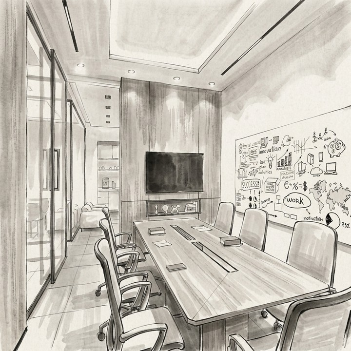

# Color Temperature Consistency

This metric evaluates the consistency of **environmental atmosphere (color-temperature logic)** in generated videos. We analyze the Hue channel in HSV color space: the hue spectrum $[0, 179]$ is divided into $7$ core intervals to construct a hue feature vector $\mathbf{h}_t \in \mathbb{R}^{7}$. We then compute a weighted perceptual similarity of the full sequence relative to the initial frame. To balance **global constancy** and **local transition**, the similarity at frame $t$ ($t \geq 2$) is the arithmetic mean of current-to-first and current-to-previous similarities. The similarity $S(\cdot, \cdot)$ follows the cosine inner product (same as Eq. (3) in the brightness-distribution metric):

\[
S(a, b)
=
\frac{a \cdot b}{\|a\|\,\|b\|}
=
\frac{\sum_{i=1}^{n} a_i b_i}{
    \sqrt{\sum_{i=1}^{n} a_i^2}\,\sqrt{\sum_{i=1}^{n} b_i^2}
}
\tag{3}
\]

\[
\bar{S}_t
=
\frac{
    S(\mathbf{h}_t, \mathbf{h}_1)
    +
    S(\mathbf{h}_t, \mathbf{h}_{t-1})
}{
    2
}
\tag{7}
\]

For each frame $I_t$, RGB is converted to HSV; a saturation-weighted histogram over $7$ hue bins on $[0, 180)$ is normalized to form $\mathbf{h}_t$ (WorldArena default `hue_bins=7`).

The final score uses a **normalized exponentially decaying weighted sum**, where weights $\hat{w}'(d)$ are an improved variant of $\hat{w}(d)$ with faster decay ($\beta > \alpha$), and similarities are passed through the modified Softmax transform $T(\cdot)$ (Eq. (4), default $\lambda = 4.0$):

\[
T(x)
=
\frac{e^{\lambda x} - 1}{e^{\lambda} - 1},
\quad \lambda > 0
\tag{4}
\]

\[
w'(d) = e^{-\beta \cdot d},
\qquad
\hat{w}'(d)
=
\frac{w'(d)}{\sum_{k=1}^{T-1} w'(k)}
\quad (\beta > 0)
\tag{8}
\]

Here $d \in [1, T-1]$ is the frame distance ($d=1$ for the second frame relative to the first), and $\beta$ is the decay coefficient. The default $\beta = 0.10$ exceeds the brightness metric's $\alpha = 0.05$, so $\hat{w}'(d)$ decays faster than $\hat{w}(d)$ and long-video color drift is penalized more strongly. The comprehensive score is:

\[
S_{\mathrm{Color}}
=
\sum_{d=1}^{T-1}
\hat{w}'(d) \cdot T\!\left(\bar{S}_{d+1}\right)
\tag{9}
\]

In WorldArena this algorithm is implemented as the official metric **`color_temperature_constraint`** (`hue_distribution` backend). Under the default normalization config, raw and normalized outputs lie in $[0,1]$ with **higher is better**. The legacy scalar alias `color_temperature_consistency` remains diagnostic and is not part of the seven-metric official quality total.

<!-- metric-examples:start -->
## Verified Same-Input Examples

Up to three cases are shown per metric. Within each case, both videos must belong to the same benchmark sample, and both first frames must pass SIFT + RANSAC geometric matching against that case's displayed input. Candidates that fail are not published. Labels compare this metric only, not overall model quality.

Audit manifest: `docs/assets/metric_examples/curated_same_case_manifest.json`.

<article class="metric-case-exhibit metric-case-exhibit--curated">
  

    <figure class="metric-input-card">
      
      <figcaption>Input image</figcaption>
    </figure>
    

      
Input verified · same benchmark case · gap 0.8068

      <h4><code>image_static_stylized_aquatic_landscape_0098</code></h4>
      
Suite: image_staticScene: stylized / outdoor / aquatic_landscape

      

        Benchmark prompt target
        
Camera pan left. An aquatic landscape with beach, cliffs, and ocean.

        <small>prompt source: prompt_target</small>
      

      
Both first frames passed geometric matching against the displayed input; labels compare this metric only.

    

  

  

    <figure class="metric-output-card metric-output-card--good">
      

        <video class="metric-output-video" controls muted loop playsinline preload="metadata" aria-label="Higher metric score: image_static_stylized_aquatic_landscape_0098">
          <source src="../../../assets/metric_examples/curated_20260801/e34a878acd25__image_static_stylized_aquatic_landscape_0098__high.mp4" type="video/mp4">
        </video>
        
Higher metric score · Score 0.9983

      

      <figcaption class="metric-output-caption"><strong>Higher metric score</strong>color_temperature_constraint</figcaption>
    </figure>
    <figure class="metric-output-card metric-output-card--bad">
      

        <video class="metric-output-video" controls muted loop playsinline preload="metadata" aria-label="Lower metric score: image_static_stylized_aquatic_landscape_0098">
          <source src="../../../assets/metric_examples/curated_20260801/23de9c97cbb5__image_static_stylized_aquatic_landscape_0098__low.mp4" type="video/mp4">
        </video>
        
Lower metric score · Score 0.1915

      

      <figcaption class="metric-output-caption"><strong>Lower metric score</strong>color_temperature_constraint</figcaption>
    </figure>
  

</article>
<article class="metric-case-exhibit metric-case-exhibit--curated">
  

    <figure class="metric-input-card">
      
      <figcaption>Input image</figcaption>
    </figure>
    

      
Input verified · same benchmark case · gap 0.8132

      <h4><code>image_static_stylized_workspaces_0088</code></h4>
      
Suite: image_staticScene: stylized / indoor / workspaces

      

        Benchmark prompt target
        
Camera pan right. A modern conference room with couch, coffee table, and bookshelves.

        <small>prompt source: prompt_target</small>
      

      
Both first frames passed geometric matching against the displayed input; labels compare this metric only.

    

  

  

    <figure class="metric-output-card metric-output-card--good">
      

        <video class="metric-output-video" controls muted loop playsinline preload="metadata" aria-label="Higher metric score: image_static_stylized_workspaces_0088">
          <source src="../../../assets/metric_examples/curated_20260801/270f2c11486a__image_static_stylized_workspaces_0088__high.mp4" type="video/mp4">
        </video>
        
Higher metric score · Score 0.9998

      

      <figcaption class="metric-output-caption"><strong>Higher metric score</strong>color_temperature_constraint</figcaption>
    </figure>
    <figure class="metric-output-card metric-output-card--bad">
      

        <video class="metric-output-video" controls muted loop playsinline preload="metadata" aria-label="Lower metric score: image_static_stylized_workspaces_0088">
          <source src="../../../assets/metric_examples/curated_20260801/b3fb040b2633__image_static_stylized_workspaces_0088__low.mp4" type="video/mp4">
        </video>
        
Lower metric score · Score 0.1866

      

      <figcaption class="metric-output-caption"><strong>Lower metric score</strong>color_temperature_constraint</figcaption>
    </figure>
  

</article>
<article class="metric-case-exhibit metric-case-exhibit--curated">
  

    <figure class="metric-input-card">
      
      <figcaption>Input image</figcaption>
    </figure>
    

      
Input verified · same benchmark case · gap 0.6806

      <h4><code>image_static_stylized_suburb_0132</code></h4>
      
Suite: image_staticScene: stylized / outdoor / suburb

      

        Benchmark prompt target
        
Camera move right. A suburban street with houses, trees, and road.

        <small>prompt source: prompt_target</small>
      

      
Both first frames passed geometric matching against the displayed input; labels compare this metric only.

    

  

  

    <figure class="metric-output-card metric-output-card--good">
      

        <video class="metric-output-video" controls muted loop playsinline preload="metadata" aria-label="Higher metric score: image_static_stylized_suburb_0132">
          <source src="../../../assets/metric_examples/curated_20260801/a8b3af0667b6__image_static_stylized_suburb_0132__high.mp4" type="video/mp4">
        </video>
        
Higher metric score · Score 0.9968

      

      <figcaption class="metric-output-caption"><strong>Higher metric score</strong>color_temperature_constraint</figcaption>
    </figure>
    <figure class="metric-output-card metric-output-card--bad">
      

        <video class="metric-output-video" controls muted loop playsinline preload="metadata" aria-label="Lower metric score: image_static_stylized_suburb_0132">
          <source src="../../../assets/metric_examples/curated_20260801/9c8023a7cd72__image_static_stylized_suburb_0132__low.mp4" type="video/mp4">
        </video>
        
Lower metric score · Score 0.3162

      

      <figcaption class="metric-output-caption"><strong>Lower metric score</strong>color_temperature_constraint</figcaption>
    </figure>
  

</article>

<!-- metric-examples:end -->
