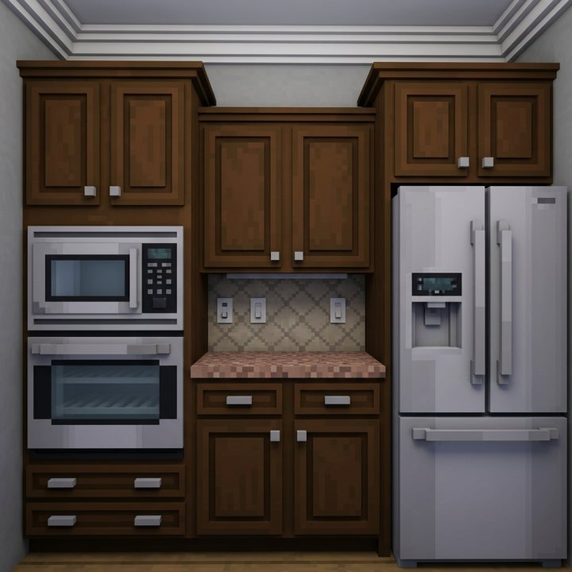
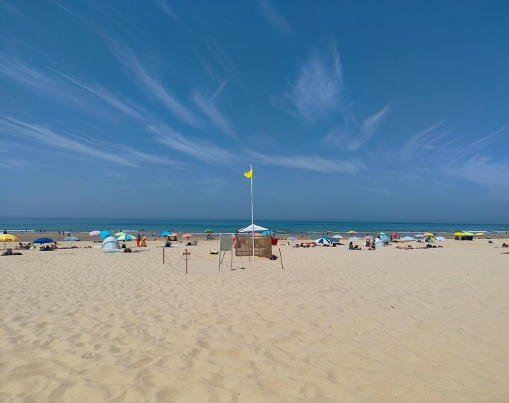
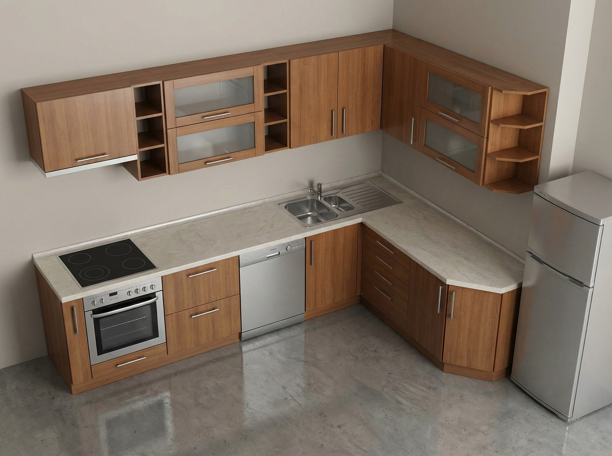
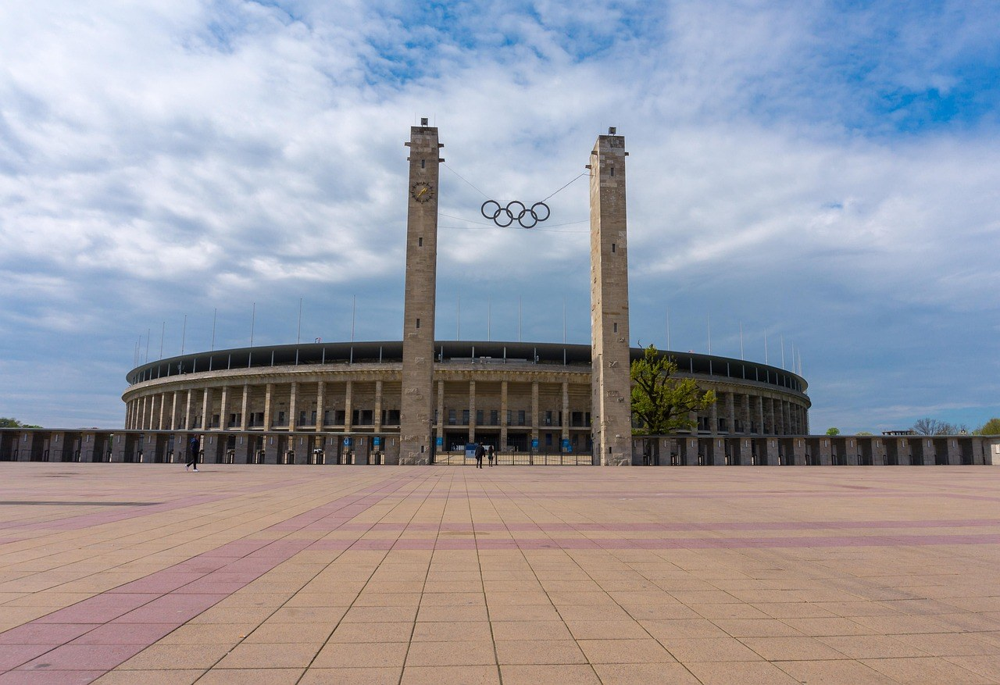
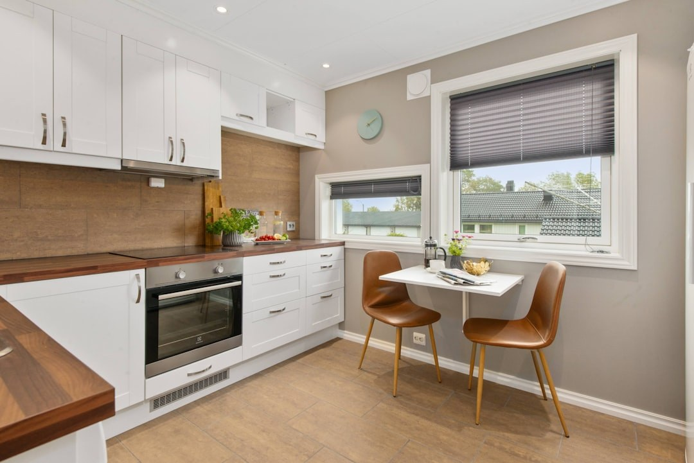

# Depth Accuracy

Depth Accuracy is a paired metric comparing relative monocular depth structure between prediction and reference anchor frames. Both sides pass through the same Depth Anything V2 model; no ground-truth depth is used.

For pair \(i\), let \(D_i^{\mathrm{pred}}\) and \(D_i^{\mathrm{ref}}\) be predicted depth maps. Median-ratio alignment yields

\[
\alpha_i = \frac{\mathrm{median}(D_i^{\mathrm{ref}})}{\max(\mathrm{median}(D_i^{\mathrm{pred}}), 10^{-6})},
\qquad
\tilde{D}_i^{\mathrm{pred}} = \alpha_i D_i^{\mathrm{pred}}
\tag{1}
\]

Over valid pixels \(\Omega_i = \{(x,y) \mid D_i^{\mathrm{ref}}(x,y) > 10^{-3}\}\), frame-level absolute relative error is

\[
e_i = \frac{1}{|\Omega_i|}\sum_{(x,y)\in\Omega_i} \frac{\left|\tilde{D}_i^{\mathrm{pred}}(x,y) - D_i^{\mathrm{ref}}(x,y)\right|}{\max(D_i^{\mathrm{ref}}(x,y), 10^{-6})}
\tag{2}
\]

The raw score \(e_{\mathrm{depth}} = \frac{1}{N}\sum_i e_i\) averages over \(N\) aligned pairs. Lower error maps to a higher normalized score. The metric evaluates coarse front–back ordering preservation, not metric-depth ground truth or camera trajectory accuracy.

<!-- metric-examples:start -->
## Representative Same-Case Comparisons

Each exhibit first shows the input image and the actual generation prompt, then compares generated outputs. Every pair must match on sample_id, input-image SHA-256, and generation-prompt SHA-256. Cases are balanced across photorealistic/stylized, indoor/outdoor, scene categories, and score-gap bands instead of selecting only the largest gaps. Metrics without such a cross-model pair in the current formal snapshot are separated as high/low extrema rather than presented as same-case comparisons.

Machine-readable paired export: `docs/assets/metric_examples/paired_manifest.csv`.

### `depth_accuracy`

<article class="metric-case-exhibit metric-case-exhibit--fallback">
  

    
Case 1 · separate high/low extremes from current snapshot

  
No cross-model pair with the same input image and same prompt is available for this metric in the current formal snapshot; the high- and low-scoring examples below are independent cases, not a same-input model comparison.

  

  

  <section class="metric-fallback-side metric-fallback-side--good">
    
High-scoring extreme

    

      <figure class="metric-input-card">
        
        <figcaption>Input image</figcaption>
      </figure>
      

        <h4><code>image_static_stylized_dining_spaces_0071</code></h4>
        
Suite: image_staticScene: stylized / indoor / dining_spaces

        

          Prompt target
          
Camera move left. A modern kitchen with dining table, chairs, and wooden floor. Camera pan left. A modern kitchen with window, potted plant, and curtains. Camera pull out. A modern kitchen with kitchen island, bar stools, and hanging lights.

          <small>prompt source: prompt_target</small>
        

      

    

    

<figure class="metric-output-card metric-output-card--good">
  

    <video class="metric-output-video" controls muted loop playsinline preload="metadata" aria-label="Good output: ac3d-image-static image_static_stylized_dining_spaces_0071">
      <source src="../../../assets/metric_examples/afbfb9bd5380__ac3d-image-static__image_static_stylized_dining_spaces_0071.mp4" type="video/mp4">
    </video>
    
Good output · Score 0.9934

  

  <figcaption class="metric-output-caption">
    <strong>Good output</strong>
    Metric: depth_accuracy · protocol: segment_random
  </figcaption>
</figure>
    

  </section>
  <section class="metric-fallback-side metric-fallback-side--bad">
    
Low-scoring extreme

    

      <figure class="metric-input-card">
        
        <figcaption>Input image</figcaption>
      </figure>
      

        <h4><code>image_static_photorealistic_aquatic_landscape_0017</code></h4>
        
Suite: image_staticScene: photorealistic / outdoor / aquatic_landscape

        

          Prompt target
          
Camera orbit left. An aquatic landscape with red lighthouse, ship&#x27;s deck, and harbor.

          <small>prompt source: prompt_target</small>
        

      

    

    

<figure class="metric-output-card metric-output-card--bad">
  

    <video class="metric-output-video" controls muted loop playsinline preload="metadata" aria-label="Poor output: ac3d-image-static image_static_photorealistic_aquatic_landscape_0017">
      <source src="../../../assets/metric_examples/d339e4209040__ac3d-image-static__image_static_photorealistic_aquatic_landscape_0017.mp4" type="video/mp4">
    </video>
    
Poor output · Score 0.0000

  

  <figcaption class="metric-output-caption">
    <strong>Poor output</strong>
    Metric: depth_accuracy · protocol: segment_random
  </figcaption>
</figure>
    

  </section>
  

</article>
<article class="metric-case-exhibit metric-case-exhibit--fallback">
  

    
Case 2 · separate high/low extremes from current snapshot

  
No cross-model pair with the same input image and same prompt is available for this metric in the current formal snapshot; the high- and low-scoring examples below are independent cases, not a same-input model comparison.

  

  

  <section class="metric-fallback-side metric-fallback-side--good">
    
High-scoring extreme

    

      <figure class="metric-input-card">
        
        <figcaption>Input image</figcaption>
      </figure>
      

        <h4><code>image_static_photorealistic_public_spaces_0138</code></h4>
        
Suite: image_staticScene: photorealistic / indoor / public_spaces

        

          Prompt target
          
Camera orbit right. A grand room with ornate chandelier, detailed ceiling, and arched windows.

          <small>prompt source: prompt_target</small>
        

      

    

    

<figure class="metric-output-card metric-output-card--good">
  

    <video class="metric-output-video" controls muted loop playsinline preload="metadata" aria-label="Good output: ac3d-image-static image_static_photorealistic_public_spaces_0138">
      <source src="../../../assets/metric_examples/9be3503b5aa7__ac3d-image-static__image_static_photorealistic_public_spaces_0138.mp4" type="video/mp4">
    </video>
    
Good output · Score 0.9925

  

  <figcaption class="metric-output-caption">
    <strong>Good output</strong>
    Metric: depth_accuracy · protocol: segment_random
  </figcaption>
</figure>
    

  </section>
  <section class="metric-fallback-side metric-fallback-side--bad">
    
Low-scoring extreme

    

      <figure class="metric-input-card">
        
        <figcaption>Input image</figcaption>
      </figure>
      

        <h4><code>image_static_photorealistic_aquatic_landscape_0129</code></h4>
        
Suite: image_staticScene: photorealistic / outdoor / aquatic_landscape

        

          Prompt target
          
Camera pan left. An aquatic landscape with beach, umbrellas, and people.

          <small>prompt source: prompt_target</small>
        

      

    

    

<figure class="metric-output-card metric-output-card--bad">
  

    <video class="metric-output-video" controls muted loop playsinline preload="metadata" aria-label="Poor output: ac3d-image-static image_static_photorealistic_aquatic_landscape_0129">
      <source src="../../../assets/metric_examples/de45932a63fc__ac3d-image-static__image_static_photorealistic_aquatic_landscape_0129.mp4" type="video/mp4">
    </video>
    
Poor output · Score 0.0000

  

  <figcaption class="metric-output-caption">
    <strong>Poor output</strong>
    Metric: depth_accuracy · protocol: segment_random
  </figcaption>
</figure>
    

  </section>
  

</article>
<article class="metric-case-exhibit metric-case-exhibit--fallback">
  

    
Case 3 · separate high/low extremes from current snapshot

  
No cross-model pair with the same input image and same prompt is available for this metric in the current formal snapshot; the high- and low-scoring examples below are independent cases, not a same-input model comparison.

  

  

  <section class="metric-fallback-side metric-fallback-side--good">
    
High-scoring extreme

    

      <figure class="metric-input-card">
        
        <figcaption>Input image</figcaption>
      </figure>
      

        <h4><code>image_static_photorealistic_dining_spaces_0149</code></h4>
        
Suite: image_staticScene: photorealistic / indoor / dining_spaces

        

          Prompt target
          
Camera move right. A modern kitchen with dining table, chairs, and wooden floor.

          <small>prompt source: prompt_target</small>
        

      

    

    

<figure class="metric-output-card metric-output-card--good">
  

    <video class="metric-output-video" controls muted loop playsinline preload="metadata" aria-label="Good output: ac3d-image-static image_static_photorealistic_dining_spaces_0149">
      <source src="../../../assets/metric_examples/fc545d0de2d7__ac3d-image-static__image_static_photorealistic_dining_spaces_0149.mp4" type="video/mp4">
    </video>
    
Good output · Score 0.9921

  

  <figcaption class="metric-output-caption">
    <strong>Good output</strong>
    Metric: depth_accuracy · protocol: segment_random
  </figcaption>
</figure>
    

  </section>
  <section class="metric-fallback-side metric-fallback-side--bad">
    
Low-scoring extreme

    

      <figure class="metric-input-card">
        
        <figcaption>Input image</figcaption>
      </figure>
      

        <h4><code>image_static_photorealistic_city_0168</code></h4>
        
Suite: image_staticScene: photorealistic / outdoor / city

        

          Prompt target
          
Camera orbit right. A city street with stadium, towers, and olympic rings.

          <small>prompt source: prompt_target</small>
        

      

    

    

<figure class="metric-output-card metric-output-card--bad">
  

    <video class="metric-output-video" controls muted loop playsinline preload="metadata" aria-label="Poor output: ac3d-image-static image_static_photorealistic_city_0168">
      <source src="../../../assets/metric_examples/9df30d500edc__ac3d-image-static__image_static_photorealistic_city_0168.mp4" type="video/mp4">
    </video>
    
Poor output · Score 0.0000

  

  <figcaption class="metric-output-caption">
    <strong>Poor output</strong>
    Metric: depth_accuracy · protocol: segment_random
  </figcaption>
</figure>
    

  </section>
  

</article>
<article class="metric-case-exhibit metric-case-exhibit--fallback">
  

    
Case 4 · separate high/low extremes from current snapshot

  
No cross-model pair with the same input image and same prompt is available for this metric in the current formal snapshot; the high- and low-scoring examples below are independent cases, not a same-input model comparison.

  

  

  <section class="metric-fallback-side metric-fallback-side--good">
    
High-scoring extreme

    

      <figure class="metric-input-card">
        
        <figcaption>Input image</figcaption>
      </figure>
      

        <h4><code>image_static_photorealistic_dining_spaces_0071</code></h4>
        
Suite: image_staticScene: photorealistic / indoor / dining_spaces

        

          Prompt target
          
Camera push in. A modern kitchen with dining table, breakfast items, and brown chairs.

          <small>prompt source: prompt_target</small>
        

      

    

    

<figure class="metric-output-card metric-output-card--good">
  

    <video class="metric-output-video" controls muted loop playsinline preload="metadata" aria-label="Good output: ac3d-image-static image_static_photorealistic_dining_spaces_0071">
      <source src="../../../assets/metric_examples/a36f7bd6076d__ac3d-image-static__image_static_photorealistic_dining_spaces_0071.mp4" type="video/mp4">
    </video>
    
Good output · Score 0.9920

  

  <figcaption class="metric-output-caption">
    <strong>Good output</strong>
    Metric: depth_accuracy · protocol: segment_random
  </figcaption>
</figure>
    

  </section>
  <section class="metric-fallback-side metric-fallback-side--bad">
    
Low-scoring extreme

    

      <figure class="metric-input-card">
        
        <figcaption>Input image</figcaption>
      </figure>
      

        <h4><code>image_static_photorealistic_terrestrial_landscape_0007</code></h4>
        
Suite: image_staticScene: photorealistic / outdoor / terrestrial_landscape

        

          Prompt target
          
Camera pan left. A mountain landscape with road, trucks, and clouds. Camera move left. A mountain landscape with road, village, and houses. Camera pull out. A mountain landscape with road, plains, and clouds.

          <small>prompt source: prompt_target</small>
        

      

    

    

<figure class="metric-output-card metric-output-card--bad">
  

    <video class="metric-output-video" controls muted loop playsinline preload="metadata" aria-label="Poor output: ac3d-image-static image_static_photorealistic_terrestrial_landscape_0007">
      <source src="../../../assets/metric_examples/a513b129439f__ac3d-image-static__image_static_photorealistic_terrestrial_landscape_0007.mp4" type="video/mp4">
    </video>
    
Poor output · Score 0.0000

  

  <figcaption class="metric-output-caption">
    <strong>Poor output</strong>
    Metric: depth_accuracy · protocol: segment_random
  </figcaption>
</figure>
    

  </section>
  

</article>

<!-- metric-examples:end -->

## References {#reference}

!!! quote "Depth Anything V2"

    Yang et al., 2024.
    [https://arxiv.org/abs/2406.09414](https://arxiv.org/abs/2406.09414)
