# Epipolar Geometry

This page defines three **GVGC-style epipolar-geometry diagnostic metrics** that probe whether nearby generated frames admit a stable two-view epipolar explanation [[Hartley and Zisserman, 2004](#reference)]. They require only the prediction video—no camera-pose annotations and no reference video. The core question is whether local feature correspondences approximately satisfy the epipolar constraint, indicating that two frames can be explained as projections of the same scene under a pinhole camera model with rigid relative motion.

In classical multiple-view geometry, if two frames observe the same scene under rigid camera motion, a point \(x\) in the first frame must map to a corresponding point \(x'\) that lies on the epipolar line \(l' = F x\) induced by the fundamental matrix \(F\). Generated videos with background warping, local object drift, unstable depth layering, or frame pairs that are not projections of one 3D structure will struggle to maintain many RANSAC inliers under this constraint, raising Sampson error and lowering inlier rate. These metrics therefore provide a **lightweight, interpretable** two-view geometry signal; they check sparse-feature epipolar consistency only and do not replace global 3D self-consistency metrics such as MEt3R, reprojection error, or reconstruction-based scores.

In WorldArena, the backend builds adjacent (or strided) frame pairs from sampled prediction frames, matches SIFT features with Lowe's ratio test by default, and estimates \(F\) with OpenCV RANSAC. It computes Sampson error on RANSAC inliers and reports inlier rate and coverage; if the primary path fails, the runtime may fall back to relaxed matching thresholds or Shi-Tomasi + Lucas-Kanade tracking. All three sub-metrics share one backend pass:

| Metric | Raw statistic | Direction |
| --- | --- | --- |
| `epipolar_error` | median inlier Sampson error after fundamental-matrix RANSAC | lower is better |
| `epipolar_inlier_rate` | RANSAC inliers / Lowe-ratio feature matches | higher is better |
| `feature_match_coverage` | RANSAC inliers / min keypoint count | higher is better |

For matched homogeneous points \(x_i, x'_i\), Sampson error is

\[
d_i = \frac{|{x'_i}^{\mathsf T} F x_i|}{\sqrt{(Fx_i)_1^2 + (Fx_i)_2^2 + (F^{\mathsf T}x'_i)_1^2 + (F^{\mathsf T}x'_i)_2^2}}
\tag{1}
\]

Per valid pair, `epipolar_error` uses the median \(d_i\) over RANSAC inliers; the video-level value is the median across pairs. Normalization maps \([0, 5]\) with lower-is-better scaling.

Per valid pair, inlier rate and coverage are

\[
r = \frac{\#\mathrm{inliers}}{\#\mathrm{good\ matches}},
\qquad
c = \min\!\left(\frac{\#\mathrm{inliers}}{\min(\#\mathrm{kp}_\mathrm{left}, \#\mathrm{kp}_\mathrm{right})},\, 1\right)
\tag{2}
\]

Video-level `epipolar_inlier_rate` and `feature_match_coverage` average \(r\) and \(c\) over valid pairs with identity normalization on \([0,1]\). `epipolar_error` takes the median of per-pair medians and is reverse-normalized from \([0, 5]\) to \([0, 1]\) (higher normalized score means stronger epipolar consistency). If no pair yields sufficient inliers, all three metrics return `not_applicable`. They are currently **diagnostic**: reported separately and excluded from headline aggregation. They may fail often in weak-texture, strongly non-rigid, or dynamic-prompt regimes and should be read alongside MEt3R and reprojection error.

<!-- metric-examples:start -->
## Representative Same-Case Comparisons
Each exhibit first shows the input image and the actual generation prompt, then compares generated outputs. Every pair must match on sample_id, input-image SHA-256, and generation-prompt SHA-256. Cases are balanced across photorealistic/stylized, indoor/outdoor, scene categories, and score-gap bands instead of selecting only the largest gaps. Metrics without such a cross-model pair in the current formal snapshot are separated as high/low extrema rather than presented as same-case comparisons.
Machine-readable paired export: `docs/assets/metric_examples/paired_manifest.csv`.
### `epipolar_error`

<article class="metric-case-exhibit">
  

    <figure class="metric-input-card">
      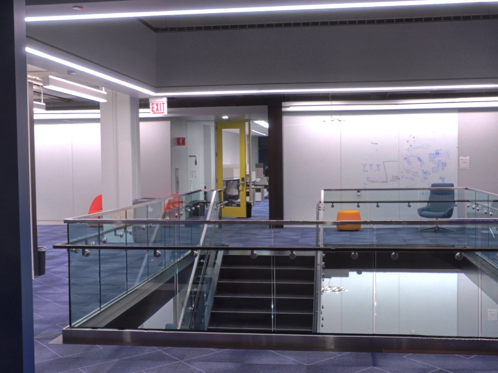
      <figcaption>Input image</figcaption>
    </figure>
    

      
Case 1 · strictly verified same case · score gap 0.0678

      <h4><code>image_static_photorealistic_workspaces_0016</code></h4>
      
Suite: image_staticScene: photorealistic / indoor / workspaces

      

        Generation prompt
        
Camera pan right. A modern office with desks, computers, and office chairs. Everything in the scene remains completely motionless.

        <small>prompt source: generation_records</small>
      

  

  

<figure class="metric-output-card metric-output-card--good">
  

    <video class="metric-output-video" controls muted loop playsinline preload="metadata" aria-label="Good output: image_static_photorealistic_workspaces_0016">
      <source src="../../../assets/metric_examples/5186200d0d8d__astra_image_static__image_static_photorealistic_workspaces_0016.mp4" type="video/mp4">
    </video>
    
Good output · Score 0.9898

  

</figure>
<figure class="metric-output-card metric-output-card--bad">
  

    <video class="metric-output-video" controls muted loop playsinline preload="metadata" aria-label="Poor output: image_static_photorealistic_workspaces_0016">
      <source src="../../../assets/metric_examples/101a8b600780__matrix_game2_5s_image_static__image_static_photorealistic_workspaces_0016.mp4" type="video/mp4">
    </video>
    
Poor output · Score 0.9221

  

</figure>
  

</article>
<article class="metric-case-exhibit">
  

    <figure class="metric-input-card">
      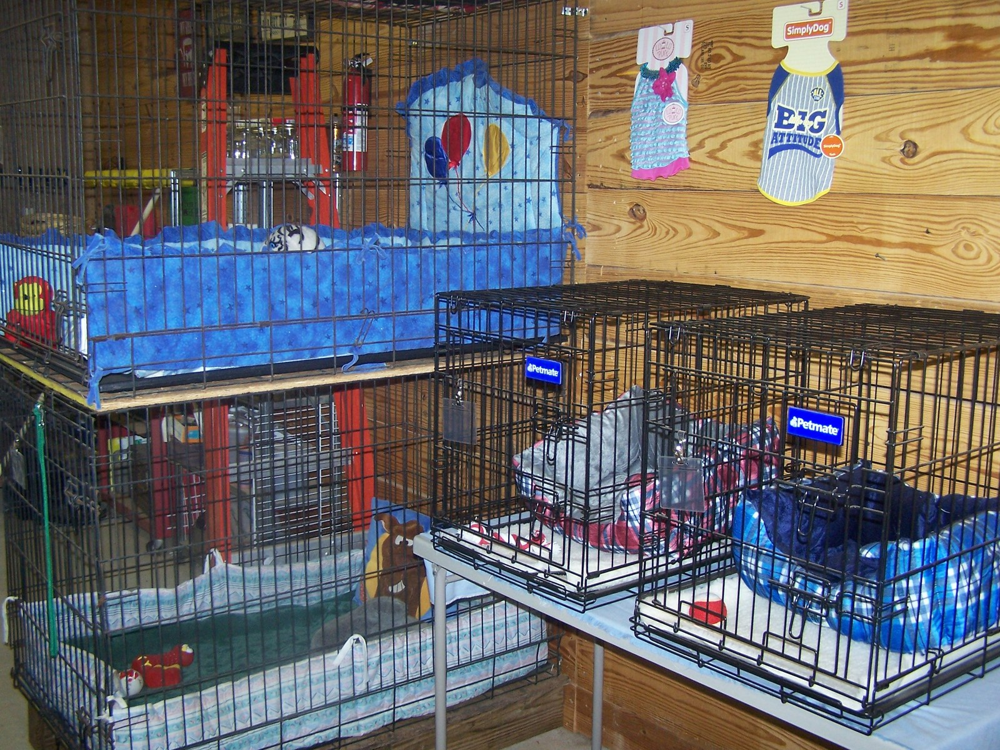
      <figcaption>Input image</figcaption>
    </figure>
    

      
Case 2 · strictly verified same case · score gap 0.0537

      <h4><code>image_static_photorealistic_public_spaces_0014</code></h4>
      
Suite: image_staticScene: photorealistic / indoor / public_spaces

      

        Generation prompt
        
Camera pan right. A pet care room with pet cages, feeding station, and water bowls.

        <small>prompt source: generation_records</small>
      

  

  

<figure class="metric-output-card metric-output-card--good">
  

    <video class="metric-output-video" controls muted loop playsinline preload="metadata" aria-label="Good output: image_static_photorealistic_public_spaces_0014">
      <source src="../../../assets/metric_examples/e0104d4a4ae9__luciddreamer-image-static-8gpu-20260613_151844__image_static_photorealistic_public_spaces_0014.mp4" type="video/mp4">
    </video>
    
Good output · Score 0.9865

  

</figure>
<figure class="metric-output-card metric-output-card--bad">
  

    <video class="metric-output-video" controls muted loop playsinline preload="metadata" aria-label="Poor output: image_static_photorealistic_public_spaces_0014">
      <source src="../../../assets/metric_examples/b0fc8fda531d__ac3d-image-static__image_static_photorealistic_public_spaces_0014.mp4" type="video/mp4">
    </video>
    
Poor output · Score 0.9329

  

</figure>
  

</article>
<article class="metric-case-exhibit">
  

    <figure class="metric-input-card">
      
      <figcaption>Input image</figcaption>
    </figure>
    

      
Case 3 · strictly verified same case · score gap 0.0827

      <h4><code>image_static_photorealistic_terrestrial_landscape_0091</code></h4>
      
Suite: image_staticScene: photorealistic / outdoor / terrestrial_landscape

      

        Generation prompt
        
Camera pull out. An edge of the field with grasses and distant trees. Everything in the scene remains completely motionless.

        <small>prompt source: generation_records</small>
      

  

  

<figure class="metric-output-card metric-output-card--good">
  

    <video class="metric-output-video" controls muted loop playsinline preload="metadata" aria-label="Good output: image_static_photorealistic_terrestrial_landscape_0091">
      <source src="../../../assets/metric_examples/7992ecd2bebe__astra_image_static__image_static_photorealistic_terrestrial_landscape_0091.mp4" type="video/mp4">
    </video>
    
Good output · Score 1.0000

  

</figure>
<figure class="metric-output-card metric-output-card--bad">
  

    <video class="metric-output-video" controls muted loop playsinline preload="metadata" aria-label="Poor output: image_static_photorealistic_terrestrial_landscape_0091">
      <source src="../../../assets/metric_examples/4b8207797696__dreamx_world_image_static__image_static_photorealistic_terrestrial_landscape_0091.mp4" type="video/mp4">
    </video>
    
Poor output · Score 0.9173

  

</figure>
  

</article>
<article class="metric-case-exhibit">
  

    <figure class="metric-input-card">
      
      <figcaption>Input image</figcaption>
    </figure>
    

      
Case 4 · strictly verified same case · score gap 0.0545

      <h4><code>image_static_photorealistic_aquatic_landscape_0070</code></h4>
      
Suite: image_staticScene: photorealistic / outdoor / aquatic_landscape

      

        Generation prompt
        
Camera pan left. A frozen lake with snow-covered mountains, evergreen trees, and distant peak. Everything in the scene remains completely motionless.

        <small>prompt source: generation_records</small>
      

  

  

<figure class="metric-output-card metric-output-card--good">
  

    <video class="metric-output-video" controls muted loop playsinline preload="metadata" aria-label="Good output: image_static_photorealistic_aquatic_landscape_0070">
      <source src="../../../assets/metric_examples/95c7578a9527__hy_worldplay_ar_image_test_balanced_5000_5s__image_static_photorealistic_aquatic_landscape_0070.mp4" type="video/mp4">
    </video>
    
Good output · Score 0.9875

  

</figure>
<figure class="metric-output-card metric-output-card--bad">
  

    <video class="metric-output-video" controls muted loop playsinline preload="metadata" aria-label="Poor output: image_static_photorealistic_aquatic_landscape_0070">
      <source src="../../../assets/metric_examples/b226b2177cb9__motionctrl_image_static_official_default_tmp2__image_static_photorealistic_aquatic_landscape_0070.mp4" type="video/mp4">
    </video>
    
Poor output · Score 0.9330

  

</figure>
  

</article>
<article class="metric-case-exhibit">
  

    <figure class="metric-input-card">
      
      <figcaption>Input image</figcaption>
    </figure>
    

      
Case 5 · strictly verified same case · score gap 0.0704

      <h4><code>image_static_stylized_living_spaces_0037</code></h4>
      
Suite: image_staticScene: stylized / indoor / living_spaces

      

        Generation prompt
        
Camera pan right. A bedroom corner with wardrobe, chair, and rug. Everything in the scene remains completely motionless.

        <small>prompt source: generation_records</small>
      

  

  

<figure class="metric-output-card metric-output-card--good">
  

    <video class="metric-output-video" controls muted loop playsinline preload="metadata" aria-label="Good output: image_static_stylized_living_spaces_0037">
      <source src="../../../assets/metric_examples/96bc5f185eee__dreamx_world_image_static__image_static_stylized_living_spaces_0037.mp4" type="video/mp4">
    </video>
    
Good output · Score 0.9715

  

</figure>
<figure class="metric-output-card metric-output-card--bad">
  

    <video class="metric-output-video" controls muted loop playsinline preload="metadata" aria-label="Poor output: image_static_stylized_living_spaces_0037">
      <source src="../../../assets/metric_examples/c223556eb328__matrix_game2_5s_image_static__image_static_stylized_living_spaces_0037.mp4" type="video/mp4">
    </video>
    
Poor output · Score 0.9011

  

</figure>
  

</article>
<article class="metric-case-exhibit">
  

    <figure class="metric-input-card">
      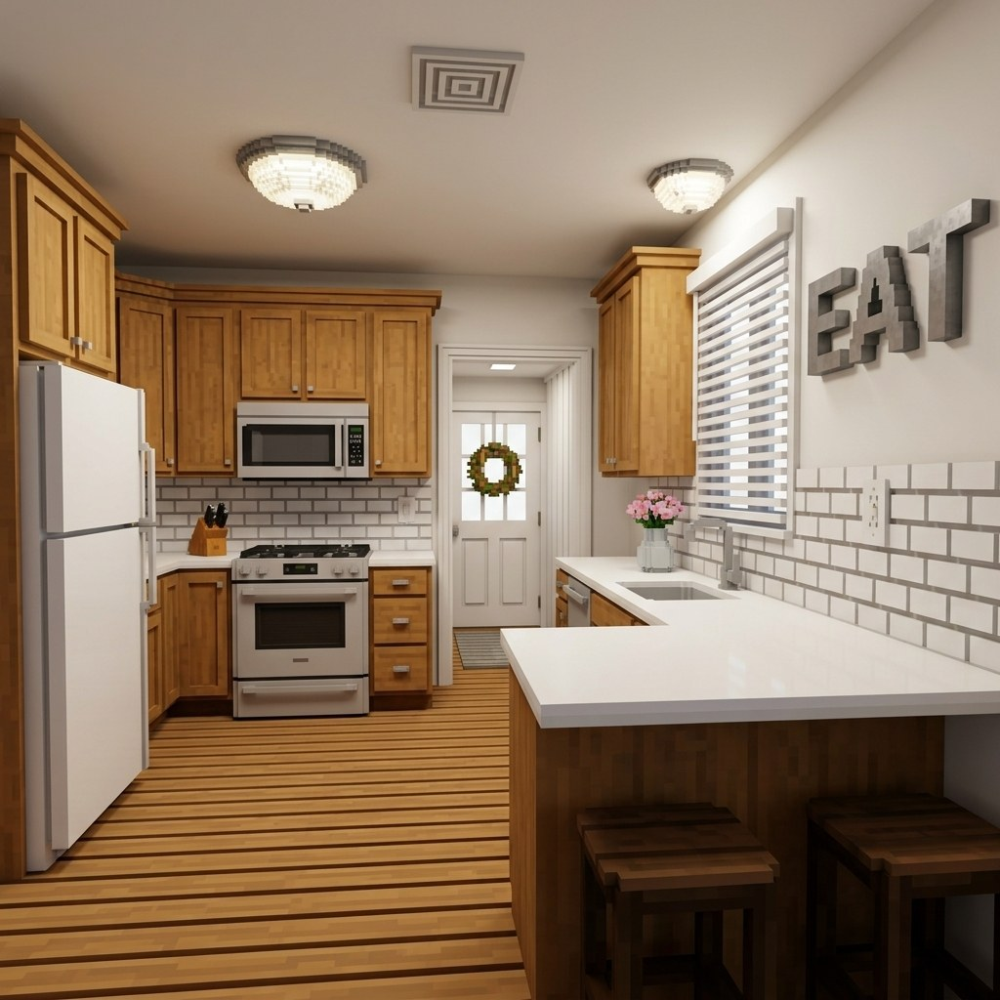
      <figcaption>Input image</figcaption>
    </figure>
    

      
Case 6 · strictly verified same case · score gap 0.0532

      <h4><code>image_static_stylized_dining_spaces_0097</code></h4>
      
Suite: image_staticScene: stylized / indoor / dining_spaces

      

        Generation prompt
        
Camera pull out. Dining spaces with wooden table, chairs, and window with curtains. Everything in the scene remains completely motionless.

        <small>prompt source: generation_records</small>
      

  

  

<figure class="metric-output-card metric-output-card--good">
  

    <video class="metric-output-video" controls muted loop playsinline preload="metadata" aria-label="Good output: image_static_stylized_dining_spaces_0097">
      <source src="../../../assets/metric_examples/254315e5aac8__cameractrl_image_static__image_static_stylized_dining_spaces_0097.mp4" type="video/mp4">
    </video>
    
Good output · Score 0.9890

  

</figure>
<figure class="metric-output-card metric-output-card--bad">
  

    <video class="metric-output-video" controls muted loop playsinline preload="metadata" aria-label="Poor output: image_static_stylized_dining_spaces_0097">
      <source src="../../../assets/metric_examples/7d93ea0bf915__dreamx_world_image_static__image_static_stylized_dining_spaces_0097.mp4" type="video/mp4">
    </video>
    
Poor output · Score 0.9358

  

</figure>
  

</article>
<article class="metric-case-exhibit">
  

    <figure class="metric-input-card">
      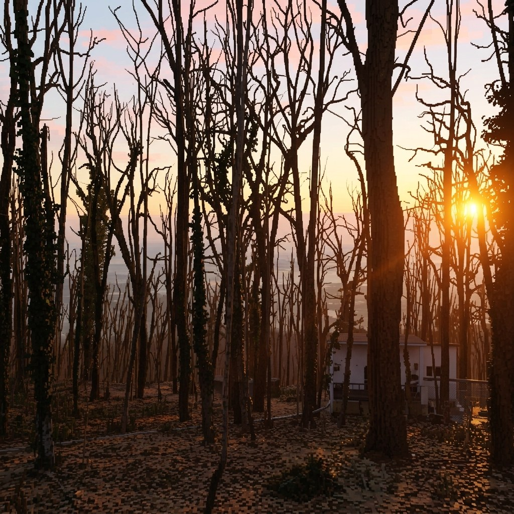
      <figcaption>Input image</figcaption>
    </figure>
    

      
Case 7 · strictly verified same case · score gap 0.0705

      <h4><code>image_static_stylized_verdant_landscape_0087</code></h4>
      
Suite: image_staticScene: stylized / outdoor / verdant_landscape

      

        Generation prompt
        
Camera pan left. A forest at sunset with trees, open field, and forest edge.

        <small>prompt source: generation_records</small>
      

  

  

<figure class="metric-output-card metric-output-card--good">
  

    <video class="metric-output-video" controls muted loop playsinline preload="metadata" aria-label="Good output: image_static_stylized_verdant_landscape_0087">
      <source src="../../../assets/metric_examples/d3048e41a43a__longcat-video-image-static-8gpu-20260612_133950__image_static_stylized_verdant_landscape_0087.mp4" type="video/mp4">
    </video>
    
Good output · Score 1.0000

  

</figure>
<figure class="metric-output-card metric-output-card--bad">
  

    <video class="metric-output-video" controls muted loop playsinline preload="metadata" aria-label="Poor output: image_static_stylized_verdant_landscape_0087">
      <source src="../../../assets/metric_examples/5ab7297b6b75__ac3d-image-static__image_static_stylized_verdant_landscape_0087.mp4" type="video/mp4">
    </video>
    
Poor output · Score 0.9295

  

</figure>
  

</article>
<article class="metric-case-exhibit">
  

    <figure class="metric-input-card">
      
      <figcaption>Input image</figcaption>
    </figure>
    

      
Case 8 · strictly verified same case · score gap 0.0537

      <h4><code>image_static_stylized_city_0051</code></h4>
      
Suite: image_staticScene: stylized / outdoor / city

      

        Generation prompt
        
Camera pan right. A city construction site with street, snow, and cars.

        <small>prompt source: generation_records</small>
      

  

  

<figure class="metric-output-card metric-output-card--good">
  

    <video class="metric-output-video" controls muted loop playsinline preload="metadata" aria-label="Good output: image_static_stylized_city_0051">
      <source src="../../../assets/metric_examples/d614d31c9a9c__longcat-video-image-static-8gpu-20260612_133950__image_static_stylized_city_0051.mp4" type="video/mp4">
    </video>
    
Good output · Score 0.9920

  

</figure>
<figure class="metric-output-card metric-output-card--bad">
  

    <video class="metric-output-video" controls muted loop playsinline preload="metadata" aria-label="Poor output: image_static_stylized_city_0051">
      <source src="../../../assets/metric_examples/2ec012332022__warp-as-history-image-static-8gpu-20260612_152000__image_static_stylized_city_0051.mp4" type="video/mp4">
    </video>
    
Poor output · Score 0.9383

  

</figure>
  

</article>

### `epipolar_inlier_rate`

<article class="metric-case-exhibit">
  

    <figure class="metric-input-card">
      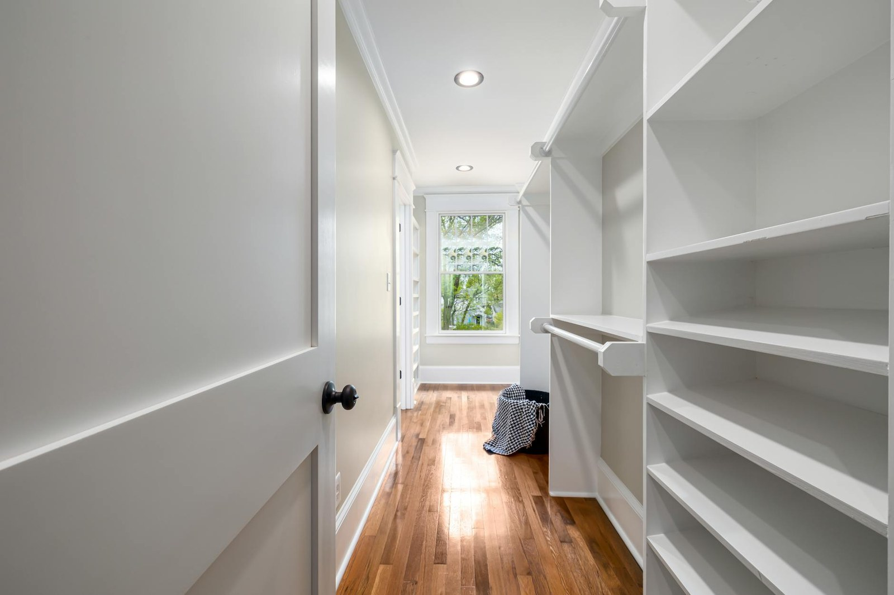
      <figcaption>Input image</figcaption>
    </figure>
    

      
Case 1 · strictly verified same case · score gap 0.5194

      <h4><code>image_static_photorealistic_passageways_0079</code></h4>
      
Suite: image_staticScene: photorealistic / indoor / passageways

      

        Generation prompt
        
Camera move right. A bright hallway with wooden floor, armchair, and small table. Everything in the scene remains completely motionless.

        <small>prompt source: generation_records</small>
      

  

  

<figure class="metric-output-card metric-output-card--good">
  

    <video class="metric-output-video" controls muted loop playsinline preload="metadata" aria-label="Good output: image_static_photorealistic_passageways_0079">
      <source src="../../../assets/metric_examples/2aca94b55772__cameractrl_image_static__image_static_photorealistic_passageways_0079.mp4" type="video/mp4">
    </video>
    
Good output · Score 0.9344

  

</figure>
<figure class="metric-output-card metric-output-card--bad">
  

    <video class="metric-output-video" controls muted loop playsinline preload="metadata" aria-label="Poor output: image_static_photorealistic_passageways_0079">
      <source src="../../../assets/metric_examples/67bd53a27f54__matrix_game2_5s_image_static__image_static_photorealistic_passageways_0079.mp4" type="video/mp4">
    </video>
    
Poor output · Score 0.4150

  

</figure>
  

</article>
<article class="metric-case-exhibit">
  

    <figure class="metric-input-card">
      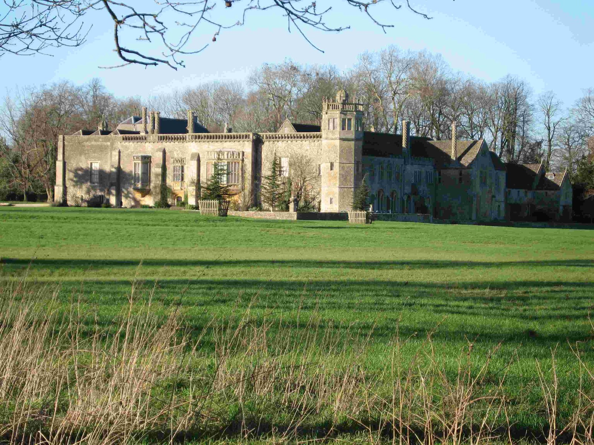
      <figcaption>Input image</figcaption>
    </figure>
    

      
Case 2 · strictly verified same case · score gap 0.2254

      <h4><code>image_static_photorealistic_public_spaces_0150</code></h4>
      
Suite: image_staticScene: photorealistic / indoor / public_spaces

      

        Generation prompt
        
Camera pan left. A historic building with flower beds, stone path, and hedges. Everything in the scene remains completely motionless.

        <small>prompt source: generation_records</small>
      

  

  

<figure class="metric-output-card metric-output-card--good">
  

    <video class="metric-output-video" controls muted loop playsinline preload="metadata" aria-label="Good output: image_static_photorealistic_public_spaces_0150">
      <source src="../../../assets/metric_examples/df2b86a89f74__dreamx_world_image_static__image_static_photorealistic_public_spaces_0150.mp4" type="video/mp4">
    </video>
    
Good output · Score 0.9759

  

</figure>
<figure class="metric-output-card metric-output-card--bad">
  

    <video class="metric-output-video" controls muted loop playsinline preload="metadata" aria-label="Poor output: image_static_photorealistic_public_spaces_0150">
      <source src="../../../assets/metric_examples/8d82cdd290f9__matrix_game2_5s_image_static__image_static_photorealistic_public_spaces_0150.mp4" type="video/mp4">
    </video>
    
Poor output · Score 0.7505

  

</figure>
  

</article>
<article class="metric-case-exhibit">
  

    <figure class="metric-input-card">
      
      <figcaption>Input image</figcaption>
    </figure>
    

      
Case 3 · strictly verified same case · score gap 0.5209

      <h4><code>image_static_photorealistic_verdant_landscape_0091</code></h4>
      
Suite: image_staticScene: photorealistic / outdoor / verdant_landscape

      

        Generation prompt
        
Camera move left. Tall grasses with field of grasses, distant trees, and open sky. Everything in the scene remains completely motionless.

        <small>prompt source: generation_records</small>
      

  

  

<figure class="metric-output-card metric-output-card--good">
  

    <video class="metric-output-video" controls muted loop playsinline preload="metadata" aria-label="Good output: image_static_photorealistic_verdant_landscape_0091">
      <source src="../../../assets/metric_examples/4b1f1aa1624b__matrix_game2_5s_image_static__image_static_photorealistic_verdant_landscape_0091.mp4" type="video/mp4">
    </video>
    
Good output · Score 0.9878

  

</figure>
<figure class="metric-output-card metric-output-card--bad">
  

    <video class="metric-output-video" controls muted loop playsinline preload="metadata" aria-label="Poor output: image_static_photorealistic_verdant_landscape_0091">
      <source src="../../../assets/metric_examples/fe05997e84a6__hy_worldplay_ar_image_test_balanced_5000_5s__image_static_photorealistic_verdant_landscape_0091.mp4" type="video/mp4">
    </video>
    
Poor output · Score 0.4669

  

</figure>
  

</article>
<article class="metric-case-exhibit">
  

    <figure class="metric-input-card">
      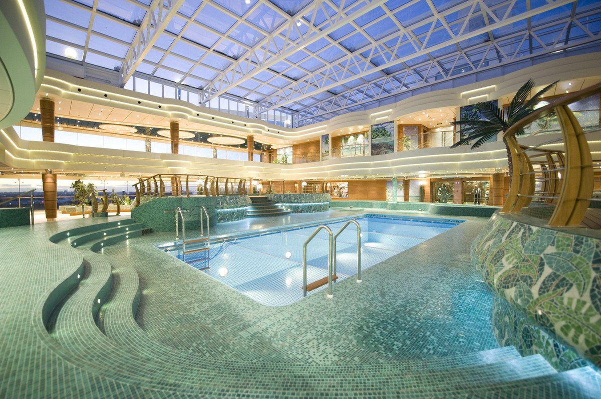
      <figcaption>Input image</figcaption>
    </figure>
    

      
Case 4 · strictly verified same case · score gap 0.2005

      <h4><code>image_static_photorealistic_terrestrial_landscape_0006</code></h4>
      
Suite: image_staticScene: photorealistic / outdoor / terrestrial_landscape

      

        Generation prompt
        
Camera orbit left. An indoor pool with wooden railings, decorative plants, and upper level. Everything in the scene remains completely motionless.

        <small>prompt source: generation_records</small>
      

  

  

<figure class="metric-output-card metric-output-card--good">
  

    <video class="metric-output-video" controls muted loop playsinline preload="metadata" aria-label="Good output: image_static_photorealistic_terrestrial_landscape_0006">
      <source src="../../../assets/metric_examples/f1115249bb4c__hy_worldplay_ar_distilled_image_test_balanced_5000_5s__image_static_photorealistic_terrestrial_landscape_0006.mp4" type="video/mp4">
    </video>
    
Good output · Score 0.9675

  

</figure>
<figure class="metric-output-card metric-output-card--bad">
  

    <video class="metric-output-video" controls muted loop playsinline preload="metadata" aria-label="Poor output: image_static_photorealistic_terrestrial_landscape_0006">
      <source src="../../../assets/metric_examples/7dd67d4756c8__cameractrl_image_static__image_static_photorealistic_terrestrial_landscape_0006.mp4" type="video/mp4">
    </video>
    
Poor output · Score 0.7670

  

</figure>
  

</article>
<article class="metric-case-exhibit">
  

    <figure class="metric-input-card">
      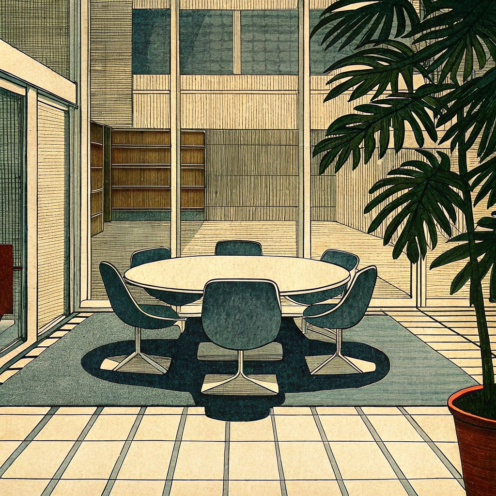
      <figcaption>Input image</figcaption>
    </figure>
    

      
Case 5 · strictly verified same case · score gap 0.5392

      <h4><code>image_static_stylized_workspaces_0008</code></h4>
      
Suite: image_staticScene: stylized / indoor / workspaces

      

        Generation prompt
        
Camera orbit left. A modern conference room with bookshelves, glass walls, and modern chairs. Everything in the scene remains completely motionless.

        <small>prompt source: generation_records</small>
      

  

  

<figure class="metric-output-card metric-output-card--good">
  

    <video class="metric-output-video" controls muted loop playsinline preload="metadata" aria-label="Good output: image_static_stylized_workspaces_0008">
      <source src="../../../assets/metric_examples/762d162b0f5f__hy_worldplay_ar_distilled_image_test_balanced_5000_5s__image_static_stylized_workspaces_0008.mp4" type="video/mp4">
    </video>
    
Good output · Score 0.9507

  

</figure>
<figure class="metric-output-card metric-output-card--bad">
  

    <video class="metric-output-video" controls muted loop playsinline preload="metadata" aria-label="Poor output: image_static_stylized_workspaces_0008">
      <source src="../../../assets/metric_examples/f724b74f4ea9__matrix_game3_5s_image_static_dynamic__image_static_stylized_workspaces_0008.mp4" type="video/mp4">
    </video>
    
Poor output · Score 0.4115

  

</figure>
  

</article>
<article class="metric-case-exhibit">
  

    <figure class="metric-input-card">
      
      <figcaption>Input image</figcaption>
    </figure>
    

      
Case 6 · strictly verified same case · score gap 0.2484

      <h4><code>image_static_stylized_dining_spaces_0041</code></h4>
      
Suite: image_staticScene: stylized / indoor / dining_spaces

      

        Generation prompt
        
Camera pull out. A beachside path with sand, lanterns, and ocean. Camera pan left. A beachfront lounge with lounge chairs, palm trees, and ocean. Camera move left. A beach bar with bar counter, stools, and string lights.

        <small>prompt source: generation_records</small>
      

  

  

<figure class="metric-output-card metric-output-card--good">
  

    <video class="metric-output-video" controls muted loop playsinline preload="metadata" aria-label="Good output: image_static_stylized_dining_spaces_0041">
      <source src="../../../assets/metric_examples/055610540354__luciddreamer-image-static-8gpu-20260613_151844__image_static_stylized_dining_spaces_0041.mp4" type="video/mp4">
    </video>
    
Good output · Score 0.9290

  

</figure>
<figure class="metric-output-card metric-output-card--bad">
  

    <video class="metric-output-video" controls muted loop playsinline preload="metadata" aria-label="Poor output: image_static_stylized_dining_spaces_0041">
      <source src="../../../assets/metric_examples/eb258637ccee__longcat-video-image-static-8gpu-20260612_133950__image_static_stylized_dining_spaces_0041.mp4" type="video/mp4">
    </video>
    
Poor output · Score 0.6806

  

</figure>
  

</article>
<article class="metric-case-exhibit">
  

    <figure class="metric-input-card">
      
      <figcaption>Input image</figcaption>
    </figure>
    

      
Case 7 · strictly verified same case · score gap 0.4548

      <h4><code>image_static_stylized_city_0021</code></h4>
      
Suite: image_staticScene: stylized / outdoor / city

      

        Generation prompt
        
Camera move right. A cityscape silhouette with towers, buildings, and bridge. Everything in the scene remains completely motionless.

        <small>prompt source: generation_records</small>
      

  

  

<figure class="metric-output-card metric-output-card--good">
  

    <video class="metric-output-video" controls muted loop playsinline preload="metadata" aria-label="Good output: image_static_stylized_city_0021">
      <source src="../../../assets/metric_examples/50a398808e7c__motionctrl_image_static_official_default_tmp2__image_static_stylized_city_0021.mp4" type="video/mp4">
    </video>
    
Good output · Score 0.9696

  

</figure>
<figure class="metric-output-card metric-output-card--bad">
  

    <video class="metric-output-video" controls muted loop playsinline preload="metadata" aria-label="Poor output: image_static_stylized_city_0021">
      <source src="../../../assets/metric_examples/26dc3b8b908f__astra_image_static__image_static_stylized_city_0021.mp4" type="video/mp4">
    </video>
    
Poor output · Score 0.5148

  

</figure>
  

</article>
<article class="metric-case-exhibit">
  

    <figure class="metric-input-card">
      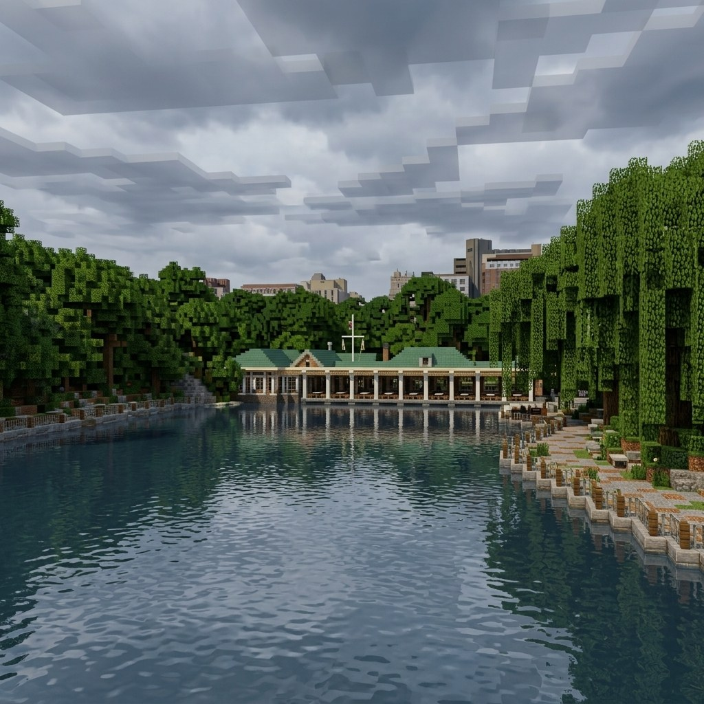
      <figcaption>Input image</figcaption>
    </figure>
    

      
Case 8 · strictly verified same case · score gap 0.2243

      <h4><code>image_static_stylized_aquatic_landscape_0123</code></h4>
      
Suite: image_staticScene: stylized / outdoor / aquatic_landscape

      

        Generation prompt
        
Camera pan left. Dense trees with stone pathway and lake. Everything in the scene remains completely motionless.

        <small>prompt source: generation_records</small>
      

  

  

<figure class="metric-output-card metric-output-card--good">
  

    <video class="metric-output-video" controls muted loop playsinline preload="metadata" aria-label="Good output: image_static_stylized_aquatic_landscape_0123">
      <source src="../../../assets/metric_examples/089030954b5b__hy_worldplay_ar_distilled_image_test_balanced_5000_5s__image_static_stylized_aquatic_landscape_0123.mp4" type="video/mp4">
    </video>
    
Good output · Score 0.9741

  

</figure>
<figure class="metric-output-card metric-output-card--bad">
  

    <video class="metric-output-video" controls muted loop playsinline preload="metadata" aria-label="Poor output: image_static_stylized_aquatic_landscape_0123">
      <source src="../../../assets/metric_examples/684370a91577__motionctrl_image_static_official_default_tmp2__image_static_stylized_aquatic_landscape_0123.mp4" type="video/mp4">
    </video>
    
Poor output · Score 0.7498

  

</figure>
  

</article>

### `feature_match_coverage`

<article class="metric-case-exhibit">
  

    <figure class="metric-input-card">
      
      <figcaption>Input image</figcaption>
    </figure>
    

      
Case 1 · strictly verified same case · score gap 0.8407

      <h4><code>image_static_photorealistic_passageways_0155</code></h4>
      
Suite: image_staticScene: photorealistic / indoor / passageways

      

        Generation prompt
        
Camera push in. A concrete corridor with end wall and light source. Everything in the scene remains completely motionless.

        <small>prompt source: generation_records</small>
      

  

  

<figure class="metric-output-card metric-output-card--good">
  

    <video class="metric-output-video" controls muted loop playsinline preload="metadata" aria-label="Good output: image_static_photorealistic_passageways_0155">
      <source src="../../../assets/metric_examples/35ab3fc3e20b__cameractrl_image_static__image_static_photorealistic_passageways_0155.mp4" type="video/mp4">
    </video>
    
Good output · Score 0.8889

  

</figure>
<figure class="metric-output-card metric-output-card--bad">
  

    <video class="metric-output-video" controls muted loop playsinline preload="metadata" aria-label="Poor output: image_static_photorealistic_passageways_0155">
      <source src="../../../assets/metric_examples/bdf8a95737dc__matrix_game3_5s_image_static_dynamic__image_static_photorealistic_passageways_0155.mp4" type="video/mp4">
    </video>
    
Poor output · Score 0.0482

  

</figure>
  

</article>
<article class="metric-case-exhibit">
  

    <figure class="metric-input-card">
      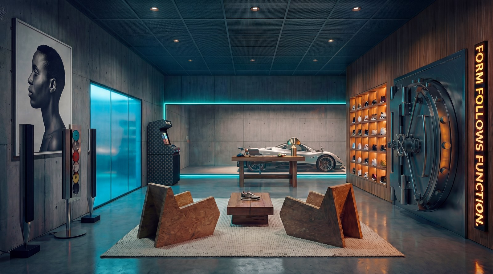
      <figcaption>Input image</figcaption>
    </figure>
    

      
Case 2 · strictly verified same case · score gap 0.4021

      <h4><code>image_static_photorealistic_workspaces_0074</code></h4>
      
Suite: image_staticScene: photorealistic / indoor / workspaces

      

        Generation prompt
        
Camera orbit left. A modern workspace with sneaker wall, vault door, and futuristic car. Everything in the scene remains completely motionless.

        <small>prompt source: generation_records</small>
      

  

  

<figure class="metric-output-card metric-output-card--good">
  

    <video class="metric-output-video" controls muted loop playsinline preload="metadata" aria-label="Good output: image_static_photorealistic_workspaces_0074">
      <source src="../../../assets/metric_examples/5627a1bd7949__hy_worldplay_ar_distilled_image_test_balanced_5000_5s__image_static_photorealistic_workspaces_0074.mp4" type="video/mp4">
    </video>
    
Good output · Score 0.5724

  

</figure>
<figure class="metric-output-card metric-output-card--bad">
  

    <video class="metric-output-video" controls muted loop playsinline preload="metadata" aria-label="Poor output: image_static_photorealistic_workspaces_0074">
      <source src="../../../assets/metric_examples/ef518968e81d__hy_worldplay_ar_rl_image_test_balanced_5000_5s__image_static_photorealistic_workspaces_0074.mp4" type="video/mp4">
    </video>
    
Poor output · Score 0.1703

  

</figure>
  

</article>
<article class="metric-case-exhibit">
  

    <figure class="metric-input-card">
      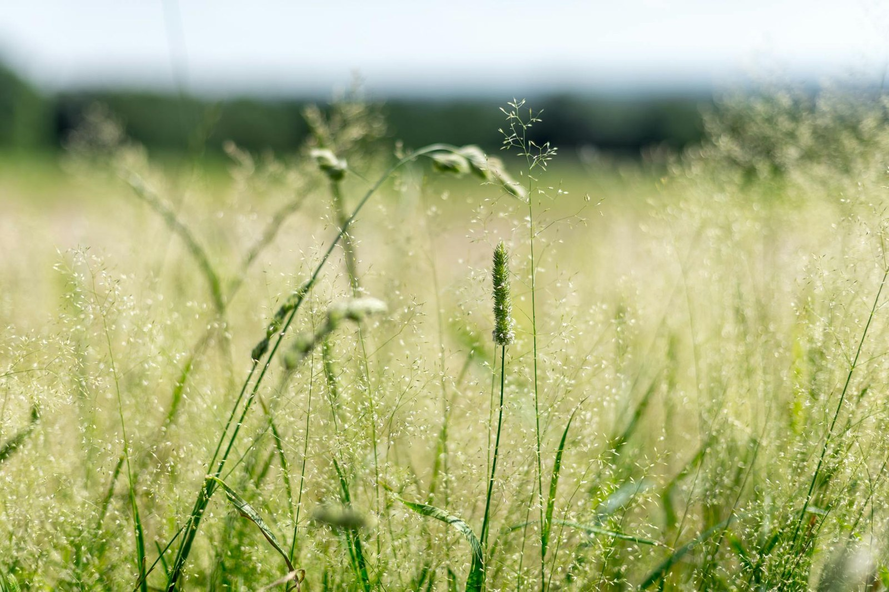
      <figcaption>Input image</figcaption>
    </figure>
    

      
Case 3 · strictly verified same case · score gap 0.9874

      <h4><code>image_static_photorealistic_verdant_landscape_0041</code></h4>
      
Suite: image_staticScene: photorealistic / outdoor / verdant_landscape

      

        Generation prompt
        
Camera orbit right. A sunlit field with grass and distant trees. Everything in the scene remains completely motionless.

        <small>prompt source: generation_records</small>
      

  

  

<figure class="metric-output-card metric-output-card--good">
  

    <video class="metric-output-video" controls muted loop playsinline preload="metadata" aria-label="Good output: image_static_photorealistic_verdant_landscape_0041">
      <source src="../../../assets/metric_examples/ec70c09d7795__cameractrl_image_static__image_static_photorealistic_verdant_landscape_0041.mp4" type="video/mp4">
    </video>
    
Good output · Score 1.0000

  

</figure>
<figure class="metric-output-card metric-output-card--bad">
  

    <video class="metric-output-video" controls muted loop playsinline preload="metadata" aria-label="Poor output: image_static_photorealistic_verdant_landscape_0041">
      <source src="../../../assets/metric_examples/36fca0c55ef0__dreamx_world_image_static__image_static_photorealistic_verdant_landscape_0041.mp4" type="video/mp4">
    </video>
    
Poor output · Score 0.0126

  

</figure>
  

</article>
<article class="metric-case-exhibit">
  

    <figure class="metric-input-card">
      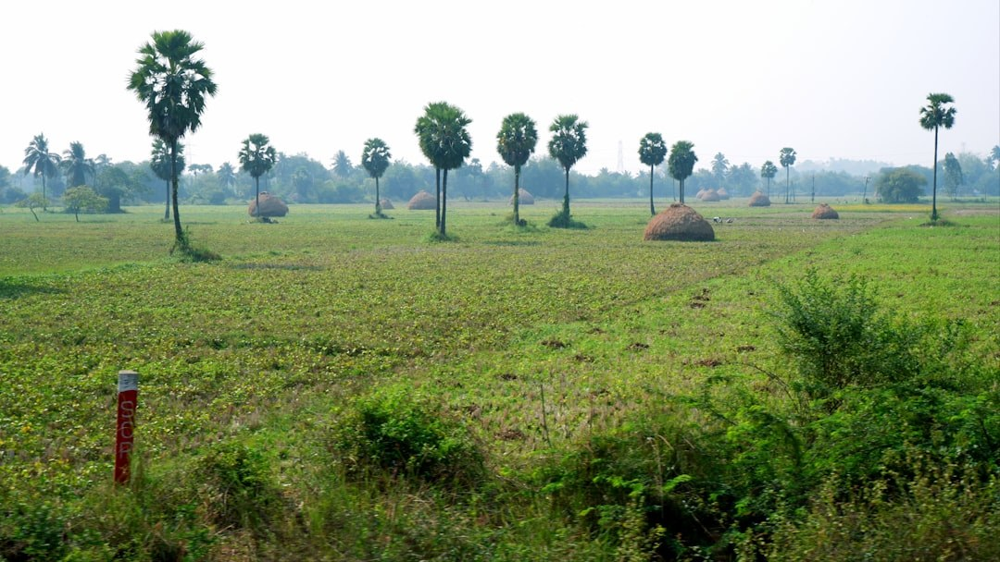
      <figcaption>Input image</figcaption>
    </figure>
    

      
Case 4 · strictly verified same case · score gap 0.3860

      <h4><code>image_static_photorealistic_terrestrial_landscape_0067</code></h4>
      
Suite: image_staticScene: photorealistic / outdoor / terrestrial_landscape

      

        Generation prompt
        
Camera pan left. A rural field with palm trees, haystacks, and green field. Everything in the scene remains completely motionless.

        <small>prompt source: generation_records</small>
      

  

  

<figure class="metric-output-card metric-output-card--good">
  

    <video class="metric-output-video" controls muted loop playsinline preload="metadata" aria-label="Good output: image_static_photorealistic_terrestrial_landscape_0067">
      <source src="../../../assets/metric_examples/01de9809e554__lyra-2-image-static-openenvision__image_static_photorealistic_terrestrial_landscape_0067.mp4" type="video/mp4">
    </video>
    
Good output · Score 0.4469

  

</figure>
<figure class="metric-output-card metric-output-card--bad">
  

    <video class="metric-output-video" controls muted loop playsinline preload="metadata" aria-label="Poor output: image_static_photorealistic_terrestrial_landscape_0067">
      <source src="../../../assets/metric_examples/25022d74d777__matrix_game3_5s_image_static_dynamic__image_static_photorealistic_terrestrial_landscape_0067.mp4" type="video/mp4">
    </video>
    
Poor output · Score 0.0609

  

</figure>
  

</article>
<article class="metric-case-exhibit">
  

    <figure class="metric-input-card">
      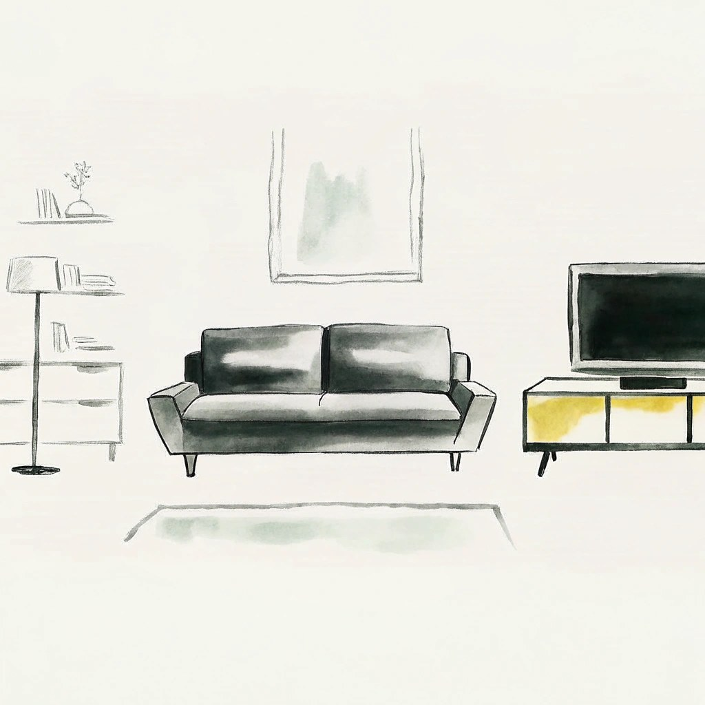
      <figcaption>Input image</figcaption>
    </figure>
    

      
Case 5 · strictly verified same case · score gap 0.8906

      <h4><code>image_static_stylized_living_spaces_0034</code></h4>
      
Suite: image_staticScene: stylized / indoor / living_spaces

      

        Generation prompt
        
Camera move left. A minimalist living room with bookshelf, window, and armchair. Everything in the scene remains completely motionless.

        <small>prompt source: generation_records</small>
      

  

  

<figure class="metric-output-card metric-output-card--good">
  

    <video class="metric-output-video" controls muted loop playsinline preload="metadata" aria-label="Good output: image_static_stylized_living_spaces_0034">
      <source src="../../../assets/metric_examples/379d7e7af470__cameractrl_image_static__image_static_stylized_living_spaces_0034.mp4" type="video/mp4">
    </video>
    
Good output · Score 1.0000

  

</figure>
<figure class="metric-output-card metric-output-card--bad">
  

    <video class="metric-output-video" controls muted loop playsinline preload="metadata" aria-label="Poor output: image_static_stylized_living_spaces_0034">
      <source src="../../../assets/metric_examples/6f9f03923ec1__astra_image_static__image_static_stylized_living_spaces_0034.mp4" type="video/mp4">
    </video>
    
Poor output · Score 0.1094

  

</figure>
  

</article>
<article class="metric-case-exhibit">
  

    <figure class="metric-input-card">
      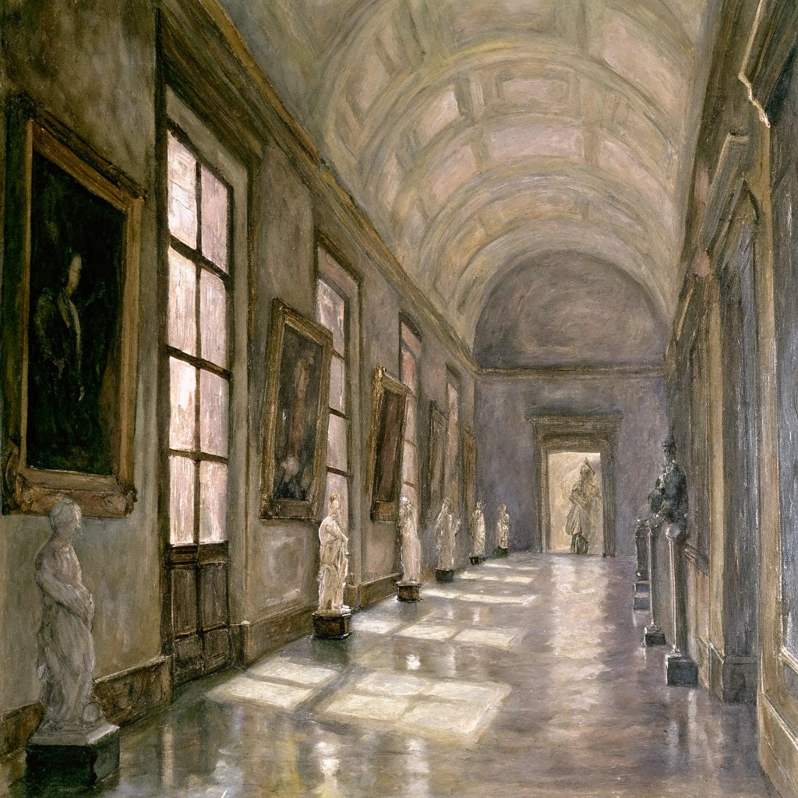
      <figcaption>Input image</figcaption>
    </figure>
    

      
Case 6 · strictly verified same case · score gap 0.3882

      <h4><code>image_static_stylized_public_spaces_0008</code></h4>
      
Suite: image_staticScene: stylized / indoor / public_spaces

      

        Generation prompt
        
Camera orbit left. A gallery corridor with statues, paintings, and windows. Everything in the scene remains completely motionless.

        <small>prompt source: generation_records</small>
      

  

  

<figure class="metric-output-card metric-output-card--good">
  

    <video class="metric-output-video" controls muted loop playsinline preload="metadata" aria-label="Good output: image_static_stylized_public_spaces_0008">
      <source src="../../../assets/metric_examples/e8af08ddfa9e__astra_image_static__image_static_stylized_public_spaces_0008.mp4" type="video/mp4">
    </video>
    
Good output · Score 0.4870

  

</figure>
<figure class="metric-output-card metric-output-card--bad">
  

    <video class="metric-output-video" controls muted loop playsinline preload="metadata" aria-label="Poor output: image_static_stylized_public_spaces_0008">
      <source src="../../../assets/metric_examples/2922278be5d3__matrix_game3_5s_image_static_dynamic__image_static_stylized_public_spaces_0008.mp4" type="video/mp4">
    </video>
    
Poor output · Score 0.0988

  

</figure>
  

</article>
<article class="metric-case-exhibit">
  

    <figure class="metric-input-card">
      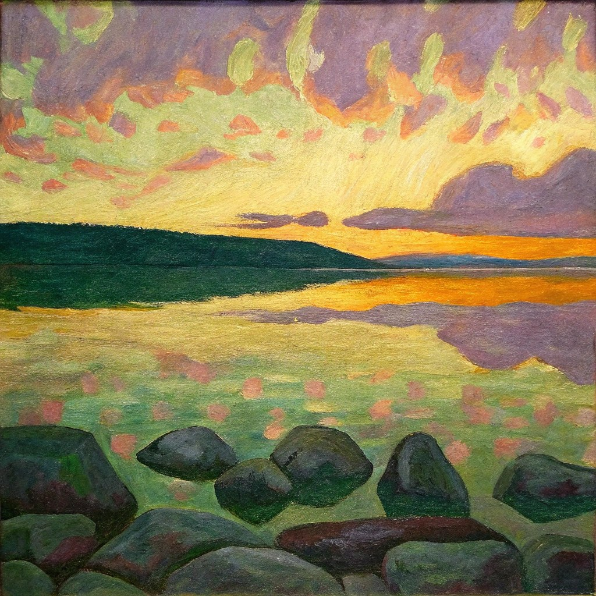
      <figcaption>Input image</figcaption>
    </figure>
    

      
Case 7 · strictly verified same case · score gap 0.9024

      <h4><code>image_static_stylized_aquatic_landscape_0048</code></h4>
      
Suite: image_staticScene: stylized / outdoor / aquatic_landscape

      

        Generation prompt
        
Camera orbit right. A sunset lake with rocks, sunset sky, and distant shoreline. Everything in the scene remains completely motionless.

        <small>prompt source: generation_records</small>
      

  

  

<figure class="metric-output-card metric-output-card--good">
  

    <video class="metric-output-video" controls muted loop playsinline preload="metadata" aria-label="Good output: image_static_stylized_aquatic_landscape_0048">
      <source src="../../../assets/metric_examples/f7d0b1135562__cameractrl_image_static__image_static_stylized_aquatic_landscape_0048.mp4" type="video/mp4">
    </video>
    
Good output · Score 1.0000

  

</figure>
<figure class="metric-output-card metric-output-card--bad">
  

    <video class="metric-output-video" controls muted loop playsinline preload="metadata" aria-label="Poor output: image_static_stylized_aquatic_landscape_0048">
      <source src="../../../assets/metric_examples/0920650a0969__matrix_game2_5s_image_static__image_static_stylized_aquatic_landscape_0048.mp4" type="video/mp4">
    </video>
    
Poor output · Score 0.0976

  

</figure>
  

</article>
<article class="metric-case-exhibit">
  

    <figure class="metric-input-card">
      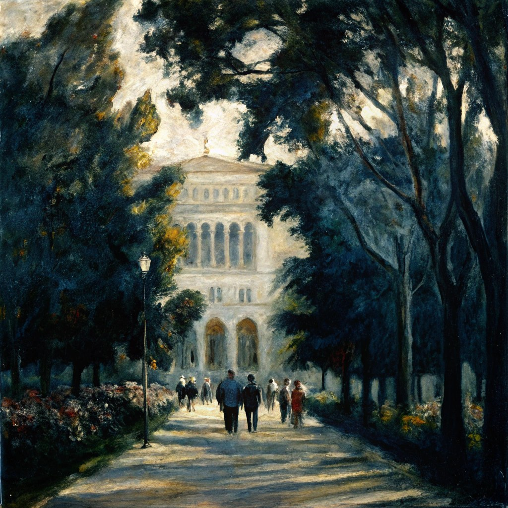
      <figcaption>Input image</figcaption>
    </figure>
    

      
Case 8 · strictly verified same case · score gap 0.4055

      <h4><code>image_static_stylized_suburb_0007</code></h4>
      
Suite: image_staticScene: stylized / outdoor / suburb

      

        Generation prompt
        
Camera pull out. A path intersection with trees, benches, and people. Everything in the scene remains completely motionless.

        <small>prompt source: generation_records</small>
      

  

  

<figure class="metric-output-card metric-output-card--good">
  

    <video class="metric-output-video" controls muted loop playsinline preload="metadata" aria-label="Good output: image_static_stylized_suburb_0007">
      <source src="../../../assets/metric_examples/774124c6e96d__hy_worldplay_ar_image_test_balanced_5000_5s__image_static_stylized_suburb_0007.mp4" type="video/mp4">
    </video>
    
Good output · Score 0.4402

  

</figure>
<figure class="metric-output-card metric-output-card--bad">
  

    <video class="metric-output-video" controls muted loop playsinline preload="metadata" aria-label="Poor output: image_static_stylized_suburb_0007">
      <source src="../../../assets/metric_examples/d5bd629c2cff__dreamx_world_image_static__image_static_stylized_suburb_0007.mp4" type="video/mp4">
    </video>
    
Poor output · Score 0.0348

  

</figure>
  

</article>

<!-- metric-examples:end -->

## References {#reference}

!!! quote "Multiple View Geometry in Computer Vision"

    Hartley & Zisserman, Cambridge University Press, 2004.
