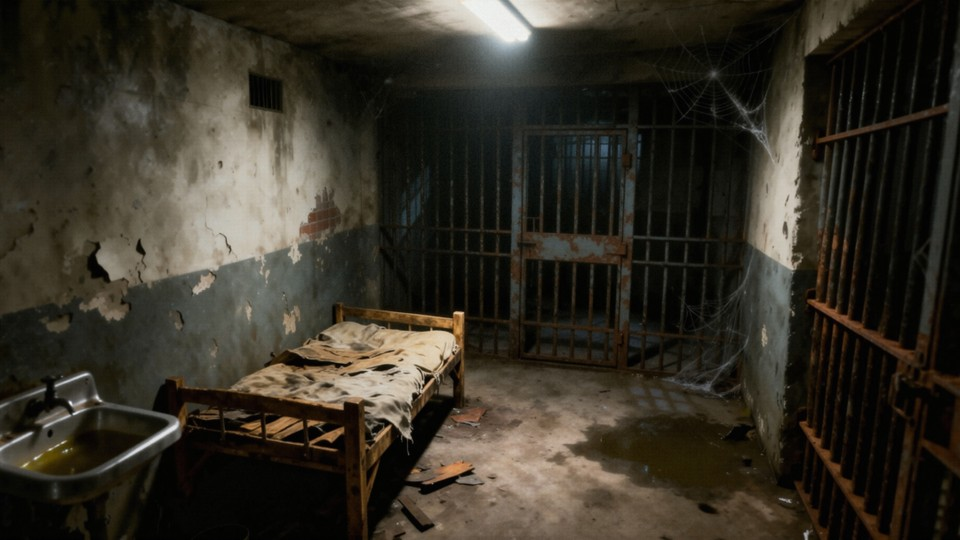
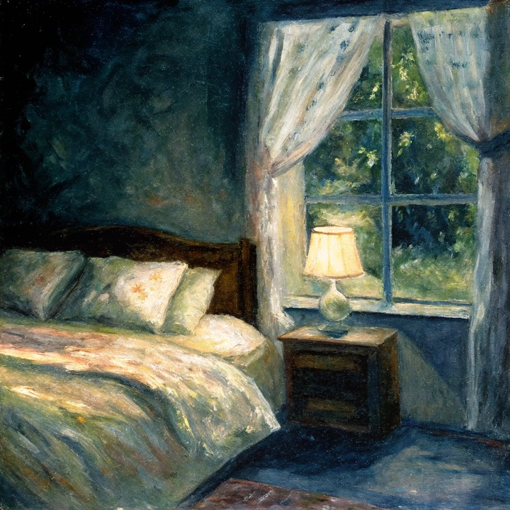
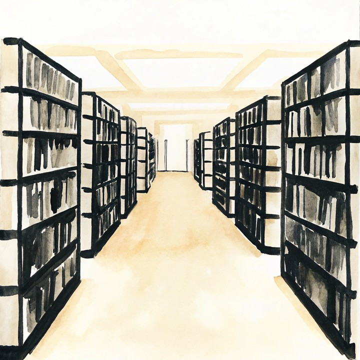
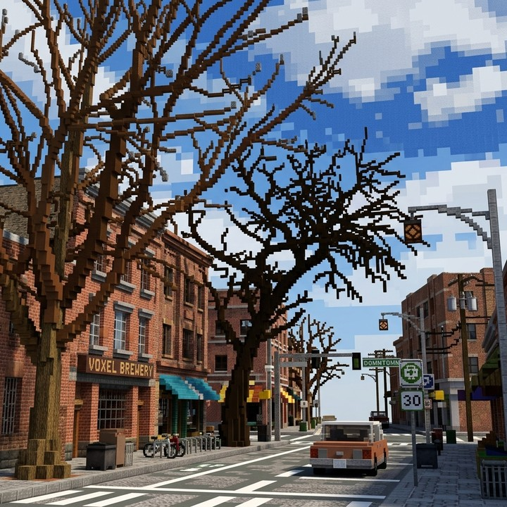
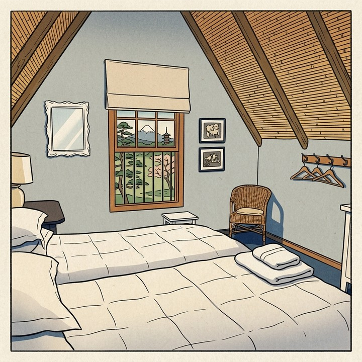
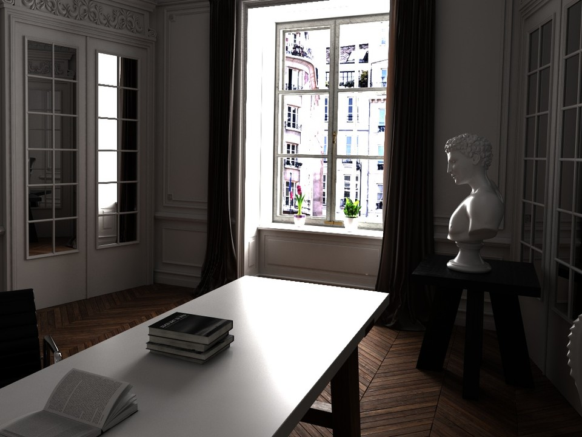

# Epipolar Geometry

This page defines three **GVGC-style epipolar-geometry diagnostic metrics** that probe whether nearby generated frames admit a stable two-view epipolar explanation [[Hartley and Zisserman, 2004](#reference)]. They require only the prediction video—no camera-pose annotations and no reference video. The core question is whether local feature correspondences approximately satisfy the epipolar constraint, indicating that two frames can be explained as projections of the same scene under a pinhole camera model with rigid relative motion.

In classical multiple-view geometry, if two frames observe the same scene under rigid camera motion, a point \(x\) in the first frame must map to a corresponding point \(x'\) that lies on the epipolar line \(l' = F x\) induced by the fundamental matrix \(F\). Generated videos with background warping, local object drift, unstable depth layering, or frame pairs that are not projections of one 3D structure will struggle to maintain many RANSAC inliers under this constraint, raising Sampson error and lowering inlier rate. These metrics therefore provide a **lightweight, interpretable** two-view geometry signal; they check sparse-feature epipolar consistency only and do not replace global 3D self-consistency metrics such as MEt3R, reprojection error, or reconstruction-based scores.

In WorldArena, the backend builds adjacent (or strided) frame pairs from sampled prediction frames, matches SIFT features with Lowe's ratio test by default, and estimates \(F\) with OpenCV RANSAC. It computes Sampson error on RANSAC inliers and reports inlier rate and coverage; if the primary path fails, the runtime may fall back to relaxed matching thresholds or Shi-Tomasi + Lucas-Kanade tracking. All three sub-metrics share one backend pass:

| Metric | Raw statistic | Direction |
| --- | --- | --- |
| `epipolar_error` | median inlier Sampson error after fundamental-matrix RANSAC | lower is better |
| `epipolar_inlier_rate` | RANSAC inliers / Lowe-ratio feature matches | higher is better |
| `feature_match_coverage` | RANSAC inliers / min keypoint count | higher is better |

For matched homogeneous points \(x_i, x'_i\), Sampson error is

\[
d_i = \frac{|{x'_i}^{\mathsf T} F x_i|}{\sqrt{(Fx_i)_1^2 + (Fx_i)_2^2 + (F^{\mathsf T}x'_i)_1^2 + (F^{\mathsf T}x'_i)_2^2}}
\tag{1}
\]

Per valid pair, `epipolar_error` uses the median \(d_i\) over RANSAC inliers; the video-level value is the median across pairs. Normalization maps \([0, 5]\) with lower-is-better scaling.

Per valid pair, inlier rate and coverage are

\[
r = \frac{\#\mathrm{inliers}}{\#\mathrm{good\ matches}},
\qquad
c = \min\!\left(\frac{\#\mathrm{inliers}}{\min(\#\mathrm{kp}_\mathrm{left}, \#\mathrm{kp}_\mathrm{right})},\, 1\right)
\tag{2}
\]

Video-level `epipolar_inlier_rate` and `feature_match_coverage` average \(r\) and \(c\) over valid pairs with identity normalization on \([0,1]\). `epipolar_error` takes the median of per-pair medians and is reverse-normalized from \([0, 5]\) to \([0, 1]\) (higher normalized score means stronger epipolar consistency). If no pair yields sufficient inliers, all three metrics return `not_applicable`. They are currently **diagnostic**: reported separately and excluded from headline aggregation. They may fail often in weak-texture, strongly non-rigid, or dynamic-prompt regimes and should be read alongside MEt3R and reprojection error.

<!-- metric-examples:start -->
## Verified Same-Input Examples

Up to three cases are shown per metric. Within each case, both videos must belong to the same benchmark sample, and both first frames must pass SIFT + RANSAC geometric matching against that case's displayed input. Candidates that fail are not published. Labels compare this metric only, not overall model quality.

Audit manifest: `docs/assets/metric_examples/curated_same_case_manifest.json`.

<article class="metric-case-exhibit metric-case-exhibit--curated">
  

    <figure class="metric-input-card">
      
      <figcaption>Input image</figcaption>
    </figure>
    

      
Input verified · same benchmark case · gap 0.0743

      <h4><code>image_static_photorealistic_public_spaces_0064</code></h4>
      
Suite: image_staticScene: photorealistic / indoor / public_spaces

      

        Benchmark prompt target
        
Camera move left. A prison cell with barred door, cobwebs, and peeling paint.

        <small>prompt source: prompt_target</small>
      

      
Both first frames passed geometric matching against the displayed input; labels compare this metric only.

    

  

  

    <figure class="metric-output-card metric-output-card--good">
      

        <video class="metric-output-video" controls muted loop playsinline preload="metadata" aria-label="Higher metric score: image_static_photorealistic_public_spaces_0064">
          <source src="../../../assets/metric_examples/curated_20260801/394f94fcdcda__image_static_photorealistic_public_spaces_0064__high.mp4" type="video/mp4">
        </video>
        
Higher metric score · Score 0.9924

      

      <figcaption class="metric-output-caption"><strong>Higher metric score</strong>epipolar_error</figcaption>
    </figure>
    <figure class="metric-output-card metric-output-card--bad">
      

        <video class="metric-output-video" controls muted loop playsinline preload="metadata" aria-label="Lower metric score: image_static_photorealistic_public_spaces_0064">
          <source src="../../../assets/metric_examples/curated_20260801/448f0f8062ae__image_static_photorealistic_public_spaces_0064__low.mp4" type="video/mp4">
        </video>
        
Lower metric score · Score 0.9181

      

      <figcaption class="metric-output-caption"><strong>Lower metric score</strong>epipolar_error</figcaption>
    </figure>
  

</article>
<article class="metric-case-exhibit metric-case-exhibit--curated">
  

    <figure class="metric-input-card">
      
      <figcaption>Input image</figcaption>
    </figure>
    

      
Input verified · same benchmark case · gap 0.0770

      <h4><code>image_static_photorealistic_living_spaces_0155</code></h4>
      
Suite: image_staticScene: photorealistic / indoor / living_spaces

      

        Benchmark prompt target
        
Camera pan right. A vintage bathroom with wooden shelves, bath products, and towels.

        <small>prompt source: prompt_target</small>
      

      
Both first frames passed geometric matching against the displayed input; labels compare this metric only.

    

  

  

    <figure class="metric-output-card metric-output-card--good">
      

        <video class="metric-output-video" controls muted loop playsinline preload="metadata" aria-label="Higher metric score: image_static_photorealistic_living_spaces_0155">
          <source src="../../../assets/metric_examples/curated_20260801/adf26cec582b__image_static_photorealistic_living_spaces_0155__high.mp4" type="video/mp4">
        </video>
        
Higher metric score · Score 0.9911

      

      <figcaption class="metric-output-caption"><strong>Higher metric score</strong>epipolar_error</figcaption>
    </figure>
    <figure class="metric-output-card metric-output-card--bad">
      

        <video class="metric-output-video" controls muted loop playsinline preload="metadata" aria-label="Lower metric score: image_static_photorealistic_living_spaces_0155">
          <source src="../../../assets/metric_examples/curated_20260801/c28e8366ed77__image_static_photorealistic_living_spaces_0155__low.mp4" type="video/mp4">
        </video>
        
Lower metric score · Score 0.9141

      

      <figcaption class="metric-output-caption"><strong>Lower metric score</strong>epipolar_error</figcaption>
    </figure>
  

</article>
<article class="metric-case-exhibit metric-case-exhibit--curated">
  

    <figure class="metric-input-card">
      
      <figcaption>Input image</figcaption>
    </figure>
    

      
Input verified · same benchmark case · gap 0.0860

      <h4><code>image_static_stylized_living_spaces_0037</code></h4>
      
Suite: image_staticScene: stylized / indoor / living_spaces

      

        Benchmark prompt target
        
Camera pan right. A bedroom corner with wardrobe, chair, and rug.

        <small>prompt source: prompt_target</small>
      

      
Both first frames passed geometric matching against the displayed input; labels compare this metric only.

    

  

  

    <figure class="metric-output-card metric-output-card--good">
      

        <video class="metric-output-video" controls muted loop playsinline preload="metadata" aria-label="Higher metric score: image_static_stylized_living_spaces_0037">
          <source src="../../../assets/metric_examples/curated_20260801/7f6f8eb8d3f9__image_static_stylized_living_spaces_0037__high.mp4" type="video/mp4">
        </video>
        
Higher metric score · Score 0.9871

      

      <figcaption class="metric-output-caption"><strong>Higher metric score</strong>epipolar_error</figcaption>
    </figure>
    <figure class="metric-output-card metric-output-card--bad">
      

        <video class="metric-output-video" controls muted loop playsinline preload="metadata" aria-label="Lower metric score: image_static_stylized_living_spaces_0037">
          <source src="../../../assets/metric_examples/c223556eb328__matrix_game2_5s_image_static__image_static_stylized_living_spaces_0037.mp4" type="video/mp4">
        </video>
        
Lower metric score · Score 0.9011

      

      <figcaption class="metric-output-caption"><strong>Lower metric score</strong>epipolar_error</figcaption>
    </figure>
  

</article>
<article class="metric-case-exhibit metric-case-exhibit--curated">
  

    <figure class="metric-input-card">
      
      <figcaption>Input image</figcaption>
    </figure>
    

      
Input verified · same benchmark case · gap 0.7193

      <h4><code>image_static_stylized_public_spaces_0049</code></h4>
      
Suite: image_staticScene: stylized / indoor / public_spaces

      

        Benchmark prompt target
        
Camera orbit left. A library aisle with bookshelves, books, and reading table.

        <small>prompt source: prompt_target</small>
      

      
Both first frames passed geometric matching against the displayed input; labels compare this metric only.

    

  

  

    <figure class="metric-output-card metric-output-card--good">
      

        <video class="metric-output-video" controls muted loop playsinline preload="metadata" aria-label="Higher metric score: image_static_stylized_public_spaces_0049">
          <source src="../../../assets/metric_examples/curated_20260801/080234cb97e9__image_static_stylized_public_spaces_0049__high.mp4" type="video/mp4">
        </video>
        
Higher metric score · Score 0.9841

      

      <figcaption class="metric-output-caption"><strong>Higher metric score</strong>epipolar_inlier_rate</figcaption>
    </figure>
    <figure class="metric-output-card metric-output-card--bad">
      

        <video class="metric-output-video" controls muted loop playsinline preload="metadata" aria-label="Lower metric score: image_static_stylized_public_spaces_0049">
          <source src="../../../assets/metric_examples/curated_20260801/d609d31a9446__image_static_stylized_public_spaces_0049__low.mp4" type="video/mp4">
        </video>
        
Lower metric score · Score 0.2648

      

      <figcaption class="metric-output-caption"><strong>Lower metric score</strong>epipolar_inlier_rate</figcaption>
    </figure>
  

</article>
<article class="metric-case-exhibit metric-case-exhibit--curated">
  

    <figure class="metric-input-card">
      
      <figcaption>Input image</figcaption>
    </figure>
    

      
Input verified · same benchmark case · gap 0.6446

      <h4><code>image_static_photorealistic_public_spaces_0154</code></h4>
      
Suite: image_staticScene: photorealistic / indoor / public_spaces

      

        Benchmark prompt target
        
Camera orbit left. A library aisle with bookshelves, books, and reading tables.

        <small>prompt source: prompt_target</small>
      

      
Both first frames passed geometric matching against the displayed input; labels compare this metric only.

    

  

  

    <figure class="metric-output-card metric-output-card--good">
      

        <video class="metric-output-video" controls muted loop playsinline preload="metadata" aria-label="Higher metric score: image_static_photorealistic_public_spaces_0154">
          <source src="../../../assets/metric_examples/curated_20260801/645f013eaa1d__image_static_photorealistic_public_spaces_0154__high.mp4" type="video/mp4">
        </video>
        
Higher metric score · Score 0.9924

      

      <figcaption class="metric-output-caption"><strong>Higher metric score</strong>epipolar_inlier_rate</figcaption>
    </figure>
    <figure class="metric-output-card metric-output-card--bad">
      

        <video class="metric-output-video" controls muted loop playsinline preload="metadata" aria-label="Lower metric score: image_static_photorealistic_public_spaces_0154">
          <source src="../../../assets/metric_examples/curated_20260801/238c47aefdbf__image_static_photorealistic_public_spaces_0154__low.mp4" type="video/mp4">
        </video>
        
Lower metric score · Score 0.3478

      

      <figcaption class="metric-output-caption"><strong>Lower metric score</strong>epipolar_inlier_rate</figcaption>
    </figure>
  

</article>
<article class="metric-case-exhibit metric-case-exhibit--curated">
  

    <figure class="metric-input-card">
      
      <figcaption>Input image</figcaption>
    </figure>
    

      
Input verified · same benchmark case · gap 0.6917

      <h4><code>image_static_stylized_city_0157</code></h4>
      
Suite: image_staticScene: stylized / outdoor / city

      

        Benchmark prompt target
        
Camera orbit right. A voxel city street with brick buildings, crosswalk, and street signs.

        <small>prompt source: prompt_target</small>
      

      
Both first frames passed geometric matching against the displayed input; labels compare this metric only.

    

  

  

    <figure class="metric-output-card metric-output-card--good">
      

        <video class="metric-output-video" controls muted loop playsinline preload="metadata" aria-label="Higher metric score: image_static_stylized_city_0157">
          <source src="../../../assets/metric_examples/curated_20260801/0c0c6f4e64c1__image_static_stylized_city_0157__high.mp4" type="video/mp4">
        </video>
        
Higher metric score · Score 0.9927

      

      <figcaption class="metric-output-caption"><strong>Higher metric score</strong>epipolar_inlier_rate</figcaption>
    </figure>
    <figure class="metric-output-card metric-output-card--bad">
      

        <video class="metric-output-video" controls muted loop playsinline preload="metadata" aria-label="Lower metric score: image_static_stylized_city_0157">
          <source src="../../../assets/metric_examples/curated_20260801/2844ad2d0729__image_static_stylized_city_0157__low.mp4" type="video/mp4">
        </video>
        
Lower metric score · Score 0.3010

      

      <figcaption class="metric-output-caption"><strong>Lower metric score</strong>epipolar_inlier_rate</figcaption>
    </figure>
  

</article>
<article class="metric-case-exhibit metric-case-exhibit--curated">
  

    <figure class="metric-input-card">
      
      <figcaption>Input image</figcaption>
    </figure>
    

      
Input verified · same benchmark case · gap 0.8146

      <h4><code>image_static_stylized_living_spaces_0134</code></h4>
      
Suite: image_staticScene: stylized / indoor / living_spaces

      

        Benchmark prompt target
        
Camera orbit right. A modern living room with bookshelf, abstract painting, and sectional sofa.

        <small>prompt source: prompt_target</small>
      

      
Both first frames passed geometric matching against the displayed input; labels compare this metric only.

    

  

  

    <figure class="metric-output-card metric-output-card--good">
      

        <video class="metric-output-video" controls muted loop playsinline preload="metadata" aria-label="Higher metric score: image_static_stylized_living_spaces_0134">
          <source src="../../../assets/metric_examples/curated_20260801/356f3599300f__image_static_stylized_living_spaces_0134__high.mp4" type="video/mp4">
        </video>
        
Higher metric score · Score 0.8414

      

      <figcaption class="metric-output-caption"><strong>Higher metric score</strong>feature_match_coverage</figcaption>
    </figure>
    <figure class="metric-output-card metric-output-card--bad">
      

        <video class="metric-output-video" controls muted loop playsinline preload="metadata" aria-label="Lower metric score: image_static_stylized_living_spaces_0134">
          <source src="../../../assets/metric_examples/curated_20260801/e28be2531442__image_static_stylized_living_spaces_0134__low.mp4" type="video/mp4">
        </video>
        
Lower metric score · Score 0.0268

      

      <figcaption class="metric-output-caption"><strong>Lower metric score</strong>feature_match_coverage</figcaption>
    </figure>
  

</article>
<article class="metric-case-exhibit metric-case-exhibit--curated">
  

    <figure class="metric-input-card">
      
      <figcaption>Input image</figcaption>
    </figure>
    

      
Input verified · same benchmark case · gap 0.8123

      <h4><code>image_static_stylized_living_spaces_0091</code></h4>
      
Suite: image_staticScene: stylized / indoor / living_spaces

      

        Benchmark prompt target
        
Camera pan right. A bedroom corner with wardrobe, small bookshelf, and window.

        <small>prompt source: prompt_target</small>
      

      
Both first frames passed geometric matching against the displayed input; labels compare this metric only.

    

  

  

    <figure class="metric-output-card metric-output-card--good">
      

        <video class="metric-output-video" controls muted loop playsinline preload="metadata" aria-label="Higher metric score: image_static_stylized_living_spaces_0091">
          <source src="../../../assets/metric_examples/curated_20260801/7e539eca98ce__image_static_stylized_living_spaces_0091__high.mp4" type="video/mp4">
        </video>
        
Higher metric score · Score 0.8396

      

      <figcaption class="metric-output-caption"><strong>Higher metric score</strong>feature_match_coverage</figcaption>
    </figure>
    <figure class="metric-output-card metric-output-card--bad">
      

        <video class="metric-output-video" controls muted loop playsinline preload="metadata" aria-label="Lower metric score: image_static_stylized_living_spaces_0091">
          <source src="../../../assets/metric_examples/curated_20260801/1752059b5701__image_static_stylized_living_spaces_0091__low.mp4" type="video/mp4">
        </video>
        
Lower metric score · Score 0.0273

      

      <figcaption class="metric-output-caption"><strong>Lower metric score</strong>feature_match_coverage</figcaption>
    </figure>
  

</article>
<article class="metric-case-exhibit metric-case-exhibit--curated">
  

    <figure class="metric-input-card">
      
      <figcaption>Input image</figcaption>
    </figure>
    

      
Input verified · same benchmark case · gap 0.8311

      <h4><code>image_static_photorealistic_workspaces_0083</code></h4>
      
Suite: image_staticScene: photorealistic / indoor / workspaces

      

        Benchmark prompt target
        
Camera pan right. An elegant office with bookshelf, books, and armchair.

        <small>prompt source: prompt_target</small>
      

      
Both first frames passed geometric matching against the displayed input; labels compare this metric only.

    

  

  

    <figure class="metric-output-card metric-output-card--good">
      

        <video class="metric-output-video" controls muted loop playsinline preload="metadata" aria-label="Higher metric score: image_static_photorealistic_workspaces_0083">
          <source src="../../../assets/metric_examples/curated_20260801/ce09026b33ba__image_static_photorealistic_workspaces_0083__high.mp4" type="video/mp4">
        </video>
        
Higher metric score · Score 0.8699

      

      <figcaption class="metric-output-caption"><strong>Higher metric score</strong>feature_match_coverage</figcaption>
    </figure>
    <figure class="metric-output-card metric-output-card--bad">
      

        <video class="metric-output-video" controls muted loop playsinline preload="metadata" aria-label="Lower metric score: image_static_photorealistic_workspaces_0083">
          <source src="../../../assets/metric_examples/curated_20260801/e5b5f4c35b8e__image_static_photorealistic_workspaces_0083__low.mp4" type="video/mp4">
        </video>
        
Lower metric score · Score 0.0388

      

      <figcaption class="metric-output-caption"><strong>Lower metric score</strong>feature_match_coverage</figcaption>
    </figure>
  

</article>

<!-- metric-examples:end -->

## References {#reference}

!!! quote "Multiple View Geometry in Computer Vision"

    Hartley & Zisserman, Cambridge University Press, 2004.
