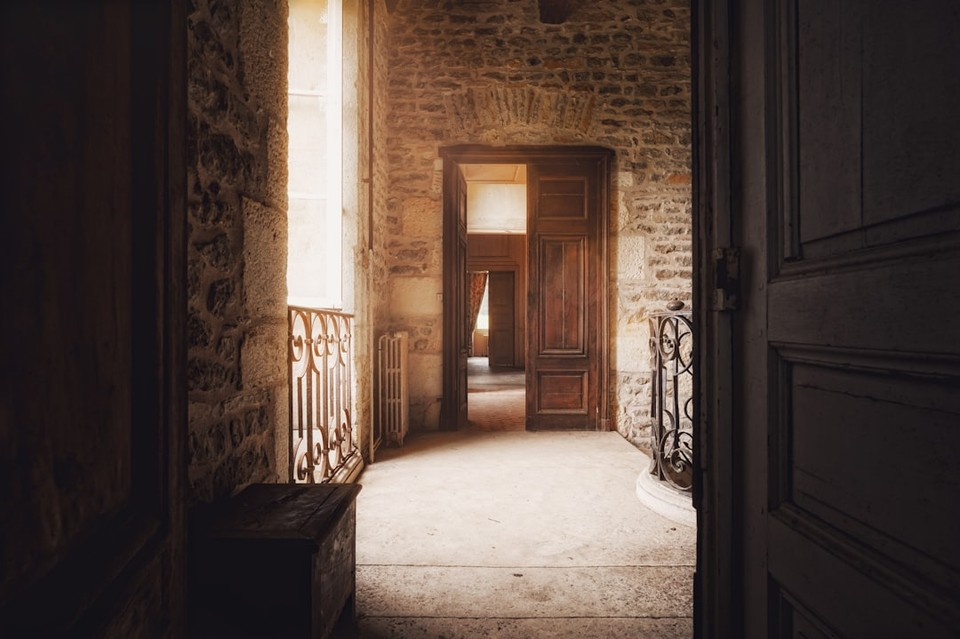

# Image Quality (MUSIQ)

`image_quality` is an official no-reference `image_static` quality metric. It evaluates prediction frames with the MUSIQ-SPAQ image-quality model and does not require a paired reference rollout.

For each protocol-selected prediction frame $I_i$, MUSIQ produces a native score $q_i$ on its $[0,100]$ scale. WorldArena normalizes and clips each score,

\[
s_i = \mathrm{clip}\!\left(\frac{q_i}{100}, 0, 1\right),
\]

then averages the normalized frame scores:

\[
S_{\mathrm{MUSIQ}} = \frac{1}{N}\sum_{i=1}^{N}s_i.
\]

Higher is better. The resulting value enters `per_metric_summary` and the equal-weight seven-metric quality total. The default backend is `musiq`, with `longer` preprocessing.

<!-- metric-examples:start -->
## Verified Same-Input Examples

Up to three cases are shown per metric. Within each case, both videos must belong to the same benchmark sample, and both first frames must pass SIFT + RANSAC geometric matching against that case's displayed input. Candidates that fail are not published. Labels compare this metric only, not overall model quality.

Audit manifest: `docs/assets/metric_examples/curated_same_case_manifest.json`.

<article class="metric-case-exhibit metric-case-exhibit--curated">
  

    <figure class="metric-input-card">
      
      <figcaption>Input image</figcaption>
    </figure>
    

      
Input verified · same benchmark case · gap 0.4837

      <h4><code>image_static_stylized_living_spaces_0096</code></h4>
      
Suite: image_staticScene: stylized / indoor / living_spaces

      

        Benchmark prompt target
        
Camera pan right. A modern living space with hallway, neon lights, and artwork.

        <small>prompt source: prompt_target</small>
      

      
Both first frames passed geometric matching against the displayed input; labels compare this metric only.

    

  

  

    <figure class="metric-output-card metric-output-card--good">
      

        <video class="metric-output-video" controls muted loop playsinline preload="metadata" aria-label="Higher metric score: image_static_stylized_living_spaces_0096">
          <source src="../../../assets/metric_examples/curated_20260801/1e7a3127e127__image_static_stylized_living_spaces_0096__high.mp4" type="video/mp4">
        </video>
        
Higher metric score · Score 0.7218

      

      <figcaption class="metric-output-caption"><strong>Higher metric score</strong>image_quality</figcaption>
    </figure>
    <figure class="metric-output-card metric-output-card--bad">
      

        <video class="metric-output-video" controls muted loop playsinline preload="metadata" aria-label="Lower metric score: image_static_stylized_living_spaces_0096">
          <source src="../../../assets/metric_examples/curated_20260801/b8886f3dbd11__image_static_stylized_living_spaces_0096__low.mp4" type="video/mp4">
        </video>
        
Lower metric score · Score 0.2381

      

      <figcaption class="metric-output-caption"><strong>Lower metric score</strong>image_quality</figcaption>
    </figure>
  

</article>
<article class="metric-case-exhibit metric-case-exhibit--curated">
  

    <figure class="metric-input-card">
      
      <figcaption>Input image</figcaption>
    </figure>
    

      
Input verified · same benchmark case · gap 0.4037

      <h4><code>image_static_photorealistic_passageways_0129</code></h4>
      
Suite: image_staticScene: photorealistic / indoor / passageways

      

        Benchmark prompt target
        
Camera move right. A rustic hallway with wooden floor, window with curtains, and vintage furniture.

        <small>prompt source: prompt_target</small>
      

      
Both first frames passed geometric matching against the displayed input; labels compare this metric only.

    

  

  

    <figure class="metric-output-card metric-output-card--good">
      

        <video class="metric-output-video" controls muted loop playsinline preload="metadata" aria-label="Higher metric score: image_static_photorealistic_passageways_0129">
          <source src="../../../assets/metric_examples/curated_20260801/6ae6bcb192f7__image_static_photorealistic_passageways_0129__high.mp4" type="video/mp4">
        </video>
        
Higher metric score · Score 0.7462

      

      <figcaption class="metric-output-caption"><strong>Higher metric score</strong>image_quality</figcaption>
    </figure>
    <figure class="metric-output-card metric-output-card--bad">
      

        <video class="metric-output-video" controls muted loop playsinline preload="metadata" aria-label="Lower metric score: image_static_photorealistic_passageways_0129">
          <source src="../../../assets/metric_examples/curated_20260801/72ff72478035__image_static_photorealistic_passageways_0129__low.mp4" type="video/mp4">
        </video>
        
Lower metric score · Score 0.3425

      

      <figcaption class="metric-output-caption"><strong>Lower metric score</strong>image_quality</figcaption>
    </figure>
  

</article>
<article class="metric-case-exhibit metric-case-exhibit--curated">
  

    <figure class="metric-input-card">
      
      <figcaption>Input image</figcaption>
    </figure>
    

      
Input verified · same benchmark case · gap 0.4016

      <h4><code>image_static_photorealistic_passageways_0140</code></h4>
      
Suite: image_staticScene: photorealistic / indoor / passageways

      

        Benchmark prompt target
        
Camera move right. A luxurious hallway with marble columns, doors, and gold-framed mirrors.

        <small>prompt source: prompt_target</small>
      

      
Both first frames passed geometric matching against the displayed input; labels compare this metric only.

    

  

  

    <figure class="metric-output-card metric-output-card--good">
      

        <video class="metric-output-video" controls muted loop playsinline preload="metadata" aria-label="Higher metric score: image_static_photorealistic_passageways_0140">
          <source src="../../../assets/metric_examples/curated_20260801/8cdcc534d30e__image_static_photorealistic_passageways_0140__high.mp4" type="video/mp4">
        </video>
        
Higher metric score · Score 0.7334

      

      <figcaption class="metric-output-caption"><strong>Higher metric score</strong>image_quality</figcaption>
    </figure>
    <figure class="metric-output-card metric-output-card--bad">
      

        <video class="metric-output-video" controls muted loop playsinline preload="metadata" aria-label="Lower metric score: image_static_photorealistic_passageways_0140">
          <source src="../../../assets/metric_examples/curated_20260801/5b233f91cddf__image_static_photorealistic_passageways_0140__low.mp4" type="video/mp4">
        </video>
        
Lower metric score · Score 0.3318

      

      <figcaption class="metric-output-caption"><strong>Lower metric score</strong>image_quality</figcaption>
    </figure>
  

</article>

<!-- metric-examples:end -->
