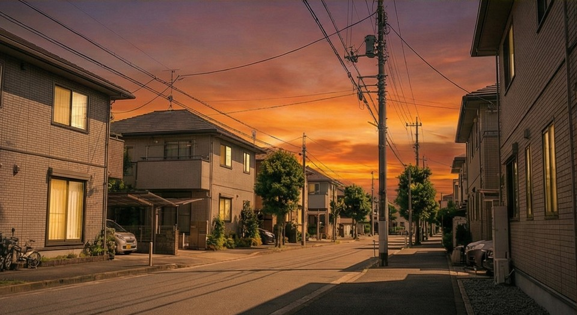
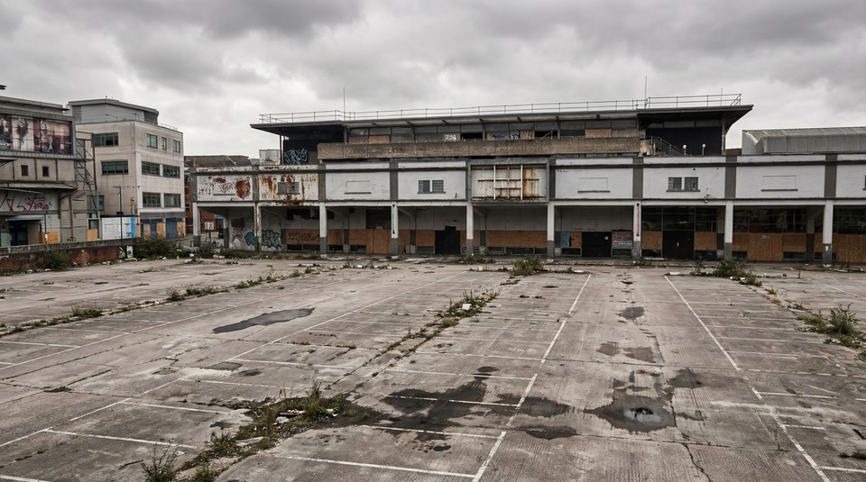

# Long-Sequence Metrics

WorldArena bundles a native `Long-Sequence` backend to extract long-horizon motion and quality signals from full prediction videos. These metrics do not only inspect single frames or adjacent frame pairs. They split a generated video into short clips, then analyze longer-range motion continuity and visual quality.

The main question is whether a generated video still preserves motion continuity and image quality over a longer horizon.

These metrics are computed prediction-only. They do not use the benchmark reference rollout or annotations. They are best used to explain long-video degradation modes such as motion collapse, abrupt temporal artifacts, or quality decay over time.

## Covered Metrics

| Metric name | Wrapped Long-Sequence dimension | Role in WorldArena |
| --- | --- | --- |
| `long_sequence_motion_smoothness` | `motion_smoothness` | motion smoothness based on video-frame-interpolation error |
| `long_sequence_dynamic_degree` | `dynamic_degree` | optical-flow-based probe for whether enough motion occurs |
| `long_sequence_aesthetic_quality` | `aesthetic_quality` | no-reference aesthetic quality |
| `long_sequence_imaging_quality` | `imaging_quality` | MUSIQ-based image clarity and degradation quality |

## Principle

Short-range metrics can miss failures that appear only after a longer rollout. The Long-Sequence backend first splits the full video into short clips, then applies native long-video routines to motion and quality dimensions.

`motion_smoothness` uses AMT-S to interpolate middle frames and compares the interpolation with real middle frames. `dynamic_degree` uses RAFT flow strength to detect whether motion is sufficiently present. `aesthetic_quality` and `imaging_quality` use no-reference quality models over clip frames.

## Detailed Algorithm

1. WorldArena reads the full prediction video and prepares a Long-Sequence input workspace.
2. `worldarena.benchmark.long_video` splits the video into `split_clip/` inputs and builds the minimal manifest required by each dimension.
3. A dispatcher routes each requested dimension to the corresponding implementation:
    - `motion_smoothness`: AMT-S interpolation, comparing predicted middle frames with real middle frames.
    - `dynamic_degree`: RAFT optical flow, counting whether high-motion transitions exceed the threshold.
    - `aesthetic_quality`: no-reference aesthetic scorer over clip frames.
    - `imaging_quality`: MUSIQ over clip frames.
4. Each WorldArena metric reads only its own wrapped dimension.
5. The wrapper records runtime metadata, including device, source root, clip count, per-video scores, and dimension-specific details.
6. Each metric is independently normalized according to the `[0, 1]` range in `config/benchmark.yaml`; all four metrics are higher-is-better.

## Key Formulas

For `motion_smoothness`, AMT-S interpolates middle frames from evenly sampled frames and compares interpolated and real middle frames using mean absolute difference:

!!! info "Motion smoothness"

    \[
    s_{\mathrm{smooth}}
    =
    \operatorname{clamp}
    \left(
        \frac{255-\operatorname{mean}(|I^{real}_{mid}-I^{interp}_{mid}|)}{255},
        0,
        1
    \right)
    \]

For `dynamic_degree`, RAFT estimates optical flow between adjacent sampled frames and uses the mean magnitude of the top 5% highest-motion pixels as the transition motion score. If enough transitions exceed the motion threshold, the clip is marked dynamic and outputs `1.0`; otherwise it outputs `0.0`.

For `aesthetic_quality` and `imaging_quality`, the backend scores frames in each clip with no-reference quality models, then averages over clips, videos, and the sample batch.

<!-- metric-examples:start -->
## Verified Same-Input Examples

Up to three cases are shown per metric. Within each case, both videos must belong to the same benchmark sample, and both first frames must pass SIFT + RANSAC geometric matching against that case's displayed input. Candidates that fail are not published. Labels compare this metric only, not overall model quality.

Audit manifest: `docs/assets/metric_examples/curated_same_case_manifest.json`.

<article class="metric-case-exhibit metric-case-exhibit--curated">
  

    <figure class="metric-input-card">
      
      <figcaption>Input image</figcaption>
    </figure>
    

      
Input verified · same benchmark case · gap 0.4214

      <h4><code>image_static_stylized_terrestrial_landscape_0001</code></h4>
      
Suite: image_staticScene: stylized / outdoor / terrestrial_landscape

      

        Benchmark prompt target
        
Camera move right. A stone church with pathway, wildflowers, and distant hills.

        <small>prompt source: prompt_target</small>
      

      
Both first frames passed geometric matching against the displayed input; labels compare this metric only.

    

  

  

    <figure class="metric-output-card metric-output-card--good">
      

        <video class="metric-output-video" controls muted loop playsinline preload="metadata" aria-label="Higher metric score: image_static_stylized_terrestrial_landscape_0001">
          <source src="../../../assets/metric_examples/5a5135ed4314__wan22-ti2v-5b-image-static-plan-missing__image_static_stylized_terrestrial_landscape_0001.mp4" type="video/mp4">
        </video>
        
Higher metric score · Score 0.8615

      

      <figcaption class="metric-output-caption"><strong>Higher metric score</strong>rollout_visual_score</figcaption>
    </figure>
    <figure class="metric-output-card metric-output-card--bad">
      

        <video class="metric-output-video" controls muted loop playsinline preload="metadata" aria-label="Lower metric score: image_static_stylized_terrestrial_landscape_0001">
          <source src="../../../assets/metric_examples/c643ca835a4a__stable_virtual_camera__image_static_stylized_terrestrial_landscape_0001.mp4" type="video/mp4">
        </video>
        
Lower metric score · Score 0.4401

      

      <figcaption class="metric-output-caption"><strong>Lower metric score</strong>rollout_visual_score</figcaption>
    </figure>
  

</article>
<article class="metric-case-exhibit metric-case-exhibit--curated">
  

    <figure class="metric-input-card">
      
      <figcaption>Input image</figcaption>
    </figure>
    

      
Input verified · same benchmark case · gap 0.4277

      <h4><code>image_static_photorealistic_suburb_0067</code></h4>
      
Suite: image_staticScene: photorealistic / outdoor / suburb

      

        Benchmark prompt target
        
Camera push in. A suburban street with house, front yard, and garden.

        <small>prompt source: prompt_target</small>
      

      
Both first frames passed geometric matching against the displayed input; labels compare this metric only.

    

  

  

    <figure class="metric-output-card metric-output-card--good">
      

        <video class="metric-output-video" controls muted loop playsinline preload="metadata" aria-label="Higher metric score: image_static_photorealistic_suburb_0067">
          <source src="../../../assets/metric_examples/41f4e3499573__ac3d-image-static__image_static_photorealistic_suburb_0067.mp4" type="video/mp4">
        </video>
        
Higher metric score · Score 0.8223

      

      <figcaption class="metric-output-caption"><strong>Higher metric score</strong>rollout_visual_score</figcaption>
    </figure>
    <figure class="metric-output-card metric-output-card--bad">
      

        <video class="metric-output-video" controls muted loop playsinline preload="metadata" aria-label="Lower metric score: image_static_photorealistic_suburb_0067">
          <source src="../../../assets/metric_examples/65b2958f9c9a__warp-as-history-image-static-8gpu-20260612_152000__image_static_photorealistic_suburb_0067.mp4" type="video/mp4">
        </video>
        
Lower metric score · Score 0.3946

      

      <figcaption class="metric-output-caption"><strong>Lower metric score</strong>rollout_visual_score</figcaption>
    </figure>
  

</article>
<article class="metric-case-exhibit metric-case-exhibit--curated">
  

    <figure class="metric-input-card">
      
      <figcaption>Input image</figcaption>
    </figure>
    

      
Input verified · same benchmark case · gap 0.3887

      <h4><code>image_static_photorealistic_city_0080</code></h4>
      
Suite: image_staticScene: photorealistic / outdoor / city

      

        Benchmark prompt target
        
Camera orbit left. An abandoned parking lot with weeds, derelict buildings, and side street.

        <small>prompt source: prompt_target</small>
      

      
Both first frames passed geometric matching against the displayed input; labels compare this metric only.

    

  

  

    <figure class="metric-output-card metric-output-card--good">
      

        <video class="metric-output-video" controls muted loop playsinline preload="metadata" aria-label="Higher metric score: image_static_photorealistic_city_0080">
          <source src="../../../assets/metric_examples/cb357d2cde00__wan22-image-static-8gpu-20260612_160808__image_static_photorealistic_city_0080.mp4" type="video/mp4">
        </video>
        
Higher metric score · Score 0.8288

      

      <figcaption class="metric-output-caption"><strong>Higher metric score</strong>rollout_visual_score</figcaption>
    </figure>
    <figure class="metric-output-card metric-output-card--bad">
      

        <video class="metric-output-video" controls muted loop playsinline preload="metadata" aria-label="Lower metric score: image_static_photorealistic_city_0080">
          <source src="../../../assets/metric_examples/da3e80c4c375__sana-wm-image-static__image_static_photorealistic_city_0080.mp4" type="video/mp4">
        </video>
        
Lower metric score · Score 0.4400

      

      <figcaption class="metric-output-caption"><strong>Lower metric score</strong>rollout_visual_score</figcaption>
    </figure>
  

</article>

<!-- metric-examples:end -->
