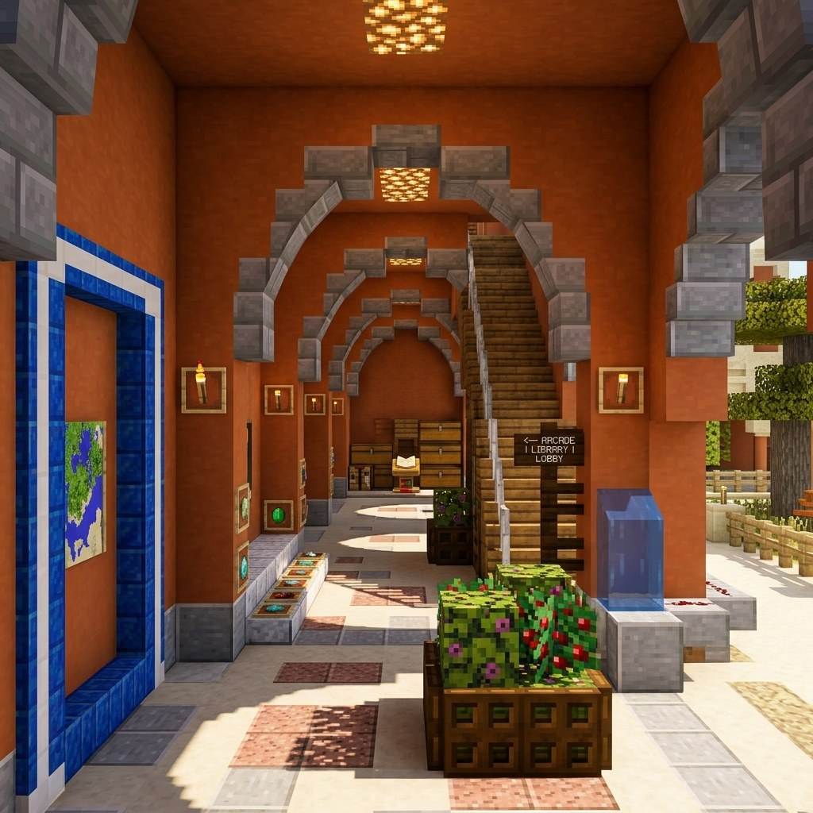
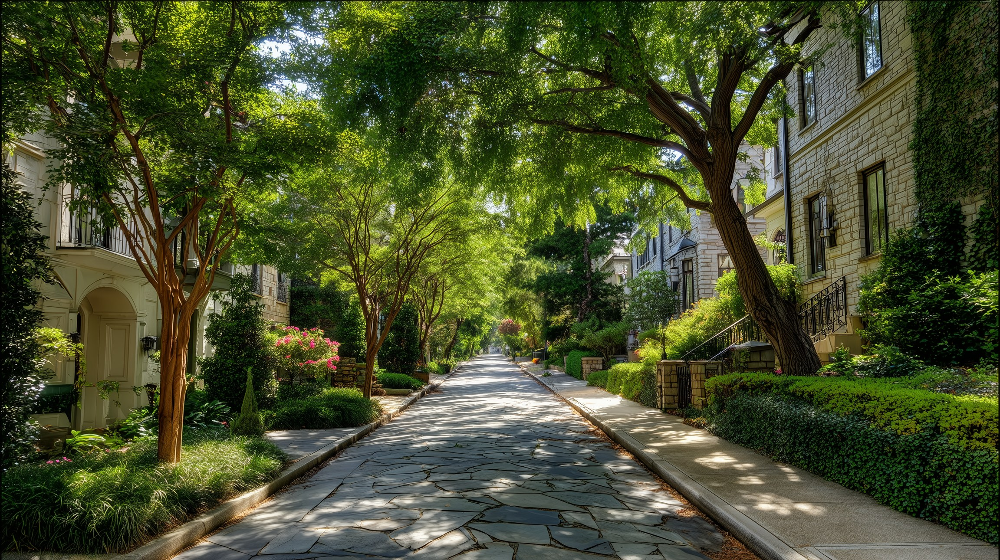
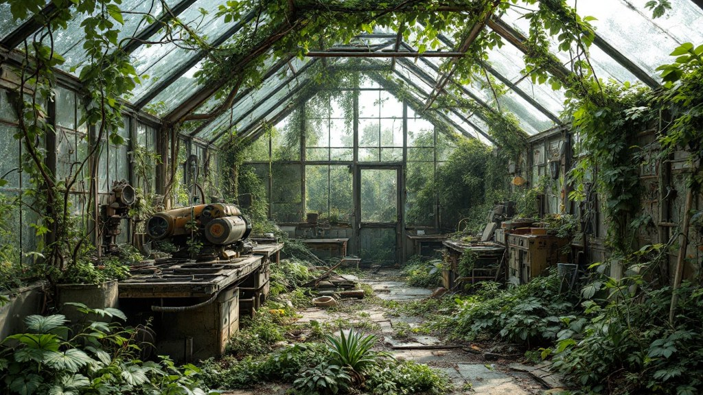

# Long Sequence Aesthetic Quality

**long_sequence_aesthetic_quality** measures **mean no-reference aesthetic appeal** over prediction frames. Each frame $I_t$ is encoded by a frozen CLIP ViT-L/14 backbone; a LAION-Aesthetics linear head produces per-frame scores normalized to $[0,1]$.

\[
S_{\mathrm{aes}} = \frac{1}{T}\sum_{t=1}^{T} s_t^{\mathrm{aes}}
\tag{1}
\]

Higher is better. Long-rollout quality signal computed prediction-only via the `long_sequence` backend (`aesthetic_quality` dimension). See [Long-Sequence Metrics](long_sequence.md) for the shared runtime.

<!-- metric-examples:start -->
## Representative Same-Case Comparisons
Each exhibit first shows the input image and the exact displayed prompt for the case, then compares generated outputs. Paired exhibits require the same input image and the same prompt text, with one high-scoring and one low-scoring model output. Metrics without such a cross-model pair in the current formal snapshot are separated as high/low extrema rather than presented as same-case comparisons.
Machine-readable paired export: `docs/assets/metric_examples/paired_manifest.csv`.
### `long_sequence_aesthetic_quality`

<article class="metric-case-exhibit">
  

    <figure class="metric-input-card">
      
      <figcaption>Input image</figcaption>
    </figure>
    

      
Case 1 · same input image + same prompt · score gap 0.3237

      <h4><code>image_static_stylized_terrestrial_landscape_0004</code></h4>
      
Suite: image_staticScene: stylized / outdoor / terrestrial_landscape

      

        Prompt target
        
Camera move right. A snowy forest with snow-covered trees, distant path, and snowy ground.

        <small>prompt source: prompt_target</small>
      

    

  

  

<figure class="metric-output-card metric-output-card--good">
  

    <video class="metric-output-video" controls muted loop playsinline preload="metadata" aria-label="Good output: image_static_stylized_terrestrial_landscape_0004">
      <source src="../../../assets/metric_examples/95a9cc54e18b__wan22-ti2v-5b-image-static-plan-missing__image_static_stylized_terrestrial_landscape_0004.mp4" type="video/mp4">
    </video>
    
Good output · Score 0.6700

  

</figure>
<figure class="metric-output-card metric-output-card--bad">
  

    <video class="metric-output-video" controls muted loop playsinline preload="metadata" aria-label="Poor output: image_static_stylized_terrestrial_landscape_0004">
      <source src="../../../assets/metric_examples/cf80f8e9ac0c__motionctrl__image_static_stylized_terrestrial_landscape_0004.mp4" type="video/mp4">
    </video>
    
Poor output · Score 0.3464

  

</figure>
  

</article>
<article class="metric-case-exhibit">
  

    <figure class="metric-input-card">
      
      <figcaption>Input image</figcaption>
    </figure>
    

      
Case 2 · same input image + same prompt · score gap 0.2892

      <h4><code>image_static_stylized_passageways_0105</code></h4>
      
Suite: image_staticScene: stylized / indoor / passageways

      

        Prompt target
        
Camera push in. A stylized indoor passageway with wooden floor, bookshelves, and reading area.

        <small>prompt source: prompt_target</small>
      

    

  

  

<figure class="metric-output-card metric-output-card--good">
  

    <video class="metric-output-video" controls muted loop playsinline preload="metadata" aria-label="Good output: image_static_stylized_passageways_0105">
      <source src="../../../assets/metric_examples/f8f86fde3531__wan22-ti2v-5b-image-static-plan-missing__image_static_stylized_passageways_0105.mp4" type="video/mp4">
    </video>
    
Good output · Score 0.5670

  

</figure>
<figure class="metric-output-card metric-output-card--bad">
  

    <video class="metric-output-video" controls muted loop playsinline preload="metadata" aria-label="Poor output: image_static_stylized_passageways_0105">
      <source src="../../../assets/metric_examples/58ddbf8228dd__motionctrl__image_static_stylized_passageways_0105.mp4" type="video/mp4">
    </video>
    
Poor output · Score 0.2777

  

</figure>
  

</article>
<article class="metric-case-exhibit">
  

    <figure class="metric-input-card">
      
      <figcaption>Input image</figcaption>
    </figure>
    

      
Case 3 · same input image + same prompt · score gap 0.2665

      <h4><code>image_static_photorealistic_terrestrial_landscape_0100</code></h4>
      
Suite: image_staticScene: photorealistic / outdoor / terrestrial_landscape

      

        Prompt target
        
Camera pan right. A mountain landscape with valley, river, and mountain peaks. Camera pull out. A mountain landscape with forest, wildlife, and deer. Camera move right. A mountain landscape with village, smoke, and chimneys.

        <small>prompt source: prompt_target</small>
      

    

  

  

<figure class="metric-output-card metric-output-card--good">
  

    <video class="metric-output-video" controls muted loop playsinline preload="metadata" aria-label="Good output: image_static_photorealistic_terrestrial_landscape_0100">
      <source src="../../../assets/metric_examples/3ef2096fbf6e__stable_virtual_camera__image_static_photorealistic_terrestrial_landscape_0100.mp4" type="video/mp4">
    </video>
    
Good output · Score 0.6438

  

</figure>
<figure class="metric-output-card metric-output-card--bad">
  

    <video class="metric-output-video" controls muted loop playsinline preload="metadata" aria-label="Poor output: image_static_photorealistic_terrestrial_landscape_0100">
      <source src="../../../assets/metric_examples/b61a742a411b__motionctrl__image_static_photorealistic_terrestrial_landscape_0100.mp4" type="video/mp4">
    </video>
    
Poor output · Score 0.3773

  

</figure>
  

</article>
<article class="metric-case-exhibit">
  

    <figure class="metric-input-card">
      
      <figcaption>Input image</figcaption>
    </figure>
    

      
Case 4 · same input image + same prompt · score gap 0.2628

      <h4><code>image_static_photorealistic_suburb_0063</code></h4>
      
Suite: image_staticScene: photorealistic / outdoor / suburb

      

        Prompt target
        
Camera pan right. A suburban street with houses, parked cars, and street signs.

        <small>prompt source: prompt_target</small>
      

    

  

  

<figure class="metric-output-card metric-output-card--good">
  

    <video class="metric-output-video" controls muted loop playsinline preload="metadata" aria-label="Good output: image_static_photorealistic_suburb_0063">
      <source src="../../../assets/metric_examples/2ad22bc01a86__wan22-ti2v-5b-image-static-plan-missing__image_static_photorealistic_suburb_0063.mp4" type="video/mp4">
    </video>
    
Good output · Score 0.5978

  

</figure>
<figure class="metric-output-card metric-output-card--bad">
  

    <video class="metric-output-video" controls muted loop playsinline preload="metadata" aria-label="Poor output: image_static_photorealistic_suburb_0063">
      <source src="../../../assets/metric_examples/ebf0aaa3ac2b__motionctrl__image_static_photorealistic_suburb_0063.mp4" type="video/mp4">
    </video>
    
Poor output · Score 0.3350

  

</figure>
  

</article>
<article class="metric-case-exhibit">
  

    <figure class="metric-input-card">
      
      <figcaption>Input image</figcaption>
    </figure>
    

      
Case 5 · same input image + same prompt · score gap 0.2586

      <h4><code>image_static_photorealistic_verdant_landscape_0080</code></h4>
      
Suite: image_staticScene: photorealistic / outdoor / verdant_landscape

      

        Prompt target
        
Camera orbit left. An overgrown greenhouse with vines, rusted tools, and workbenches.

        <small>prompt source: prompt_target</small>
      

    

  

  

<figure class="metric-output-card metric-output-card--good">
  

    <video class="metric-output-video" controls muted loop playsinline preload="metadata" aria-label="Good output: image_static_photorealistic_verdant_landscape_0080">
      <source src="../../../assets/metric_examples/1f27af206163__yume-sample5b-image-static-dynamic-5s__image_static_photorealistic_verdant_landscape_0080.mp4" type="video/mp4">
    </video>
    
Good output · Score 0.6437

  

</figure>
<figure class="metric-output-card metric-output-card--bad">
  

    <video class="metric-output-video" controls muted loop playsinline preload="metadata" aria-label="Poor output: image_static_photorealistic_verdant_landscape_0080">
      <source src="../../../assets/metric_examples/b8d768559d11__motionctrl__image_static_photorealistic_verdant_landscape_0080.mp4" type="video/mp4">
    </video>
    
Poor output · Score 0.3851

  

</figure>
  

</article>
<article class="metric-case-exhibit">
  

    <figure class="metric-input-card">
      
      <figcaption>Input image</figcaption>
    </figure>
    

      
Case 6 · same input image + same prompt · score gap 0.2425

      <h4><code>image_static_stylized_public_spaces_0115</code></h4>
      
Suite: image_staticScene: stylized / indoor / public_spaces

      

        Prompt target
        
Camera pan left. A vintage museum with display cases, historical artifacts, and inventions.

        <small>prompt source: prompt_target</small>
      

    

  

  

<figure class="metric-output-card metric-output-card--good">
  

    <video class="metric-output-video" controls muted loop playsinline preload="metadata" aria-label="Good output: image_static_stylized_public_spaces_0115">
      <source src="../../../assets/metric_examples/963841dad8d8__stable_virtual_camera__image_static_stylized_public_spaces_0115.mp4" type="video/mp4">
    </video>
    
Good output · Score 0.6808

  

</figure>
<figure class="metric-output-card metric-output-card--bad">
  

    <video class="metric-output-video" controls muted loop playsinline preload="metadata" aria-label="Poor output: image_static_stylized_public_spaces_0115">
      <source src="../../../assets/metric_examples/dfa37f7aa924__motionctrl__image_static_stylized_public_spaces_0115.mp4" type="video/mp4">
    </video>
    
Poor output · Score 0.4384

  

</figure>
  

</article>

<!-- metric-examples:end -->

## References {#reference}

!!! quote "LAION-Aesthetics Predictor (CLIP-based linear aesthetic regressor)"

    Used via pyiqa `laion_aes`; CLIP ViT-L/14 features with a linear head trained on human aesthetic ratings.
