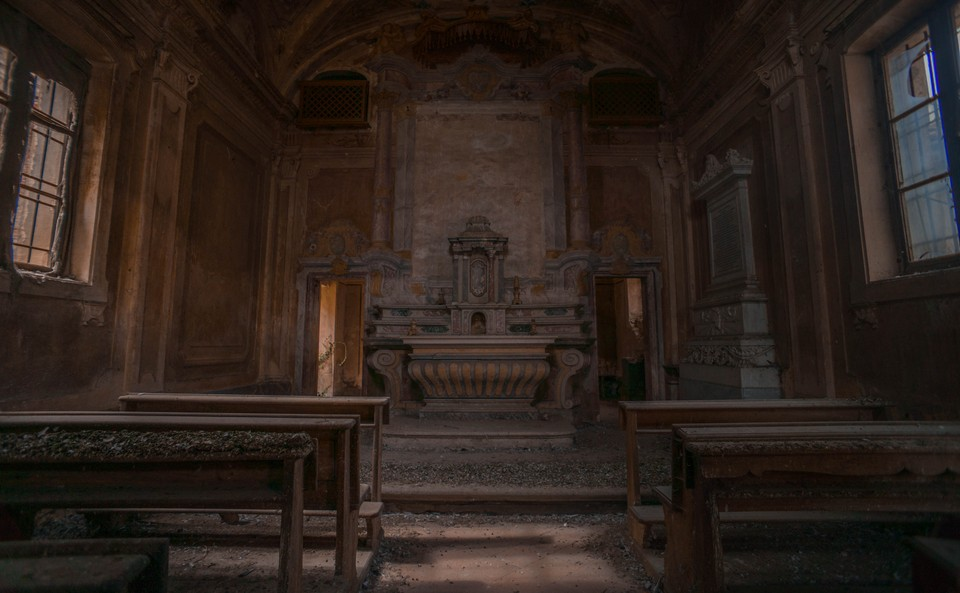
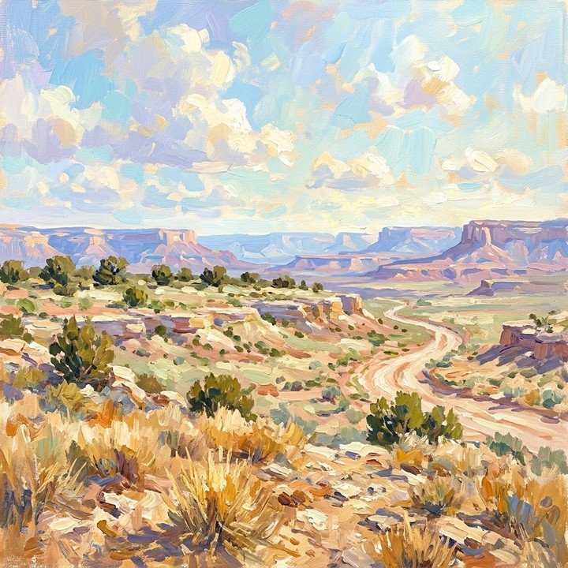

# Long Sequence Imaging Quality

**long_sequence_imaging_quality** measures **mean no-reference technical image quality** (sharpness, noise, compression artifacts) over prediction frames using MUSIQ. Native scores are divided by $100$ and averaged to $[0,1]$.

\[
S_{\mathrm{img}} = \frac{1}{T}\sum_{t=1}^{T} s_t^{\mathrm{img}}
\tag{1}
\]

Higher is better. Long-rollout quality signal computed prediction-only via the `long_sequence` backend (`imaging_quality` dimension; default MUSIQ-SPAQ weights, longer side resized to $512$). See [Long-Sequence Metrics](long_sequence.md).

<!-- metric-examples:start -->
## Verified Same-Input Examples

Up to three cases are shown per metric. Within each case, both videos must belong to the same benchmark sample, and both first frames must pass SIFT + RANSAC geometric matching against that case's displayed input. Candidates that fail are not published. Labels compare this metric only, not overall model quality.

Audit manifest: `docs/assets/metric_examples/curated_same_case_manifest.json`.

<article class="metric-case-exhibit metric-case-exhibit--curated">
  

    <figure class="metric-input-card">
      
      <figcaption>Input image</figcaption>
    </figure>
    

      
Input verified · same benchmark case · gap 0.4353

      <h4><code>image_static_photorealistic_public_spaces_0068</code></h4>
      
Suite: image_staticScene: photorealistic / indoor / public_spaces

      

        Benchmark prompt target
        
Camera push in. An abandoned chapel with altar, carvings, and faded symbols.

        <small>prompt source: prompt_target</small>
      

      
Both first frames passed geometric matching against the displayed input; labels compare this metric only.

    

  

  

    <figure class="metric-output-card metric-output-card--good">
      

        <video class="metric-output-video" controls muted loop playsinline preload="metadata" aria-label="Higher metric score: image_static_photorealistic_public_spaces_0068">
          <source src="../../../assets/metric_examples/5009426ec26e__yume-sample5b-image-static-dynamic-5s__image_static_photorealistic_public_spaces_0068.mp4" type="video/mp4">
        </video>
        
Higher metric score · Score 0.7406

      

      <figcaption class="metric-output-caption"><strong>Higher metric score</strong>long_sequence_imaging_quality</figcaption>
    </figure>
    <figure class="metric-output-card metric-output-card--bad">
      

        <video class="metric-output-video" controls muted loop playsinline preload="metadata" aria-label="Lower metric score: image_static_photorealistic_public_spaces_0068">
          <source src="../../../assets/metric_examples/a14a53e19198__warp-as-history-image-static-8gpu-20260612_152000__image_static_photorealistic_public_spaces_0068.mp4" type="video/mp4">
        </video>
        
Lower metric score · Score 0.3053

      

      <figcaption class="metric-output-caption"><strong>Lower metric score</strong>long_sequence_imaging_quality</figcaption>
    </figure>
  

</article>
<article class="metric-case-exhibit metric-case-exhibit--curated">
  

    <figure class="metric-input-card">
      
      <figcaption>Input image</figcaption>
    </figure>
    

      
Input verified · same benchmark case · gap 0.3767

      <h4><code>image_static_stylized_terrestrial_landscape_0149</code></h4>
      
Suite: image_staticScene: stylized / outdoor / terrestrial_landscape

      

        Benchmark prompt target
        
Camera pan left. A desert landscape with dry shrubs, distant mesas, and rocky terrain. Camera move left. A desert landscape with distant mesas, rocky terrain, and dry shrubs. Camera pull out. A desert landscape with open sky, distant mesas, and rocky terrain.

        <small>prompt source: prompt_target</small>
      

      
Both first frames passed geometric matching against the displayed input; labels compare this metric only.

    

  

  

    <figure class="metric-output-card metric-output-card--good">
      

        <video class="metric-output-video" controls muted loop playsinline preload="metadata" aria-label="Higher metric score: image_static_stylized_terrestrial_landscape_0149">
          <source src="../../../assets/metric_examples/476b02851a40__yume-sample5b-missing-reverse-5s-target__image_static_stylized_terrestrial_landscape_0149.mp4" type="video/mp4">
        </video>
        
Higher metric score · Score 0.7517

      

      <figcaption class="metric-output-caption"><strong>Higher metric score</strong>long_sequence_imaging_quality</figcaption>
    </figure>
    <figure class="metric-output-card metric-output-card--bad">
      

        <video class="metric-output-video" controls muted loop playsinline preload="metadata" aria-label="Lower metric score: image_static_stylized_terrestrial_landscape_0149">
          <source src="../../../assets/metric_examples/30b3f591dec6__matrix_game2_5s__image_static_stylized_terrestrial_landscape_0149.mp4" type="video/mp4">
        </video>
        
Lower metric score · Score 0.3750

      

      <figcaption class="metric-output-caption"><strong>Lower metric score</strong>long_sequence_imaging_quality</figcaption>
    </figure>
  

</article>

<!-- metric-examples:end -->

## References {#reference}

!!! quote "MUSIQ: Multi-scale Image Quality Transformer"

    Zejiang Hou, Hui Ren, Ming Sun, Jiahao Li, Weining Wang.  
    ICCV 2021.  
    [https://arxiv.org/abs/2108.05997](https://arxiv.org/abs/2108.05997)
