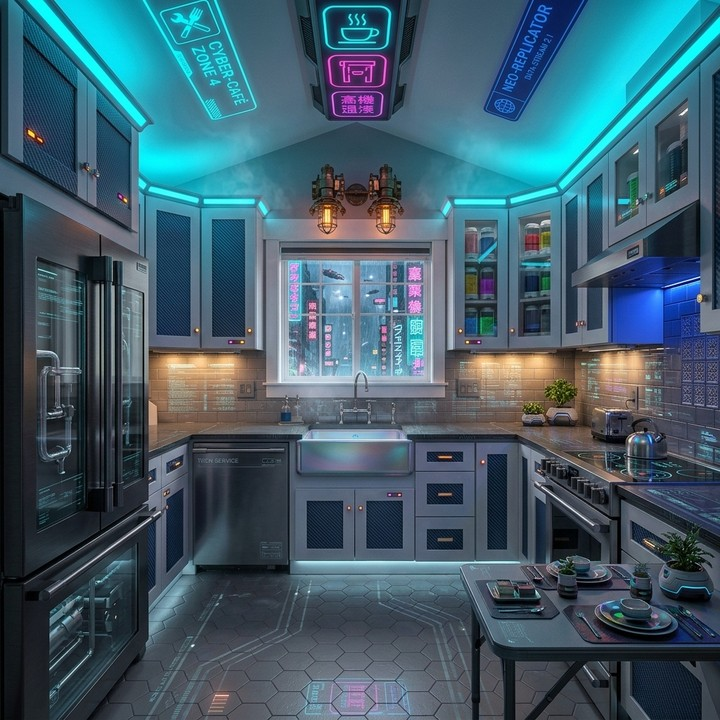
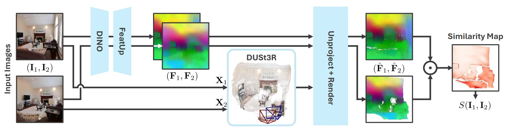

# MEt3R Consistency

**met3r_consistency** is built on MEt3R [[Asim et al., 2025](#reference)] and measures **multi-view 3D consistency between reference and prediction views** at benchmark protocol anchor positions. It asks whether two frames describe the same scene geometrically—for example, whether the same wall, object contour, or depth layout can be mutually explained across both views—rather than whether pixels match ground truth or whether the image simply looks good.

As image and video diffusion models are repurposed for novel-view synthesis and camera-trajectory generation, evaluation increasingly needs a consistency metric that does **not** rely on paired sampling ground truth and does **not** require known camera poses. FID and FVD measure distributional similarity to training data, while epipolar metrics such as TSED and SED usually need relative poses and can be overly sensitive to small geometric violations while missing obvious structural drift. MEt3R is designed to provide a continuous, interpretable 3D-consistency signal without pose inputs, and to stay orthogonal to image-quality metrics.

For any image pair \(I_1, I_2\), MEt3R first uses DUSt3R to recover pixel-aligned dense point maps expressed in a shared camera frame. It then extracts DINO features, upsamples them with FeatUp, projects them into a shared view, and compares feature cosine similarity \(S(I_1, I_2)\) on the valid overlap region. Feature-space comparison reduces sensitivity to view-dependent effects such as lighting and exposure, and is less likely than flow-warped PSNR/SSIM to treat blur as higher consistency. The MEt3R score is

\[
\mathrm{MEt3R}(I_1, I_2)
=
1 - \frac{1}{2}\big(S(I_1, I_2) + S(I_2, I_1)\big)
\tag{1}
\]

The raw score lies in \([0, 2]\), with **lower being better**. Real videos usually form a lower bound slightly above zero due to DUSt3R alignment error, while clearly inconsistent generations receive substantially higher scores.

In WorldArena, the runtime sends reference anchor frames and prediction anchor frames through the wrapped MEt3R model in pairs at the benchmark protocol positions, with defaults `backbone = mast3r` and `distance = cosine`. The raw score is the mean over anchor pairs and is reverse-normalized from \([0, 2]\) to \([0, 1]\) (higher normalized score means better consistency). If a pair has almost no valid overlap, it receives the worst raw value for the configured distance rather than being treated as a perfect match. When MEt3R computation succeeds, the metric is **official** in all formal suites and enters the `consistency_3d_4d` aggregate. It complements geometry supervision, but does not replace ground-truth geometry metrics such as camera error or reprojection error.

<!-- met3r-representative-cases:start -->
## Representative MEt3R Comparisons

These representative comparisons were selected from the official 2026-07-17 `image_static` MEt3R snapshot and manually reviewed as frame strips. Each exhibit fixes one benchmark case—input image and eval-plan prompt target—and compares two prediction videos. The normalized MEt3R score is higher-is-better; raw MEt3R distance is lower-is-better.

Adapter-specific conditioning may differ, so these are metric diagnostics rather than controlled model rankings. Exact paths, hashes, overlap values, and report provenance are in the [machine-readable MEt3R manifest](../../../assets/metric_examples/met3r_representative_manifest.csv).

<div class="metric-case-stack">
<article class="metric-case-exhibit">
  <div class="metric-case-context">
    <figure class="metric-input-card">
      
      <figcaption>Input image</figcaption>
    </figure>
    <div class="metric-case-copy">
      <div class="metric-case-kicker">Case 1 · visible structural drift lowers multi-view consistency</div>
      <h4><code>image_static_stylized_dining_spaces_0115</code></h4>
      <div class="metric-case-meta"><span>image_static</span><span>stylized / indoor / dining_spaces</span></div>
      <div class="metric-case-prompt">
        <span>Benchmark prompt target</span>
        <p>Camera pan right. A futuristic dining area with dining table, chairs, and digital displays. Camera pull out. A futuristic living room with sofa, digital screens, and neon accents. Camera move right. A futuristic balcony with neon signs, railing, and skyscrapers.</p>
      </div>
      <p class="metric-case-note">Output A follows the requested scene progression with stable, well-defined structure at the evaluated anchor. Output B develops translucent duplicate contours and warped room geometry; valid overlap drops and raw MEt3R distance rises.</p>
    </div>
  </div>
  <div class="metric-output-grid">
    <figure class="metric-output-card">
      <div class="metric-output-media-wrap">
        <video class="metric-output-video" controls muted loop playsinline preload="metadata" aria-label="Output A: LongCat-Video, stylized dining space 0115">
          <source src="../../../assets/metric_examples/5842a0b01dda__longcat-video-image-static-8gpu-20260612_133950__image_static_stylized_dining_spaces_0115.mp4" type="video/mp4">
        </video>
      </div>
      <figcaption class="metric-output-caption">
        <strong>Output A</strong>
        <span>MEt3R: <strong>0.9823</strong> normalized · 0.0354 raw · 0.9388 overlap</span>
      </figcaption>
    </figure>
    <figure class="metric-output-card">
      <div class="metric-output-media-wrap">
        <video class="metric-output-video" controls muted loop playsinline preload="metadata" aria-label="Output B: AC3D, stylized dining space 0115">
          <source src="../../../assets/metric_examples/d47ca5e1e3f1__ac3d-image-static__image_static_stylized_dining_spaces_0115.mp4" type="video/mp4">
        </video>
      </div>
      <figcaption class="metric-output-caption">
        <strong>Output B</strong>
        <span>MEt3R: <strong>0.5737</strong> normalized · 0.8527 raw · 0.4778 overlap</span>
      </figcaption>
    </figure>
  </div>
</article>

<article class="metric-case-exhibit">
  <div class="metric-case-context">
    <figure class="metric-input-card">
      
      <figcaption>Input image</figcaption>
    </figure>
    <div class="metric-case-copy">
      <div class="metric-case-kicker">Case 2 · low anchor overlap after an abrupt view change</div>
      <h4><code>image_static_photorealistic_aquatic_landscape_0006</code></h4>
      <div class="metric-case-meta"><span>image_static</span><span>photorealistic / outdoor / aquatic_landscape</span></div>
      <div class="metric-case-prompt">
        <span>Benchmark prompt target</span>
        <p>Camera pull out. A forest edge with rocky shore and trees. Camera pan right. A forest edge with open meadow, grassy field, and distant hills. Camera move right. A hiking trail with path through trees and small clearing.</p>
      </div>
      <p class="metric-case-note">Output A changes viewpoint gradually while retaining mountain, treeline, and shore structure. Output B jumps more abruptly toward the trail; at the evaluated anchor, valid projected overlap falls to 0.0529 and raw MEt3R distance increases.</p>
    </div>
  </div>
  <div class="metric-output-grid">
    <figure class="metric-output-card">
      <div class="metric-output-media-wrap">
        <video class="metric-output-video" controls muted loop playsinline preload="metadata" aria-label="Output A: AC3D, aquatic landscape 0006">
          <source src="../../../assets/metric_examples/4d5bdc0d37b0__ac3d-image-static__image_static_photorealistic_aquatic_landscape_0006.mp4" type="video/mp4">
        </video>
      </div>
      <figcaption class="metric-output-caption">
        <strong>Output A</strong>
        <span>MEt3R: <strong>0.9559</strong> normalized · 0.0883 raw · 0.8652 overlap</span>
      </figcaption>
    </figure>
    <figure class="metric-output-card">
      <div class="metric-output-media-wrap">
        <video class="metric-output-video" controls muted loop playsinline preload="metadata" aria-label="Output B: LongCat-Video, aquatic landscape 0006">
          <source src="../../../assets/metric_examples/4043d273f2b0__longcat-video-image-static-8gpu-20260612_133950__image_static_photorealistic_aquatic_landscape_0006.mp4" type="video/mp4">
        </video>
      </div>
      <figcaption class="metric-output-caption">
        <strong>Output B</strong>
        <span>MEt3R: <strong>0.7167</strong> normalized · 0.5666 raw · 0.0529 overlap</span>
      </figcaption>
    </figure>
  </div>
</article>

<article class="metric-case-exhibit">
  <div class="metric-case-context">
    <figure class="metric-input-card">
      
      <figcaption>Input image</figcaption>
    </figure>
    <div class="metric-case-copy">
      <div class="metric-case-kicker">Case 3 · similar anchor consistency under different motion amounts</div>
      <h4><code>image_static_photorealistic_living_spaces_0140</code></h4>
      <div class="metric-case-meta"><span>image_static</span><span>photorealistic / indoor / living_spaces</span></div>
      <div class="metric-case-prompt">
        <span>Benchmark prompt target</span>
        <p>Camera push in. A living room with sofa, bookshelf, and books.</p>
      </div>
      <p class="metric-case-note">Output A moves little, while Output B makes a larger smooth camera move and reveals the bookshelf. At the evaluated MEt3R anchor, both retain high feature and projected-view consistency and therefore receive almost identical scores.</p>
    </div>
  </div>
  <div class="metric-output-grid">
    <figure class="metric-output-card">
      <div class="metric-output-media-wrap">
        <video class="metric-output-video" controls muted loop playsinline preload="metadata" aria-label="Output A: ac3d-image-static, living space 0140">
          <source src="../../../assets/metric_examples/3a76d4fa805b__ac3d-image-static__image_static_photorealistic_living_spaces_0140.mp4" type="video/mp4">
        </video>
      </div>
      <figcaption class="metric-output-caption">
        <strong>Output A</strong>
        <span>MEt3R: <strong>0.9957</strong> normalized · 0.0087 raw · 0.5406 overlap</span>
      </figcaption>
    </figure>
    <figure class="metric-output-card">
      <div class="metric-output-media-wrap">
        <video class="metric-output-video" controls muted loop playsinline preload="metadata" aria-label="Output B: LongCat-Video, living space 0140">
          <source src="../../../assets/metric_examples/d43209bc4d20__longcat-video-image-static-8gpu-20260612_133950__image_static_photorealistic_living_spaces_0140.mp4" type="video/mp4">
        </video>
      </div>
      <figcaption class="metric-output-caption">
        <strong>Output B</strong>
        <span>MEt3R: <strong>0.9972</strong> normalized · 0.0055 raw · 0.5455 overlap</span>
      </figcaption>
    </figure>
  </div>
</article>

</div>
<!-- met3r-representative-cases:end -->

<figure markdown="span">
  
  <figcaption>MEt3R measures multi-view consistency in generated images through geometric and representation consistency across views.</figcaption>
</figure>

## Reference {#reference}

!!! quote "MEt3R: Measuring Multi-View Consistency in Generated Images"

    Mohammad Asim, Christopher Wewer, Thomas Wimmer, Bernt Schiele, and Jan Eric Lenssen.  
    IEEE/CVF Conference on Computer Vision and Pattern Recognition (CVPR), 2025.

??? note "BibTeX"

    ```bibtex
    @inproceedings{asim25met3r,
        title = {MEt3R: Measuring Multi-View Consistency in Generated Images},
        author = {Asim, Mohammad and Wewer, Christopher and Wimmer, Thomas and Schiele, Bernt and Lenssen, Jan Eric},
        booktitle = {IEEE/CVF Computer Vision and Pattern Recognition ({CVPR})},
        year = {2025},
    }
    ```
