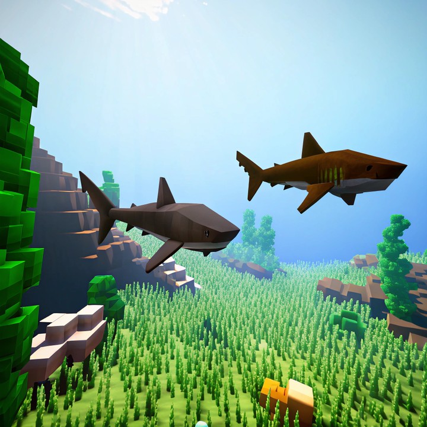

# Motion Accuracy

Motion Accuracy measures **foreground motion salience** inside supervised dynamic regions. SAM2 propagates initial segmentation masks through the prediction; SEA-RAFT estimates optical flow between consecutive frames. The metric tests whether masked object regions exhibit stronger motion than the background—it does **not** compare realized motion to a target trajectory, direction, or velocity profile.

For consecutive frame pair \((I_t, I_{t+1})\), let \(\mathbf{u}_t\) be the optical-flow field and \(M_t\) the propagated (dilated) object mask. Define magnitude \(m_t = \|\mathbf{u}_t\|_2\) and

\[
\Delta_t = \max_{p \in M_t} m_t(p) - \max_{p \notin M_t} m_t(p)
\tag{1}
\]

The raw score is the mean salience over all pairs:

\[
S_{\mathrm{mot}}^{\mathrm{raw}} = \frac{1}{N-1}\sum_{t=1}^{N-1} \Delta_t
\tag{2}
\]

WorldArena applies z-score calibration with \(\mu = -0.1965\), \(\sigma = 2.3687\), clip bounds \([-1.6147, 1.5180]\), and maps to \([0.25, 0.75]\). Higher normalized scores indicate stronger mask-conditioned motion relative to background. The metric is **official** when per-frame segmentation masks are available under `sample.mask_path`.

<!-- metric-examples:start -->
## Verified Same-Input Examples

Up to three cases are shown per metric. Within each case, both videos must belong to the same benchmark sample, and both first frames must pass SIFT + RANSAC geometric matching against that case's displayed input. Candidates that fail are not published. Labels compare this metric only, not overall model quality.

Audit manifest: `docs/assets/metric_examples/curated_same_case_manifest.json`.

<article class="metric-case-exhibit metric-case-exhibit--curated">
  

    <figure class="metric-input-card">
      
      <figcaption>Input image</figcaption>
    </figure>
    

      
Input verified · same benchmark case · gap 0.8369

      <h4><code>image_dynamic_photorealistic_articulated_0061</code></h4>
      
Suite: image_dynamicScene: photorealistic / articulated

      

        Benchmark prompt target
        
Camera fixed. Two tigers stir on the rocky ledges; the upper tiger stretches a foreleg while the lower tiger turns its head and flicks its ears. The rugged enclosure rocks stay unchanged.

        <small>prompt source: prompt_target</small>
      

      
Both first frames passed geometric matching against the displayed input; labels compare this metric only.

    

  

  

    <figure class="metric-output-card metric-output-card--good">
      

        <video class="metric-output-video" controls muted loop playsinline preload="metadata" aria-label="Higher metric score: image_dynamic_photorealistic_articulated_0061">
          <source src="../../../assets/metric_examples/curated_20260801/d37481d48321__image_dynamic_photorealistic_articulated_0061__high.mp4" type="video/mp4">
        </video>
        
Higher metric score · Score 0.8448

      

      <figcaption class="metric-output-caption"><strong>Higher metric score</strong>motion_accuracy</figcaption>
    </figure>
    <figure class="metric-output-card metric-output-card--bad">
      

        <video class="metric-output-video" controls muted loop playsinline preload="metadata" aria-label="Lower metric score: image_dynamic_photorealistic_articulated_0061">
          <source src="../../../assets/metric_examples/curated_20260801/5763f5cf2870__image_dynamic_photorealistic_articulated_0061__low.mp4" type="video/mp4">
        </video>
        
Lower metric score · Score 0.0079

      

      <figcaption class="metric-output-caption"><strong>Lower metric score</strong>motion_accuracy</figcaption>
    </figure>
  

</article>
<article class="metric-case-exhibit metric-case-exhibit--curated">
  

    <figure class="metric-input-card">
      
      <figcaption>Input image</figcaption>
    </figure>
    

      
Input verified · same benchmark case · gap 0.7946

      <h4><code>image_dynamic_stylized_deformable_0031</code></h4>
      
Suite: image_dynamicScene: stylized / deformable

      

        Benchmark prompt target
        
Camera fixed. A blocky octopus emerges from the pixelated water near the sandy shore, its tentacles spread outward around its large eyes. The water, grass, and blocky trees remain calm.

        <small>prompt source: prompt_target</small>
      

      
Both first frames passed geometric matching against the displayed input; labels compare this metric only.

    

  

  

    <figure class="metric-output-card metric-output-card--good">
      

        <video class="metric-output-video" controls muted loop playsinline preload="metadata" aria-label="Higher metric score: image_dynamic_stylized_deformable_0031">
          <source src="../../../assets/metric_examples/curated_20260801/fb6e4230eb82__image_dynamic_stylized_deformable_0031__high.mp4" type="video/mp4">
        </video>
        
Higher metric score · Score 0.9839

      

      <figcaption class="metric-output-caption"><strong>Higher metric score</strong>motion_accuracy</figcaption>
    </figure>
    <figure class="metric-output-card metric-output-card--bad">
      

        <video class="metric-output-video" controls muted loop playsinline preload="metadata" aria-label="Lower metric score: image_dynamic_stylized_deformable_0031">
          <source src="../../../assets/metric_examples/curated_20260801/8c91865b7966__image_dynamic_stylized_deformable_0031__low.mp4" type="video/mp4">
        </video>
        
Lower metric score · Score 0.1893

      

      <figcaption class="metric-output-caption"><strong>Lower metric score</strong>motion_accuracy</figcaption>
    </figure>
  

</article>
<article class="metric-case-exhibit metric-case-exhibit--curated">
  

    <figure class="metric-input-card">
      
      <figcaption>Input image</figcaption>
    </figure>
    

      
Input verified · same benchmark case · gap 0.8605

      <h4><code>image_dynamic_stylized_articulated_0020</code></h4>
      
Suite: image_dynamicScene: stylized / articulated

      

        Benchmark prompt target
        
Camera fixed. Two stylized sharks glide over the underwater landscape, their tails sweeping gently as they pass seaweed and rocky formations. Sunlight filters through the clear water while the seabed remains steady.

        <small>prompt source: prompt_target</small>
      

      
Both first frames passed geometric matching against the displayed input; labels compare this metric only.

    

  

  

    <figure class="metric-output-card metric-output-card--good">
      

        <video class="metric-output-video" controls muted loop playsinline preload="metadata" aria-label="Higher metric score: image_dynamic_stylized_articulated_0020">
          <source src="../../../assets/metric_examples/curated_20260801/ceb76b5f7507__image_dynamic_stylized_articulated_0020__high.mp4" type="video/mp4">
        </video>
        
Higher metric score · Score 0.9535

      

      <figcaption class="metric-output-caption"><strong>Higher metric score</strong>motion_accuracy</figcaption>
    </figure>
    <figure class="metric-output-card metric-output-card--bad">
      

        <video class="metric-output-video" controls muted loop playsinline preload="metadata" aria-label="Lower metric score: image_dynamic_stylized_articulated_0020">
          <source src="../../../assets/metric_examples/curated_20260801/8f5a70ee480e__image_dynamic_stylized_articulated_0020__low.mp4" type="video/mp4">
        </video>
        
Lower metric score · Score 0.0930

      

      <figcaption class="metric-output-caption"><strong>Lower metric score</strong>motion_accuracy</figcaption>
    </figure>
  

</article>

<!-- metric-examples:end -->

## References {#reference}

!!! quote "SAM 2 — Segment Anything in Images and Videos"

    Ravi et al., 2024.
    [https://arxiv.org/abs/2408.00714](https://arxiv.org/abs/2408.00714)

!!! quote "SEA-RAFT — Simple, Efficient, Accurate RAFT for Optical Flow"

    Wang et al., 2024.
    [https://arxiv.org/abs/2405.14793](https://arxiv.org/abs/2405.14793)
