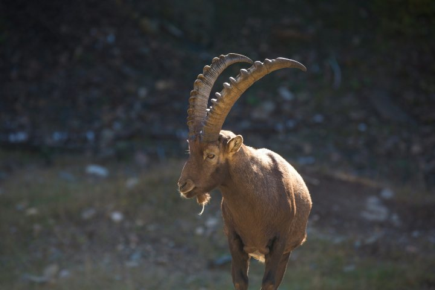
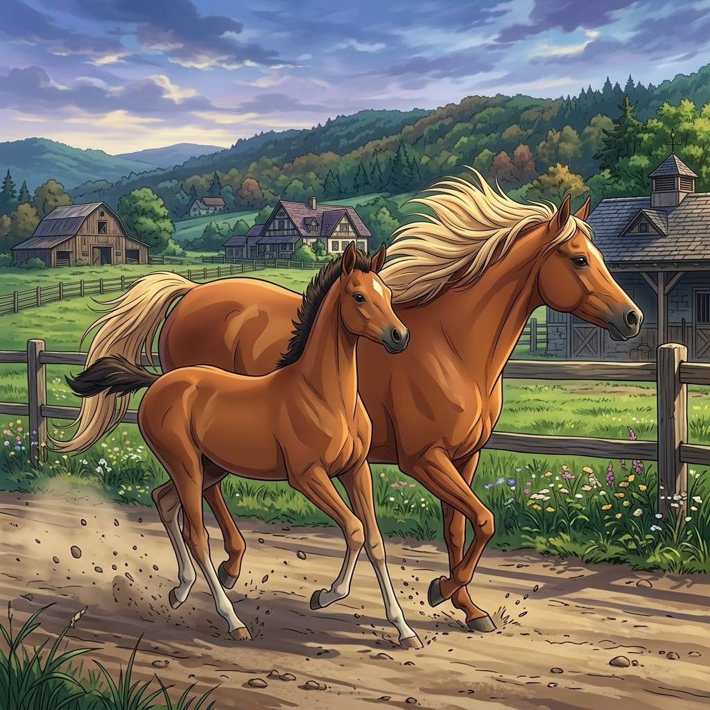
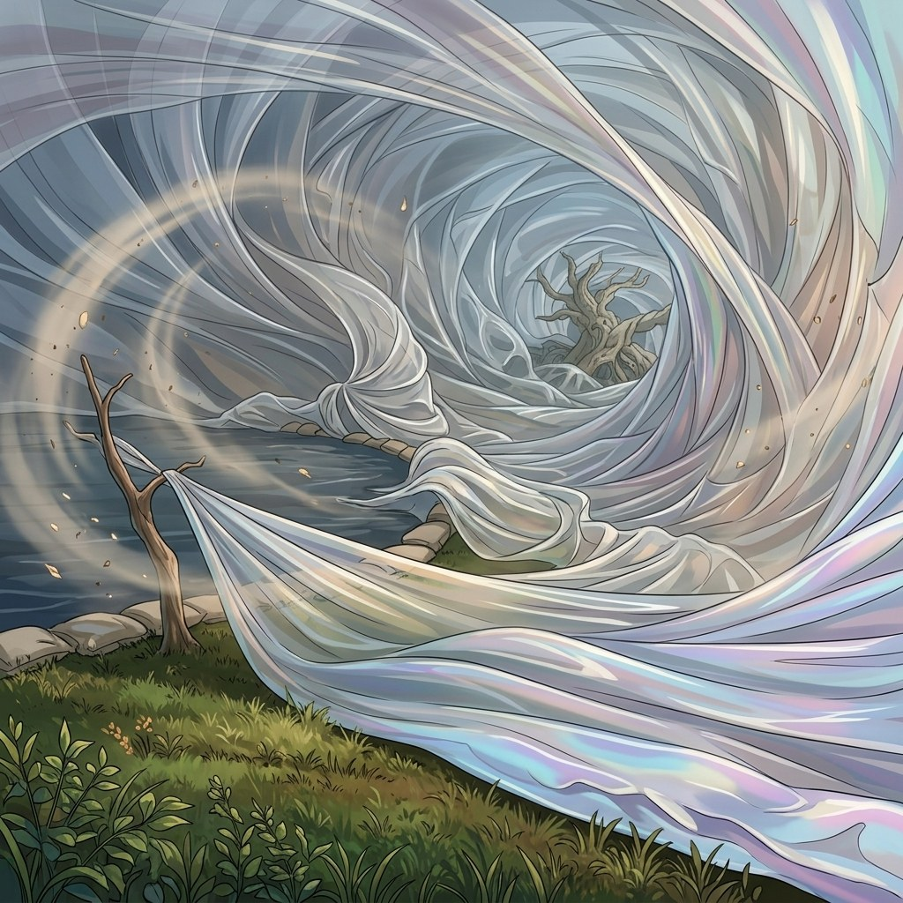

# Motion Accuracy

Motion Accuracy measures **foreground motion salience** inside supervised dynamic regions. SAM2 propagates initial segmentation masks through the prediction; SEA-RAFT estimates optical flow between consecutive frames. The metric tests whether masked object regions exhibit stronger motion than the background—it does **not** compare realized motion to a target trajectory, direction, or velocity profile.

For consecutive frame pair \((I_t, I_{t+1})\), let \(\mathbf{u}_t\) be the optical-flow field and \(M_t\) the propagated (dilated) object mask. Define magnitude \(m_t = \|\mathbf{u}_t\|_2\) and

\[
\Delta_t = \max_{p \in M_t} m_t(p) - \max_{p \notin M_t} m_t(p)
\tag{1}
\]

The raw score is the mean salience over all pairs:

\[
S_{\mathrm{mot}}^{\mathrm{raw}} = \frac{1}{N-1}\sum_{t=1}^{N-1} \Delta_t
\tag{2}
\]

WorldArena applies z-score calibration with \(\mu = -0.1965\), \(\sigma = 2.3687\), clip bounds \([-1.6147, 1.5180]\), and maps to \([0.25, 0.75]\). Higher normalized scores indicate stronger mask-conditioned motion relative to background. The metric is **official** when per-frame segmentation masks are available under `sample.mask_path`.

<!-- metric-examples:start -->
## Representative Same-Case Comparisons
Each exhibit first shows the input image and the exact displayed prompt for the case, then compares generated outputs. Paired exhibits require the same input image and the same prompt text, with one high-scoring and one low-scoring model output. Metrics without such a cross-model pair in the current formal snapshot are separated as high/low extrema rather than presented as same-case comparisons.
Machine-readable paired export: `docs/assets/metric_examples/paired_manifest.csv`.
### `motion_accuracy`

<article class="metric-case-exhibit">
  

    <figure class="metric-input-card">
      
      <figcaption>Input image</figcaption>
    </figure>
    

      
Case 1 · same input image + same prompt · score gap 1.0000

      <h4><code>image_dynamic_photorealistic_articulated_0031</code></h4>
      
Suite: image_dynamicScene: photorealistic

      

        Prompt target
        
Camera fixed. The ibex steps over the sunlit rocky terrain, bending its knees and lowering its curved horns as it navigates patches of grass. The earthy background remains stable.

        <small>prompt source: prompt_target</small>
      

    

  

  

<figure class="metric-output-card metric-output-card--good">
  

    <video class="metric-output-video" controls muted loop playsinline preload="metadata" aria-label="Good output: yume-sample5b-image-dynamic-5s image_dynamic_photorealistic_articulated_0031">
      <source src="../../../assets/metric_examples/93d9df1827ff__yume-sample5b-image-dynamic-5s__image_dynamic_photorealistic_articulated_0031.mp4" type="video/mp4">
    </video>
    
Good output · Score 1.0000

  

</figure>
<figure class="metric-output-card metric-output-card--bad">
  

    <video class="metric-output-video" controls muted loop playsinline preload="metadata" aria-label="Poor output: ltx23-image-dynamic-8gpu-full_20260702_233041 image_dynamic_photorealistic_articulated_0031">
      <source src="../../../assets/metric_examples/8731ae302368__ltx23-image-dynamic-8gpu-full_20260702_233041__image_dynamic_photorealistic_articulated_0031.mp4" type="video/mp4">
    </video>
    
Poor output · Score 0.0000

  

</figure>
  

</article>
<article class="metric-case-exhibit">
  

    <figure class="metric-input-card">
      
      <figcaption>Input image</figcaption>
    </figure>
    

      
Case 2 · same input image + same prompt · score gap 1.0000

      <h4><code>image_dynamic_photorealistic_articulated_0065</code></h4>
      
Suite: image_dynamicScene: photorealistic

      

        Prompt target
        
Camera fixed. The elephant steps through savanna grass, swinging its trunk and flapping its ears while sunlight highlights its tusks. Acacia trees and the clear sky remain stable.

        <small>prompt source: prompt_target</small>
      

    

  

  

<figure class="metric-output-card metric-output-card--good">
  

    <video class="metric-output-video" controls muted loop playsinline preload="metadata" aria-label="Good output: longcat-video-image-dynamic image_dynamic_photorealistic_articulated_0065">
      <source src="../../../assets/metric_examples/a793606886de__longcat-video-image-dynamic__image_dynamic_photorealistic_articulated_0065.mp4" type="video/mp4">
    </video>
    
Good output · Score 1.0000

  

</figure>
<figure class="metric-output-card metric-output-card--bad">
  

    <video class="metric-output-video" controls muted loop playsinline preload="metadata" aria-label="Poor output: echo-infinity-image-dynamic image_dynamic_photorealistic_articulated_0065">
      <source src="../../../assets/metric_examples/b55b5fe13514__echo-infinity-image-dynamic__image_dynamic_photorealistic_articulated_0065.mp4" type="video/mp4">
    </video>
    
Poor output · Score 0.0000

  

</figure>
  

</article>
<article class="metric-case-exhibit">
  

    <figure class="metric-input-card">
      
      <figcaption>Input image</figcaption>
    </figure>
    

      
Case 3 · same input image + same prompt · score gap 1.0000

      <h4><code>image_dynamic_photorealistic_deformable_0152</code></h4>
      
Suite: image_dynamicScene: photorealistic

      

        Prompt target
        
Camera fixed. The suspended white fabric undulates in slow waves, folding and unfurling along its silky edges. Its overall position stays centered against the blue-gray gradient background.

        <small>prompt source: prompt_target</small>
      

    

  

  

<figure class="metric-output-card metric-output-card--good">
  

    <video class="metric-output-video" controls muted loop playsinline preload="metadata" aria-label="Good output: echo-infinity-image-dynamic image_dynamic_photorealistic_deformable_0152">
      <source src="../../../assets/metric_examples/13447b8c023e__echo-infinity-image-dynamic__image_dynamic_photorealistic_deformable_0152.mp4" type="video/mp4">
    </video>
    
Good output · Score 1.0000

  

</figure>
<figure class="metric-output-card metric-output-card--bad">
  

    <video class="metric-output-video" controls muted loop playsinline preload="metadata" aria-label="Poor output: sana-wm-image-dynamic image_dynamic_photorealistic_deformable_0152">
      <source src="../../../assets/metric_examples/a4db33c6a26d__sana-wm-image-dynamic__image_dynamic_photorealistic_deformable_0152.mp4" type="video/mp4">
    </video>
    
Poor output · Score 0.0000

  

</figure>
  

</article>
<article class="metric-case-exhibit">
  

    <figure class="metric-input-card">
      
      <figcaption>Input image</figcaption>
    </figure>
    

      
Case 4 · same input image + same prompt · score gap 1.0000

      <h4><code>image_dynamic_photorealistic_rigid_0104</code></h4>
      
Suite: image_dynamicScene: photorealistic

      

        Prompt target
        
Camera fixed. The helicopter flies low over the calm sea, moving across the open water with its body level. Cargo ships, distant hills, and the clear sky remain steady in the background.

        <small>prompt source: prompt_target</small>
      

    

  

  

<figure class="metric-output-card metric-output-card--good">
  

    <video class="metric-output-video" controls muted loop playsinline preload="metadata" aria-label="Good output: echo-infinity-image-dynamic image_dynamic_photorealistic_rigid_0104">
      <source src="../../../assets/metric_examples/2030d2058a70__echo-infinity-image-dynamic__image_dynamic_photorealistic_rigid_0104.mp4" type="video/mp4">
    </video>
    
Good output · Score 1.0000

  

</figure>
<figure class="metric-output-card metric-output-card--bad">
  

    <video class="metric-output-video" controls muted loop playsinline preload="metadata" aria-label="Poor output: yume-sample5b-image-dynamic-5s image_dynamic_photorealistic_rigid_0104">
      <source src="../../../assets/metric_examples/ba4163c69f03__yume-sample5b-image-dynamic-5s__image_dynamic_photorealistic_rigid_0104.mp4" type="video/mp4">
    </video>
    
Poor output · Score 0.0000

  

</figure>
  

</article>
<article class="metric-case-exhibit">
  

    <figure class="metric-input-card">
      
      <figcaption>Input image</figcaption>
    </figure>
    

      
Case 5 · same input image + same prompt · score gap 1.0000

      <h4><code>image_dynamic_stylized_articulated_0114</code></h4>
      
Suite: image_dynamicScene: stylized

      

        Prompt target
        
Camera fixed. The adult horse and foal run side by side along the dirt path, legs alternating, manes and tails streaming while fences, farm buildings, hills, and trees remain still.

        <small>prompt source: prompt_target</small>
      

    

  

  

<figure class="metric-output-card metric-output-card--good">
  

    <video class="metric-output-video" controls muted loop playsinline preload="metadata" aria-label="Good output: yume-sample5b-image-dynamic-5s image_dynamic_stylized_articulated_0114">
      <source src="../../../assets/metric_examples/74b0886de041__yume-sample5b-image-dynamic-5s__image_dynamic_stylized_articulated_0114.mp4" type="video/mp4">
    </video>
    
Good output · Score 1.0000

  

</figure>
<figure class="metric-output-card metric-output-card--bad">
  

    <video class="metric-output-video" controls muted loop playsinline preload="metadata" aria-label="Poor output: lingbot_world image_dynamic_stylized_articulated_0114">
      <source src="../../../assets/metric_examples/3d3f5820d0fa__lingbot_world__image_dynamic_stylized_articulated_0114.mp4" type="video/mp4">
    </video>
    
Poor output · Score 0.0000

  

</figure>
  

</article>
<article class="metric-case-exhibit">
  

    <figure class="metric-input-card">
      
      <figcaption>Input image</figcaption>
    </figure>
    

      
Case 6 · same input image + same prompt · score gap 1.0000

      <h4><code>image_dynamic_stylized_deformable_0105</code></h4>
      
Suite: image_dynamicScene: stylized

      

        Prompt target
        
Camera fixed. Wide sheets of fabric spiral around the barren tree, folding, twisting, and tightening into a vortex above the pond. The tree trunk, grass, scattered leaves, and pond edge stay stable.

        <small>prompt source: prompt_target</small>
      

    

  

  

<figure class="metric-output-card metric-output-card--good">
  

    <video class="metric-output-video" controls muted loop playsinline preload="metadata" aria-label="Good output: echo-infinity-image-dynamic image_dynamic_stylized_deformable_0105">
      <source src="../../../assets/metric_examples/67477bd7cc6c__echo-infinity-image-dynamic__image_dynamic_stylized_deformable_0105.mp4" type="video/mp4">
    </video>
    
Good output · Score 1.0000

  

</figure>
<figure class="metric-output-card metric-output-card--bad">
  

    <video class="metric-output-video" controls muted loop playsinline preload="metadata" aria-label="Poor output: yume-sample5b-image-dynamic-5s image_dynamic_stylized_deformable_0105">
      <source src="../../../assets/metric_examples/00244e911711__yume-sample5b-image-dynamic-5s__image_dynamic_stylized_deformable_0105.mp4" type="video/mp4">
    </video>
    
Poor output · Score 0.0000

  

</figure>
  

</article>

<!-- metric-examples:end -->

## References {#reference}

!!! quote "SAM 2 — Segment Anything in Images and Videos"

    Ravi et al., 2024.
    [https://arxiv.org/abs/2408.00714](https://arxiv.org/abs/2408.00714)

!!! quote "SEA-RAFT — Simple, Efficient, Accurate RAFT for Optical Flow"

    Wang et al., 2024.
    [https://arxiv.org/abs/2405.14793](https://arxiv.org/abs/2405.14793)
