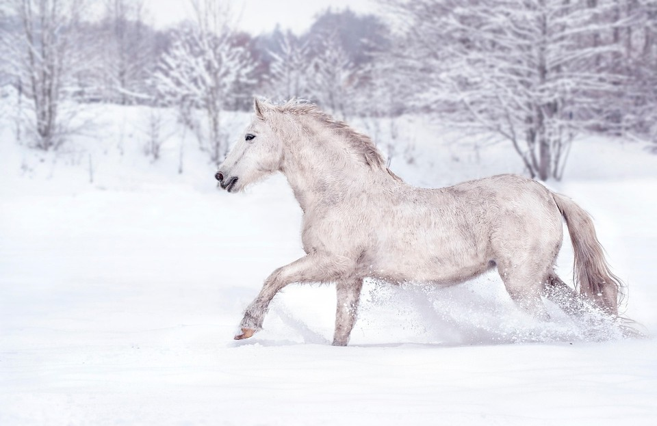
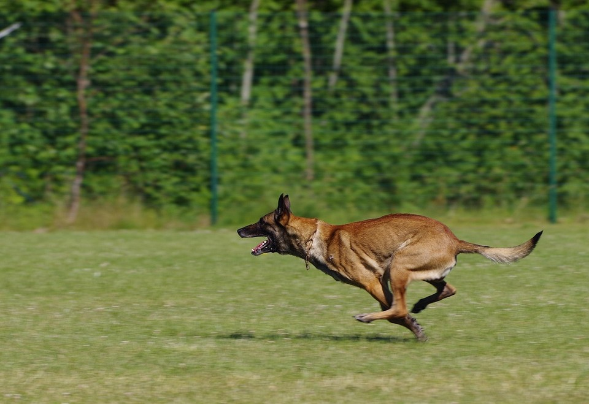
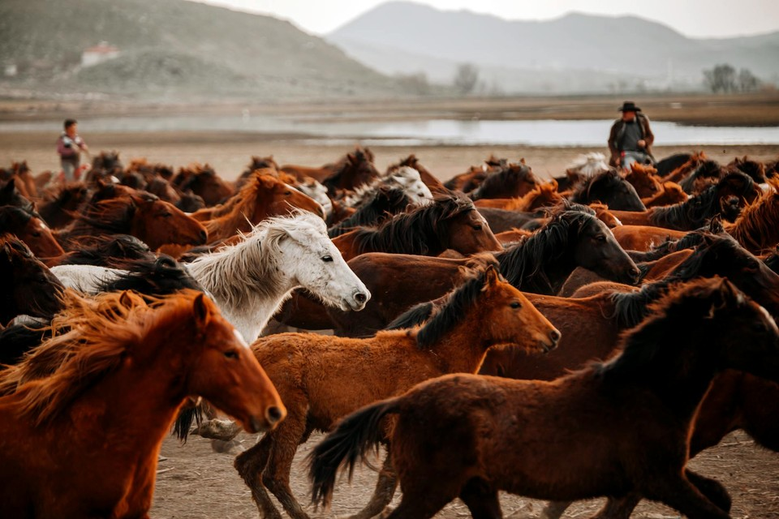

# Motion Magnitude

Motion Magnitude quantifies **how much internal motion** a generated video contains, independent of motion correctness. It detects conservative generation—visually stable but nearly static outputs—without evaluating direction, semantics, or object behavior.

For adjacent frames \((I_t, I_{t+1})\), SEA-RAFT yields flow magnitude \(F_t(x,y) = \sqrt{u_t^2 + v_t^2}\). The frame-pair statistic is the pixel median; the raw score averages over pairs:

\[
S_{\mathrm{mag}}^{\mathrm{raw}} = \frac{1}{T-1}\sum_{t=0}^{T-2} \mathrm{median}_{x,y}\, F_t(x,y)
\tag{1}
\]

WorldArena z-score calibrates with \(\mu = 3.2425\), \(\sigma = 3.4505\), clip \([-0.8638, 2.7498]\), mapping to \([0.25, 0.75]\). Higher normalized scores indicate stronger visible motion. The metric is **official** when computation succeeds.

<!-- metric-examples:start -->
## Verified Same-Input Examples

Up to three cases are shown per metric. Within each case, both videos must belong to the same benchmark sample, and both first frames must pass SIFT + RANSAC geometric matching against that case's displayed input. Candidates that fail are not published. Labels compare this metric only, not overall model quality.

Audit manifest: `docs/assets/metric_examples/curated_same_case_manifest.json`.

<article class="metric-case-exhibit metric-case-exhibit--curated">
  

    <figure class="metric-input-card">
      
      <figcaption>Input image</figcaption>
    </figure>
    

      
Input verified · same benchmark case · gap 0.6749

      <h4><code>image_dynamic_photorealistic_articulated_0004</code></h4>
      
Suite: image_dynamicScene: photorealistic / articulated

      

        Benchmark prompt target
        
Camera fixed. A white horse gallops through a snowy field, legs extending and gathering as its hooves kick up loose snow. Its mane and tail flow while the snow-covered trees remain still.

        <small>prompt source: prompt_target</small>
      

      
Both first frames passed geometric matching against the displayed input; labels compare this metric only.

    

  

  

    <figure class="metric-output-card metric-output-card--good">
      

        <video class="metric-output-video" controls muted loop playsinline preload="metadata" aria-label="Higher metric score: image_dynamic_photorealistic_articulated_0004">
          <source src="../../../assets/metric_examples/curated_20260801/5b7c28802e40__image_dynamic_photorealistic_articulated_0004__high.mp4" type="video/mp4">
        </video>
        
Higher metric score · Score 0.9149

      

      <figcaption class="metric-output-caption"><strong>Higher metric score</strong>motion_magnitude</figcaption>
    </figure>
    <figure class="metric-output-card metric-output-card--bad">
      

        <video class="metric-output-video" controls muted loop playsinline preload="metadata" aria-label="Lower metric score: image_dynamic_photorealistic_articulated_0004">
          <source src="../../../assets/metric_examples/curated_20260801/a9559a924062__image_dynamic_photorealistic_articulated_0004__low.mp4" type="video/mp4">
        </video>
        
Lower metric score · Score 0.2400

      

      <figcaption class="metric-output-caption"><strong>Lower metric score</strong>motion_magnitude</figcaption>
    </figure>
  

</article>
<article class="metric-case-exhibit metric-case-exhibit--curated">
  

    <figure class="metric-input-card">
      
      <figcaption>Input image</figcaption>
    </figure>
    

      
Input verified · same benchmark case · gap 0.7604

      <h4><code>image_dynamic_photorealistic_articulated_0068</code></h4>
      
Suite: image_dynamicScene: photorealistic / articulated

      

        Benchmark prompt target
        
Camera fixed. The dog runs quickly across the grassy field, moving forward with alternating legs, open mouth, and perked ears while the fence and trees stay in place.

        <small>prompt source: prompt_target</small>
      

      
Both first frames passed geometric matching against the displayed input; labels compare this metric only.

    

  

  

    <figure class="metric-output-card metric-output-card--good">
      

        <video class="metric-output-video" controls muted loop playsinline preload="metadata" aria-label="Higher metric score: image_dynamic_photorealistic_articulated_0068">
          <source src="../../../assets/metric_examples/curated_20260801/d473083aaa1b__image_dynamic_photorealistic_articulated_0068__high.mp4" type="video/mp4">
        </video>
        
Higher metric score · Score 1.0000

      

      <figcaption class="metric-output-caption"><strong>Higher metric score</strong>motion_magnitude</figcaption>
    </figure>
    <figure class="metric-output-card metric-output-card--bad">
      

        <video class="metric-output-video" controls muted loop playsinline preload="metadata" aria-label="Lower metric score: image_dynamic_photorealistic_articulated_0068">
          <source src="../../../assets/metric_examples/aff317072a9d__matrix_game2_5s__image_dynamic_photorealistic_articulated_0068.mp4" type="video/mp4">
        </video>
        
Lower metric score · Score 0.2396

      

      <figcaption class="metric-output-caption"><strong>Lower metric score</strong>motion_magnitude</figcaption>
    </figure>
  

</article>
<article class="metric-case-exhibit metric-case-exhibit--curated">
  

    <figure class="metric-input-card">
      
      <figcaption>Input image</figcaption>
    </figure>
    

      
Input verified · same benchmark case · gap 0.5764

      <h4><code>image_dynamic_photorealistic_articulated_0023</code></h4>
      
Suite: image_dynamicScene: photorealistic / articulated

      

        Benchmark prompt target
        
Camera fixed. A large herd of horses gallops across the dry landscape, hooves kicking dust while manes and tails stream backward. The two distant observers and low hills remain stable in the background.

        <small>prompt source: prompt_target</small>
      

      
Both first frames passed geometric matching against the displayed input; labels compare this metric only.

    

  

  

    <figure class="metric-output-card metric-output-card--good">
      

        <video class="metric-output-video" controls muted loop playsinline preload="metadata" aria-label="Higher metric score: image_dynamic_photorealistic_articulated_0023">
          <source src="../../../assets/metric_examples/curated_20260801/5ef88d814cdd__image_dynamic_photorealistic_articulated_0023__high.mp4" type="video/mp4">
        </video>
        
Higher metric score · Score 0.8167

      

      <figcaption class="metric-output-caption"><strong>Higher metric score</strong>motion_magnitude</figcaption>
    </figure>
    <figure class="metric-output-card metric-output-card--bad">
      

        <video class="metric-output-video" controls muted loop playsinline preload="metadata" aria-label="Lower metric score: image_dynamic_photorealistic_articulated_0023">
          <source src="../../../assets/metric_examples/curated_20260801/c5575ee7578d__image_dynamic_photorealistic_articulated_0023__low.mp4" type="video/mp4">
        </video>
        
Lower metric score · Score 0.2403

      

      <figcaption class="metric-output-caption"><strong>Lower metric score</strong>motion_magnitude</figcaption>
    </figure>
  

</article>

<!-- metric-examples:end -->

## References {#reference}

!!! quote "SEA-RAFT: Simple, Efficient, Accurate RAFT for Optical Flow"

    Wang et al., ECCV 2024.
