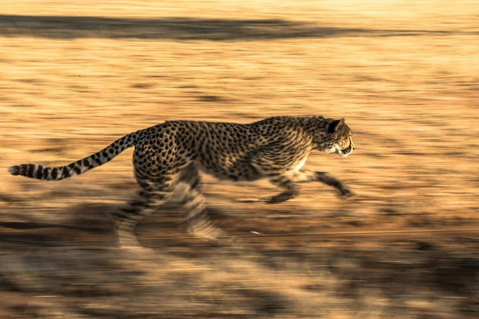
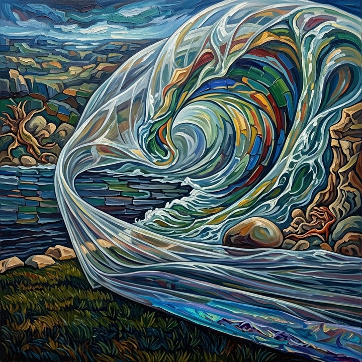

# Motion Smoothness

Motion Smoothness measures **temporal interpolatability** of a generated video under a frame-interpolation prior. VFIMamba reconstructs discarded odd frames from neighboring even frames; low reconstruction error indicates smooth, continuous motion—not correct semantics or magnitude.

For window \(k\), \(\hat{I}_{2k+1} = \Phi(I_{2k}, I_{2k+2})\) is compared to ground-truth odd frame \(I_{2k+1}\) via MSE, SSIM, and LPIPS. Raw components average over \(K\) windows:

\[
E_{\mathrm{mse}} = \frac{1}{K}\sum_k \mathrm{MSE}(\hat{I}_{2k+1}, I_{2k+1}),\quad
S_{\mathrm{ssim}} = \frac{1}{K}\sum_k \mathrm{SSIM}(\hat{I}_{2k+1}, I_{2k+1}),\quad
E_{\mathrm{lpips}} = \frac{1}{K}\sum_k \mathrm{LPIPS}(\hat{I}_{2k+1}, I_{2k+1})
\tag{1}
\]

Decoded `uint8` frames are converted to `float32` before MSE subtraction and squaring, so negative pixel differences cannot wrap modulo 256.

Each component is normalized independently; the final score is their arithmetic mean. Higher \(S_{\mathrm{smooth}}\) indicates smoother generated motion. The metric is **official** when computation succeeds and requires no reference video.

The configured MSE empirical bound predates `v2_float32_mse`. Corrected raw reports are versioned, but their normalized score remains provisional until that bound is recalibrated on the corrected benchmark corpus.

<!-- metric-examples:start -->
## Verified Same-Input Examples

Up to three cases are shown per metric. Within each case, both videos must belong to the same benchmark sample, and both first frames must pass SIFT + RANSAC geometric matching against that case's displayed input. Candidates that fail are not published. Labels compare this metric only, not overall model quality.

Audit manifest: `docs/assets/metric_examples/curated_same_case_manifest.json`.

<article class="metric-case-exhibit metric-case-exhibit--curated">
  

    <figure class="metric-input-card">
      
      <figcaption>Input image</figcaption>
    </figure>
    

      
Input verified · same benchmark case · gap 0.8951

      <h4><code>image_dynamic_photorealistic_deformable_0096</code></h4>
      
Suite: image_dynamicScene: photorealistic / deformable

      

        Benchmark prompt target
        
Camera fixed. Heavy wheat grain heads nod downward and lift slightly as wind moves through the dense cluster. Overlapping stalks brush together while the warm field backdrop stays consistent.

        <small>prompt source: prompt_target</small>
      

      
Both first frames passed geometric matching against the displayed input; labels compare this metric only.

    

  

  

    <figure class="metric-output-card metric-output-card--good">
      

        <video class="metric-output-video" controls muted loop playsinline preload="metadata" aria-label="Higher metric score: image_dynamic_photorealistic_deformable_0096">
          <source src="../../../assets/metric_examples/curated_20260801/154e282065d6__image_dynamic_photorealistic_deformable_0096__high.mp4" type="video/mp4">
        </video>
        
Higher metric score · Score 0.9462

      

      <figcaption class="metric-output-caption"><strong>Higher metric score</strong>motion_smoothness</figcaption>
    </figure>
    <figure class="metric-output-card metric-output-card--bad">
      

        <video class="metric-output-video" controls muted loop playsinline preload="metadata" aria-label="Lower metric score: image_dynamic_photorealistic_deformable_0096">
          <source src="../../../assets/metric_examples/curated_20260801/120a8a389b9d__image_dynamic_photorealistic_deformable_0096__low.mp4" type="video/mp4">
        </video>
        
Lower metric score · Score 0.0511

      

      <figcaption class="metric-output-caption"><strong>Lower metric score</strong>motion_smoothness</figcaption>
    </figure>
  

</article>
<article class="metric-case-exhibit metric-case-exhibit--curated">
  

    <figure class="metric-input-card">
      
      <figcaption>Input image</figcaption>
    </figure>
    

      
Input verified · same benchmark case · gap 0.9357

      <h4><code>image_dynamic_photorealistic_articulated_0136</code></h4>
      
Suite: image_dynamicScene: photorealistic / articulated

      

        Benchmark prompt target
        
Camera fixed. A cheetah sprints across the dry grassy savannah, its legs cycling rapidly and body stretching low with each stride. Golden grass, sunlight, and shadows remain consistent around it.

        <small>prompt source: prompt_target</small>
      

      
Both first frames passed geometric matching against the displayed input; labels compare this metric only.

    

  

  

    <figure class="metric-output-card metric-output-card--good">
      

        <video class="metric-output-video" controls muted loop playsinline preload="metadata" aria-label="Higher metric score: image_dynamic_photorealistic_articulated_0136">
          <source src="../../../assets/metric_examples/b03e9f8572a3__matrix-game-3-image-dynamic-5s__image_dynamic_photorealistic_articulated_0136.mp4" type="video/mp4">
        </video>
        
Higher metric score · Score 0.9557

      

      <figcaption class="metric-output-caption"><strong>Higher metric score</strong>motion_smoothness</figcaption>
    </figure>
    <figure class="metric-output-card metric-output-card--bad">
      

        <video class="metric-output-video" controls muted loop playsinline preload="metadata" aria-label="Lower metric score: image_dynamic_photorealistic_articulated_0136">
          <source src="../../../assets/metric_examples/curated_20260801/4a46c83ac1c0__image_dynamic_photorealistic_articulated_0136__low.mp4" type="video/mp4">
        </video>
        
Lower metric score · Score 0.0200

      

      <figcaption class="metric-output-caption"><strong>Lower metric score</strong>motion_smoothness</figcaption>
    </figure>
  

</article>
<article class="metric-case-exhibit metric-case-exhibit--curated">
  

    <figure class="metric-input-card">
      
      <figcaption>Input image</figcaption>
    </figure>
    

      
Input verified · same benchmark case · gap 0.8808

      <h4><code>image_dynamic_stylized_deformable_0154</code></h4>
      
Suite: image_dynamicScene: stylized / deformable

      

        Benchmark prompt target
        
Camera fixed. A vibrant stylized wave curls and rolls over the rocky shoreline, its colorful water swirling forward. Clouds twist overhead while the rocks and grass patch remain stable.

        <small>prompt source: prompt_target</small>
      

      
Both first frames passed geometric matching against the displayed input; labels compare this metric only.

    

  

  

    <figure class="metric-output-card metric-output-card--good">
      

        <video class="metric-output-video" controls muted loop playsinline preload="metadata" aria-label="Higher metric score: image_dynamic_stylized_deformable_0154">
          <source src="../../../assets/metric_examples/curated_20260801/84fe2b2a1fd7__image_dynamic_stylized_deformable_0154__high.mp4" type="video/mp4">
        </video>
        
Higher metric score · Score 0.9577

      

      <figcaption class="metric-output-caption"><strong>Higher metric score</strong>motion_smoothness</figcaption>
    </figure>
    <figure class="metric-output-card metric-output-card--bad">
      

        <video class="metric-output-video" controls muted loop playsinline preload="metadata" aria-label="Lower metric score: image_dynamic_stylized_deformable_0154">
          <source src="../../../assets/metric_examples/curated_20260801/ff7cca037561__image_dynamic_stylized_deformable_0154__low.mp4" type="video/mp4">
        </video>
        
Lower metric score · Score 0.0769

      

      <figcaption class="metric-output-caption"><strong>Lower metric score</strong>motion_smoothness</figcaption>
    </figure>
  

</article>

<!-- metric-examples:end -->

## References {#reference}

!!! quote "VFIMamba: Video Frame Interpolation with State Space Models"

    Zhang et al., NeurIPS 2024.

!!! quote "The Unreasonable Effectiveness of Deep Features as a Perceptual Metric"

    Zhang et al., CVPR 2018.
