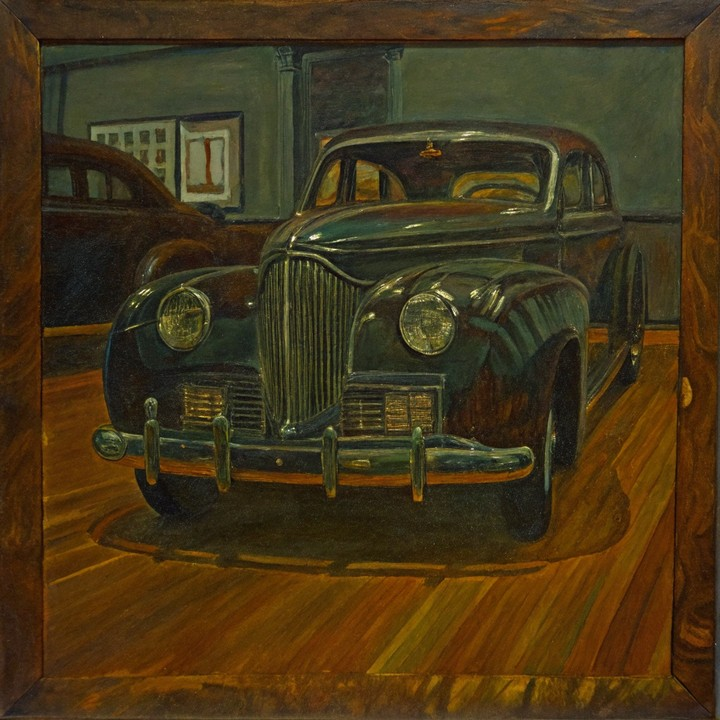
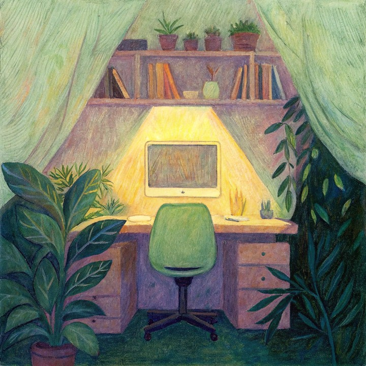
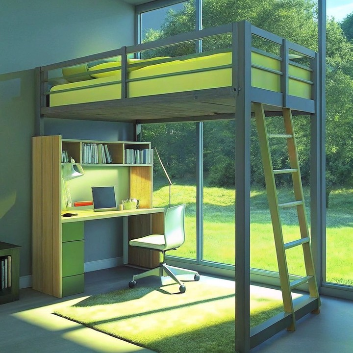

# Prompt Alignment

Prompt Alignment measures **semantic agreement** between protocol anchor frames of a generated video and the target instruction \(T = \texttt{sample.prompt\_target}\). It evaluates whether the prediction realizes the requested scene content at benchmark-sampled time points, not whether the full rollout is temporally coherent or visually realistic.

Let \(\mathcal{A} = \{f_i\}_{i=1}^{M}\) denote the anchor-frame set selected by the evaluation protocol from the decoded prediction. With CLIP ViT-B/16 image encoder \(\phi_I\) and text encoder \(\phi_T\), define L2-normalized embeddings \(\mathbf{e}_i = \phi_I(f_i)\) and \(\mathbf{t} = \phi_T(T)\). The native CLIPScore for frame \(i\) is

\[
s_i = \max\!\left(100 \cdot \langle \mathbf{e}_i, \mathbf{t} \rangle,\, 0\right)
\tag{1}
\]

WorldArena maps each anchor score to \([0,1]\) via \(\tilde{s}_i = \mathrm{clamp}(s_i / 100,\, 0,\, 1)\) and reports the mean

\[
S_{\mathrm{prompt}} = \frac{1}{M}\sum_{i=1}^{M} \tilde{s}_i
\tag{2}
\]

Higher \(S_{\mathrm{prompt}}\) indicates stronger instruction following at protocol anchors. The metric is **official** when explicit instruction supervision is available and conditioning is not self-referential (`conditioning_strategy ≠ self`). Image suites may condition on a single reference frame, but the model prediction must still be a video.

The examples below are curated from the complete 2026-07-17 `image_static` snapshot: 20 models evaluated on the same 3,372 cases. Every side-by-side pair is strictly verified to share the sample ID, conditioning-image SHA-256, and actual generation-prompt SHA-256; both generation records must also identify that image as the conditioning input. “Good” and “poor” refer only to Prompt Alignment—not overall video quality—and each score is the mean over four `segment_random` protocol anchors.

<!-- metric-examples:start -->
## Verified Same-Input Examples

Up to three cases are shown per metric. Within each case, both videos must belong to the same benchmark sample, and both first frames must pass SIFT + RANSAC geometric matching against that case's displayed input. Candidates that fail are not published. Labels compare this metric only, not overall model quality.

Audit manifest: `docs/assets/metric_examples/curated_same_case_manifest.json`.

<article class="metric-case-exhibit metric-case-exhibit--curated">
  

    <figure class="metric-input-card">
      
      <figcaption>Input image</figcaption>
    </figure>
    

      
Input verified · same benchmark case · gap 0.1526

      <h4><code>image_static_stylized_public_spaces_0029</code></h4>
      
Suite: image_staticScene: stylized / indoor / public_spaces

      

        Benchmark prompt target
        
Camera orbit left. A vintage car display with wooden floor, framed artworks, and cars.

        <small>prompt source: prompt_target</small>
      

      
Both first frames passed geometric matching against the displayed input; labels compare this metric only.

    

  

  

    <figure class="metric-output-card metric-output-card--good">
      

        <video class="metric-output-video" controls muted loop playsinline preload="metadata" aria-label="Higher metric score: image_static_stylized_public_spaces_0029">
          <source src="../../../assets/metric_examples/curated_20260801/cc11f324a93f__image_static_stylized_public_spaces_0029__high.mp4" type="video/mp4">
        </video>
        
Higher metric score · Score 0.3508

      

      <figcaption class="metric-output-caption"><strong>Higher metric score</strong>prompt_alignment</figcaption>
    </figure>
    <figure class="metric-output-card metric-output-card--bad">
      

        <video class="metric-output-video" controls muted loop playsinline preload="metadata" aria-label="Lower metric score: image_static_stylized_public_spaces_0029">
          <source src="../../../assets/metric_examples/curated_20260801/117df6803bf2__image_static_stylized_public_spaces_0029__low.mp4" type="video/mp4">
        </video>
        
Lower metric score · Score 0.1982

      

      <figcaption class="metric-output-caption"><strong>Lower metric score</strong>prompt_alignment</figcaption>
    </figure>
  

</article>
<article class="metric-case-exhibit metric-case-exhibit--curated">
  

    <figure class="metric-input-card">
      
      <figcaption>Input image</figcaption>
    </figure>
    

      
Input verified · same benchmark case · gap 0.1561

      <h4><code>image_static_stylized_workspaces_0016</code></h4>
      
Suite: image_staticScene: stylized / indoor / workspaces

      

        Benchmark prompt target
        
Camera pan right. A cozy workspace with desk, plants, and window.

        <small>prompt source: prompt_target</small>
      

      
Both first frames passed geometric matching against the displayed input; labels compare this metric only.

    

  

  

    <figure class="metric-output-card metric-output-card--good">
      

        <video class="metric-output-video" controls muted loop playsinline preload="metadata" aria-label="Higher metric score: image_static_stylized_workspaces_0016">
          <source src="../../../assets/metric_examples/curated_20260801/68b11dff54be__image_static_stylized_workspaces_0016__high.mp4" type="video/mp4">
        </video>
        
Higher metric score · Score 0.3342

      

      <figcaption class="metric-output-caption"><strong>Higher metric score</strong>prompt_alignment</figcaption>
    </figure>
    <figure class="metric-output-card metric-output-card--bad">
      

        <video class="metric-output-video" controls muted loop playsinline preload="metadata" aria-label="Lower metric score: image_static_stylized_workspaces_0016">
          <source src="../../../assets/metric_examples/cea803b80e21__matrix_game2_5s_image_static__image_static_stylized_workspaces_0016.mp4" type="video/mp4">
        </video>
        
Lower metric score · Score 0.1781

      

      <figcaption class="metric-output-caption"><strong>Lower metric score</strong>prompt_alignment</figcaption>
    </figure>
  

</article>
<article class="metric-case-exhibit metric-case-exhibit--curated">
  

    <figure class="metric-input-card">
      
      <figcaption>Input image</figcaption>
    </figure>
    

      
Input verified · same benchmark case · gap 0.1533

      <h4><code>image_static_stylized_workspaces_0044</code></h4>
      
Suite: image_staticScene: stylized / indoor / workspaces

      

        Benchmark prompt target
        
Camera pan right. A modern loft bed with bookshelf, indoor plant, and wall.

        <small>prompt source: prompt_target</small>
      

    

  

  

    <figure class="metric-output-card metric-output-card--good">
      

        <video class="metric-output-video" controls muted loop playsinline preload="metadata" aria-label="Higher metric score: image_static_stylized_workspaces_0044">
          <source src="../../../assets/metric_examples/curated_20260801/3e816f47f052__image_static_stylized_workspaces_0044__high.mp4" type="video/mp4">
        </video>
        
Higher metric score · Score 0.3331

      

      <figcaption class="metric-output-caption"><strong>Higher metric score</strong>prompt_alignment</figcaption>
    </figure>
    <figure class="metric-output-card metric-output-card--bad">
      

        <video class="metric-output-video" controls muted loop playsinline preload="metadata" aria-label="Lower metric score: image_static_stylized_workspaces_0044">
          <source src="../../../assets/metric_examples/curated_20260801/153b900ccf6f__image_static_stylized_workspaces_0044__low.mp4" type="video/mp4">
        </video>
        
Lower metric score · Score 0.1798

      

      <figcaption class="metric-output-caption"><strong>Lower metric score</strong>prompt_alignment</figcaption>
    </figure>
  

</article>

<!-- metric-examples:end -->

## References {#reference}

!!! quote "CLIP — Learning Transferable Visual Models From Natural Language Supervision"

    Radford et al., ICML 2021.
    [https://arxiv.org/abs/2103.00020](https://arxiv.org/abs/2103.00020)
