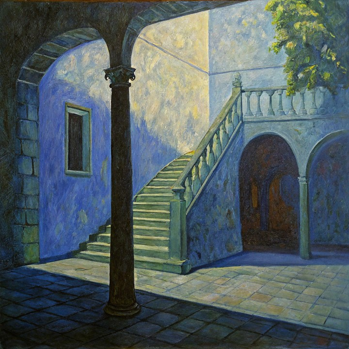
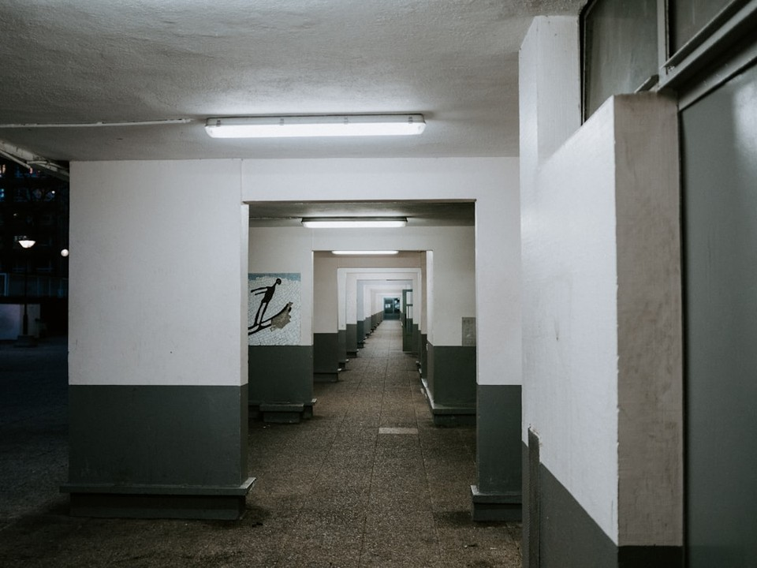

# Rollout Imaging Drift

**rollout_imaging_drift** measures **temporal imaging-quality degradation** along a rollout. Per-frame MUSIQ scores are split into $N=10$ equal segments; drift is the relative drop from the best to the worst segment mean.

\[
D_{\mathrm{img}} = \frac{\bar{s}_{\mathrm{best}} - \bar{s}_{\mathrm{worst}}}{|\bar{s}_{\mathrm{best}}|}
\tag{1}
\]

Lower is better. The value is clamped to $[0,1]$. Computed prediction-only. Backend: `quality_drift` (imaging component via MUSIQ-SPAQ).

<!-- metric-examples:start -->
## Verified Same-Input Examples

Up to three cases are shown per metric. Within each case, both videos must belong to the same benchmark sample, and both first frames must pass SIFT + RANSAC geometric matching against that case's displayed input. Candidates that fail are not published. Labels compare this metric only, not overall model quality.

Audit manifest: `docs/assets/metric_examples/curated_same_case_manifest.json`.

<article class="metric-case-exhibit metric-case-exhibit--curated">
  

    <figure class="metric-input-card">
      
      <figcaption>Input image</figcaption>
    </figure>
    

      
Input verified · same benchmark case · gap 0.7798

      <h4><code>image_static_photorealistic_aquatic_landscape_0071</code></h4>
      
Suite: image_staticScene: photorealistic / outdoor / aquatic_landscape

      

        Benchmark prompt target
        
Camera move right. A castle on rocky cliff with rocky path and sea. Camera pan right. A castle on rocky cliff with castle entrance, drawbridge, and forest. Camera pull out. A forest edge with castle, twilight sky, and distant sea.

        <small>prompt source: prompt_target</small>
      

      
Both first frames passed geometric matching against the displayed input; labels compare this metric only.

    

  

  

    <figure class="metric-output-card metric-output-card--good">
      

        <video class="metric-output-video" controls muted loop playsinline preload="metadata" aria-label="Higher metric score: image_static_photorealistic_aquatic_landscape_0071">
          <source src="../../../assets/metric_examples/468c4e319b29__yume_sample5b__image_static_photorealistic_aquatic_landscape_0071.mp4" type="video/mp4">
        </video>
        
Higher metric score · Score 0.9751

      

      <figcaption class="metric-output-caption"><strong>Higher metric score</strong>rollout_imaging_drift</figcaption>
    </figure>
    <figure class="metric-output-card metric-output-card--bad">
      

        <video class="metric-output-video" controls muted loop playsinline preload="metadata" aria-label="Lower metric score: image_static_photorealistic_aquatic_landscape_0071">
          <source src="../../../assets/metric_examples/66ef97296842__warp-as-history-image-static-8gpu-20260612_152000__image_static_photorealistic_aquatic_landscape_0071.mp4" type="video/mp4">
        </video>
        
Lower metric score · Score 0.1953

      

      <figcaption class="metric-output-caption"><strong>Lower metric score</strong>rollout_imaging_drift</figcaption>
    </figure>
  

</article>
<article class="metric-case-exhibit metric-case-exhibit--curated">
  

    <figure class="metric-input-card">
      
      <figcaption>Input image</figcaption>
    </figure>
    

      
Input verified · same benchmark case · gap 0.8269

      <h4><code>image_static_stylized_passageways_0014</code></h4>
      
Suite: image_staticScene: stylized / indoor / passageways

      

        Benchmark prompt target
        
Camera orbit right. A passageways scene with staircase, column, and arched passageway.

        <small>prompt source: prompt_target</small>
      

      
Both first frames passed geometric matching against the displayed input; labels compare this metric only.

    

  

  

    <figure class="metric-output-card metric-output-card--good">
      

        <video class="metric-output-video" controls muted loop playsinline preload="metadata" aria-label="Higher metric score: image_static_stylized_passageways_0014">
          <source src="../../../assets/metric_examples/0c627e2bd9b7__matrix-game-1-image-static-worldarena-prompt-min5-lowmem-rmsnorm-v2__image_static_stylized_passageways_0014.mp4" type="video/mp4">
        </video>
        
Higher metric score · Score 0.9804

      

      <figcaption class="metric-output-caption"><strong>Higher metric score</strong>rollout_imaging_drift</figcaption>
    </figure>
    <figure class="metric-output-card metric-output-card--bad">
      

        <video class="metric-output-video" controls muted loop playsinline preload="metadata" aria-label="Lower metric score: image_static_stylized_passageways_0014">
          <source src="../../../assets/metric_examples/dacc3200ce74__matrix_game2_5s__image_static_stylized_passageways_0014.mp4" type="video/mp4">
        </video>
        
Lower metric score · Score 0.1534

      

      <figcaption class="metric-output-caption"><strong>Lower metric score</strong>rollout_imaging_drift</figcaption>
    </figure>
  

</article>
<article class="metric-case-exhibit metric-case-exhibit--curated">
  

    <figure class="metric-input-card">
      
      <figcaption>Input image</figcaption>
    </figure>
    

      
Input verified · same benchmark case · gap 0.7934

      <h4><code>image_static_photorealistic_passageways_0081</code></h4>
      
Suite: image_staticScene: photorealistic / indoor / passageways

      

        Benchmark prompt target
        
Camera move right. A long corridor with corridor extension, columns, and mural.

        <small>prompt source: prompt_target</small>
      

      
Both first frames passed geometric matching against the displayed input; labels compare this metric only.

    

  

  

    <figure class="metric-output-card metric-output-card--good">
      

        <video class="metric-output-video" controls muted loop playsinline preload="metadata" aria-label="Higher metric score: image_static_photorealistic_passageways_0081">
          <source src="../../../assets/metric_examples/4300ac0093a0__wan22-ti2v-5b-image-static-plan-missing__image_static_photorealistic_passageways_0081.mp4" type="video/mp4">
        </video>
        
Higher metric score · Score 0.9573

      

      <figcaption class="metric-output-caption"><strong>Higher metric score</strong>rollout_imaging_drift</figcaption>
    </figure>
    <figure class="metric-output-card metric-output-card--bad">
      

        <video class="metric-output-video" controls muted loop playsinline preload="metadata" aria-label="Lower metric score: image_static_photorealistic_passageways_0081">
          <source src="../../../assets/metric_examples/519973dc5747__matrix_game2_5s__image_static_photorealistic_passageways_0081.mp4" type="video/mp4">
        </video>
        
Lower metric score · Score 0.1639

      

      <figcaption class="metric-output-caption"><strong>Lower metric score</strong>rollout_imaging_drift</figcaption>
    </figure>
  

</article>

<!-- metric-examples:end -->

## References {#reference}

!!! quote "MUSIQ: Multi-scale Image Quality Transformer"

    Zejiang Hou, Hui Ren, Ming Sun, Jiahao Li, Weining Wang.  
    ICCV 2021.  
    [https://arxiv.org/abs/2108.05997](https://arxiv.org/abs/2108.05997)
