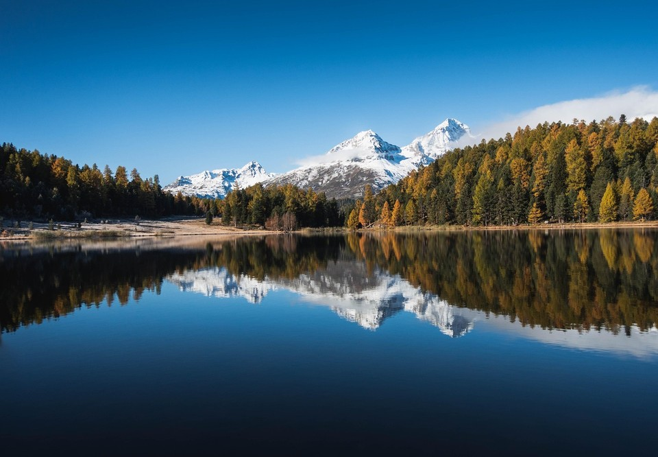
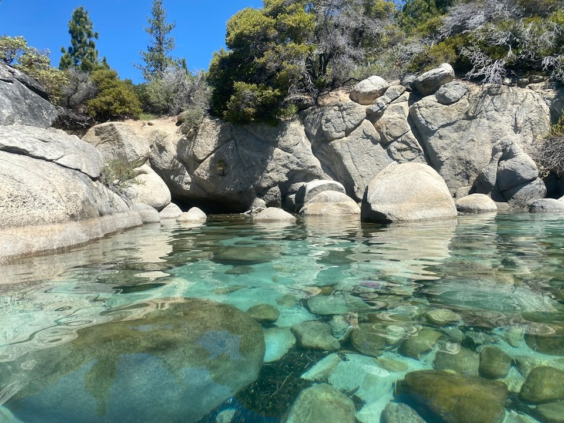

# Segment Continuity

Segment Continuity measures whether a generated video contains **detected scene cuts**. Unintended hard transitions break temporal coherence and indicate segment discontinuities.

TransNetV2 outputs a per-frame scene-boundary probability $p_i$ for decoded frame $x_i$. Frames with $p_i > \theta$ are flagged as cut candidates, with defaults $\theta = 0.5$. A cut is recorded at frame index $i$ when the binary mask rises from $0$ to $1$ at $i$, following TransNetV2 transition parsing.

To suppress spurious detections, cut candidates are filtered so that every retained scene spans at least $L$ frames (default $L = 10$). Let $n_{\mathrm{cut}}$ denote the number of retained cuts in one video. The per-video score is binary:

\[
S_{\mathrm{seg}}
=
\begin{cases}
1, & n_{\mathrm{cut}} = 0 \\
0, & n_{\mathrm{cut}} > 0
\end{cases}
\tag{1}
\]

Across $N$ evaluated videos, the model-level aggregate is

\[
\bar{S}_{\mathrm{seg}}
=
1 - \frac{n_{\mathrm{cut}}}{N}
\tag{2}
\]

where $n_{\mathrm{cut}}$ counts videos with at least one retained cut. WorldArena stores the per-sample binary value from Eq. (1) as the metric raw score. The metric is **prediction-only** and requires TransNetV2 inference code and weights.

## References {#reference}

!!! quote "TransNet V2 — Shot Boundary Detection"

    Sočik et al., ACM MM 2020.
    [https://arxiv.org/abs/2008.04838](https://arxiv.org/abs/2008.04838)

<!-- metric-examples:start -->
## Verified Same-Input Examples

Up to three cases are shown per metric. Within each case, both videos must belong to the same benchmark sample, and both first frames must pass SIFT + RANSAC geometric matching against that case's displayed input. Candidates that fail are not published. Labels compare this metric only, not overall model quality.

Audit manifest: `docs/assets/metric_examples/curated_same_case_manifest.json`.

<article class="metric-case-exhibit metric-case-exhibit--curated">
  

    <figure class="metric-input-card">
      
      <figcaption>Input image</figcaption>
    </figure>
    

      
Input verified · same benchmark case · gap 1.0000

      <h4><code>image_static_photorealistic_city_0064</code></h4>
      
Suite: image_staticScene: photorealistic / outdoor / city

      

        Benchmark prompt target
        
Camera pull out. An expanded city view with buildings, distant hills, and extended waterfront.

        <small>prompt source: prompt_target</small>
      

      
Both first frames passed geometric matching against the displayed input; labels compare this metric only.

    

  

  

    <figure class="metric-output-card metric-output-card--good">
      

        <video class="metric-output-video" controls muted loop playsinline preload="metadata" aria-label="Higher metric score: image_static_photorealistic_city_0064">
          <source src="../../../assets/metric_examples/curated_20260801/4133494bf815__image_static_photorealistic_city_0064__high.mp4" type="video/mp4">
        </video>
        
Higher metric score · Score 1.0000

      

      <figcaption class="metric-output-caption"><strong>Higher metric score</strong>segment_continuityDetected hard cuts: 0</figcaption>
    </figure>
    <figure class="metric-output-card metric-output-card--bad">
      

        <video class="metric-output-video" controls muted loop playsinline preload="metadata" aria-label="Lower metric score: image_static_photorealistic_city_0064">
          <source src="../../../assets/metric_examples/curated_20260801/0dffa172da47__image_static_photorealistic_city_0064__low.mp4" type="video/mp4">
        </video>
        
Lower metric score · Score 0.0000

      

      <figcaption class="metric-output-caption"><strong>Lower metric score</strong>segment_continuityDetected hard cuts: 1</figcaption>
    </figure>
  

</article>
<article class="metric-case-exhibit metric-case-exhibit--curated">
  

    <figure class="metric-input-card">
      
      <figcaption>Input image</figcaption>
    </figure>
    

      
Input verified · same benchmark case · gap 1.0000

      <h4><code>image_static_photorealistic_aquatic_landscape_0084</code></h4>
      
Suite: image_staticScene: photorealistic / outdoor / aquatic_landscape

      

        Benchmark prompt target
        
Camera move left. A lake edge with reeds, autumn trees, and distant mountains.

        <small>prompt source: prompt_target</small>
      

      
Both first frames passed geometric matching against the displayed input; labels compare this metric only.

    

  

  

    <figure class="metric-output-card metric-output-card--good">
      

        <video class="metric-output-video" controls muted loop playsinline preload="metadata" aria-label="Higher metric score: image_static_photorealistic_aquatic_landscape_0084">
          <source src="../../../assets/metric_examples/curated_20260801/3ff6bbb0893e__image_static_photorealistic_aquatic_landscape_0084__high.mp4" type="video/mp4">
        </video>
        
Higher metric score · Score 1.0000

      

      <figcaption class="metric-output-caption"><strong>Higher metric score</strong>segment_continuityDetected hard cuts: 0</figcaption>
    </figure>
    <figure class="metric-output-card metric-output-card--bad">
      

        <video class="metric-output-video" controls muted loop playsinline preload="metadata" aria-label="Lower metric score: image_static_photorealistic_aquatic_landscape_0084">
          <source src="../../../assets/metric_examples/curated_20260801/fe8753fa0234__image_static_photorealistic_aquatic_landscape_0084__low.mp4" type="video/mp4">
        </video>
        
Lower metric score · Score 0.0000

      

      <figcaption class="metric-output-caption"><strong>Lower metric score</strong>segment_continuityDetected hard cuts: 1</figcaption>
    </figure>
  

</article>
<article class="metric-case-exhibit metric-case-exhibit--curated">
  

    <figure class="metric-input-card">
      
      <figcaption>Input image</figcaption>
    </figure>
    

      
Input verified · same benchmark case · gap 1.0000

      <h4><code>image_static_photorealistic_aquatic_landscape_0089</code></h4>
      
Suite: image_staticScene: photorealistic / outdoor / aquatic_landscape

      

        Benchmark prompt target
        
Camera pull out. A rocky shoreline with trees and distant hills. Camera move right. A forest edge with dense foliage and sunlight. Camera pan right. A forest edge with forest path, scattered rocks, and tree canopy.

        <small>prompt source: prompt_target</small>
      

      
Both first frames passed geometric matching against the displayed input; labels compare this metric only.

    

  

  

    <figure class="metric-output-card metric-output-card--good">
      

        <video class="metric-output-video" controls muted loop playsinline preload="metadata" aria-label="Higher metric score: image_static_photorealistic_aquatic_landscape_0089">
          <source src="../../../assets/metric_examples/curated_20260801/78d59f9021b3__image_static_photorealistic_aquatic_landscape_0089__high.mp4" type="video/mp4">
        </video>
        
Higher metric score · Score 1.0000

      

      <figcaption class="metric-output-caption"><strong>Higher metric score</strong>segment_continuityDetected hard cuts: 0</figcaption>
    </figure>
    <figure class="metric-output-card metric-output-card--bad">
      

        <video class="metric-output-video" controls muted loop playsinline preload="metadata" aria-label="Lower metric score: image_static_photorealistic_aquatic_landscape_0089">
          <source src="../../../assets/metric_examples/curated_20260801/0b291d32d947__image_static_photorealistic_aquatic_landscape_0089__low.mp4" type="video/mp4">
        </video>
        
Lower metric score · Score 0.0000

      

      <figcaption class="metric-output-caption"><strong>Lower metric score</strong>segment_continuityDetected hard cuts: 1</figcaption>
    </figure>
  

</article>

<!-- metric-examples:end -->
