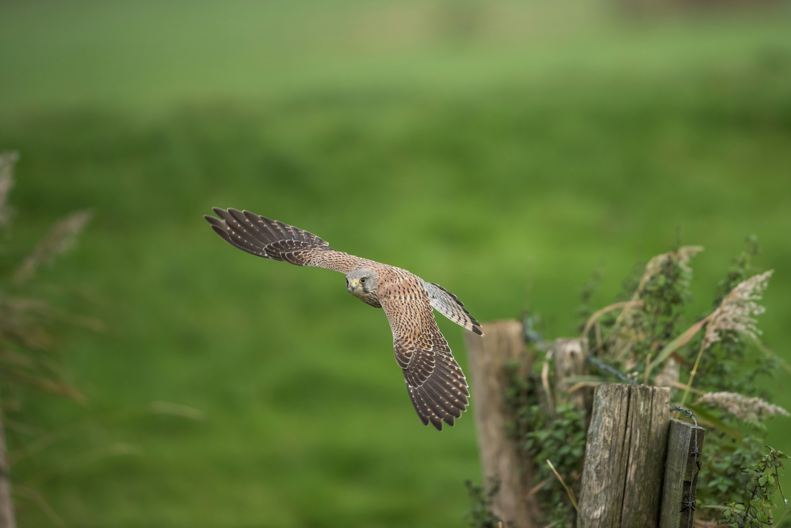

# Semantic Alignment

Semantic Alignment measures whether a generated video preserves scene-level content described in annotation sidecars, independent of the benchmark prompt \(T\). It complements Prompt Alignment by scoring agreement with caption-derived reference text rather than the explicit generation instruction.

WorldArena constructs reference text \(R\) from `caption.json` under `sample.annotation_path`, optionally appending camera-instruction labels. When annotation text is unavailable, \(R\) falls back to `sample.prompt_current` or `sample.prompt_target`. For decoded frame \(f_i\), CLIP ViT-B/16 yields L2-normalized image embedding \(\mathbf{e}_i\) and text embedding \(\mathbf{r} = \phi_T(R)\). The per-frame score is

\[
\tilde{s}_i = \mathrm{clamp}\!\left(\frac{\cos(\mathbf{e}_i, \mathbf{r}) + 1}{2},\, 0,\, 1\right)
\tag{1}
\]

The raw metric aggregates over all evaluated frames:

\[
S_{\mathrm{sem}} = \frac{1}{N}\sum_{i=1}^{N} \tilde{s}_i
\tag{2}
\]

Higher \(S_{\mathrm{sem}}\) indicates closer semantic match to the annotated reference description. The metric does not substitute for instruction-following scores or object-level verification.

<!-- metric-examples:start -->
## Representative Same-Case Comparisons
Each exhibit first shows the input image and the exact displayed prompt for the case, then compares generated outputs. Paired exhibits require the same input image and the same prompt text, with one high-scoring and one low-scoring model output. Metrics without such a cross-model pair in the current formal snapshot are separated as high/low extrema rather than presented as same-case comparisons.
Machine-readable paired export: `docs/assets/metric_examples/paired_manifest.csv`.
### `semantic_alignment`

<article class="metric-case-exhibit">
  

    <figure class="metric-input-card">
      
      <figcaption>Input image</figcaption>
    </figure>
    

      
Case 1 · same input image + same prompt · score gap 0.0678

      <h4><code>image_dynamic_photorealistic_articulated_0001</code></h4>
      
Suite: image_dynamicScene: photorealistic

      

        Prompt target
        
Camera fixed. A bird of prey glides forward low over a grassy field, wings spread wide with subtle body and wing adjustments. The wooden fence post, wild grasses, and vines remain still.

        <small>prompt source: prompt_target</small>
      

    

  

  

<figure class="metric-output-card metric-output-card--good">
  

    <video class="metric-output-video" controls muted loop playsinline preload="metadata" aria-label="Good output: _readiness_echo_dynamic_smoke_after image_dynamic_photorealistic_articulated_0001">
      <source src="../../../assets/metric_examples/8f778faac6c6___readiness_echo_dynamic_smoke_after__image_dynamic_photorealistic_articulated_0001.mp4" type="video/mp4">
    </video>
    
Good output · Score 0.6668

  

</figure>
<figure class="metric-output-card metric-output-card--bad">
  

    <video class="metric-output-video" controls muted loop playsinline preload="metadata" aria-label="Poor output: stable-virtual-camera-image-dynamic-5s image_dynamic_photorealistic_articulated_0001">
      <source src="../../../assets/metric_examples/73ddbcad1071__stable-virtual-camera-image-dynamic-5s__image_dynamic_photorealistic_articulated_0001.mp4" type="video/mp4">
    </video>
    
Poor output · Score 0.5990

  

</figure>
  

</article>

<!-- metric-examples:end -->

## References {#reference}

!!! quote "CLIP — Learning Transferable Visual Models From Natural Language Supervision"

    Radford et al., ICML 2021.
    [https://arxiv.org/abs/2103.00020](https://arxiv.org/abs/2103.00020)
