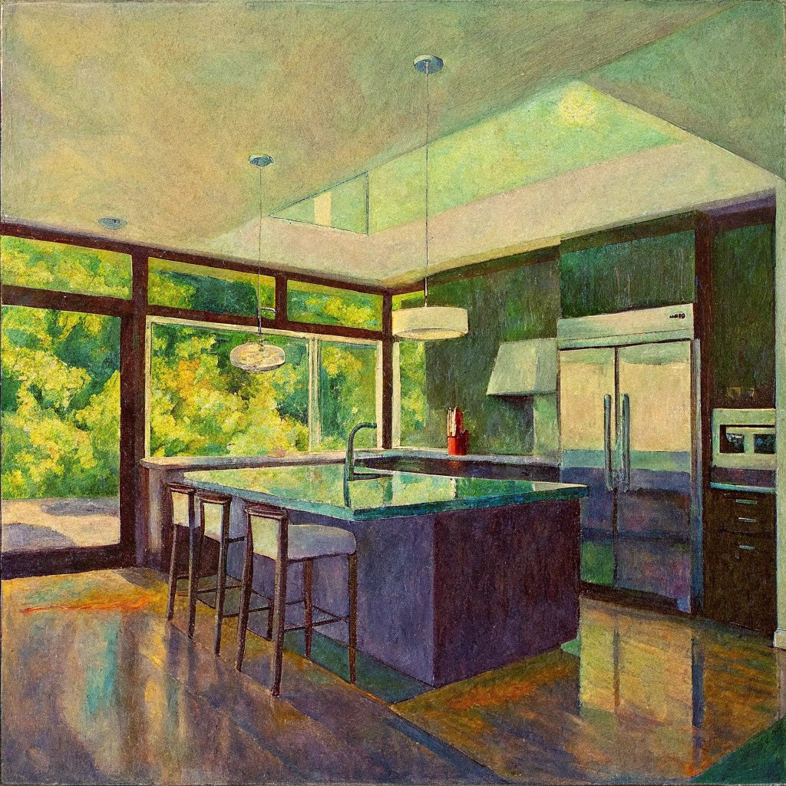
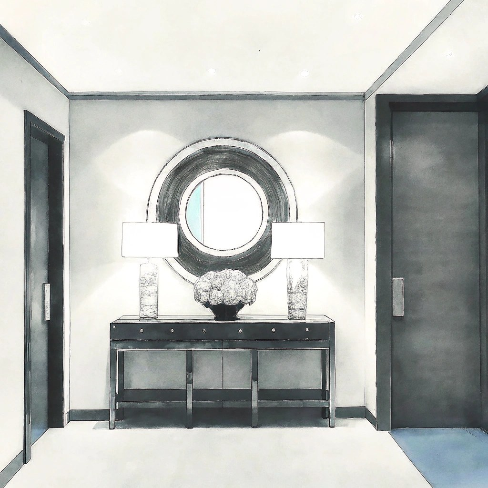

# Sharpness Retention

This metric evaluates the stability of fine details by monitoring the evolution of edge gradients. Successful numeric scores are official: they enter the `quality` dimension and the public leaderboard vector. We propose a vectorized Tenengrad method: independently compute the sum of absolute gradients in the horizontal ($G_x$) and vertical ($G_y$) directions, and construct a 2-D sharpness vector to capture texture-direction features:

\[
\mathbf{g}_t
=
\begin{pmatrix}
\sum |G_x| \\
\sum |G_y|
\end{pmatrix}
\tag{6}
\]

where $G_x$ and $G_y$ are Sobel responses ($3\times3$ kernel) on the grayscale frame $I_t$.

A **noise-aware circuit breaker** distinguishes true detail from high-frequency artifacts. Let $n_t$ be the BRISQUE noise score at frame $t$ and $\tau$ a noise threshold. When high noise ($n_t > \tau$) occurs for $5$ consecutive frames, the triggered state is $I_{\mathrm{trig}}=1$. The fusing penalty logic $M$ combines texture similarity with the breaker state (similarity $S(\cdot,\cdot)$ follows the cosine inner product in Eq. (3)):

BRISQUE is undefined for a zero-variance frame. Such a frame receives the configured worst-case `brisque_bad` value and remains in the aggregate, so a collapse to a flat or black frame is penalized rather than silently excluded as a missing score.

\[
M(x_t)
=
\begin{cases}
S(\mathbf{g}_t, \mathbf{g}_1), & I_{\mathrm{trig}} = 0 \;\wedge\; n_t < \tau \\[4pt]
\mathrm{clip}\!\bigl(1 - S(\mathbf{g}_t, \mathbf{g}_1),\, 0,\, 0.2\bigr), & \text{otherwise}
\end{cases}
\tag{11}
\]

An **upper-convex logarithmic transform** $L(\cdot)$ enhances low-to-mid score segments ($x \in [0,1]$, avoiding undefined logarithms and preserving normalization):

\[
L(x)
=
\frac{\ln(1 + k \cdot x)}{\ln(1 + k)},
\quad k > 0
\tag{10}
\]

where $k$ controls the upper-convex degree; $k \in [10, 20]$ is common in vision pipelines. The numerator ensures $x=0 \Rightarrow L(x)=0$; the denominator ensures $x=1 \Rightarrow L(x)=1$.

Temporal aggregation uses normalized exponentially decaying weights $\hat{w}(d)$ (Eq. (5) in the brightness-consistency metric, $d \in [1, T-1]$). The comprehensive score is:

\[
S_{\mathrm{Sharpness}}
=
\sum_{d=1}^{T-1}
\hat{w}(d) \cdot L\!\left(M(x_{d+1})\right)
\tag{12}
\]

where $S(\mathbf{g}_t, \mathbf{g}_1)$ is the cosine similarity between the sharpness vector of frame $t$ and the initial frame. This mechanism distinguishes genuine detail from high-frequency noise and penalizes systematic visual collapse.

<!-- metric-examples:start -->
## Representative Same-Case Comparisons
Each exhibit first shows the input image and the exact displayed prompt for the case, then compares generated outputs. Paired exhibits require the same input image and the same prompt text, with one high-scoring and one low-scoring model output. Metrics without such a cross-model pair in the current formal snapshot are separated as high/low extrema rather than presented as same-case comparisons.
Machine-readable paired export: `docs/assets/metric_examples/paired_manifest.csv`.
### `sharpness_retention`

<article class="metric-case-exhibit">
  

    <figure class="metric-input-card">
      
      <figcaption>Input image</figcaption>
    </figure>
    

      
Case 1 · same input image + same prompt · score gap 1.0000

      <h4><code>image_static_photorealistic_passageways_0077</code></h4>
      
Suite: image_staticScene: photorealistic / indoor / passageways

      

        Prompt target
        
Camera pan left. A japanese pathway with torii gates, stone lantern, and fox statues. Camera move left. A japanese garden with small pond, stone bridge, and red foliage. Camera pull out. A japanese garden with tea house, bamboo grove, and garden plants.

        <small>prompt source: prompt_target</small>
      

    

  

  

<figure class="metric-output-card metric-output-card--good">
  

    <video class="metric-output-video" controls muted loop playsinline preload="metadata" aria-label="Good output: image_static_photorealistic_passageways_0077">
      <source src="../../../assets/metric_examples/641521aff88e__cosmos3-nano-image-static__image_static_photorealistic_passageways_0077.mp4" type="video/mp4">
    </video>
    
Good output · Score 1.0000

  

</figure>
<figure class="metric-output-card metric-output-card--bad">
  

    <video class="metric-output-video" controls muted loop playsinline preload="metadata" aria-label="Poor output: image_static_photorealistic_passageways_0077">
      <source src="../../../assets/metric_examples/4e91b9f3e95c__longcat-video-image-static-8gpu-20260612_133950__image_static_photorealistic_passageways_0077.mp4" type="video/mp4">
    </video>
    
Poor output · Score 0.0000

  

</figure>
  

</article>
<article class="metric-case-exhibit">
  

    <figure class="metric-input-card">
      
      <figcaption>Input image</figcaption>
    </figure>
    

      
Case 2 · same input image + same prompt · score gap 1.0000

      <h4><code>image_static_photorealistic_public_spaces_0037</code></h4>
      
Suite: image_staticScene: photorealistic / indoor / public_spaces

      

        Prompt target
        
Camera move right. Modern buildings with street and pedestrians.

        <small>prompt source: prompt_target</small>
      

    

  

  

<figure class="metric-output-card metric-output-card--good">
  

    <video class="metric-output-video" controls muted loop playsinline preload="metadata" aria-label="Good output: image_static_photorealistic_public_spaces_0037">
      <source src="../../../assets/metric_examples/7e1b20e236f8__cosmos3-nano-image-static__image_static_photorealistic_public_spaces_0037.mp4" type="video/mp4">
    </video>
    
Good output · Score 1.0000

  

</figure>
<figure class="metric-output-card metric-output-card--bad">
  

    <video class="metric-output-video" controls muted loop playsinline preload="metadata" aria-label="Poor output: image_static_photorealistic_public_spaces_0037">
      <source src="../../../assets/metric_examples/5b5643c5c871__longcat-video-image-static-8gpu-20260612_133950__image_static_photorealistic_public_spaces_0037.mp4" type="video/mp4">
    </video>
    
Poor output · Score 0.0000

  

</figure>
  

</article>
<article class="metric-case-exhibit">
  

    <figure class="metric-input-card">
      
      <figcaption>Input image</figcaption>
    </figure>
    

      
Case 3 · same input image + same prompt · score gap 1.0000

      <h4><code>image_static_photorealistic_suburb_0012</code></h4>
      
Suite: image_staticScene: photorealistic / outdoor / suburb

      

        Prompt target
        
Camera pull out. A suburban landscape with city skyline, green hills, and road. Camera move right. A suburban landscape with road, residential area, and green hills. Camera pan right. A residential area with park, playground, and green hills.

        <small>prompt source: prompt_target</small>
      

    

  

  

<figure class="metric-output-card metric-output-card--good">
  

    <video class="metric-output-video" controls muted loop playsinline preload="metadata" aria-label="Good output: image_static_photorealistic_suburb_0012">
      <source src="../../../assets/metric_examples/3c1ba8c5ffad__wan22-ti2v-5b-image-static-plan-missing__image_static_photorealistic_suburb_0012.mp4" type="video/mp4">
    </video>
    
Good output · Score 1.0000

  

</figure>
<figure class="metric-output-card metric-output-card--bad">
  

    <video class="metric-output-video" controls muted loop playsinline preload="metadata" aria-label="Poor output: image_static_photorealistic_suburb_0012">
      <source src="../../../assets/metric_examples/9f1698417770__dreamx_world__image_static_photorealistic_suburb_0012.mp4" type="video/mp4">
    </video>
    
Poor output · Score 0.0000

  

</figure>
  

</article>
<article class="metric-case-exhibit">
  

    <figure class="metric-input-card">
      
      <figcaption>Input image</figcaption>
    </figure>
    

      
Case 4 · same input image + same prompt · score gap 1.0000

      <h4><code>image_static_stylized_dining_spaces_0027</code></h4>
      
Suite: image_staticScene: stylized / indoor / dining_spaces

      

        Prompt target
        
Camera move left. A modern kitchen with dining table, chairs, and greenery outside. Camera pan left. A modern kitchen with sofa, coffee table, and living area. Camera pull out. A modern kitchen with hallway, artwork, and indoor plants.

        <small>prompt source: prompt_target</small>
      

    

  

  

<figure class="metric-output-card metric-output-card--good">
  

    <video class="metric-output-video" controls muted loop playsinline preload="metadata" aria-label="Good output: image_static_stylized_dining_spaces_0027">
      <source src="../../../assets/metric_examples/166bdb8a9374__astra__image_static_stylized_dining_spaces_0027.mp4" type="video/mp4">
    </video>
    
Good output · Score 1.0000

  

</figure>
<figure class="metric-output-card metric-output-card--bad">
  

    <video class="metric-output-video" controls muted loop playsinline preload="metadata" aria-label="Poor output: image_static_stylized_dining_spaces_0027">
      <source src="../../../assets/metric_examples/8119a3b3dbfc__warp-as-history-image-static-8gpu-20260612_152000__image_static_stylized_dining_spaces_0027.mp4" type="video/mp4">
    </video>
    
Poor output · Score 0.0000

  

</figure>
  

</article>
<article class="metric-case-exhibit">
  

    <figure class="metric-input-card">
      
      <figcaption>Input image</figcaption>
    </figure>
    

      
Case 5 · same input image + same prompt · score gap 1.0000

      <h4><code>image_static_stylized_passageways_0073</code></h4>
      
Suite: image_staticScene: stylized / indoor / passageways

      

        Prompt target
        
Camera orbit left. A stylized hallway with console table, circular mirror, and lamps.

        <small>prompt source: prompt_target</small>
      

    

  

  

<figure class="metric-output-card metric-output-card--good">
  

    <video class="metric-output-video" controls muted loop playsinline preload="metadata" aria-label="Good output: image_static_stylized_passageways_0073">
      <source src="../../../assets/metric_examples/95936cc0040a__wan22-ti2v-5b-image-static-plan-missing__image_static_stylized_passageways_0073.mp4" type="video/mp4">
    </video>
    
Good output · Score 1.0000

  

</figure>
<figure class="metric-output-card metric-output-card--bad">
  

    <video class="metric-output-video" controls muted loop playsinline preload="metadata" aria-label="Poor output: image_static_stylized_passageways_0073">
      <source src="../../../assets/metric_examples/da49df4a04bd__warp-as-history-image-static-8gpu-20260612_152000__image_static_stylized_passageways_0073.mp4" type="video/mp4">
    </video>
    
Poor output · Score 0.0000

  

</figure>
  

</article>
<article class="metric-case-exhibit">
  

    <figure class="metric-input-card">
      
      <figcaption>Input image</figcaption>
    </figure>
    

      
Case 6 · same input image + same prompt · score gap 1.0000

      <h4><code>image_static_stylized_public_spaces_0033</code></h4>
      
Suite: image_staticScene: stylized / indoor / public_spaces

      

        Prompt target
        
Camera orbit right. A library hall with bookshelves, chandeliers, and reading tables.

        <small>prompt source: prompt_target</small>
      

    

  

  

<figure class="metric-output-card metric-output-card--good">
  

    <video class="metric-output-video" controls muted loop playsinline preload="metadata" aria-label="Good output: image_static_stylized_public_spaces_0033">
      <source src="../../../assets/metric_examples/d463b04eb239__wan22-ti2v-5b-image-static-plan-missing__image_static_stylized_public_spaces_0033.mp4" type="video/mp4">
    </video>
    
Good output · Score 1.0000

  

</figure>
<figure class="metric-output-card metric-output-card--bad">
  

    <video class="metric-output-video" controls muted loop playsinline preload="metadata" aria-label="Poor output: image_static_stylized_public_spaces_0033">
      <source src="../../../assets/metric_examples/7fd273eb810c__hy_worldplay_ar_rl_image_test_balanced_5000_5s__image_static_stylized_public_spaces_0033.mp4" type="video/mp4">
    </video>
    
Poor output · Score 0.0000

  

</figure>
  

</article>

<!-- metric-examples:end -->
