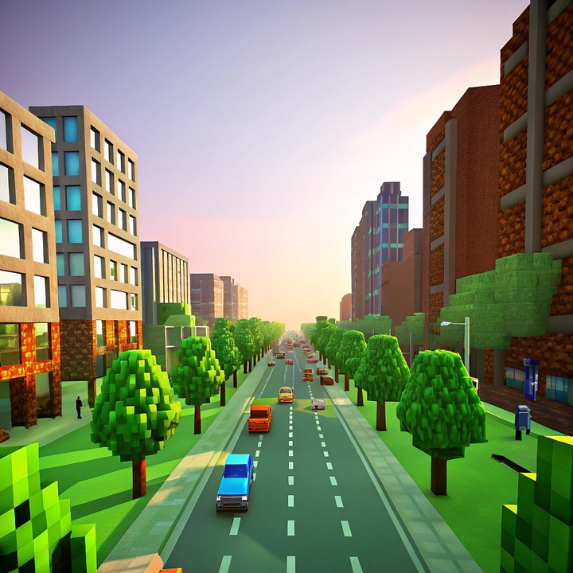

# Sharpness Retention

This metric evaluates the stability of fine details by monitoring the evolution of edge gradients. Successful numeric scores are official: they enter the `quality` dimension and the public leaderboard vector. We propose a vectorized Tenengrad method: independently compute the sum of absolute gradients in the horizontal ($G_x$) and vertical ($G_y$) directions, and construct a 2-D sharpness vector to capture texture-direction features:

\[
\mathbf{g}_t
=
\begin{pmatrix}
\sum |G_x| \\
\sum |G_y|
\end{pmatrix}
\tag{6}
\]

where $G_x$ and $G_y$ are Sobel responses ($3\times3$ kernel) on the grayscale frame $I_t$.

A **noise-aware circuit breaker** distinguishes true detail from high-frequency artifacts. Let $n_t$ be the BRISQUE noise score at frame $t$ and $\tau$ a noise threshold. When high noise ($n_t > \tau$) occurs for $5$ consecutive frames, the triggered state is $I_{\mathrm{trig}}=1$. The fusing penalty logic $M$ combines texture similarity with the breaker state (similarity $S(\cdot,\cdot)$ follows the cosine inner product in Eq. (3)):

BRISQUE is undefined for a zero-variance frame. Such a frame receives the configured worst-case `brisque_bad` value and remains in the aggregate, so a collapse to a flat or black frame is penalized rather than silently excluded as a missing score.

\[
M(x_t)
=
\begin{cases}
S(\mathbf{g}_t, \mathbf{g}_1), & I_{\mathrm{trig}} = 0 \;\wedge\; n_t < \tau \\[4pt]
\mathrm{clip}\!\bigl(1 - S(\mathbf{g}_t, \mathbf{g}_1),\, 0,\, 0.2\bigr), & \text{otherwise}
\end{cases}
\tag{11}
\]

An **upper-convex logarithmic transform** $L(\cdot)$ enhances low-to-mid score segments ($x \in [0,1]$, avoiding undefined logarithms and preserving normalization):

\[
L(x)
=
\frac{\ln(1 + k \cdot x)}{\ln(1 + k)},
\quad k > 0
\tag{10}
\]

where $k$ controls the upper-convex degree; $k \in [10, 20]$ is common in vision pipelines. The numerator ensures $x=0 \Rightarrow L(x)=0$; the denominator ensures $x=1 \Rightarrow L(x)=1$.

Temporal aggregation uses normalized exponentially decaying weights $\hat{w}(d)$ (Eq. (5) in the brightness-consistency metric, $d \in [1, T-1]$). The comprehensive score is:

\[
S_{\mathrm{Sharpness}}
=
\sum_{d=1}^{T-1}
\hat{w}(d) \cdot L\!\left(M(x_{d+1})\right)
\tag{12}
\]

where $S(\mathbf{g}_t, \mathbf{g}_1)$ is the cosine similarity between the sharpness vector of frame $t$ and the initial frame. This mechanism distinguishes genuine detail from high-frequency noise and penalizes systematic visual collapse.

<!-- metric-examples:start -->
## Human-reviewed Same-Case Example

The examples below come from the same-case comparison index generated from `artifacts/reports`. The input image, sample ID, and exact generation prompt are identical within each pair. Candidates were shortlisted by score quantiles and gap, then reviewed frame by frame. Labels describe only this metric—not overall model quality—and model names are intentionally omitted so a single case is not mistaken for a leaderboard.

Audit manifest: `docs/assets/metric_examples/curated_same_case_manifest.json`.

<article class="metric-case-exhibit metric-case-exhibit--curated">
  

    <figure class="metric-input-card">
      
      <figcaption>Input image</figcaption>
    </figure>
    

      
Human reviewed · same case, input and prompt · gap 0.9009

      <h4><code>image_static_stylized_city_0023</code></h4>
      
Suite: image_staticScene: stylized / outdoor / city

      

        Exact generation prompt
        
Camera move right. A stylized city street with buildings, pedestrians, and trees. Camera pan right. A stylized city street with park gates, benches, and trees. Camera pull out. A stylized city street with fountain, people, and paved square.

        <small>prompt source: prompt_target</small>
      

      
The higher-scoring rollout retains crisp edges and fine structure; the lower-scoring rollout progressively blurs and dissolves the city scene.

    

  

  

    <figure class="metric-output-card metric-output-card--good">
      

        <video class="metric-output-video" controls muted loop playsinline preload="metadata" aria-label="Higher metric score: image_static_stylized_city_0023">
          <source src="../../../assets/metric_examples/curated_20260801/2cfbdda4e56c__image_static_stylized_city_0023__high.mp4" type="video/mp4">
        </video>
        
Higher metric score · Score 0.9858

      

      <figcaption class="metric-output-caption"><strong>Higher metric score</strong>sharpness_retention</figcaption>
    </figure>
    <figure class="metric-output-card metric-output-card--bad">
      

        <video class="metric-output-video" controls muted loop playsinline preload="metadata" aria-label="Lower metric score: image_static_stylized_city_0023">
          <source src="../../../assets/metric_examples/curated_20260801/b4f81c8fb084__image_static_stylized_city_0023__low.mp4" type="video/mp4">
        </video>
        
Lower metric score · Score 0.0849

      

      <figcaption class="metric-output-caption"><strong>Lower metric score</strong>sharpness_retention</figcaption>
    </figure>
  

</article>

<!-- metric-examples:end -->
