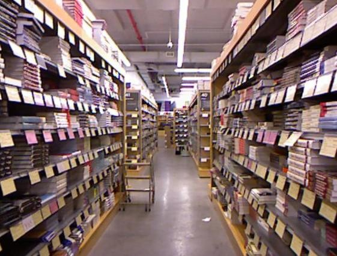
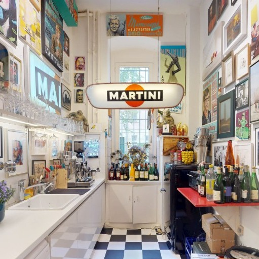
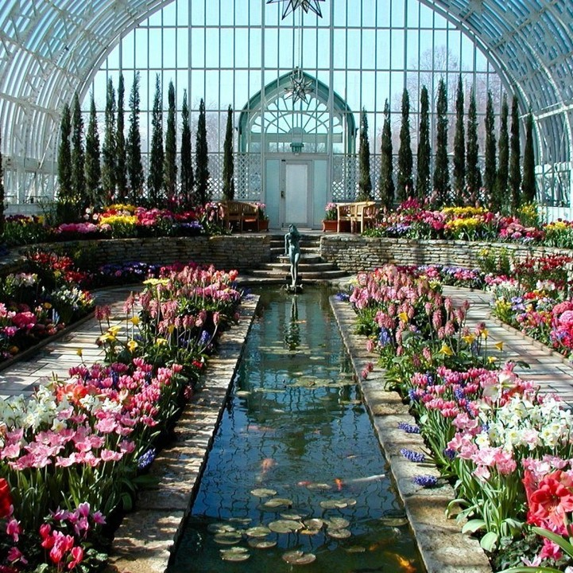

# SSIM

**ssim** measures frame-wise structural similarity between prediction and reference.

## What It Measures

- structural closeness to the reference
- luminance, contrast, and local-structure agreement
- reconstruction-style similarity with a mild perceptual bias

## Detailed Algorithm

1. WorldArena pairs sampled prediction and reference frames at aligned time indices.
2. The prediction frame is resized to the reference frame resolution if needed.
3. For each RGB channel, it computes a standard Gaussian-window SSIM map.
4. Channel SSIM scores are averaged into one frame score.
5. The raw metric is the mean frame SSIM.

## Inputs And Outputs

| Item | Current implementation |
| --- | --- |
| Prediction input | sampled prediction frames |
| Reference input | sampled reference frames |
| Annotation input | none |
| Raw output | one scalar mean SSIM score in `[0, 1]` |
| Normalized output | bounded scalar under the default config |
| Details payload | `frame_scores`, frame index metadata |
| Failure mode | returns `raw = null`, `normalized = null`, and an error string if no aligned frames are available |

## Integration Readiness

| Item | Verdict |
| --- | --- |
| Current aggregation | `diagnostic` only |
| Publication verdict | `Supporting only` |

- Why it is useful: it is more structure-aware than raw PSNR.
- Why it is limited: like PSNR, it still rewards reference copying and should not stand in for semantic
  or control correctness.
- Recommended use: report it only as a supporting full-reference metric.

<!-- metric-examples:start -->
## Verified Same-Input Examples

Up to three cases are shown per metric. Within each case, both videos must belong to the same benchmark sample, and both first frames must pass SIFT + RANSAC geometric matching against that case's displayed input. Candidates that fail are not published. Labels compare this metric only, not overall model quality.

Audit manifest: `docs/assets/metric_examples/curated_same_case_manifest.json`.

<article class="metric-case-exhibit metric-case-exhibit--curated">
  

    <figure class="metric-input-card">
      
      <figcaption>Input image</figcaption>
    </figure>
    

      
Input verified · same benchmark case · gap 0.7476

      <h4><code>image_static_photorealistic_passageways_0076</code></h4>
      
Suite: image_staticScene: photorealistic / indoor / passageways

      

        Benchmark prompt target
        
Camera move right. A library aisle with bookshelves, books, and reading table.

        <small>prompt source: prompt_target</small>
      

      
Both first frames passed geometric matching against the displayed input; labels compare this metric only.

    

  

  

    <figure class="metric-output-card metric-output-card--good">
      

        <video class="metric-output-video" controls muted loop playsinline preload="metadata" aria-label="Higher metric score: image_static_photorealistic_passageways_0076">
          <source src="../../../assets/metric_examples/curated_20260801/5bc5be0ae204__image_static_photorealistic_passageways_0076__high.mp4" type="video/mp4">
        </video>
        
Higher metric score · Score 0.9410

      

      <figcaption class="metric-output-caption"><strong>Higher metric score</strong>ssim</figcaption>
    </figure>
    <figure class="metric-output-card metric-output-card--bad">
      

        <video class="metric-output-video" controls muted loop playsinline preload="metadata" aria-label="Lower metric score: image_static_photorealistic_passageways_0076">
          <source src="../../../assets/metric_examples/curated_20260801/07118e8eb56d__image_static_photorealistic_passageways_0076__low.mp4" type="video/mp4">
        </video>
        
Lower metric score · Score 0.1934

      

      <figcaption class="metric-output-caption"><strong>Lower metric score</strong>ssim</figcaption>
    </figure>
  

</article>
<article class="metric-case-exhibit metric-case-exhibit--curated">
  

    <figure class="metric-input-card">
      
      <figcaption>Input image</figcaption>
    </figure>
    

      
Input verified · same benchmark case · gap 0.6786

      <h4><code>image_static_photorealistic_dining_spaces_0032</code></h4>
      
Suite: image_staticScene: photorealistic / indoor / dining_spaces

      

        Benchmark prompt target
        
Camera orbit left. An eclectic kitchen with martini sign, posters, and fruit bowl.

        <small>prompt source: prompt_target</small>
      

      
Both first frames passed geometric matching against the displayed input; labels compare this metric only.

    

  

  

    <figure class="metric-output-card metric-output-card--good">
      

        <video class="metric-output-video" controls muted loop playsinline preload="metadata" aria-label="Higher metric score: image_static_photorealistic_dining_spaces_0032">
          <source src="../../../assets/metric_examples/curated_20260801/c0df8ae0b4fc__image_static_photorealistic_dining_spaces_0032__high.mp4" type="video/mp4">
        </video>
        
Higher metric score · Score 0.9218

      

      <figcaption class="metric-output-caption"><strong>Higher metric score</strong>ssim</figcaption>
    </figure>
    <figure class="metric-output-card metric-output-card--bad">
      

        <video class="metric-output-video" controls muted loop playsinline preload="metadata" aria-label="Lower metric score: image_static_photorealistic_dining_spaces_0032">
          <source src="../../../assets/metric_examples/curated_20260801/81c3f89d947c__image_static_photorealistic_dining_spaces_0032__low.mp4" type="video/mp4">
        </video>
        
Lower metric score · Score 0.2432

      

      <figcaption class="metric-output-caption"><strong>Lower metric score</strong>ssim</figcaption>
    </figure>
  

</article>
<article class="metric-case-exhibit metric-case-exhibit--curated">
  

    <figure class="metric-input-card">
      
      <figcaption>Input image</figcaption>
    </figure>
    

      
Input verified · same benchmark case · gap 0.6761

      <h4><code>image_static_photorealistic_verdant_landscape_0001</code></h4>
      
Suite: image_staticScene: photorealistic / outdoor / verdant_landscape

      

        Benchmark prompt target
        
Camera pull out. An indoor garden with flower beds, statues, and arched windows. Camera pan left. An indoor garden with side path, benches, and flower beds. Camera move left. An indoor garden with exit door, plants, and sunlight.

        <small>prompt source: prompt_target</small>
      

      
Both first frames passed geometric matching against the displayed input; labels compare this metric only.

    

  

  

    <figure class="metric-output-card metric-output-card--good">
      

        <video class="metric-output-video" controls muted loop playsinline preload="metadata" aria-label="Higher metric score: image_static_photorealistic_verdant_landscape_0001">
          <source src="../../../assets/metric_examples/curated_20260801/3b4d97b32e5b__image_static_photorealistic_verdant_landscape_0001__high.mp4" type="video/mp4">
        </video>
        
Higher metric score · Score 0.7518

      

      <figcaption class="metric-output-caption"><strong>Higher metric score</strong>ssim</figcaption>
    </figure>
    <figure class="metric-output-card metric-output-card--bad">
      

        <video class="metric-output-video" controls muted loop playsinline preload="metadata" aria-label="Lower metric score: image_static_photorealistic_verdant_landscape_0001">
          <source src="../../../assets/metric_examples/curated_20260801/258b319b48d6__image_static_photorealistic_verdant_landscape_0001__low.mp4" type="video/mp4">
        </video>
        
Lower metric score · Score 0.0757

      

      <figcaption class="metric-output-caption"><strong>Lower metric score</strong>ssim</figcaption>
    </figure>
  

</article>

<!-- metric-examples:end -->
