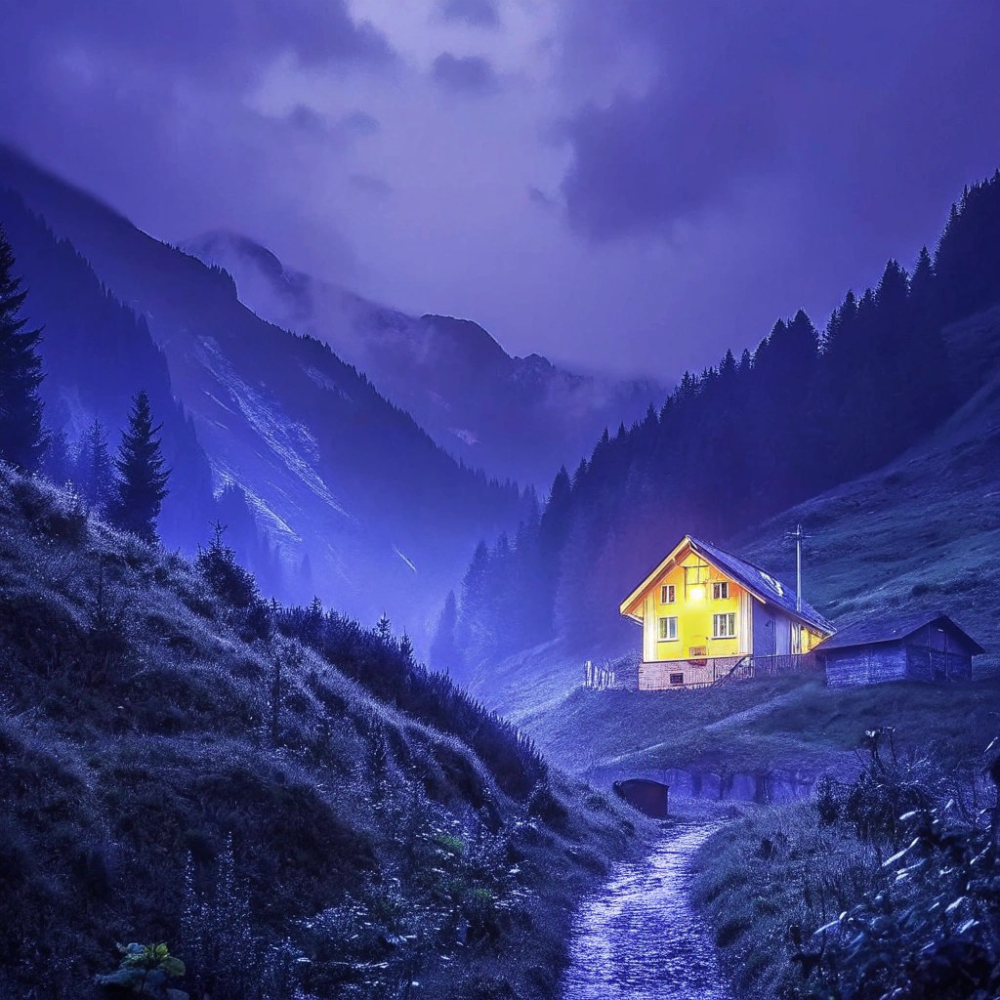
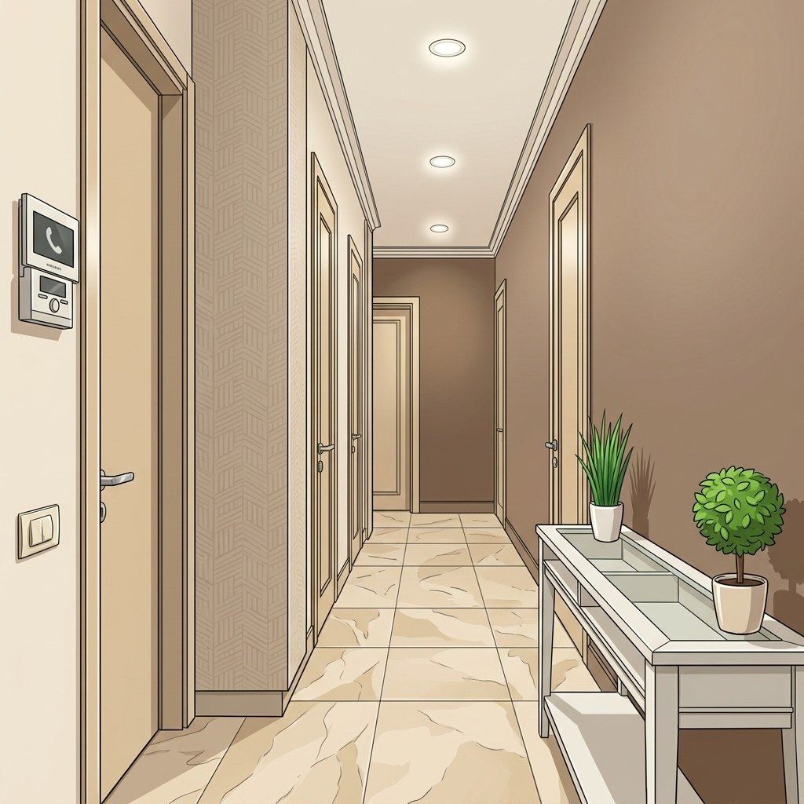
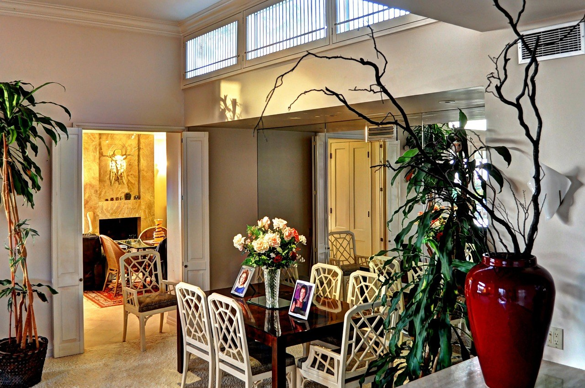
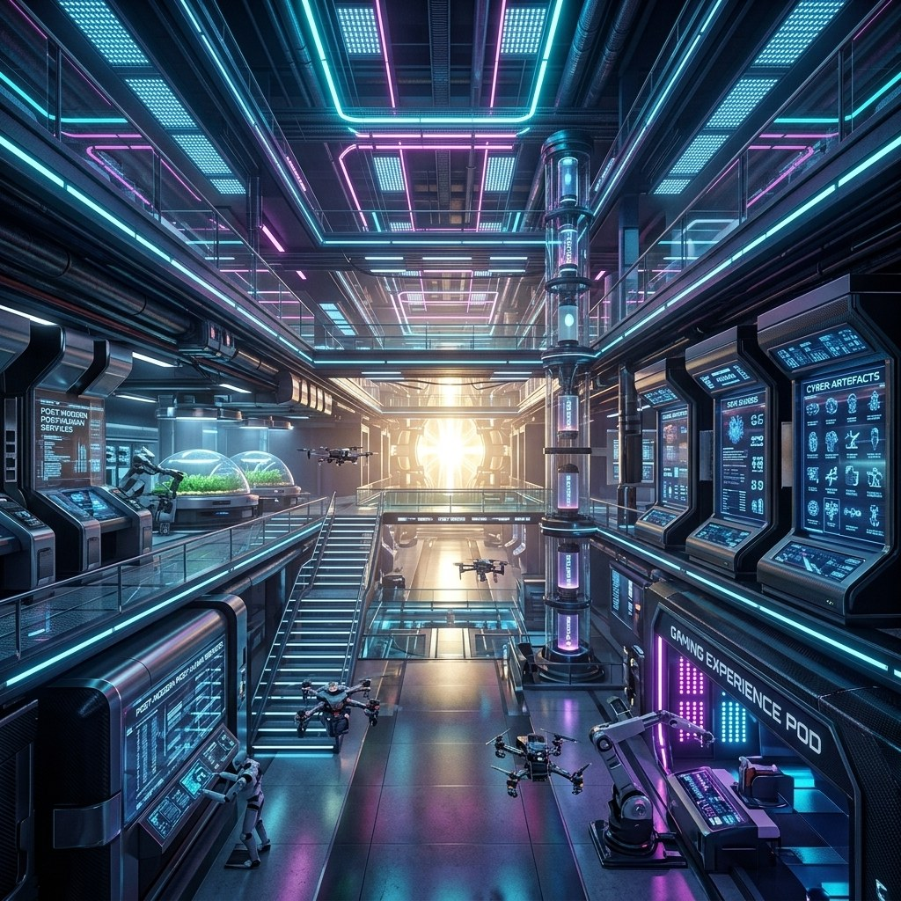
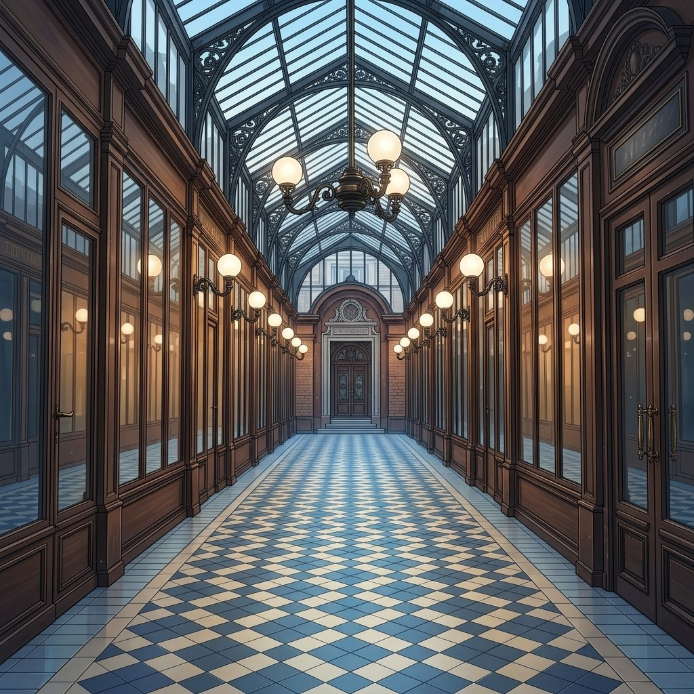

# Style Consistency
This metric evaluates the stability of visual style—color palette, texture, and coarse appearance statistics—across scenes within a generated rollout.  Given protocol-selected anchor frames $\{I_t\}_{t=1}^{T}$ with $T \geq 2$, the first frame $I_1$ serves as the style reference; each later anchor $I_{d+1}$ ($d \in [1, T-1]$) is compared against $I_1$ via multi-layer VGG19 Gram representations.

Each frame $I_t$ is resized ($512 \times 512$ on CUDA, $128 \times 128$ on CPU), converted to a tensor, and normalized with ImageNet mean and standard deviation before a forward pass through VGG19 `features`. At the outputs of convolutional layers $\mathrm{conv}_1, \ldots, \mathrm{conv}_5$ (before ReLU), feature maps $F_{t,l} \in \mathbb{R}^{C \times H \times W}$ are extracted. The Gram matrix is defined as

\[
G(F)
=
\frac{
    \mathrm{vec}(F)\,\mathrm{vec}(F)^{\top}
}{
    C \cdot H \cdot W
}
\tag{1}
\]

where $\mathrm{vec}(\cdot)$ denotes vectorization. The layer-wise style distance for frame $d+1$ at layer $l$ is

\[
\delta_{d,l}
=
\mathrm{MSE}\!\left(
    G(F_{d+1,l}),\,
    G(F_{1,l})
\right)
\tag{2}
\]

The per-frame distance is the sum over five layers:

\[
d_d
=
\sum_{l \in \{\mathrm{conv}_1, \ldots, \mathrm{conv}_5\}}
\delta_{d,l}
\tag{3}
\]

The raw score is the arithmetic mean over later anchors (**lower is better**):

\[
\mathrm{raw}
=
\frac{1}{T-1}
\sum_{d=1}^{T-1} d_d
\tag{4}
\]

Normalization follows configured empirical bounds $\varepsilon_{\min}=0$ and $\varepsilon_{\max}=0.007$ (`higher_is_better=false`). The raw value is first clamped to the empirical range, then mapped to a **higher-is-better** score in $[0,1]$:

\[
\mathrm{raw}'
=
\mathrm{clip}(\mathrm{raw},\, \varepsilon_{\min},\, \varepsilon_{\max})
\tag{5}
\]

\[
S_{\mathrm{style}}
=
1
-
\frac{
    \mathrm{raw}' - \varepsilon_{\min}
}{
    \varepsilon_{\max} - \varepsilon_{\min}
}
\tag{6}
\]

<!-- metric-examples:start -->
## Representative Same-Case Comparisons
Each exhibit first shows the input image and the exact displayed prompt for the case, then compares generated outputs. Paired exhibits require the same input image and the same prompt text, with one high-scoring and one low-scoring model output. Metrics without such a cross-model pair in the current formal snapshot are separated as high/low extrema rather than presented as same-case comparisons.
Machine-readable paired export: `docs/assets/metric_examples/paired_manifest.csv`.
### `style_consistency`

<article class="metric-case-exhibit">
  

    <figure class="metric-input-card">
      
      <figcaption>Input image</figcaption>
    </figure>
    

      
Case 1 · same input image + same prompt · score gap 1.0000

      <h4><code>image_static_stylized_verdant_landscape_0035</code></h4>
      
Suite: image_staticScene: stylized / outdoor / verdant_landscape

      

        Prompt target
        
Camera pan right. A mountain valley with stream, rocks, and pine trees. Camera move right. A mountain valley with wooden bridge, stream, and pine trees. Camera pull out. A mountain valley with open meadow, wildflowers, and pine trees.

        <small>prompt source: prompt_target</small>
      

    

  

  

<figure class="metric-output-card metric-output-card--good">
  

    <video class="metric-output-video" controls muted loop playsinline preload="metadata" aria-label="Good output: image_static_stylized_verdant_landscape_0035">
      <source src="../../../assets/metric_examples/2dbcfaa7a1f7__dreamx_world__image_static_stylized_verdant_landscape_0035.mp4" type="video/mp4">
    </video>
    
Good output · Score 1.0000

  

</figure>
<figure class="metric-output-card metric-output-card--bad">
  

    <video class="metric-output-video" controls muted loop playsinline preload="metadata" aria-label="Poor output: image_static_stylized_verdant_landscape_0035">
      <source src="../../../assets/metric_examples/3266a5a9d6da__yume-sample5b-missing-reverse-5s-target__image_static_stylized_verdant_landscape_0035.mp4" type="video/mp4">
    </video>
    
Poor output · Score 0.0000

  

</figure>
  

</article>
<article class="metric-case-exhibit">
  

    <figure class="metric-input-card">
      
      <figcaption>Input image</figcaption>
    </figure>
    

      
Case 2 · same input image + same prompt · score gap 1.0000

      <h4><code>image_static_stylized_public_spaces_0059</code></h4>
      
Suite: image_staticScene: stylized / indoor / public_spaces

      

        Prompt target
        
Camera orbit right. A grand library hall with bookshelves, reading table, and chairs.

        <small>prompt source: prompt_target</small>
      

    

  

  

<figure class="metric-output-card metric-output-card--good">
  

    <video class="metric-output-video" controls muted loop playsinline preload="metadata" aria-label="Good output: image_static_stylized_public_spaces_0059">
      <source src="../../../assets/metric_examples/f4a431310e49__wan22-ti2v-5b-image-static-plan-missing__image_static_stylized_public_spaces_0059.mp4" type="video/mp4">
    </video>
    
Good output · Score 1.0000

  

</figure>
<figure class="metric-output-card metric-output-card--bad">
  

    <video class="metric-output-video" controls muted loop playsinline preload="metadata" aria-label="Poor output: image_static_stylized_public_spaces_0059">
      <source src="../../../assets/metric_examples/2d56c790c720__yume-sample5b-missing-reverse-5s-target__image_static_stylized_public_spaces_0059.mp4" type="video/mp4">
    </video>
    
Poor output · Score 0.0000

  

</figure>
  

</article>
<article class="metric-case-exhibit">
  

    <figure class="metric-input-card">
      
      <figcaption>Input image</figcaption>
    </figure>
    

      
Case 3 · same input image + same prompt · score gap 1.0000

      <h4><code>image_static_stylized_passageways_0059</code></h4>
      
Suite: image_staticScene: stylized / indoor / passageways

      

        Prompt target
        
Camera pan right. A passageways scene with hallway, doors, and wall art. Camera move right. A passageways scene with hallway, doors, and window. Camera pull out. A living room with sofa, coffee table, and television.

        <small>prompt source: prompt_target</small>
      

    

  

  

<figure class="metric-output-card metric-output-card--good">
  

    <video class="metric-output-video" controls muted loop playsinline preload="metadata" aria-label="Good output: image_static_stylized_passageways_0059">
      <source src="../../../assets/metric_examples/aa3d2a84e53a__longcat-video-image-static-8gpu-20260612_133950__image_static_stylized_passageways_0059.mp4" type="video/mp4">
    </video>
    
Good output · Score 1.0000

  

</figure>
<figure class="metric-output-card metric-output-card--bad">
  

    <video class="metric-output-video" controls muted loop playsinline preload="metadata" aria-label="Poor output: image_static_stylized_passageways_0059">
      <source src="../../../assets/metric_examples/2434f143dbc5__yume-sample5b-missing-reverse-5s-target__image_static_stylized_passageways_0059.mp4" type="video/mp4">
    </video>
    
Poor output · Score 0.0000

  

</figure>
  

</article>
<article class="metric-case-exhibit">
  

    <figure class="metric-input-card">
      
      <figcaption>Input image</figcaption>
    </figure>
    

      
Case 4 · same input image + same prompt · score gap 1.0000

      <h4><code>image_static_photorealistic_dining_spaces_0150</code></h4>
      
Suite: image_staticScene: photorealistic / indoor / dining_spaces

      

        Prompt target
        
Camera pan left. A living area with fireplace, chairs, and wall sculpture.

        <small>prompt source: prompt_target</small>
      

    

  

  

<figure class="metric-output-card metric-output-card--good">
  

    <video class="metric-output-video" controls muted loop playsinline preload="metadata" aria-label="Good output: image_static_photorealistic_dining_spaces_0150">
      <source src="../../../assets/metric_examples/0bcc7d417411__wan22-image-static-8gpu-20260612_160808__image_static_photorealistic_dining_spaces_0150.mp4" type="video/mp4">
    </video>
    
Good output · Score 1.0000

  

</figure>
<figure class="metric-output-card metric-output-card--bad">
  

    <video class="metric-output-video" controls muted loop playsinline preload="metadata" aria-label="Poor output: image_static_photorealistic_dining_spaces_0150">
      <source src="../../../assets/metric_examples/6122df6dd5c2__yume-sample5b-image-static-dynamic-5s__image_static_photorealistic_dining_spaces_0150.mp4" type="video/mp4">
    </video>
    
Poor output · Score 0.0000

  

</figure>
  

</article>
<article class="metric-case-exhibit">
  

    <figure class="metric-input-card">
      
      <figcaption>Input image</figcaption>
    </figure>
    

      
Case 5 · same input image + same prompt · score gap 1.0000

      <h4><code>image_static_stylized_public_spaces_0146</code></h4>
      
Suite: image_staticScene: stylized / indoor / public_spaces

      

        Prompt target
        
Camera pan left. A futuristic facility with control panels, holographic displays, and neon lights. Camera move left. A futuristic facility with interactive kiosks, virtual reality stations, and holographic displays. Camera pull out. A futuristic facility with security checkpoint, automated doors, and interactive kiosks.

        <small>prompt source: prompt_target</small>
      

    

  

  

<figure class="metric-output-card metric-output-card--good">
  

    <video class="metric-output-video" controls muted loop playsinline preload="metadata" aria-label="Good output: image_static_stylized_public_spaces_0146">
      <source src="../../../assets/metric_examples/5142ed71bc6a__lingbot_world__image_static_stylized_public_spaces_0146.mp4" type="video/mp4">
    </video>
    
Good output · Score 1.0000

  

</figure>
<figure class="metric-output-card metric-output-card--bad">
  

    <video class="metric-output-video" controls muted loop playsinline preload="metadata" aria-label="Poor output: image_static_stylized_public_spaces_0146">
      <source src="../../../assets/metric_examples/9f3e178a8bf5__wan22-ti2v-5b-image-static-plan-missing__image_static_stylized_public_spaces_0146.mp4" type="video/mp4">
    </video>
    
Poor output · Score 0.0000

  

</figure>
  

</article>
<article class="metric-case-exhibit">
  

    <figure class="metric-input-card">
      
      <figcaption>Input image</figcaption>
    </figure>
    

      
Case 6 · same input image + same prompt · score gap 1.0000

      <h4><code>image_static_stylized_passageways_0162</code></h4>
      
Suite: image_staticScene: stylized / indoor / passageways

      

        Prompt target
        
Camera pan right. An elegant passageway with glass walls, light fixtures, and adjacent corridor. Camera move right. An elegant passageway with skylight, potted plants, and atrium. Camera pull out. A lobby area with seating and reception desk.

        <small>prompt source: prompt_target</small>
      

    

  

  

<figure class="metric-output-card metric-output-card--good">
  

    <video class="metric-output-video" controls muted loop playsinline preload="metadata" aria-label="Good output: image_static_stylized_passageways_0162">
      <source src="../../../assets/metric_examples/722f5aa4e411__wan22-ti2v-5b-image-static-plan-missing__image_static_stylized_passageways_0162.mp4" type="video/mp4">
    </video>
    
Good output · Score 1.0000

  

</figure>
<figure class="metric-output-card metric-output-card--bad">
  

    <video class="metric-output-video" controls muted loop playsinline preload="metadata" aria-label="Poor output: image_static_stylized_passageways_0162">
      <source src="../../../assets/metric_examples/a390dd34f900__yume-sample5b-missing-reverse-5s-target__image_static_stylized_passageways_0162.mp4" type="video/mp4">
    </video>
    
Poor output · Score 0.0000

  

</figure>
  

</article>

<!-- metric-examples:end -->

## References {#reference}

!!! quote "Very Deep Convolutional Networks for Large-Scale Image Recognition"

    Karen Simonyan and Andrew Zisserman.
    arXiv:1409.1556, 2014.
    [https://arxiv.org/pdf/1409.1556](https://arxiv.org/pdf/1409.1556)
