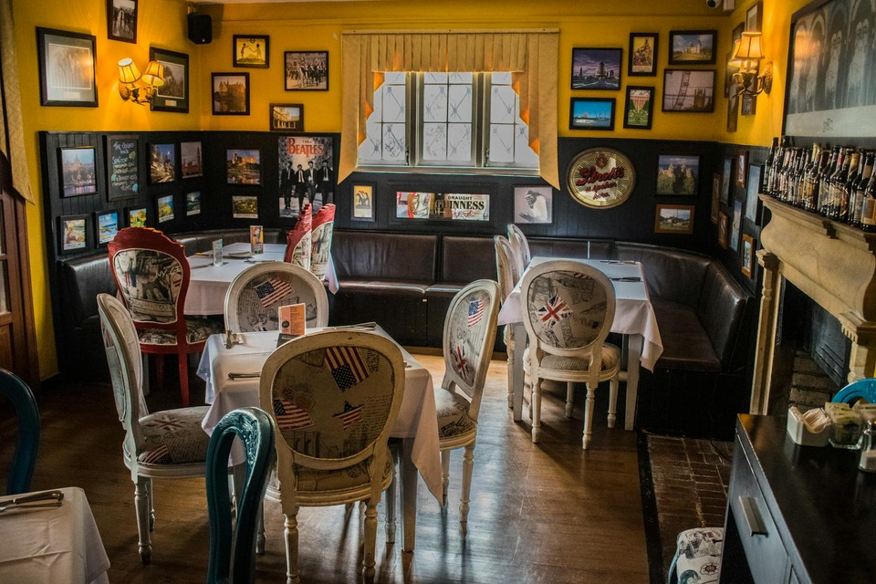

# Temporal Calibration

Temporal Calibration measures whether a generated video preserves a **stable physical clock**. When a file declares a playback frame rate, does the motion visible in the frames imply the same real-time progression? WorldArena applies this as an output-only audit in the `real_time` dimension using the wrapped Pulse-of-Motion / Visual Chronometer predictor [[Gao et al., 2026](#reference-visual-chronometer)].

This is not the same as optical flow, motion magnitude, or temporal smoothness. A rollout can look smooth frame to frame and still be temporally wrong: falls may drift as if gravity were slowed, or fast periodic motion may appear unnaturally sluggish. Visual Chronometer calls this failure mode **chronometric hallucination**—visually coherent dynamics with an ambiguous, unstable, or uncontrollable physical time scale.

The predictor estimates **Physical FPS** (`PhyFPS`) from overlapping temporal windows instead of trusting container metadata alone. WorldArena compares the mean inferred rate with the nominal playback FPS $f_{\mathrm{meta}}$ (OpenCV container FPS, or manifest fallback) and reports three official metrics: `physical_fps_error`, `physical_fps_pct_error`, and `physical_fps_intra_video_cv`. The first two capture global tempo mismatch; the third captures rhythm drift inside a single clip.

For each prediction, the runtime extracts overlapping windows with defaults `clip_length = 30`, `stride = 4`, and `resolution = 216`. Each window yields a segment estimate $\hat{f}_k$. The mean inferred physical FPS is

\[
\bar{f}_{\mathrm{phy}}
=
\frac{1}{K}\sum_{k=1}^{K} \hat{f}_k
\tag{1}
\]

Absolute and relative calibration errors are

\[
E_{\mathrm{abs}} = \left|\bar{f}_{\mathrm{phy}} - f_{\mathrm{meta}}\right|
\tag{2}
\]

\[
E_{\mathrm{pct}} = \frac{E_{\mathrm{abs}}}{f_{\mathrm{meta}}}
\tag{3}
\]

Within-video instability is the coefficient of variation over segment predictions:

\[
C_{\mathrm{intra}}
=
\frac{\operatorname{std}(\hat{f}_1,\ldots,\hat{f}_K)}{\operatorname{mean}(\hat{f}_1,\ldots,\hat{f}_K)}
\tag{4}
\]

WorldArena maps `physical_fps_error`, `physical_fps_pct_error`, and `physical_fps_intra_video_cv` to $[0,1]$ with fixed reverse scaling (`physical_fps_error`: $[0,30]$; the other two: $[0,1]$). **Higher normalized values mean better temporal calibration.** When the side runtime, checkpoint, or FPS metadata is unavailable, the metric family is reported as `not_applicable`.

## References {#reference-visual-chronometer}

!!! quote "The Pulse of Motion: Measuring Physical Frame Rate from Visual Dynamics"

    Xiangbo Gao, Mingyang Wu, Siyuan Yang, Jiongze Yu, Pardis Taghavi, Fangzhou Lin, and Zhengzhong Tu.  
    arXiv:2603.14375, 2026.

<!-- metric-examples:start -->
## Human-reviewed Same-Case Example

The examples below come from the same-case comparison index generated from `artifacts/reports`. The input image, sample ID, and exact generation prompt are identical within each pair. Candidates were shortlisted by score quantiles and gap, then reviewed frame by frame. Labels describe only this metric—not overall model quality—and model names are intentionally omitted so a single case is not mistaken for a leaderboard.

Audit manifest: `docs/assets/metric_examples/curated_same_case_manifest.json`.

<article class="metric-case-exhibit metric-case-exhibit--curated">
  

    <figure class="metric-input-card">
      
      <figcaption>Input image</figcaption>
    </figure>
    

      
Human reviewed · same case, input and prompt · gap 0.9833

      <h4><code>image_static_stylized_suburb_0123</code></h4>
      
Suite: image_staticScene: stylized / outdoor / suburb

      

        Exact generation prompt
        
Camera move left. A historic courtyard with garden, pathways, and seating.

        <small>prompt source: prompt_target</small>
      

      
Both outputs depict the same courtyard. Judge the playback cadence: the higher-scoring output's estimated physical FPS nearly matches its container FPS, while the lower-scoring output's motion is calibrated far faster than its declared rate.

    

  

  

    <figure class="metric-output-card metric-output-card--good">
      

        <video class="metric-output-video" controls muted loop playsinline preload="metadata" aria-label="Higher metric score: image_static_stylized_suburb_0123">
          <source src="../../../assets/metric_examples/curated_20260801/7baeb4773bfa__image_static_stylized_suburb_0123__high.mp4" type="video/mp4">
        </video>
        
Higher metric score · Score 0.9933

      

      <figcaption class="metric-output-caption"><strong>Higher metric score</strong>physical_fps_errorEstimated physical FPS 23.8 · declared FPS 24.0 · absolute error 0.2</figcaption>
    </figure>
    <figure class="metric-output-card metric-output-card--bad">
      

        <video class="metric-output-video" controls muted loop playsinline preload="metadata" aria-label="Lower metric score: image_static_stylized_suburb_0123">
          <source src="../../../assets/metric_examples/curated_20260801/8fca43aff466__image_static_stylized_suburb_0123__low.mp4" type="video/mp4">
        </video>
        
Lower metric score · Score 0.0100

      

      <figcaption class="metric-output-caption"><strong>Lower metric score</strong>physical_fps_errorEstimated physical FPS 44.7 · declared FPS 15.0 · absolute error 29.7</figcaption>
    </figure>
  

</article>
<article class="metric-case-exhibit metric-case-exhibit--curated">
  

    <figure class="metric-input-card">
      
      <figcaption>Input image</figcaption>
    </figure>
    

      
Human reviewed · same case, input and prompt · gap 0.7192

      <h4><code>image_static_photorealistic_workspaces_0144</code></h4>
      
Suite: image_staticScene: photorealistic / indoor / workspaces

      

        Exact generation prompt
        
Camera move left. A modern conference room with side wall, whiteboard, and chairs. Camera pull out. A modern conference room with entrance door, coat rack, and chairs. Camera pan left. A modern conference room with hallway and artwork.

        <small>prompt source: prompt_target</small>
      

      
The higher-scoring conference-room move maintains an almost constant physical-FPS cadence; the lower-scoring output drops sharply from a fast opening to a much slower remainder. Appearance quality is not what this metric measures.

    

  

  

    <figure class="metric-output-card metric-output-card--good">
      

        <video class="metric-output-video" controls muted loop playsinline preload="metadata" aria-label="Higher metric score: image_static_photorealistic_workspaces_0144">
          <source src="../../../assets/metric_examples/curated_20260801/61c84b8ed7cc__image_static_photorealistic_workspaces_0144__high.mp4" type="video/mp4">
        </video>
        
Higher metric score · Score 0.9894

      

      <figcaption class="metric-output-caption"><strong>Higher metric score</strong>physical_fps_intra_video_cvSegment physical FPS 69.1–71.7 · coefficient of variation 0.011</figcaption>
    </figure>
    <figure class="metric-output-card metric-output-card--bad">
      

        <video class="metric-output-video" controls muted loop playsinline preload="metadata" aria-label="Lower metric score: image_static_photorealistic_workspaces_0144">
          <source src="../../../assets/metric_examples/curated_20260801/ed03c3e72ce1__image_static_photorealistic_workspaces_0144__low.mp4" type="video/mp4">
        </video>
        
Lower metric score · Score 0.2702

      

      <figcaption class="metric-output-caption"><strong>Lower metric score</strong>physical_fps_intra_video_cvSegment physical FPS 11.9–54.8 · coefficient of variation 0.730</figcaption>
    </figure>
  

</article>
<article class="metric-case-exhibit metric-case-exhibit--curated">
  

    <figure class="metric-input-card">
      
      <figcaption>Input image</figcaption>
    </figure>
    

      
Human reviewed · same case, input and prompt · gap 0.9983

      <h4><code>image_static_photorealistic_dining_spaces_0137</code></h4>
      
Suite: image_staticScene: photorealistic / indoor / dining_spaces

      

        Exact generation prompt
        
Camera orbit left. A cozy dining area with bar counter, stools, and tables.

        <small>prompt source: prompt_target</small>
      

      
The higher-scoring orbit has estimated physical FPS aligned with its declared FPS; the lower-scoring output moves at roughly 60 physical FPS while declaring only 13 FPS, producing a very large relative error.

    

  

  

    <figure class="metric-output-card metric-output-card--good">
      

        <video class="metric-output-video" controls muted loop playsinline preload="metadata" aria-label="Higher metric score: image_static_photorealistic_dining_spaces_0137">
          <source src="../../../assets/metric_examples/curated_20260801/10332b72a711__image_static_photorealistic_dining_spaces_0137__high.mp4" type="video/mp4">
        </video>
        
Higher metric score · Score 0.9983

      

      <figcaption class="metric-output-caption"><strong>Higher metric score</strong>physical_fps_pct_errorEstimated physical FPS 60.1 · declared FPS 60.0 · relative error 0.17%</figcaption>
    </figure>
    <figure class="metric-output-card metric-output-card--bad">
      

        <video class="metric-output-video" controls muted loop playsinline preload="metadata" aria-label="Lower metric score: image_static_photorealistic_dining_spaces_0137">
          <source src="../../../assets/metric_examples/curated_20260801/41740b9f9a00__image_static_photorealistic_dining_spaces_0137__low.mp4" type="video/mp4">
        </video>
        
Lower metric score · Score 0.0000

      

      <figcaption class="metric-output-caption"><strong>Lower metric score</strong>physical_fps_pct_errorEstimated physical FPS 59.8 · declared FPS 13.0 · relative error 360.00%</figcaption>
    </figure>
  

</article>

<!-- metric-examples:end -->
