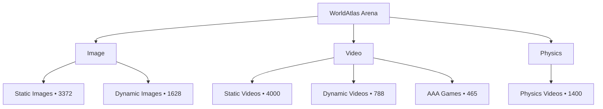

# Dataset Overview

!!! info "Generated"
    Run `worldarena build-docs --config config/datasets.yaml` after adding, deleting, or reorganizing source assets.

Snapshot note: panels and charts below use cached `docs/generated/` artifacts in this checkout because live dataset roots were unavailable during the last `worldarena build-docs` run. Re-run against local dataset roots when a live rescan is available.

## Summary

WorldAtlas Arena combines a multi-regime benchmark corpus, a six-axis evaluation contract, and a registry of world-model adapters. The panels below summarize scale from complementary angles—media inventory, task regime, metric surface, and model coverage—before the collection tables and sample galleries.

## Benchmark Scale

Headline totals, media inventory, task regimes, and benchmark contract surface.

  
Headline totals

  
Primary inventory counts, suites, metrics, and model coverage.

  
Benchmark Items

  
11,653

  
Primary rows across image, video, and physics suites

  
Formal Suites

  
4

  
Public benchmark contracts in `config/benchmark.yaml`

  
Documented Metrics

  
47

  
Public metric inventory in the benchmark docs

  
Evaluation Dimensions

  
6

  
Axes aggregated in `per_dimension_summary.json`

  
Registered Models

  
25

  
Adapter configs under `config/models/`

  
Annotated Rows

  
5,496

  
47.2% of benchmark rows carry supervision sidecars

  
Media inventory

  
Image, video, and physics assets in the benchmark corpus.

  
Images

  
5,000

  
Static and dynamic image assets

  
Videos

  
5,253

  
Static, dynamic, and gameplay videos

  
Physics

  
1,400

  
Physics-focused video assets

  
Masked Dynamics

  
2,124

  
Dynamic image and gameplay rows with segmentation masks

  
Task regimes

  
How benchmark rows split across static, dynamic, interaction, and physics tracks.

  

    Static world generation
    63.3%
  

  
7,372

  
Camera or layout change with scene preservation

  

    Dynamic world generation
    20.7%
  

  
2,416

  
In-scene temporal evolution under controlled viewpoints

  

    Interaction-conditioned
    4.0%
  

  
465

  
Gameplay and action-conditioned rollouts

  

    Physics metrics
    12.0%
  

  
1,400

  
Reference motion and simulator-backed physics tracks

  
Evaluation Framework

  
Formal suites separate static, dynamic, and interaction-conditioned generation while sharing a common reporting contract. Each suite declares an applicable metric vector in `config/benchmark.yaml`.

<table>
<thead>
<tr><th align="left">suite</th><th align="left">modality</th><th align="left">regime</th><th align="right">metrics</th></tr>
</thead>
<tbody>
<tr><td align="left">image_static</td><td align="left">image → video</td><td align="left">static</td><td align="right">43</td></tr>
<tr><td align="left">image_dynamic</td><td align="left">image → video</td><td align="left">dynamic</td><td align="right">33</td></tr>
<tr><td align="left">video_static</td><td align="left">video → video</td><td align="left">static</td><td align="right">37</td></tr>
<tr><td align="left">video_dynamic</td><td align="left">video → video</td><td align="left">dynamic</td><td align="right">43</td></tr>
</tbody>
</table>

  
Metrics by Dimension

  

    Long Sequence
    1 metrics · 0 official
  

  

    

  

  

    Action Control
    12 metrics · 4 official
  

  

    

  

  

    3D/4D Consistency
    7 metrics · 2 official
  

  

    

  

  

    Physics
    11 metrics · 10 official
  

  

    

  

  

    Quality
    14 metrics · 5 official
  

  

    

  

  

    Real Time
    2 metrics · 2 official
  

  

    

  

  
Official vs Diagnostic Surface

  
Official surface

  
23

  
Headline or conditionally official metrics in the public inventory

  
Diagnostic probes

  
24

  
Supplemental geometry, reconstruction, and long-horizon probes

  
Experimental suite

  
19

  
Non-headline slice declared separately in `config/benchmark.yaml`

  
See the <a href="benchmark/metrics/index.md">Metrics Overview</a> for eligibility rules, normalization, and aggregation semantics.

  

    <a href="benchmark/metrics/index.md">Metrics Overview</a>
    <a href="benchmark/index.md">Benchmark Overview</a>
    <a href="development.md">Development</a>
  

## Topology

## Collection Summary

| group     | collection     | modality   |   items |   annotated |   masked |
|:----------|:---------------|:-----------|--------:|------------:|---------:|
| benchmark | dynamic_images | image      |    1628 |        1628 |     1628 |
| benchmark | static_images  | image      |    3372 |        3372 |        0 |
| benchmark | physics_videos | physics    |    1400 |           0 |        0 |
| benchmark | aaa_games      | video      |     465 |         465 |      465 |
| benchmark | dynamic_videos | video      |     788 |           0 |        0 |
| benchmark | static_videos  | video      |    4000 |          31 |       31 |

## Collection Volume

<iframe class="chart-frame" src="../generated/charts/overview-collection-volume.html" title="Collection Volume" loading="lazy"></iframe>

## Benchmark Hierarchy

<iframe class="chart-frame" src="../generated/charts/overview-benchmark-hierarchy.html" title="Benchmark Hierarchy" loading="lazy"></iframe>

## Sample Image Gallery

<figure class="sample-card">
  
  <figcaption>
    <strong>Dynamic / Photorealistic / Articulated</strong>
    photorealistic/images/articulated/003.jpg
  </figcaption>
</figure>
<figure class="sample-card">
  
  <figcaption>
    <strong>Static / Photorealistic / Dining Spaces</strong>
    photorealistic/indoor/dining_spaces/000.jpg
  </figcaption>
</figure>
<figure class="sample-card">
  
  <figcaption>
    <strong>Dynamic / Photorealistic / Deformable</strong>
    photorealistic/images/deformable/000.jpg
  </figcaption>
</figure>
<figure class="sample-card">
  
  <figcaption>
    <strong>Dynamic / Photorealistic / Fluid</strong>
    photorealistic/images/fluid/001.jpg
  </figcaption>
</figure>
<figure class="sample-card">
  
  <figcaption>
    <strong>Dynamic / Photorealistic / Multi Motion</strong>
    photorealistic/images/multi_motion/001.jpg
  </figcaption>
</figure>
<figure class="sample-card">
  
  <figcaption>
    <strong>Dynamic / Photorealistic / Rigid</strong>
    photorealistic/images/rigid/000.jpg
  </figcaption>
</figure>
<figure class="sample-card">
  
  <figcaption>
    <strong>Dynamic / Stylized / Articulated</strong>
    stylized/images/articulated/000.jpg
  </figcaption>
</figure>
<figure class="sample-card">
  
  <figcaption>
    <strong>Dynamic / Stylized / Deformable</strong>
    stylized/images/deformable/001.jpg
  </figcaption>
</figure>
<figure class="sample-card">
  
  <figcaption>
    <strong>Dynamic / Stylized / Fluid</strong>
    stylized/images/fluid/000.jpg
  </figcaption>
</figure>
<figure class="sample-card">
  
  <figcaption>
    <strong>Dynamic / Stylized / Multi Motion</strong>
    stylized/images/multi_motion/000.jpg
  </figcaption>
</figure>
<figure class="sample-card">
  
  <figcaption>
    <strong>Dynamic / Stylized / Rigid</strong>
    stylized/images/rigid/000.jpg
  </figcaption>
</figure>
<figure class="sample-card">
  
  <figcaption>
    <strong>Static / Photorealistic / Living Spaces</strong>
    photorealistic/indoor/living_spaces/0000.png
  </figcaption>
</figure>

## Sample Physics Gallery

<figure class="sample-card">
  
  <figcaption>
    <strong>Basic Physics Consistency / Acceleration</strong>
    videos_by_category/basic_physics_consistency/acceleration/00c09d36eacc9b6bc61a368fff295cd06af132b25e4ed4613ed984b1c81ff31c.mp4
  </figcaption>
</figure>
<figure class="sample-card">
  
  <figcaption>
    <strong>Basic Physics Consistency / Uniform Motion</strong>
    videos_by_category/basic_physics_consistency/uniform_motion/06fc5a6aabdcb34a7f9d111775787a3d724b53e086081aae2fd6b6dbc5ce09e8.mp4
  </figcaption>
</figure>

