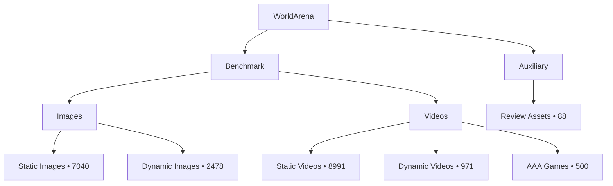

# Dataset Overview

!!! info "Generated"
    Run `worldarena build-docs --config config/datasets.yaml` after adding, deleting, or reorganizing source assets.

  
Benchmark Items

  
19,980

  
Primary benchmark rows

  
Images

  
9,518

  
Static and dynamic image assets

  
Videos

  
10,550

  
Benchmark and auxiliary video assets

  
Annotated Videos

  
6,250

  
Rows with SpatialVID-style metadata

## Topology

## Collection Summary

| group     | collection     | modality   |   items |   annotated |   masked |
|:----------|:---------------|:-----------|--------:|------------:|---------:|
| auxiliary | review_assets  | video      |      88 |           0 |        0 |
| benchmark | dynamic_images | image      |    2478 |           0 |      248 |
| benchmark | static_images  | image      |    7040 |           0 |        0 |
| benchmark | aaa_games      | video      |     500 |         500 |      500 |
| benchmark | dynamic_videos | video      |     971 |         319 |      319 |
| benchmark | static_videos  | video      |    8991 |        5431 |     5431 |

## Collection Volume

<iframe class="chart-frame" src="../generated/charts/overview-collection-volume.html" title="Collection Volume" loading="lazy"></iframe>

## Benchmark Hierarchy

<iframe class="chart-frame" src="../generated/charts/overview-benchmark-hierarchy.html" title="Benchmark Hierarchy" loading="lazy"></iframe>

## Downloadable Artifacts

- [`summary.json`](generated/data/summary.json)
- [`all_records.csv`](generated/data/all_records.csv)
- [`image_records.csv`](generated/data/image_records.csv)
- [`video_records.csv`](generated/data/video_records.csv)
