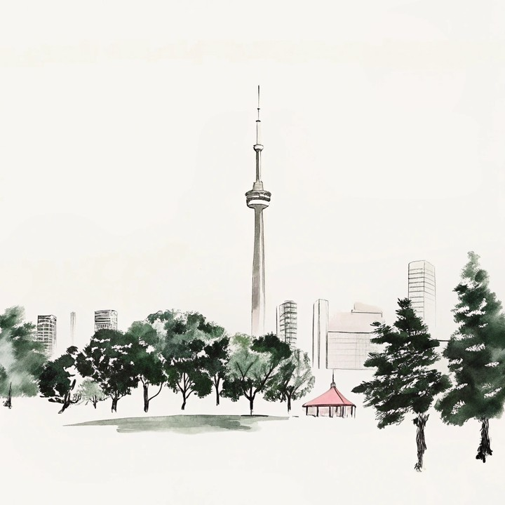
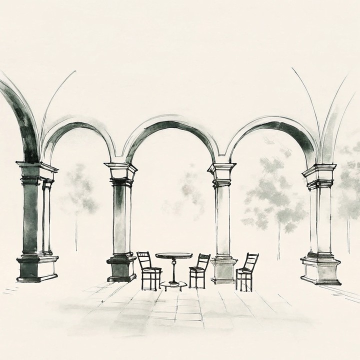

# 亮度一致性

本指标用于量化视频序列中**各帧与初始帧之间亮度分布的时序一致性**，以应对帧间亮度偏移与突变导致的视觉稳定性不足。与仅比较全局平均亮度的标量指标不同，Brightness Consistency 保留暗/中/亮三档像素占比，从而对曝光分布形状的变化更敏感。

WorldArena 将本算法作为正式指标 **`brightness_distribution_consistency`**。旧的标量别名 `brightness_consistency` 仍为 diagnostic，不进入七项正式 quality 总分。

### 三档亮度分布向量

将每帧灰度像素划分为 **暗（dark）**、**中（mid）**、**亮（bright）** 三档，构造三维亮度分布向量：

\[
\mathbf{v}_t
=
\begin{pmatrix}
p_{\mathrm{dark}} \\
p_{\mathrm{mid}} \\
p_{\mathrm{bright}}
\end{pmatrix}
\]

其中 $p_{\mathrm{dark}}$、$p_{\mathrm{bright}}$ 分别为灰度低于暗部阈值、不低于亮部阈值的像素占比，$p_{\mathrm{mid}} = 1 - p_{\mathrm{dark}} - p_{\mathrm{bright}}$。WorldArena 默认 `dark_threshold=85`、`bright_threshold=170`（OpenCV 灰度 $[0,255]$）。

### 相似度与修正 Softmax

第 $t$ 帧（$t \geq 2$）相对首帧 $\mathbf{v}_1$ 的分布相似度采用余弦内积：

\[
S(a, b)
=
\frac{a \cdot b}{\|a\|\,\|b\|}
=
\frac{\sum_{i=1}^{n} a_i b_i}{
    \sqrt{\sum_{i=1}^{n} a_i^2}\,\sqrt{\sum_{i=1}^{n} b_i^2}
}
\tag{3}
\]

对单样本分数 $x \in [0,1]$ 施加修正 Softmax 变换（增强高分段区分度，$\lambda > 0$）：

\[
T(x)
=
\frac{e^{\lambda x} - 1}{e^{\lambda} - 1}
\tag{4}
\]

默认 $\lambda = 4.0$（`softmax_lambda`）。

### 时序加权聚合

帧距 $d \in [1, T-1]$（$d=1$ 对应第 $2$ 帧）采用归一化指数衰减权重（$\alpha > 0$）：

\[
w(d) = e^{-\alpha \cdot d},
\qquad
\hat{w}(d)
=
\frac{w(d)}{\sum_{k=1}^{T-1} w(k)}
\tag{5}
\]

默认 $\alpha = 0.05$（`temporal_decay`）。综合亮度一致性得分为：

\[
S_{\mathrm{Brightness}}
=
\sum_{d=1}^{T-1}
\hat{w}(d) \cdot T\!\left(S(\mathbf{v}_{d+1}, \mathbf{v}_1)\right)
\tag{6}
\]

<!-- metric-examples:start -->
## 已核验的同输入案例

每个 metric 最多展示三个 case。每组中的两条视频必须属于同一 benchmark sample，且两侧首帧都通过与该组展示输入的 SIFT + RANSAC 几何匹配；不通过的候选不会发布。标签只表示当前 metric 的相对高低，不代表模型整体优劣。

Audit manifest: `docs/assets/metric_examples/curated_same_case_manifest.json`.

<article class="metric-case-exhibit metric-case-exhibit--curated">
  

    <figure class="metric-input-card">
      
      <figcaption>输入图像</figcaption>
    </figure>
    

      
输入已核验 · 同一 benchmark case · gap 0.8218

      <h4><code>image_static_photorealistic_terrestrial_landscape_0003</code></h4>
      
套件: image_static场景: photorealistic / outdoor / terrestrial_landscape

      

        基准 prompt target
        
Camera orbit right. A mountain landscape with mountains, trees, and mist.

        <small>prompt source: prompt_target</small>
      

      
两条视频的首帧都已通过与展示输入的几何匹配核验；高低标签只比较当前 metric。

    

  

  

    <figure class="metric-output-card metric-output-card--good">
      

        <video class="metric-output-video" controls muted loop playsinline preload="metadata" aria-label="较高指标分: image_static_photorealistic_terrestrial_landscape_0003">
          <source src="../../../assets/metric_examples/curated_20260801/c7092b92b672__image_static_photorealistic_terrestrial_landscape_0003__high.mp4" type="video/mp4">
        </video>
        
较高指标分 · 分数 0.9839

      

      <figcaption class="metric-output-caption"><strong>较高指标分</strong>brightness_distribution_consistency</figcaption>
    </figure>
    <figure class="metric-output-card metric-output-card--bad">
      

        <video class="metric-output-video" controls muted loop playsinline preload="metadata" aria-label="较低指标分: image_static_photorealistic_terrestrial_landscape_0003">
          <source src="../../../assets/metric_examples/curated_20260801/7a5ad1b24e1b__image_static_photorealistic_terrestrial_landscape_0003__low.mp4" type="video/mp4">
        </video>
        
较低指标分 · 分数 0.1621

      

      <figcaption class="metric-output-caption"><strong>较低指标分</strong>brightness_distribution_consistency</figcaption>
    </figure>
  

</article>
<article class="metric-case-exhibit metric-case-exhibit--curated">
  

    <figure class="metric-input-card">
      
      <figcaption>输入图像</figcaption>
    </figure>
    

      
输入已核验 · 同一 benchmark case · gap 0.9079

      <h4><code>image_static_stylized_suburb_0035</code></h4>
      
套件: image_static场景: stylized / outdoor / suburb

      

        基准 prompt target
        
Camera orbit right. A stylized cityscape with tower, skyscrapers, and trees.

        <small>prompt source: prompt_target</small>
      

      
两条视频的首帧都已通过与展示输入的几何匹配核验；高低标签只比较当前 metric。

    

  

  

    <figure class="metric-output-card metric-output-card--good">
      

        <video class="metric-output-video" controls muted loop playsinline preload="metadata" aria-label="较高指标分: image_static_stylized_suburb_0035">
          <source src="../../../assets/metric_examples/curated_20260801/83b4220004c5__image_static_stylized_suburb_0035__high.mp4" type="video/mp4">
        </video>
        
较高指标分 · 分数 0.9988

      

      <figcaption class="metric-output-caption"><strong>较高指标分</strong>brightness_distribution_consistency</figcaption>
    </figure>
    <figure class="metric-output-card metric-output-card--bad">
      

        <video class="metric-output-video" controls muted loop playsinline preload="metadata" aria-label="较低指标分: image_static_stylized_suburb_0035">
          <source src="../../../assets/metric_examples/curated_20260801/088f33146a5d__image_static_stylized_suburb_0035__low.mp4" type="video/mp4">
        </video>
        
较低指标分 · 分数 0.0909

      

      <figcaption class="metric-output-caption"><strong>较低指标分</strong>brightness_distribution_consistency</figcaption>
    </figure>
  

</article>
<article class="metric-case-exhibit metric-case-exhibit--curated">
  

    <figure class="metric-input-card">
      
      <figcaption>输入图像</figcaption>
    </figure>
    

      
输入已核验 · 同一 benchmark case · gap 0.9815

      <h4><code>image_static_stylized_passageways_0041</code></h4>
      
套件: image_static场景: stylized / indoor / passageways

      

        基准 prompt target
        
Camera orbit left. A stylized courtyard with arches, columns, and round table.

        <small>prompt source: prompt_target</small>
      

      
两条视频的首帧都已通过与展示输入的几何匹配核验；高低标签只比较当前 metric。

    

  

  

    <figure class="metric-output-card metric-output-card--good">
      

        <video class="metric-output-video" controls muted loop playsinline preload="metadata" aria-label="较高指标分: image_static_stylized_passageways_0041">
          <source src="../../../assets/metric_examples/curated_20260801/a1b55065b899__image_static_stylized_passageways_0041__high.mp4" type="video/mp4">
        </video>
        
较高指标分 · 分数 1.0000

      

      <figcaption class="metric-output-caption"><strong>较高指标分</strong>brightness_distribution_consistency</figcaption>
    </figure>
    <figure class="metric-output-card metric-output-card--bad">
      

        <video class="metric-output-video" controls muted loop playsinline preload="metadata" aria-label="较低指标分: image_static_stylized_passageways_0041">
          <source src="../../../assets/metric_examples/5063767b647a__astra__image_static_stylized_passageways_0041.mp4" type="video/mp4">
        </video>
        
较低指标分 · 分数 0.0185

      

      <figcaption class="metric-output-caption"><strong>较低指标分</strong>brightness_distribution_consistency</figcaption>
    </figure>
  

</article>

<!-- metric-examples:end -->

## 参考文献 {#reference}

!!! quote "WorldAtlas Arena — Brightness Consistency metric family"

    Three-bin brightness distribution vectors with cosine similarity to the initial frame, modified Softmax enhancement, and normalized exponential temporal weighting.
