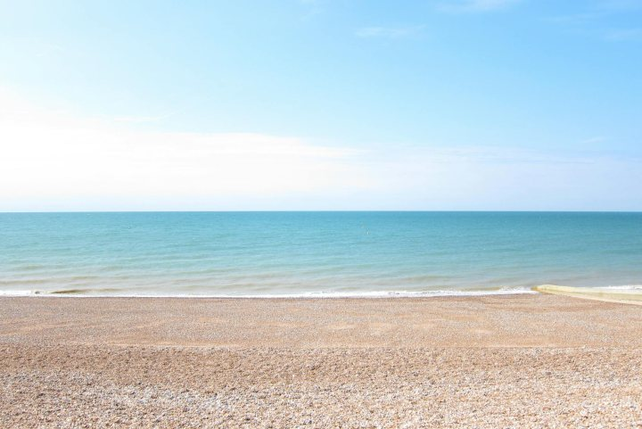
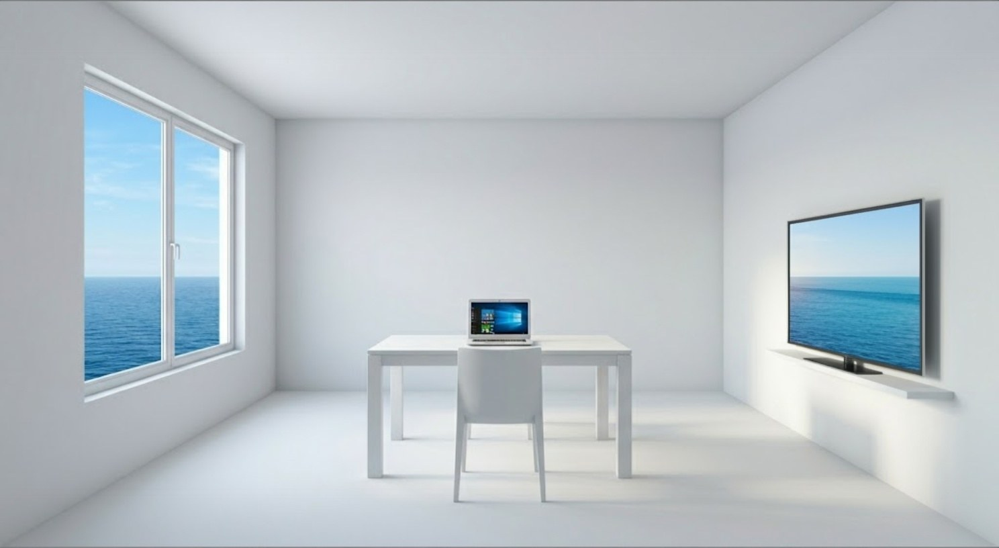
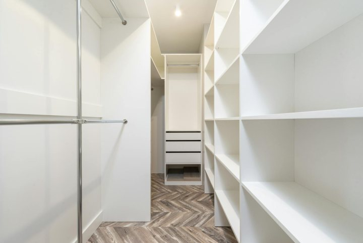
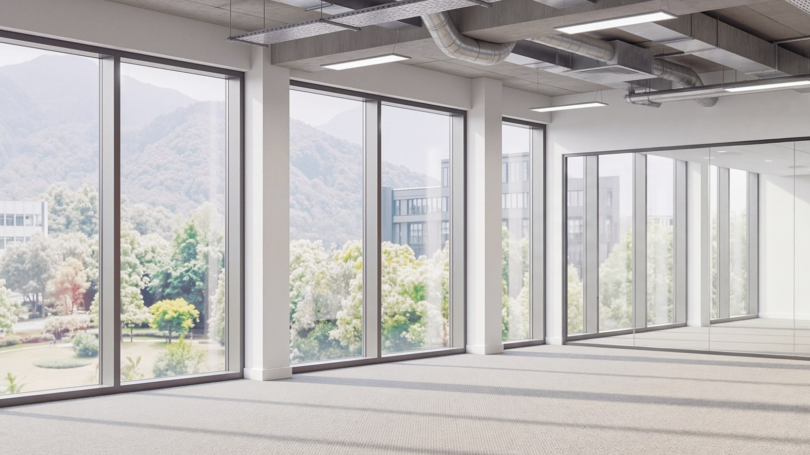
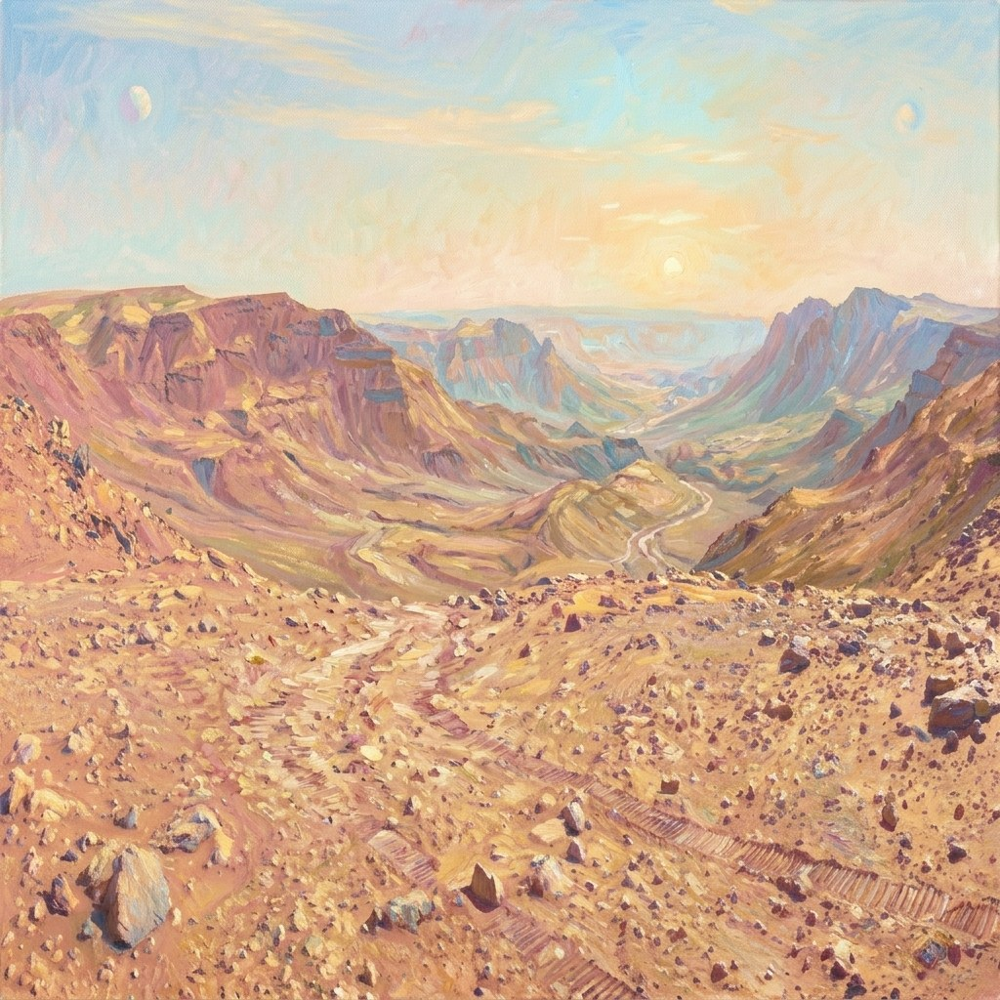

# 亮度一致性

本指标用于量化视频序列中**各帧与初始帧之间亮度分布的时序一致性**，以应对帧间亮度偏移与突变导致的视觉稳定性不足。与仅比较全局平均亮度的标量指标不同，Brightness Consistency 保留暗/中/亮三档像素占比，从而对曝光分布形状的变化更敏感。

WorldArena 将本算法作为正式指标 **`brightness_distribution_consistency`**。旧的标量别名 `brightness_consistency` 仍为 diagnostic，不进入七项正式 quality 总分。

### 三档亮度分布向量

将每帧灰度像素划分为 **暗（dark）**、**中（mid）**、**亮（bright）** 三档，构造三维亮度分布向量：

\[
\mathbf{v}_t
=
\begin{pmatrix}
p_{\mathrm{dark}} \\
p_{\mathrm{mid}} \\
p_{\mathrm{bright}}
\end{pmatrix}
\]

其中 $p_{\mathrm{dark}}$、$p_{\mathrm{bright}}$ 分别为灰度低于暗部阈值、不低于亮部阈值的像素占比，$p_{\mathrm{mid}} = 1 - p_{\mathrm{dark}} - p_{\mathrm{bright}}$。WorldArena 默认 `dark_threshold=85`、`bright_threshold=170`（OpenCV 灰度 $[0,255]$）。

### 相似度与修正 Softmax

第 $t$ 帧（$t \geq 2$）相对首帧 $\mathbf{v}_1$ 的分布相似度采用余弦内积：

\[
S(a, b)
=
\frac{a \cdot b}{\|a\|\,\|b\|}
=
\frac{\sum_{i=1}^{n} a_i b_i}{
    \sqrt{\sum_{i=1}^{n} a_i^2}\,\sqrt{\sum_{i=1}^{n} b_i^2}
}
\tag{3}
\]

对单样本分数 $x \in [0,1]$ 施加修正 Softmax 变换（增强高分段区分度，$\lambda > 0$）：

\[
T(x)
=
\frac{e^{\lambda x} - 1}{e^{\lambda} - 1}
\tag{4}
\]

默认 $\lambda = 4.0$（`softmax_lambda`）。

### 时序加权聚合

帧距 $d \in [1, T-1]$（$d=1$ 对应第 $2$ 帧）采用归一化指数衰减权重（$\alpha > 0$）：

\[
w(d) = e^{-\alpha \cdot d},
\qquad
\hat{w}(d)
=
\frac{w(d)}{\sum_{k=1}^{T-1} w(k)}
\tag{5}
\]

默认 $\alpha = 0.05$（`temporal_decay`）。综合亮度一致性得分为：

\[
S_{\mathrm{Brightness}}
=
\sum_{d=1}^{T-1}
\hat{w}(d) \cdot T\!\left(S(\mathbf{v}_{d+1}, \mathbf{v}_1)\right)
\tag{6}
\]

<!-- metric-examples:start -->
## 代表性同 Case 对比
每个展示块先给出该 case 的 input image 和完全一致的展示 prompt，然后比较模型生成结果。paired 展示必须满足 input image 相同、prompt 文本相同，并且一个模型高分、一个模型低分。若当前正式快照中该 metric 没有这种跨模型同 case pair，则单独展示高分/低分极值样例，不把它们伪装成同 case 对比。
机器可读 paired 导出： `docs/assets/metric_examples/paired_manifest.csv`.
### `brightness_distribution_consistency`

<article class="metric-case-exhibit">
  

    <figure class="metric-input-card">
      
      <figcaption>输入图像</figcaption>
    </figure>
    

      
Case 1 · 同一输入图像 + 同一 prompt · 分差 0.9991

      <h4><code>image_static_photorealistic_aquatic_landscape_0098</code></h4>
      
Suite: image_staticScene: photorealistic / outdoor / aquatic_landscape

      

        目标 prompt
        
Camera pan right. An aquatic landscape with pebble beach, calm sea, and blue sky.

        <small>prompt 来源: prompt_target</small>
      

    

  

  

<figure class="metric-output-card metric-output-card--good">
  

    <video class="metric-output-video" controls muted loop playsinline preload="metadata" aria-label="好结果: image_static_photorealistic_aquatic_landscape_0098">
      <source src="../../../assets/metric_examples/6dcb1b7c126c__cosmos3-nano-image-static__image_static_photorealistic_aquatic_landscape_0098.mp4" type="video/mp4">
    </video>
    
好结果 · 分数 0.9991

  

</figure>
<figure class="metric-output-card metric-output-card--bad">
  

    <video class="metric-output-video" controls muted loop playsinline preload="metadata" aria-label="差结果: image_static_photorealistic_aquatic_landscape_0098">
      <source src="../../../assets/metric_examples/a153996e000e__longcat-video-image-static-8gpu-20260612_133950__image_static_photorealistic_aquatic_landscape_0098.mp4" type="video/mp4">
    </video>
    
差结果 · 分数 0.0000

  

</figure>
  

</article>
<article class="metric-case-exhibit">
  

    <figure class="metric-input-card">
      
      <figcaption>输入图像</figcaption>
    </figure>
    

      
Case 2 · 同一输入图像 + 同一 prompt · 分差 0.9990

      <h4><code>image_static_photorealistic_workspaces_0012</code></h4>
      
Suite: image_staticScene: photorealistic / indoor / workspaces

      

        目标 prompt
        
Camera pan right. A minimalist workspace with desk, laptop, and chair. Camera move right. A minimalist workspace with desk, laptop, and chair. Camera pull out. A minimalist workspace with desk, laptop, and chair.

        <small>prompt 来源: prompt_target</small>
      

    

  

  

<figure class="metric-output-card metric-output-card--good">
  

    <video class="metric-output-video" controls muted loop playsinline preload="metadata" aria-label="好结果: image_static_photorealistic_workspaces_0012">
      <source src="../../../assets/metric_examples/4ce7235be4d7__yume_sample5b__image_static_photorealistic_workspaces_0012.mp4" type="video/mp4">
    </video>
    
好结果 · 分数 0.9999

  

</figure>
<figure class="metric-output-card metric-output-card--bad">
  

    <video class="metric-output-video" controls muted loop playsinline preload="metadata" aria-label="差结果: image_static_photorealistic_workspaces_0012">
      <source src="../../../assets/metric_examples/940042a83949__dreamx_world__image_static_photorealistic_workspaces_0012.mp4" type="video/mp4">
    </video>
    
差结果 · 分数 0.0009

  

</figure>
  

</article>
<article class="metric-case-exhibit">
  

    <figure class="metric-input-card">
      
      <figcaption>输入图像</figcaption>
    </figure>
    

      
Case 3 · 同一输入图像 + 同一 prompt · 分差 0.9985

      <h4><code>image_static_photorealistic_passageways_0050</code></h4>
      
Suite: image_staticScene: photorealistic / indoor / passageways

      

        目标 prompt
        
Camera move right. A modern walk-in closet with shelving, shoe rack, and mirror.

        <small>prompt 来源: prompt_target</small>
      

    

  

  

<figure class="metric-output-card metric-output-card--good">
  

    <video class="metric-output-video" controls muted loop playsinline preload="metadata" aria-label="好结果: image_static_photorealistic_passageways_0050">
      <source src="../../../assets/metric_examples/9d5b5b64512b__hy_worldplay_ar_rl_image_test_balanced_5000_5s__image_static_photorealistic_passageways_0050.mp4" type="video/mp4">
    </video>
    
好结果 · 分数 1.0000

  

</figure>
<figure class="metric-output-card metric-output-card--bad">
  

    <video class="metric-output-video" controls muted loop playsinline preload="metadata" aria-label="差结果: image_static_photorealistic_passageways_0050">
      <source src="../../../assets/metric_examples/a0c6cd5ddefe__lingbot_world__image_static_photorealistic_passageways_0050.mp4" type="video/mp4">
    </video>
    
差结果 · 分数 0.0015

  

</figure>
  

</article>
<article class="metric-case-exhibit">
  

    <figure class="metric-input-card">
      
      <figcaption>输入图像</figcaption>
    </figure>
    

      
Case 4 · 同一输入图像 + 同一 prompt · 分差 0.9983

      <h4><code>image_static_photorealistic_workspaces_0086</code></h4>
      
Suite: image_staticScene: photorealistic / indoor / workspaces

      

        目标 prompt
        
Camera move left. An empty office with glass partition, windows, and carpeted floor.

        <small>prompt 来源: prompt_target</small>
      

    

  

  

<figure class="metric-output-card metric-output-card--good">
  

    <video class="metric-output-video" controls muted loop playsinline preload="metadata" aria-label="好结果: image_static_photorealistic_workspaces_0086">
      <source src="../../../assets/metric_examples/755a7634ea65__wan22-ti2v-5b-image-static-plan-missing__image_static_photorealistic_workspaces_0086.mp4" type="video/mp4">
    </video>
    
好结果 · 分数 0.9999

  

</figure>
<figure class="metric-output-card metric-output-card--bad">
  

    <video class="metric-output-video" controls muted loop playsinline preload="metadata" aria-label="差结果: image_static_photorealistic_workspaces_0086">
      <source src="../../../assets/metric_examples/d5997ae5d656__dreamx_world__image_static_photorealistic_workspaces_0086.mp4" type="video/mp4">
    </video>
    
差结果 · 分数 0.0016

  

</figure>
  

</article>
<article class="metric-case-exhibit">
  

    <figure class="metric-input-card">
      
      <figcaption>输入图像</figcaption>
    </figure>
    

      
Case 5 · 同一输入图像 + 同一 prompt · 分差 0.9968

      <h4><code>image_static_stylized_terrestrial_landscape_0138</code></h4>
      
Suite: image_staticScene: stylized / outdoor / terrestrial_landscape

      

        目标 prompt
        
Camera pull out. An expansive desert with mountains, path, and rocks.

        <small>prompt 来源: prompt_target</small>
      

    

  

  

<figure class="metric-output-card metric-output-card--good">
  

    <video class="metric-output-video" controls muted loop playsinline preload="metadata" aria-label="好结果: image_static_stylized_terrestrial_landscape_0138">
      <source src="../../../assets/metric_examples/d85d8c9f7579__hy_worldplay_ar_rl_image_test_balanced_5000_5s__image_static_stylized_terrestrial_landscape_0138.mp4" type="video/mp4">
    </video>
    
好结果 · 分数 1.0000

  

</figure>
<figure class="metric-output-card metric-output-card--bad">
  

    <video class="metric-output-video" controls muted loop playsinline preload="metadata" aria-label="差结果: image_static_stylized_terrestrial_landscape_0138">
      <source src="../../../assets/metric_examples/b2a98165e36f__cosmos3-nano-image-static-8gpu-singleload-20260612_170108__image_static_stylized_terrestrial_landscape_0138.mp4" type="video/mp4">
    </video>
    
差结果 · 分数 0.0032

  

</figure>
  

</article>
<article class="metric-case-exhibit">
  

    <figure class="metric-input-card">
      
      <figcaption>输入图像</figcaption>
    </figure>
    

      
Case 6 · 同一输入图像 + 同一 prompt · 分差 0.9964

      <h4><code>image_static_photorealistic_aquatic_landscape_0162</code></h4>
      
Suite: image_staticScene: photorealistic / outdoor / aquatic_landscape

      

        目标 prompt
        
Camera move right. An aquatic landscape with lake, shoreline, and trees.

        <small>prompt 来源: prompt_target</small>
      

    

  

  

<figure class="metric-output-card metric-output-card--good">
  

    <video class="metric-output-video" controls muted loop playsinline preload="metadata" aria-label="好结果: image_static_photorealistic_aquatic_landscape_0162">
      <source src="../../../assets/metric_examples/9fa9ba3b8c50__longcat-video-image-static-8gpu-20260612_133950__image_static_photorealistic_aquatic_landscape_0162.mp4" type="video/mp4">
    </video>
    
好结果 · 分数 1.0000

  

</figure>
<figure class="metric-output-card metric-output-card--bad">
  

    <video class="metric-output-video" controls muted loop playsinline preload="metadata" aria-label="差结果: image_static_photorealistic_aquatic_landscape_0162">
      <source src="../../../assets/metric_examples/ea022fe1d259__hy_worldplay_ar_image_test_balanced_5000_5s__image_static_photorealistic_aquatic_landscape_0162.mp4" type="video/mp4">
    </video>
    
差结果 · 分数 0.0036

  

</figure>
  

</article>

<!-- metric-examples:end -->

## 参考文献 {#reference}

!!! quote "WorldAtlas Arena — Brightness Consistency metric family"

    Three-bin brightness distribution vectors with cosine similarity to the initial frame, modified Softmax enhancement, and normalized exponential temporal weighting.
