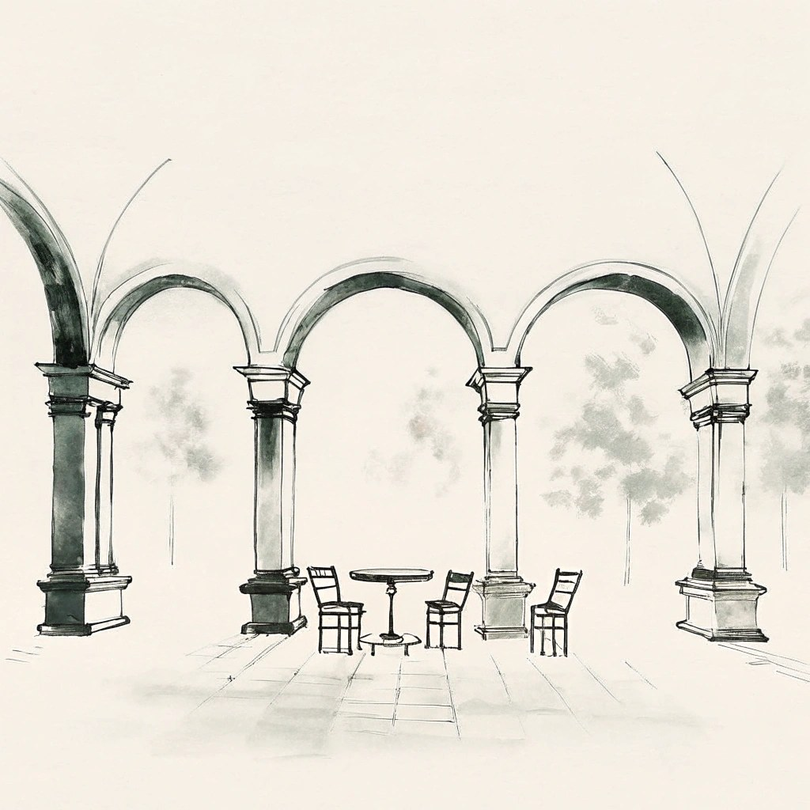

# Color Temperature Consistency

本指标用于评估生成视频中**环境氛围（色温逻辑）**的一致性。在 HSV 色彩空间中分析 Hue 维度：将 hue 取值范围 $[0, 179]$ 划分为 $7$ 个核心区间，构造 hue 特征向量 $\mathbf{h}_t \in \mathbb{R}^{7}$；再计算整段序列相对首帧的加权感知相似度。为平衡**全局恒定**与**局部过渡**，第 $t$ 帧（$t \geq 2$）的相似度定义为「当前帧–首帧」与「当前帧–前一帧」余弦相似度的算术平均。相似度 $S(\cdot, \cdot)$ 采用余弦内积（定义同亮度分布一致性指标式 (3)）：

\[
S(a, b)
=
\frac{a \cdot b}{\|a\|\,\|b\|}
=
\frac{\sum_{i=1}^{n} a_i b_i}{
    \sqrt{\sum_{i=1}^{n} a_i^2}\,\sqrt{\sum_{i=1}^{n} b_i^2}
}
\tag{3}
\]

\[
\bar{S}_t
=
\frac{
    S(\mathbf{h}_t, \mathbf{h}_1)
    +
    S(\mathbf{h}_t, \mathbf{h}_{t-1})
}{
    2
}
\tag{7}
\]

对每帧 $I_t$，先将 RGB 转为 HSV，以饱和度 $S$ 为权重在 $7$ 个 hue 区间上统计直方图并归一化，得到 $\mathbf{h}_t$（WorldArena 默认 `hue_bins=7`，区间 $[0, 180)$）。

最终分数采用**归一化指数衰减加权求和**，权重 $\hat{w}'(d)$ 为改进版指数核（相较亮度指标 $\hat{w}(d)$ 衰减更快，$\beta > \alpha$），并对相似度施加修正 Softmax 变换 $T(\cdot)$（定义同式 (4)，默认 $\lambda = 4.0$）：

\[
T(x)
=
\frac{e^{\lambda x} - 1}{e^{\lambda} - 1},
\quad \lambda > 0
\tag{4}
\]

\[
w'(d) = e^{-\beta \cdot d},
\qquad
\hat{w}'(d)
=
\frac{w'(d)}{\sum_{k=1}^{T-1} w'(k)}
\quad (\beta > 0)
\tag{8}
\]

其中 $d \in [1, T-1]$ 为帧距（$d=1$ 对应第 $2$ 帧相对首帧），$\beta$ 为衰减系数（越大则远端帧权重衰减越快）。默认配置下 $\beta = 0.10$，亮度分布指标中取 $\alpha = 0.05$，满足 $\beta > \alpha$，从而对长视频常见的「色漂」现象施加更强惩罚，保证场景色温逻辑一致。综合得分为：

\[
S_{\mathrm{Color}}
=
\sum_{d=1}^{T-1}
\hat{w}'(d) \cdot T\!\left(\bar{S}_{d+1}\right)
\tag{9}
\]

WorldArena 中本算法对应正式指标 **`color_temperature_constraint`**（`hue_distribution` 后端）；归一化配置下 raw 与 normalized 均为 $[0,1]$，**越高越好**。旧的标量别名 `color_temperature_consistency` 仍为 diagnostic，不进入七项正式 quality 总分。

<!-- metric-examples:start -->
## 人工精选的同 Case 对比

下列案例来自 `artifacts/reports` 生成的同-case比较索引。输入图、sample ID 与实际生成 prompt 完全一致；候选先按分位数和分差筛选，再逐帧人工复核。标签只表示该 metric 的相对高低，不代表模型整体优劣；为避免把单一案例误读成排行榜，卡片不展示模型名称。

Audit manifest: `docs/assets/metric_examples/curated_same_case_manifest.json`.

<article class="metric-case-exhibit metric-case-exhibit--curated">
  

    <figure class="metric-input-card">
      
      <figcaption>输入图像</figcaption>
    </figure>
    

      
人工复核 · 同一 case、输入与 prompt · gap 0.9030

      <h4><code>image_static_stylized_passageways_0041</code></h4>
      
套件: image_static场景: stylized / indoor / passageways

      

        实际生成 prompt
        
Camera orbit left. A stylized courtyard with arches, columns, and round table.

        <small>prompt source: prompt_target</small>
      

      
较高分结果保持了连贯的暖色调；较低分结果则漂移为明显去饱和的灰色外观。

    

  

  

    <figure class="metric-output-card metric-output-card--good">
      

        <video class="metric-output-video" controls muted loop playsinline preload="metadata" aria-label="较高指标分: image_static_stylized_passageways_0041">
          <source src="../../../assets/metric_examples/4203fbe1e26a__cameractrl__image_static_stylized_passageways_0041.mp4" type="video/mp4">
        </video>
        
较高指标分 · 分数 0.9994

      

      <figcaption class="metric-output-caption"><strong>较高指标分</strong>color_temperature_constraint</figcaption>
    </figure>
    <figure class="metric-output-card metric-output-card--bad">
      

        <video class="metric-output-video" controls muted loop playsinline preload="metadata" aria-label="较低指标分: image_static_stylized_passageways_0041">
          <source src="../../../assets/metric_examples/5063767b647a__astra__image_static_stylized_passageways_0041.mp4" type="video/mp4">
        </video>
        
较低指标分 · 分数 0.0964

      

      <figcaption class="metric-output-caption"><strong>较低指标分</strong>color_temperature_constraint</figcaption>
    </figure>
  

</article>

<!-- metric-examples:end -->
