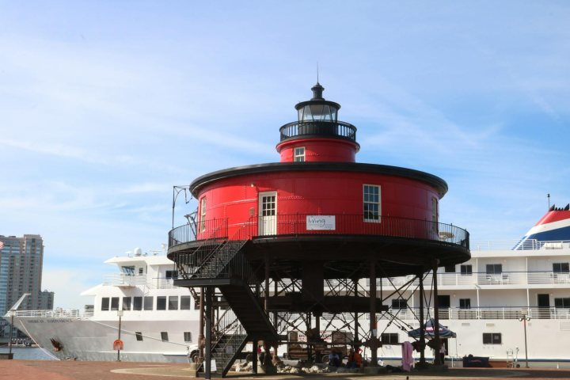
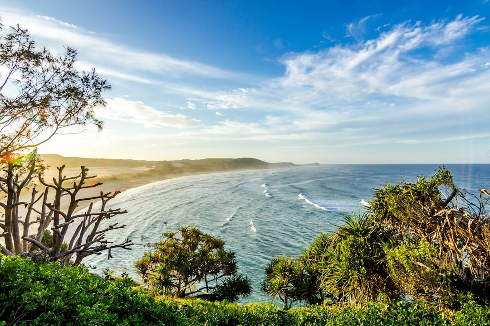

# Depth Collision

Depth Collision 是二值标记，检测相机正前方是否出现不合理近距几何。Video Depth Anything 提供逐帧 metric 深度；中心裁剪检验 rollout 过程中前向视廊是否异常逼近。

对帧 \(t\) 的深度图 \(D_t\) 与中心裁剪 \(\mathcal{C}\)：

\[
\bar{d}_t = \frac{1}{|\mathcal{C}|}\sum_{(x,y)\in\mathcal{C}} D_t(x,y)
\tag{1}
\]

给定阈值 \(\tau\)（默认 \(1.0\)），碰撞指示量为

\[
e_{\mathrm{collision}} = \mathbf{1}\!\left[\min_t \bar{d}_t < \tau\right]
\tag{2}
\]

原始得分 \(e_{\mathrm{collision}} \in \{0,1\}\) 经反向归一化，无碰撞对应更高得分。该标记在估计深度下代理近距失败（穿墙、贴脸运动），并非物理引擎接触判定。

<!-- metric-examples:start -->
## 代表性同 Case 对比
每个展示块先给出该 case 的 input image 和完全一致的展示 prompt，然后比较模型生成结果。paired 展示必须满足 input image 相同、prompt 文本相同，并且一个模型高分、一个模型低分。若当前正式快照中该 metric 没有这种跨模型同 case pair，则单独展示高分/低分极值样例，不把它们伪装成同 case 对比。
机器可读 paired 导出： `docs/assets/metric_examples/paired_manifest.csv`.
### `depth_collision`

<article class="metric-case-exhibit metric-case-exhibit--fallback">
  

    <figure class="metric-input-card">
      
      <figcaption>输入图像</figcaption>
    </figure>
    

      
Case 1 · 当前快照极值样例

      <h4><code>image_static_photorealistic_aquatic_landscape_0001</code></h4>
      
Suite: image_staticScene: photorealistic / outdoor / aquatic_landscape

      

        目标 prompt
        
Camera orbit left. A coastal landscape with ocean waves, distant hills, and sunset sky.

        <small>prompt 来源: prompt_target</small>
      

  
当前正式快照中该 metric 没有跨模型同 case 配对；以下为各自极值样例，而非同一输入下的模型对比。

    

  

  

<figure class="metric-output-card metric-output-card--good">
  

    <video class="metric-output-video" controls muted loop playsinline preload="metadata" aria-label="好结果: image_static_photorealistic_aquatic_landscape_0001">
      <source src="../../../assets/metric_examples/e3f37ff52cf2__ac3d-image-static__image_static_photorealistic_aquatic_landscape_0001.mp4" type="video/mp4">
    </video>
    
好结果 · 分数 1.0000

  

</figure>
<figure class="metric-output-card metric-output-card--bad">
  

    <video class="metric-output-video" controls muted loop playsinline preload="metadata" aria-label="差结果: image_static_photorealistic_aquatic_landscape_0001">
      <source src="../../../assets/metric_examples/e3f37ff52cf2__ac3d-image-static__image_static_photorealistic_aquatic_landscape_0001.mp4" type="video/mp4">
    </video>
    
差结果 · 分数 1.0000

  

</figure>
  

</article>
<article class="metric-case-exhibit metric-case-exhibit--fallback">
  

    <figure class="metric-input-card">
      
      <figcaption>输入图像</figcaption>
    </figure>
    

      
Case 2 · 当前快照极值样例

      <h4><code>image_static_photorealistic_aquatic_landscape_0017</code></h4>
      
Suite: image_staticScene: photorealistic / outdoor / aquatic_landscape

      

        目标 prompt
        
Camera orbit left. An aquatic landscape with red lighthouse, ship&#x27;s deck, and harbor.

        <small>prompt 来源: prompt_target</small>
      

  
当前正式快照中该 metric 没有跨模型同 case 配对；以下为各自极值样例，而非同一输入下的模型对比。

    

  

  

<figure class="metric-output-card metric-output-card--good">
  

    <video class="metric-output-video" controls muted loop playsinline preload="metadata" aria-label="好结果: image_static_photorealistic_aquatic_landscape_0017">
      <source src="../../../assets/metric_examples/d339e4209040__ac3d-image-static__image_static_photorealistic_aquatic_landscape_0017.mp4" type="video/mp4">
    </video>
    
好结果 · 分数 1.0000

  

</figure>
<figure class="metric-output-card metric-output-card--bad">
  

    <video class="metric-output-video" controls muted loop playsinline preload="metadata" aria-label="差结果: image_static_photorealistic_aquatic_landscape_0017">
      <source src="../../../assets/metric_examples/d339e4209040__ac3d-image-static__image_static_photorealistic_aquatic_landscape_0017.mp4" type="video/mp4">
    </video>
    
差结果 · 分数 1.0000

  

</figure>
  

</article>
<article class="metric-case-exhibit metric-case-exhibit--fallback">
  

    <figure class="metric-input-card">
      
      <figcaption>输入图像</figcaption>
    </figure>
    

      
Case 3 · 当前快照极值样例

      <h4><code>image_static_photorealistic_aquatic_landscape_0033</code></h4>
      
Suite: image_staticScene: photorealistic / outdoor / aquatic_landscape

      

        目标 prompt
        
Camera move right. A coastal landscape with waves, beach, and vegetation.

        <small>prompt 来源: prompt_target</small>
      

  
当前正式快照中该 metric 没有跨模型同 case 配对；以下为各自极值样例，而非同一输入下的模型对比。

    

  

  

<figure class="metric-output-card metric-output-card--good">
  

    <video class="metric-output-video" controls muted loop playsinline preload="metadata" aria-label="好结果: image_static_photorealistic_aquatic_landscape_0033">
      <source src="../../../assets/metric_examples/f9f24c8499ad__ac3d-image-static__image_static_photorealistic_aquatic_landscape_0033.mp4" type="video/mp4">
    </video>
    
好结果 · 分数 1.0000

  

</figure>
<figure class="metric-output-card metric-output-card--bad">
  

    <video class="metric-output-video" controls muted loop playsinline preload="metadata" aria-label="差结果: image_static_photorealistic_aquatic_landscape_0033">
      <source src="../../../assets/metric_examples/f9f24c8499ad__ac3d-image-static__image_static_photorealistic_aquatic_landscape_0033.mp4" type="video/mp4">
    </video>
    
差结果 · 分数 1.0000

  

</figure>
  

</article>

<!-- metric-examples:end -->

## 参考文献 {#reference}

!!! quote "Video Depth Anything: Consistent Depth Estimation for Super-Long Videos"

    Chen et al., arXiv:2501.12375, 2025.
