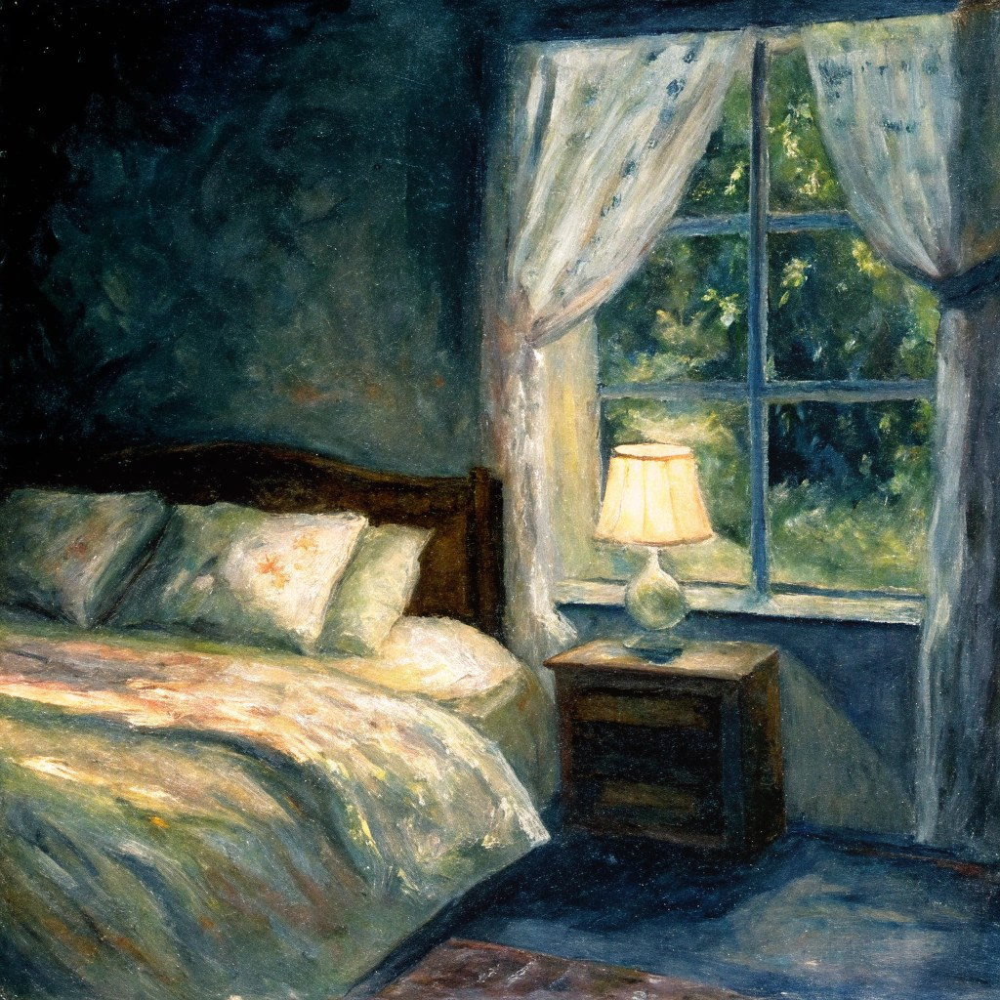
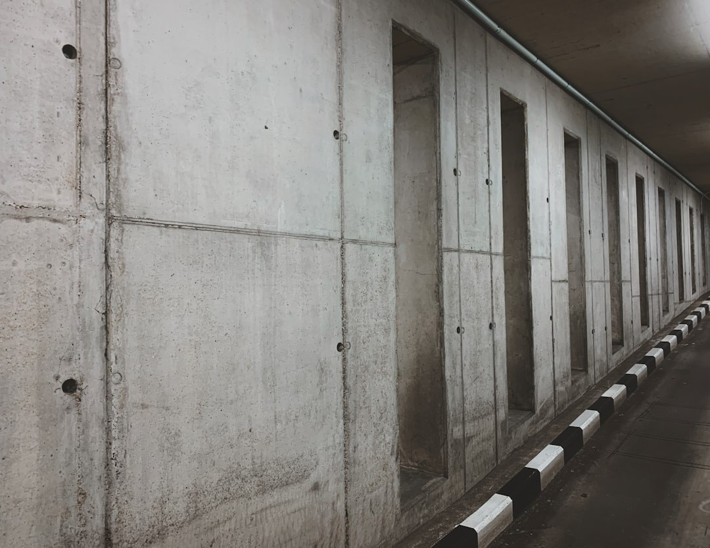

# Epipolar Geometry

本页定义三组 **GVGC-style 极线几何诊断指标**，用于检验生成视频相邻帧是否具备稳定的双视角极线解释 [[Hartley and Zisserman, 2004](#reference)]。它们只依赖 prediction 视频本身，不需要相机位姿标注或 reference video；核心问题是：局部特征对应关系是否近似满足 epipolar constraint，从而说明两帧能否被同一个 pinhole 相机模型下的相对运动解释。

在经典多视角几何中，若两帧来自同一场景、仅发生刚体相机运动，则第一帧中的点 \(x\) 在第二帧中的对应点 \(x'\) 必然落在由基础矩阵 \(F\) 诱导的极线 \(l' = F x\) 上。生成视频若出现背景扭曲、物体局部漂移、深度层次不稳定，或相邻帧并非同一三维结构的投影，RANSAC inlier 将难以同时满足该约束，Sampson 误差会升高、inlier 比例下降。因此，极线指标提供一种**轻量、可解释**的双视角几何信号；但它只检查稀疏特征点的 epipolar 一致性，不能替代 MEt3R、重投影误差或重建类指标对全局三维自洽性的判断。

WorldArena 在 prediction 的采样帧上，按 `pair_stride` 构造相邻（或跨步）帧对，默认使用 SIFT 特征与 Lowe 比率测试进行匹配，再以 OpenCV RANSAC 估计基础矩阵 \(F\)。对 RANSAC inlier 计算 Sampson 误差，并统计 inlier 比例与覆盖率；若主路径失败，runtime 还可依次尝试放宽匹配阈值或 Shi-Tomasi + Lucas-Kanade 跟踪 fallback。三个子指标共享同一次 backend 分析，分别报告如下：

| 指标 | 原始统计量 | 方向 |
| --- | --- | --- |
| `epipolar_error` | 基础矩阵 RANSAC 后 inlier 的 Sampson 误差中位数 | 越低越好 |
| `epipolar_inlier_rate` | RANSAC inlier 数 / Lowe 比率过滤后的匹配数 | 越高越好 |
| `feature_match_coverage` | RANSAC inlier 数 / 较少一侧关键点数 | 越高越好 |

对匹配齐次点 \(x_i, x'_i\)，Sampson 误差为

\[
d_i = \frac{|{x'_i}^{\mathsf T} F x_i|}{\sqrt{(Fx_i)_1^2 + (Fx_i)_2^2 + (F^{\mathsf T}x'_i)_1^2 + (F^{\mathsf T}x'_i)_2^2}}
\tag{1}
\]

每个有效帧对以 RANSAC inlier 的 \(d_i\) 中位数作为 pair 级 `epipolar_error`；视频级取各 pair 中位数，并在 \([0, 5]\) 上反向归一化。

每个有效帧对的 inlier 率与覆盖率为

\[
r = \frac{\#\mathrm{inliers}}{\#\mathrm{good\ matches}},
\qquad
c = \min\!\left(\frac{\#\mathrm{inliers}}{\min(\#\mathrm{kp}_\mathrm{left}, \#\mathrm{kp}_\mathrm{right})},\, 1\right)
\tag{2}
\]

视频级 `epipolar_inlier_rate` 与 `feature_match_coverage` 分别对 \(r\)、\(c\) 取均值，在 \([0,1]\) 上恒等归一化。`epipolar_error` 取各有效帧对中位数的中位数，并在 \([0, 5]\) 上反向归一化到 \([0, 1]\)（归一化分数越高表示极线一致性越好）。若所有帧对都无法形成足够 inlier，三项均返回 `not_applicable`。这些指标当前为 **diagnostic**，单独报告，不进 headline 聚合；在弱纹理、强非刚性运动或 dynamic prompt 场景下可能频繁失效，宜与 MEt3R、重投影误差等互补阅读。

<!-- metric-examples:start -->
## 人工精选的同 Case 对比

下列案例来自 `artifacts/reports` 生成的同-case比较索引。输入图、sample ID 与实际生成 prompt 完全一致；候选先按分位数和分差筛选，再逐帧人工复核。标签只表示该 metric 的相对高低，不代表模型整体优劣；为避免把单一案例误读成排行榜，卡片不展示模型名称。

Audit manifest: `docs/assets/metric_examples/curated_same_case_manifest.json`.

<article class="metric-case-exhibit metric-case-exhibit--curated">
  

    <figure class="metric-input-card">
      
      <figcaption>输入图像</figcaption>
    </figure>
    

      
人工复核 · 同一 case、输入与 prompt · gap 0.0860

      <h4><code>image_static_stylized_living_spaces_0037</code></h4>
      
套件: image_static场景: stylized / indoor / living_spaces

      

        实际生成 prompt
        
Camera pan right. A bedroom corner with wardrobe, chair, and rug.

        <small>prompt source: prompt_target</small>
      

      
较高分的镜头运动仍保有可恢复的场景几何；较低分结果逐步变暗并丢失跨视角对应关系。

    

  

  

    <figure class="metric-output-card metric-output-card--good">
      

        <video class="metric-output-video" controls muted loop playsinline preload="metadata" aria-label="较高指标分: image_static_stylized_living_spaces_0037">
          <source src="../../../assets/metric_examples/curated_20260801/7f6f8eb8d3f9__image_static_stylized_living_spaces_0037__high.mp4" type="video/mp4">
        </video>
        
较高指标分 · 分数 0.9871

      

      <figcaption class="metric-output-caption"><strong>较高指标分</strong>epipolar_error</figcaption>
    </figure>
    <figure class="metric-output-card metric-output-card--bad">
      

        <video class="metric-output-video" controls muted loop playsinline preload="metadata" aria-label="较低指标分: image_static_stylized_living_spaces_0037">
          <source src="../../../assets/metric_examples/c223556eb328__matrix_game2_5s_image_static__image_static_stylized_living_spaces_0037.mp4" type="video/mp4">
        </video>
        
较低指标分 · 分数 0.9011

      

      <figcaption class="metric-output-caption"><strong>较低指标分</strong>epipolar_error</figcaption>
    </figure>
  

</article>
<article class="metric-case-exhibit metric-case-exhibit--curated">
  

    <figure class="metric-input-card">
      
      <figcaption>输入图像</figcaption>
    </figure>
    

      
人工复核 · 同一 case、输入与 prompt · gap 0.7193

      <h4><code>image_static_stylized_public_spaces_0049</code></h4>
      
套件: image_static场景: stylized / indoor / public_spaces

      

        实际生成 prompt
        
Camera orbit left. A library aisle with bookshelves, books, and reading table.

        <small>prompt source: prompt_target</small>
      

      
较高分结果在环绕中仍能追踪书架通道布局；较低分结果把书架几何拆成互不兼容的视角。

    

  

  

    <figure class="metric-output-card metric-output-card--good">
      

        <video class="metric-output-video" controls muted loop playsinline preload="metadata" aria-label="较高指标分: image_static_stylized_public_spaces_0049">
          <source src="../../../assets/metric_examples/curated_20260801/080234cb97e9__image_static_stylized_public_spaces_0049__high.mp4" type="video/mp4">
        </video>
        
较高指标分 · 分数 0.9841

      

      <figcaption class="metric-output-caption"><strong>较高指标分</strong>epipolar_inlier_rate</figcaption>
    </figure>
    <figure class="metric-output-card metric-output-card--bad">
      

        <video class="metric-output-video" controls muted loop playsinline preload="metadata" aria-label="较低指标分: image_static_stylized_public_spaces_0049">
          <source src="../../../assets/metric_examples/curated_20260801/d609d31a9446__image_static_stylized_public_spaces_0049__low.mp4" type="video/mp4">
        </video>
        
较低指标分 · 分数 0.2648

      

      <figcaption class="metric-output-caption"><strong>较低指标分</strong>epipolar_inlier_rate</figcaption>
    </figure>
  

</article>
<article class="metric-case-exhibit metric-case-exhibit--curated">
  

    <figure class="metric-input-card">
      
      <figcaption>输入图像</figcaption>
    </figure>
    

      
人工复核 · 同一 case、输入与 prompt · gap 0.8407

      <h4><code>image_static_photorealistic_passageways_0155</code></h4>
      
套件: image_static场景: photorealistic / indoor / passageways

      

        实际生成 prompt
        
Camera push in. A concrete corridor with end wall and light source.

        <small>prompt source: prompt_target</small>
      

      
较高分结果在画面范围内保留了可跟踪的走廊结构；较低分结果退化为纹理墙面，可用匹配的空间覆盖明显不足。

    

  

  

    <figure class="metric-output-card metric-output-card--good">
      

        <video class="metric-output-video" controls muted loop playsinline preload="metadata" aria-label="较高指标分: image_static_photorealistic_passageways_0155">
          <source src="../../../assets/metric_examples/35ab3fc3e20b__cameractrl_image_static__image_static_photorealistic_passageways_0155.mp4" type="video/mp4">
        </video>
        
较高指标分 · 分数 0.8889

      

      <figcaption class="metric-output-caption"><strong>较高指标分</strong>feature_match_coverage</figcaption>
    </figure>
    <figure class="metric-output-card metric-output-card--bad">
      

        <video class="metric-output-video" controls muted loop playsinline preload="metadata" aria-label="较低指标分: image_static_photorealistic_passageways_0155">
          <source src="../../../assets/metric_examples/bdf8a95737dc__matrix_game3_5s_image_static_dynamic__image_static_photorealistic_passageways_0155.mp4" type="video/mp4">
        </video>
        
较低指标分 · 分数 0.0482

      

      <figcaption class="metric-output-caption"><strong>较低指标分</strong>feature_match_coverage</figcaption>
    </figure>
  

</article>

<!-- metric-examples:end -->

## 参考文献 {#reference}

!!! quote "Multiple View Geometry in Computer Vision"

    Hartley & Zisserman, Cambridge University Press, 2004.
