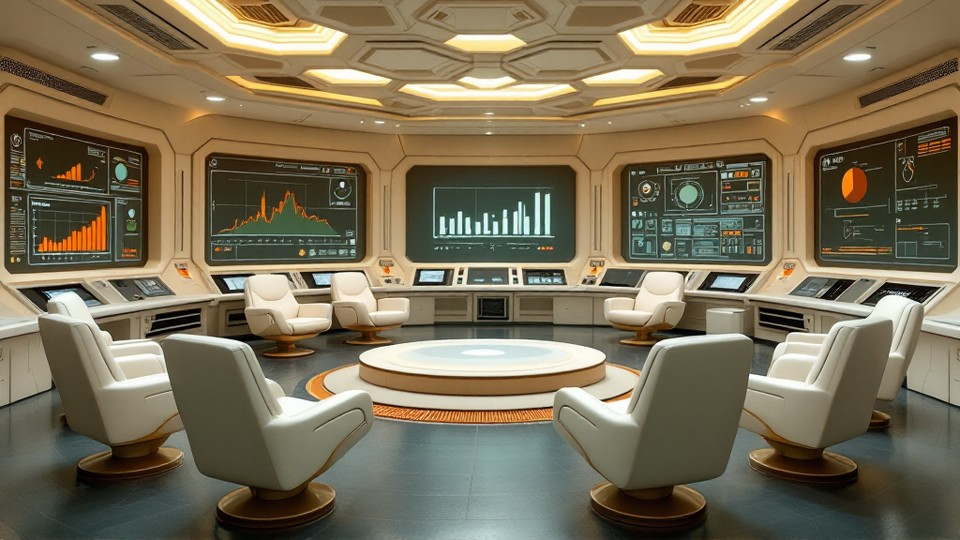
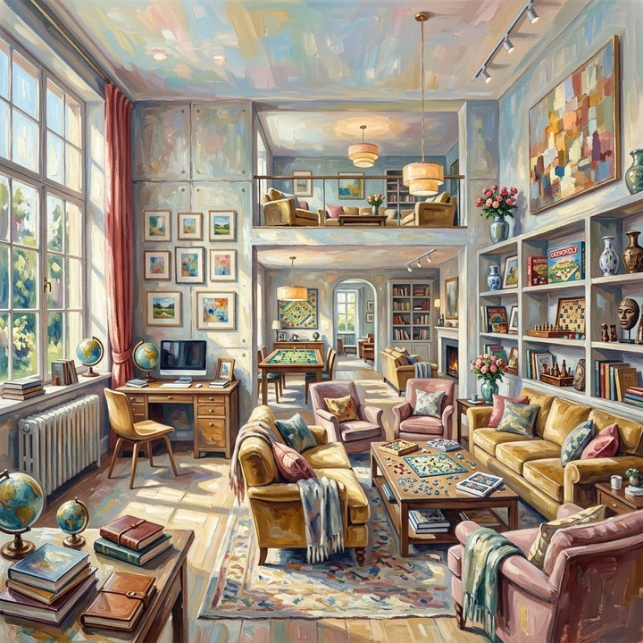

# HPSv3-Norm

HPSv3-Norm 采用 HPSv3 奖励模型度量生成视频的**人类偏好对齐视觉质量**。该指标**仅需 prediction**：各评测帧独立打分，无需与 reference rollout 配对。

`hpsv3_norm` 是正式的 `image_static` quality 指标，同时进入 `per_metric_summary` 与七项等权 quality 总分。

WorldArena 从 prediction 视频中均匀子采样至多 20 帧，默认以 HPSv3 官方评测文档中提供的批大小（`batch_size: 8`）推理；这也是 8×A100 视频评测中实测的吞吐折中点。批处理只改变执行方式：每帧仍独立获得一个奖励；为保证可比性，同一次横向评测应使用相同的批大小。对帧 $x_i$，HPSv3 推理器输出原始奖励 $r_i$。每视频平均原始奖励为

\[
\bar{r}
=
\frac{1}{N}\sum_{i=1}^{N} r_i
\tag{1}
\]

设固定归一化分位数为 $p_1$、$p_{99}$（默认 $p_1 = 5.21$，$p_{99} = 8.66$）。$[0, 100]$ 上的归一化得分为

\[
S_{\mathrm{HPS}}
=
\mathrm{clip}\!\left(
\frac{\bar{r} - p_1}{p_{99} - p_1} \times 100,\,
0,\,
100
\right)
\tag{2}
\]

WorldArena 将指标 raw 值存为 $[0, 1]$ 区间内的 $S_{\mathrm{HPS}} / 100$。得分越高表示与人类偏好对齐程度越强。若 HPSv3 backend 或 checkpoint 不可用，指标记为 `not_applicable`。

!!! note "这些 1.0000 / 0.0000 是真实分数吗？"

    这些都是真实评测结果，不是手动填写的占位值。示例区会优先选择归一化分差最大的、已核验同输入视频对。HPSv3-Norm 先对 20 帧的原始奖励取平均，再按公式 (2) 归一化：均值不低于 $p_{99}=8.66$ 时截断为 `1.0000`，不高于 $p_1=5.21$ 时截断为 `0.0000`。

    三组展示案例的原始奖励均值（高分视频 / 低分视频）分别是：

    - 工作区 `0020`：`8.872 / 4.902`
    - 绿地景观 `0125`：`8.863 / 2.239`
    - 风格化起居室 `0142`：`8.904 / 2.930`

    因此，不同视频的原始奖励并不相同；只是经过固定分位数归一化和端点截断后，这三组恰好都显示为 `1.0000 / 0.0000`。

## 参考文献 {#reference}

!!! quote "HPSv3 — Human Preference Score"

    基于人类偏好监督的视觉-语言奖励模型；WorldArena 对每视频平均原始奖励施加线性分位数归一化。

<!-- metric-examples:start -->
## 已核验的同输入案例

每个 metric 最多展示三个 case。每组中的两条视频必须属于同一 benchmark sample，且两侧首帧都通过与该组展示输入的 SIFT + RANSAC 几何匹配；不通过的候选不会发布。标签只表示当前 metric 的相对高低，不代表模型整体优劣。

Audit manifest: `docs/assets/metric_examples/curated_same_case_manifest.json`.

<article class="metric-case-exhibit metric-case-exhibit--curated">
  

    <figure class="metric-input-card">
      
      <figcaption>输入图像</figcaption>
    </figure>
    

      
输入已核验 · 同一 benchmark case · gap 1.0000

      <h4><code>image_static_photorealistic_workspaces_0020</code></h4>
      
套件: image_static场景: photorealistic / indoor / workspaces

      

        基准 prompt target
        
Camera orbit left. A futuristic control room with swivel chairs, digital screens, and control panels.

        <small>prompt source: prompt_target</small>
      

      
两条视频的首帧都已通过与展示输入的几何匹配核验；高低标签只比较当前 metric。

    

  

  

    <figure class="metric-output-card metric-output-card--good">
      

        <video class="metric-output-video" controls muted loop playsinline preload="metadata" aria-label="较高指标分: image_static_photorealistic_workspaces_0020">
          <source src="../../../assets/metric_examples/curated_20260801/46ef56e3b4ed__image_static_photorealistic_workspaces_0020__high.mp4" type="video/mp4">
        </video>
        
较高指标分 · 分数 1.0000

      

      <figcaption class="metric-output-caption"><strong>较高指标分</strong>hpsv3_norm</figcaption>
    </figure>
    <figure class="metric-output-card metric-output-card--bad">
      

        <video class="metric-output-video" controls muted loop playsinline preload="metadata" aria-label="较低指标分: image_static_photorealistic_workspaces_0020">
          <source src="../../../assets/metric_examples/curated_20260801/6e4b918a70e4__image_static_photorealistic_workspaces_0020__low.mp4" type="video/mp4">
        </video>
        
较低指标分 · 分数 0.0000

      

      <figcaption class="metric-output-caption"><strong>较低指标分</strong>hpsv3_norm</figcaption>
    </figure>
  

</article>
<article class="metric-case-exhibit metric-case-exhibit--curated">
  

    <figure class="metric-input-card">
      
      <figcaption>输入图像</figcaption>
    </figure>
    

      
输入已核验 · 同一 benchmark case · gap 1.0000

      <h4><code>image_static_photorealistic_verdant_landscape_0125</code></h4>
      
套件: image_static场景: photorealistic / outdoor / verdant_landscape

      

        基准 prompt target
        
Camera move left. Ancient ruins with side garden, stone bench, and wildflowers.

        <small>prompt source: prompt_target</small>
      

      
两条视频的首帧都已通过与展示输入的几何匹配核验；高低标签只比较当前 metric。

    

  

  

    <figure class="metric-output-card metric-output-card--good">
      

        <video class="metric-output-video" controls muted loop playsinline preload="metadata" aria-label="较高指标分: image_static_photorealistic_verdant_landscape_0125">
          <source src="../../../assets/metric_examples/curated_20260801/e5a2820cbad6__image_static_photorealistic_verdant_landscape_0125__high.mp4" type="video/mp4">
        </video>
        
较高指标分 · 分数 1.0000

      

      <figcaption class="metric-output-caption"><strong>较高指标分</strong>hpsv3_norm</figcaption>
    </figure>
    <figure class="metric-output-card metric-output-card--bad">
      

        <video class="metric-output-video" controls muted loop playsinline preload="metadata" aria-label="较低指标分: image_static_photorealistic_verdant_landscape_0125">
          <source src="../../../assets/metric_examples/curated_20260801/4d564f9b2bd0__image_static_photorealistic_verdant_landscape_0125__low.mp4" type="video/mp4">
        </video>
        
较低指标分 · 分数 0.0000

      

      <figcaption class="metric-output-caption"><strong>较低指标分</strong>hpsv3_norm</figcaption>
    </figure>
  

</article>
<article class="metric-case-exhibit metric-case-exhibit--curated">
  

    <figure class="metric-input-card">
      
      <figcaption>输入图像</figcaption>
    </figure>
    

      
输入已核验 · 同一 benchmark case · gap 1.0000

      <h4><code>image_static_stylized_living_spaces_0142</code></h4>
      
套件: image_static场景: stylized / indoor / living_spaces

      

        基准 prompt target
        
Camera orbit left. A living room with sofa, coffee table, and bookshelves.

        <small>prompt source: prompt_target</small>
      

      
两条视频的首帧都已通过与展示输入的几何匹配核验；高低标签只比较当前 metric。

    

  

  

    <figure class="metric-output-card metric-output-card--good">
      

        <video class="metric-output-video" controls muted loop playsinline preload="metadata" aria-label="较高指标分: image_static_stylized_living_spaces_0142">
          <source src="../../../assets/metric_examples/curated_20260801/6a696264f97e__image_static_stylized_living_spaces_0142__high.mp4" type="video/mp4">
        </video>
        
较高指标分 · 分数 1.0000

      

      <figcaption class="metric-output-caption"><strong>较高指标分</strong>hpsv3_norm</figcaption>
    </figure>
    <figure class="metric-output-card metric-output-card--bad">
      

        <video class="metric-output-video" controls muted loop playsinline preload="metadata" aria-label="较低指标分: image_static_stylized_living_spaces_0142">
          <source src="../../../assets/metric_examples/curated_20260801/f8fbb4a0c533__image_static_stylized_living_spaces_0142__low.mp4" type="video/mp4">
        </video>
        
较低指标分 · 分数 0.0000

      

      <figcaption class="metric-output-caption"><strong>较低指标分</strong>hpsv3_norm</figcaption>
    </figure>
  

</article>

<!-- metric-examples:end -->
