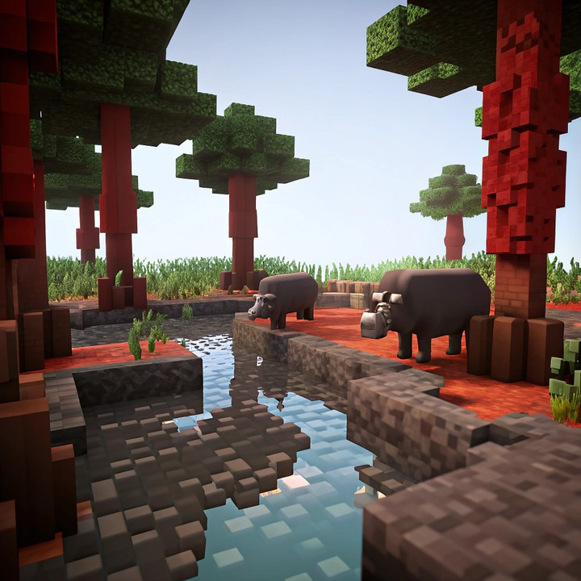

# Image Quality（MUSIQ）

`image_quality` 是正式的无参考 `image_static` quality 指标。它使用 MUSIQ-SPAQ 图像质量模型评估 prediction 帧，不需要 paired reference rollout。

对协议选出的每个 prediction 帧 $I_i$，MUSIQ 输出原生 $[0,100]$ 分数 $q_i$。WorldArena 先逐帧归一化并截断：

\[
s_i = \mathrm{clip}\!\left(\frac{q_i}{100}, 0, 1\right),
\]

再对归一化帧分数取平均：

\[
S_{\mathrm{MUSIQ}} = \frac{1}{N}\sum_{i=1}^{N}s_i.
\]

得分越高越好。该结果进入 `per_metric_summary` 与七项等权 quality 总分。默认 backend 为 `musiq`，预处理模式为 `longer`。

<!-- metric-examples:start -->
## 人工精选的同 Case 对比

下列案例来自 `artifacts/reports` 生成的同-case比较索引。输入图、sample ID 与实际生成 prompt 完全一致；候选先按分位数和分差筛选，再逐帧人工复核。标签只表示该 metric 的相对高低，不代表模型整体优劣；为避免把单一案例误读成排行榜，卡片不展示模型名称。

Audit manifest: `docs/assets/metric_examples/curated_same_case_manifest.json`.

<article class="metric-case-exhibit metric-case-exhibit--curated">
  

    <figure class="metric-input-card">
      
      <figcaption>输入图像</figcaption>
    </figure>
    

      
人工复核 · 同一 case、输入与 prompt · gap 0.5350

      <h4><code>image_static_stylized_suburb_0082</code></h4>
      
套件: image_static场景: stylized / outdoor / suburb

      

        实际生成 prompt
        
Camera move right. A stylized forest with blocky trees, distant hills, and grass.

        <small>prompt source: prompt_target</small>
      

      
较高分结果清晰、渲染完整；较低分结果明显发灰，纹理细节不足。

    

  

  

    <figure class="metric-output-card metric-output-card--good">
      

        <video class="metric-output-video" controls muted loop playsinline preload="metadata" aria-label="较高指标分: image_static_stylized_suburb_0082">
          <source src="../../../assets/metric_examples/curated_20260801/941cad1029b1__image_static_stylized_suburb_0082__high.mp4" type="video/mp4">
        </video>
        
较高指标分 · 分数 0.7881

      

      <figcaption class="metric-output-caption"><strong>较高指标分</strong>image_quality</figcaption>
    </figure>
    <figure class="metric-output-card metric-output-card--bad">
      

        <video class="metric-output-video" controls muted loop playsinline preload="metadata" aria-label="较低指标分: image_static_stylized_suburb_0082">
          <source src="../../../assets/metric_examples/curated_20260801/7e8f29555362__image_static_stylized_suburb_0082__low.mp4" type="video/mp4">
        </video>
        
较低指标分 · 分数 0.2531

      

      <figcaption class="metric-output-caption"><strong>较低指标分</strong>image_quality</figcaption>
    </figure>
  

</article>

<!-- metric-examples:end -->
