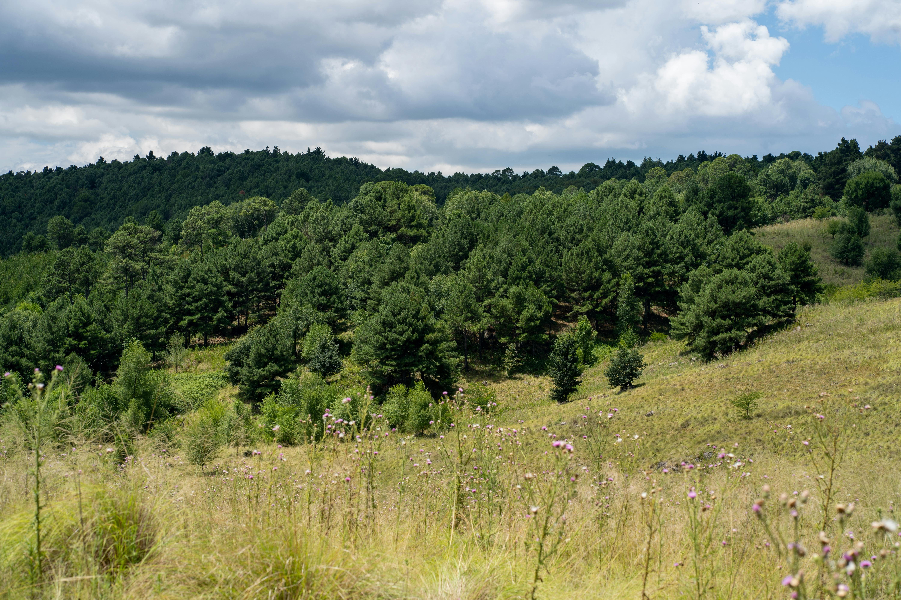
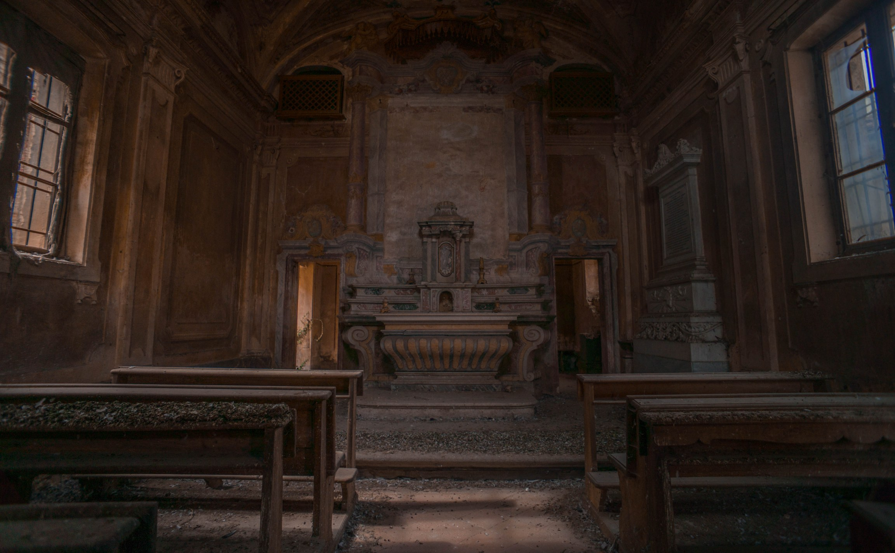
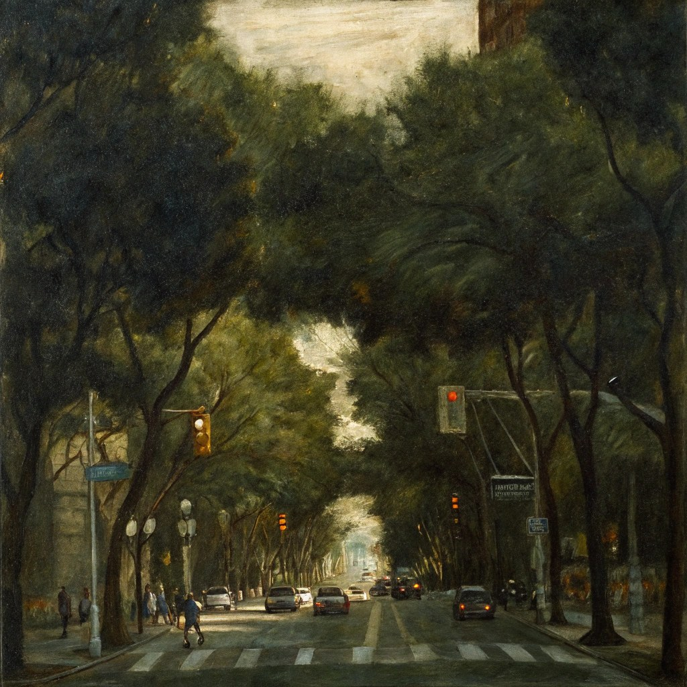
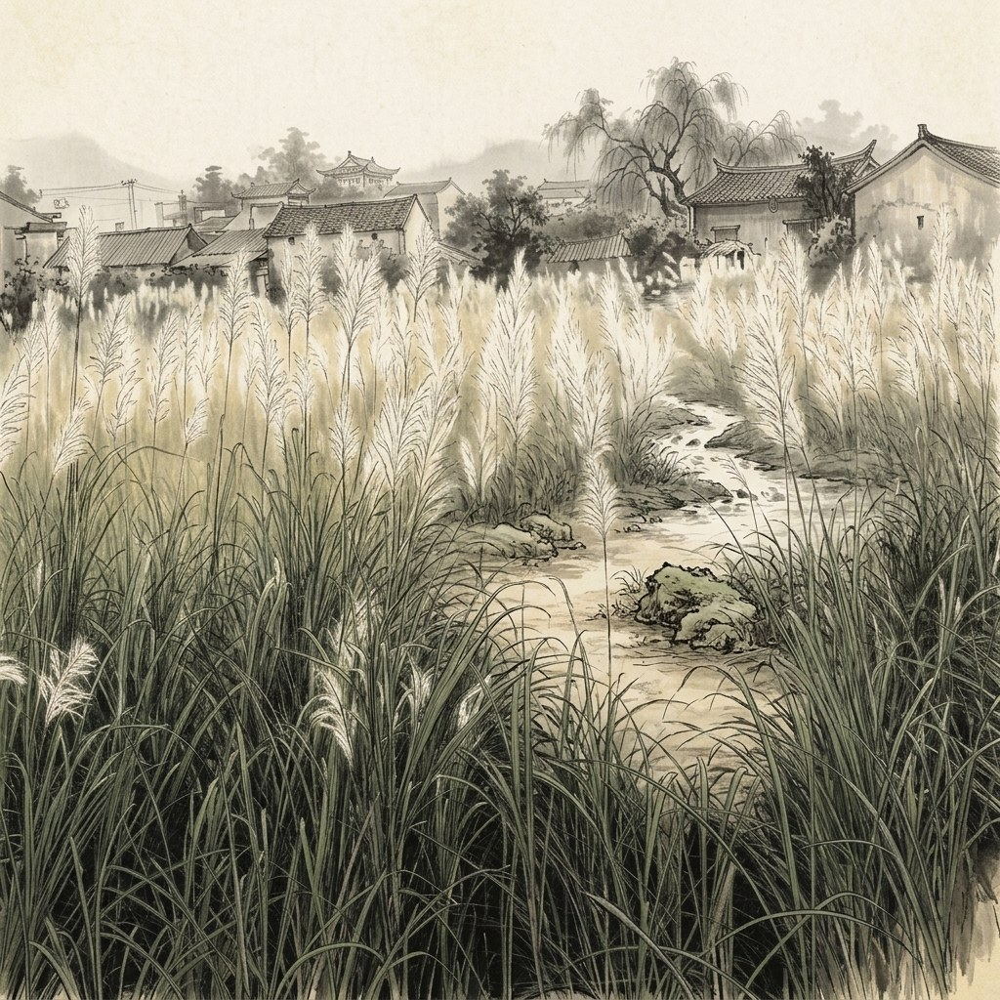
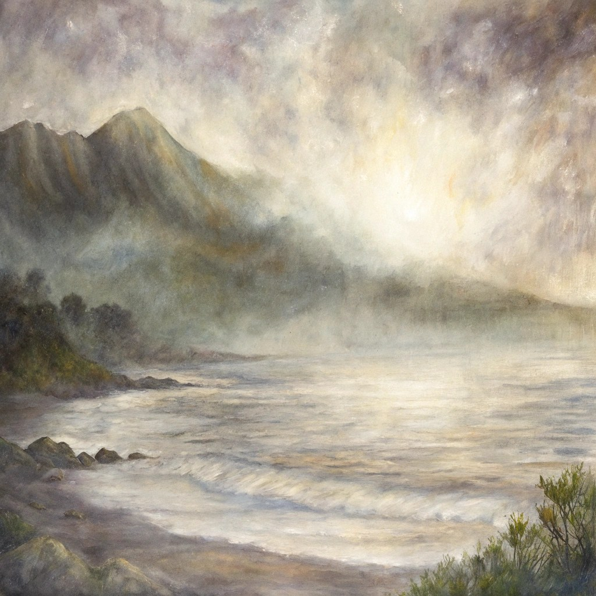
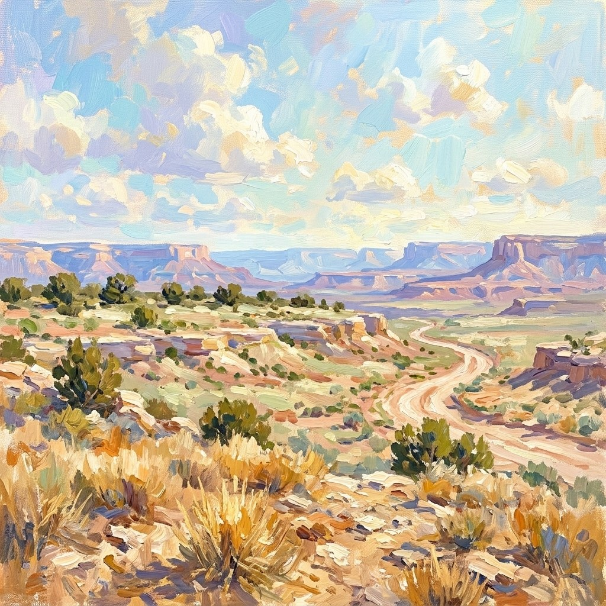

# Long Sequence Imaging Quality

**long_sequence_imaging_quality** 使用 MUSIQ 衡量预测帧的**无参考技术成像质量均值**（清晰度、噪声、压缩伪影）。native 分数除以 $100$ 后取帧均值，映射至 $[0,1]$。

\[
S_{\mathrm{img}} = \frac{1}{T}\sum_{t=1}^{T} s_t^{\mathrm{img}}
\tag{1}
\]

越高越好。该指标衡量长 rollout 质量，仅基于预测，由 `long_sequence` 后端（`imaging_quality` 维度；默认 MUSIQ-SPAQ 权重，长边 resize 至 $512$）计算。共享运行时见 [Long-Sequence 指标](long_sequence.md)。

<!-- metric-examples:start -->
## 代表性同 Case 对比
每个展示块先给出该 case 的 input image 和完全一致的展示 prompt，然后比较模型生成结果。paired 展示必须满足 input image 相同、prompt 文本相同，并且一个模型高分、一个模型低分。若当前正式快照中该 metric 没有这种跨模型同 case pair，则单独展示高分/低分极值样例，不把它们伪装成同 case 对比。
机器可读 paired 导出： `docs/assets/metric_examples/paired_manifest.csv`.
### `long_sequence_imaging_quality`

<article class="metric-case-exhibit">
  

    <figure class="metric-input-card">
      
      <figcaption>输入图像</figcaption>
    </figure>
    

      
Case 1 · 同一输入图像 + 同一 prompt · 分差 0.4753

      <h4><code>image_static_photorealistic_verdant_landscape_0109</code></h4>
      
Suite: image_staticScene: photorealistic / outdoor / verdant_landscape

      

        目标 prompt
        
Camera pan right. A forest edge with wildflowers and distant hills.

        <small>prompt 来源: prompt_target</small>
      

    

  

  

<figure class="metric-output-card metric-output-card--good">
  

    <video class="metric-output-video" controls muted loop playsinline preload="metadata" aria-label="好结果: image_static_photorealistic_verdant_landscape_0109">
      <source src="../../../assets/metric_examples/73755855521a__yume-sample5b-image-static-dynamic-5s__image_static_photorealistic_verdant_landscape_0109.mp4" type="video/mp4">
    </video>
    
好结果 · 分数 0.8024

  

</figure>
<figure class="metric-output-card metric-output-card--bad">
  

    <video class="metric-output-video" controls muted loop playsinline preload="metadata" aria-label="差结果: image_static_photorealistic_verdant_landscape_0109">
      <source src="../../../assets/metric_examples/4ac9274ee922__motionctrl__image_static_photorealistic_verdant_landscape_0109.mp4" type="video/mp4">
    </video>
    
差结果 · 分数 0.3270

  

</figure>
  

</article>
<article class="metric-case-exhibit">
  

    <figure class="metric-input-card">
      
      <figcaption>输入图像</figcaption>
    </figure>
    

      
Case 2 · 同一输入图像 + 同一 prompt · 分差 0.4353

      <h4><code>image_static_photorealistic_public_spaces_0068</code></h4>
      
Suite: image_staticScene: photorealistic / indoor / public_spaces

      

        目标 prompt
        
Camera push in. An abandoned chapel with altar, carvings, and faded symbols.

        <small>prompt 来源: prompt_target</small>
      

    

  

  

<figure class="metric-output-card metric-output-card--good">
  

    <video class="metric-output-video" controls muted loop playsinline preload="metadata" aria-label="好结果: image_static_photorealistic_public_spaces_0068">
      <source src="../../../assets/metric_examples/5009426ec26e__yume-sample5b-image-static-dynamic-5s__image_static_photorealistic_public_spaces_0068.mp4" type="video/mp4">
    </video>
    
好结果 · 分数 0.7406

  

</figure>
<figure class="metric-output-card metric-output-card--bad">
  

    <video class="metric-output-video" controls muted loop playsinline preload="metadata" aria-label="差结果: image_static_photorealistic_public_spaces_0068">
      <source src="../../../assets/metric_examples/a14a53e19198__warp-as-history-image-static-8gpu-20260612_152000__image_static_photorealistic_public_spaces_0068.mp4" type="video/mp4">
    </video>
    
差结果 · 分数 0.3053

  

</figure>
  

</article>
<article class="metric-case-exhibit">
  

    <figure class="metric-input-card">
      
      <figcaption>输入图像</figcaption>
    </figure>
    

      
Case 3 · 同一输入图像 + 同一 prompt · 分差 0.4182

      <h4><code>image_static_stylized_suburb_0084</code></h4>
      
Suite: image_staticScene: stylized / outdoor / suburb

      

        目标 prompt
        
Camera pull out. A suburban intersection with trees, parked cars, and pedestrians.

        <small>prompt 来源: prompt_target</small>
      

    

  

  

<figure class="metric-output-card metric-output-card--good">
  

    <video class="metric-output-video" controls muted loop playsinline preload="metadata" aria-label="好结果: image_static_stylized_suburb_0084">
      <source src="../../../assets/metric_examples/0d348dbc85f1__motionctrl__image_static_stylized_suburb_0084.mp4" type="video/mp4">
    </video>
    
好结果 · 分数 0.7578

  

</figure>
<figure class="metric-output-card metric-output-card--bad">
  

    <video class="metric-output-video" controls muted loop playsinline preload="metadata" aria-label="差结果: image_static_stylized_suburb_0084">
      <source src="../../../assets/metric_examples/ac7c105f46d1__warp-as-history-image-static-8gpu-20260612_152000__image_static_stylized_suburb_0084.mp4" type="video/mp4">
    </video>
    
差结果 · 分数 0.3397

  

</figure>
  

</article>
<article class="metric-case-exhibit">
  

    <figure class="metric-input-card">
      
      <figcaption>输入图像</figcaption>
    </figure>
    

      
Case 4 · 同一输入图像 + 同一 prompt · 分差 0.3910

      <h4><code>image_static_stylized_verdant_landscape_0151</code></h4>
      
Suite: image_staticScene: stylized / outdoor / verdant_landscape

      

        目标 prompt
        
Camera move right. A rural landscape with path, tall grasses, and traditional buildings.

        <small>prompt 来源: prompt_target</small>
      

    

  

  

<figure class="metric-output-card metric-output-card--good">
  

    <video class="metric-output-video" controls muted loop playsinline preload="metadata" aria-label="好结果: image_static_stylized_verdant_landscape_0151">
      <source src="../../../assets/metric_examples/34239ebf5935__yume-sample5b-missing-reverse__image_static_stylized_verdant_landscape_0151.mp4" type="video/mp4">
    </video>
    
好结果 · 分数 0.7832

  

</figure>
<figure class="metric-output-card metric-output-card--bad">
  

    <video class="metric-output-video" controls muted loop playsinline preload="metadata" aria-label="差结果: image_static_stylized_verdant_landscape_0151">
      <source src="../../../assets/metric_examples/13ccb050b001__warp-as-history-image-static-8gpu-20260612_152000__image_static_stylized_verdant_landscape_0151.mp4" type="video/mp4">
    </video>
    
差结果 · 分数 0.3922

  

</figure>
  

</article>
<article class="metric-case-exhibit">
  

    <figure class="metric-input-card">
      
      <figcaption>输入图像</figcaption>
    </figure>
    

      
Case 5 · 同一输入图像 + 同一 prompt · 分差 0.3801

      <h4><code>image_static_stylized_aquatic_landscape_0053</code></h4>
      
Suite: image_staticScene: stylized / outdoor / aquatic_landscape

      

        目标 prompt
        
Camera move left. A rocky shoreline with vegetation, distant hills, and waves.

        <small>prompt 来源: prompt_target</small>
      

    

  

  

<figure class="metric-output-card metric-output-card--good">
  

    <video class="metric-output-video" controls muted loop playsinline preload="metadata" aria-label="好结果: image_static_stylized_aquatic_landscape_0053">
      <source src="../../../assets/metric_examples/cdd233ddb905__motionctrl__image_static_stylized_aquatic_landscape_0053.mp4" type="video/mp4">
    </video>
    
好结果 · 分数 0.7774

  

</figure>
<figure class="metric-output-card metric-output-card--bad">
  

    <video class="metric-output-video" controls muted loop playsinline preload="metadata" aria-label="差结果: image_static_stylized_aquatic_landscape_0053">
      <source src="../../../assets/metric_examples/51b05aeee0a9__warp-as-history-image-static-8gpu-20260612_152000__image_static_stylized_aquatic_landscape_0053.mp4" type="video/mp4">
    </video>
    
差结果 · 分数 0.3974

  

</figure>
  

</article>
<article class="metric-case-exhibit">
  

    <figure class="metric-input-card">
      
      <figcaption>输入图像</figcaption>
    </figure>
    

      
Case 6 · 同一输入图像 + 同一 prompt · 分差 0.3767

      <h4><code>image_static_stylized_terrestrial_landscape_0149</code></h4>
      
Suite: image_staticScene: stylized / outdoor / terrestrial_landscape

      

        目标 prompt
        
Camera pan left. A desert landscape with dry shrubs, distant mesas, and rocky terrain. Camera move left. A desert landscape with distant mesas, rocky terrain, and dry shrubs. Camera pull out. A desert landscape with open sky, distant mesas, and rocky terrain.

        <small>prompt 来源: prompt_target</small>
      

    

  

  

<figure class="metric-output-card metric-output-card--good">
  

    <video class="metric-output-video" controls muted loop playsinline preload="metadata" aria-label="好结果: image_static_stylized_terrestrial_landscape_0149">
      <source src="../../../assets/metric_examples/476b02851a40__yume-sample5b-missing-reverse-5s-target__image_static_stylized_terrestrial_landscape_0149.mp4" type="video/mp4">
    </video>
    
好结果 · 分数 0.7517

  

</figure>
<figure class="metric-output-card metric-output-card--bad">
  

    <video class="metric-output-video" controls muted loop playsinline preload="metadata" aria-label="差结果: image_static_stylized_terrestrial_landscape_0149">
      <source src="../../../assets/metric_examples/30b3f591dec6__matrix_game2_5s__image_static_stylized_terrestrial_landscape_0149.mp4" type="video/mp4">
    </video>
    
差结果 · 分数 0.3750

  

</figure>
  

</article>

<!-- metric-examples:end -->

## 参考文献 {#reference}

!!! quote "MUSIQ: Multi-scale Image Quality Transformer"

    Zejiang Hou, Hui Ren, Ming Sun, Jiahao Li, Weining Wang.  
    ICCV 2021.  
    [https://arxiv.org/abs/2108.05997](https://arxiv.org/abs/2108.05997)
