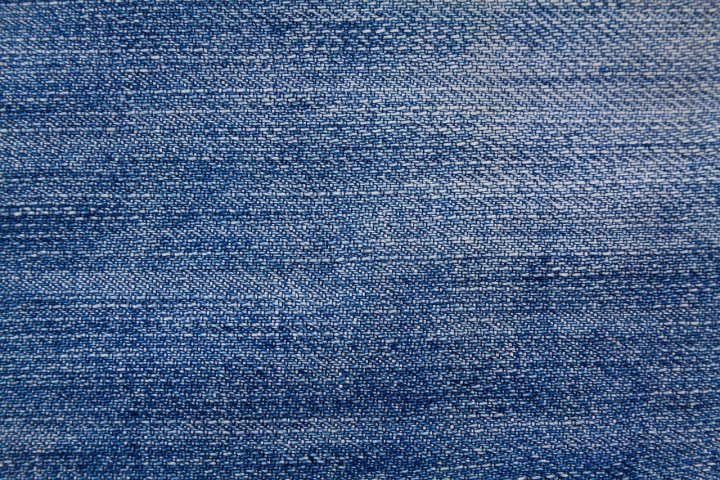
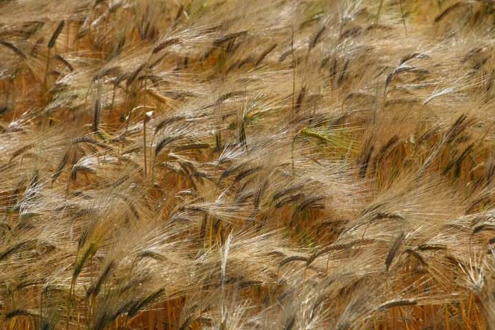
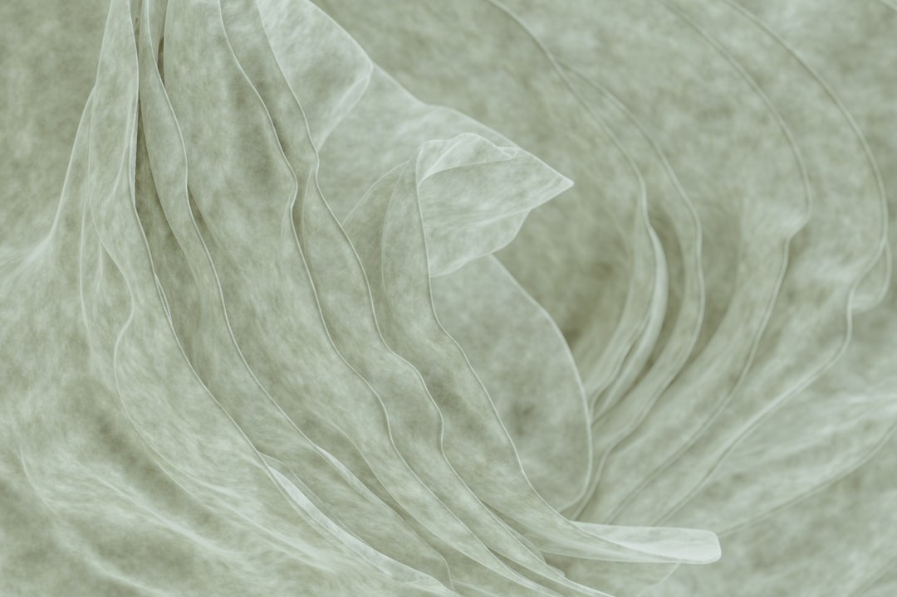

# Motion Magnitude

Motion Magnitude 量化生成视频包含的**内部运动量**，与运动是否正确无关。它检测保守生成——视觉稳定但近乎静止的输出——不评估方向、语义或物体行为。

对相邻帧 \((I_t, I_{t+1})\)，SEA-RAFT 给出光流幅值 \(F_t(x,y) = \sqrt{u_t^2 + v_t^2}\)。帧对统计量为像素中位数；原始得分对全部帧对取均值：

\[
S_{\mathrm{mag}}^{\mathrm{raw}} = \frac{1}{T-1}\sum_{t=0}^{T-2} \mathrm{median}_{x,y}\, F_t(x,y)
\tag{1}
\]

WorldArena 以 \(\mu = 3.2425\)、\(\sigma = 3.4505\) 做 z-score 校准，裁剪至 \([-0.8638, 2.7498]\)，映射至 \([0.25, 0.75]\)。归一化得分越高表示可见运动越强。计算成功时为 **official**。

<!-- metric-examples:start -->
## 代表性同 Case 对比
每个展示块先给出该 case 的 input image 和完全一致的展示 prompt，然后比较模型生成结果。paired 展示必须满足 input image 相同、prompt 文本相同，并且一个模型高分、一个模型低分。若当前正式快照中该 metric 没有这种跨模型同 case pair，则单独展示高分/低分极值样例，不把它们伪装成同 case 对比。
机器可读 paired 导出： `docs/assets/metric_examples/paired_manifest.csv`.
### `motion_magnitude`

<article class="metric-case-exhibit">
  

    <figure class="metric-input-card">
      
      <figcaption>输入图像</figcaption>
    </figure>
    

      
Case 1 · 同一输入图像 + 同一 prompt · 分差 0.7605

      <h4><code>image_dynamic_photorealistic_deformable_0090</code></h4>
      
Suite: image_dynamicScene: photorealistic

      

        目标 prompt
        
Camera fixed. The blue denim fabric subtly wrinkles and stretches, shifting the weave pattern as a fold travels across the surface. The close-up lighting and textile background stay consistent.

        <small>prompt 来源: prompt_target</small>
      

    

  

  

<figure class="metric-output-card metric-output-card--good">
  

    <video class="metric-output-video" controls muted loop playsinline preload="metadata" aria-label="好结果: yume-sample5b-image-dynamic-5s image_dynamic_photorealistic_deformable_0090">
      <source src="../../../assets/metric_examples/497f3ecfb716__yume-sample5b-image-dynamic-5s__image_dynamic_photorealistic_deformable_0090.mp4" type="video/mp4">
    </video>
    
好结果 · 分数 1.0000

  

</figure>
<figure class="metric-output-card metric-output-card--bad">
  

    <video class="metric-output-video" controls muted loop playsinline preload="metadata" aria-label="差结果: hunyuan-video-i2v-image-static-dynamic image_dynamic_photorealistic_deformable_0090">
      <source src="../../../assets/metric_examples/253f174d78d3__hunyuan-video-i2v-image-static-dynamic__image_dynamic_photorealistic_deformable_0090.mp4" type="video/mp4">
    </video>
    
差结果 · 分数 0.2395

  

</figure>
  

</article>
<article class="metric-case-exhibit">
  

    <figure class="metric-input-card">
      
      <figcaption>输入图像</figcaption>
    </figure>
    

      
Case 2 · 同一输入图像 + 同一 prompt · 分差 0.7605

      <h4><code>image_dynamic_photorealistic_deformable_0089</code></h4>
      
Suite: image_dynamicScene: photorealistic

      

        目标 prompt
        
Camera fixed. Green wheat stalks with unripe ears sway forward and spring back, their leaves fluttering in the breeze. The soft background of the field remains visually stable.

        <small>prompt 来源: prompt_target</small>
      

    

  

  

<figure class="metric-output-card metric-output-card--good">
  

    <video class="metric-output-video" controls muted loop playsinline preload="metadata" aria-label="好结果: astra image_dynamic_photorealistic_deformable_0089">
      <source src="../../../assets/metric_examples/7775b860f58b__astra__image_dynamic_photorealistic_deformable_0089.mp4" type="video/mp4">
    </video>
    
好结果 · 分数 1.0000

  

</figure>
<figure class="metric-output-card metric-output-card--bad">
  

    <video class="metric-output-video" controls muted loop playsinline preload="metadata" aria-label="差结果: matrix_game2_5s image_dynamic_photorealistic_deformable_0089">
      <source src="../../../assets/metric_examples/d0f5d3df7a68__matrix_game2_5s__image_dynamic_photorealistic_deformable_0089.mp4" type="video/mp4">
    </video>
    
差结果 · 分数 0.2395

  

</figure>
  

</article>
<article class="metric-case-exhibit">
  

    <figure class="metric-input-card">
      
      <figcaption>输入图像</figcaption>
    </figure>
    

      
Case 3 · 同一输入图像 + 同一 prompt · 分差 0.7605

      <h4><code>image_dynamic_photorealistic_deformable_0064</code></h4>
      
Suite: image_dynamicScene: photorealistic

      

        目标 prompt
        
Camera fixed. Golden barley stalks sway gently in sunlight, their fine strands bending and shimmering as a light breeze passes through. The field remains dense and continuous around them.

        <small>prompt 来源: prompt_target</small>
      

    

  

  

<figure class="metric-output-card metric-output-card--good">
  

    <video class="metric-output-video" controls muted loop playsinline preload="metadata" aria-label="好结果: longcat-video-image-dynamic image_dynamic_photorealistic_deformable_0064">
      <source src="../../../assets/metric_examples/d7eba57786ee__longcat-video-image-dynamic__image_dynamic_photorealistic_deformable_0064.mp4" type="video/mp4">
    </video>
    
好结果 · 分数 1.0000

  

</figure>
<figure class="metric-output-card metric-output-card--bad">
  

    <video class="metric-output-video" controls muted loop playsinline preload="metadata" aria-label="差结果: matrix_game2_5s image_dynamic_photorealistic_deformable_0064">
      <source src="../../../assets/metric_examples/986a22fd3c5d__matrix_game2_5s__image_dynamic_photorealistic_deformable_0064.mp4" type="video/mp4">
    </video>
    
差结果 · 分数 0.2395

  

</figure>
  

</article>
<article class="metric-case-exhibit">
  

    <figure class="metric-input-card">
      
      <figcaption>输入图像</figcaption>
    </figure>
    

      
Case 4 · 同一输入图像 + 同一 prompt · 分差 0.7604

      <h4><code>image_dynamic_photorealistic_deformable_0163</code></h4>
      
Suite: image_dynamicScene: photorealistic

      

        目标 prompt
        
Camera fixed. Translucent fabric layers ripple in a gentle swirling motion, their curved folds sliding over one another. The close-up composition stays focused on the delicate overlapping textures.

        <small>prompt 来源: prompt_target</small>
      

    

  

  

<figure class="metric-output-card metric-output-card--good">
  

    <video class="metric-output-video" controls muted loop playsinline preload="metadata" aria-label="好结果: astra image_dynamic_photorealistic_deformable_0163">
      <source src="../../../assets/metric_examples/42143df67a10__astra__image_dynamic_photorealistic_deformable_0163.mp4" type="video/mp4">
    </video>
    
好结果 · 分数 1.0000

  

</figure>
<figure class="metric-output-card metric-output-card--bad">
  

    <video class="metric-output-video" controls muted loop playsinline preload="metadata" aria-label="差结果: ac3d-image-dynamic image_dynamic_photorealistic_deformable_0163">
      <source src="../../../assets/metric_examples/aba224b60229__ac3d-image-dynamic__image_dynamic_photorealistic_deformable_0163.mp4" type="video/mp4">
    </video>
    
差结果 · 分数 0.2396

  

</figure>
  

</article>
<article class="metric-case-exhibit">
  

    <figure class="metric-input-card">
      
      <figcaption>输入图像</figcaption>
    </figure>
    

      
Case 5 · 同一输入图像 + 同一 prompt · 分差 0.7604

      <h4><code>image_dynamic_photorealistic_articulated_0068</code></h4>
      
Suite: image_dynamicScene: photorealistic

      

        目标 prompt
        
Camera fixed. The dog runs quickly across the grassy field, moving forward with alternating legs, open mouth, and perked ears while the fence and trees stay in place.

        <small>prompt 来源: prompt_target</small>
      

    

  

  

<figure class="metric-output-card metric-output-card--good">
  

    <video class="metric-output-video" controls muted loop playsinline preload="metadata" aria-label="好结果: longcat-video-image-dynamic image_dynamic_photorealistic_articulated_0068">
      <source src="../../../assets/metric_examples/1747010395f4__longcat-video-image-dynamic__image_dynamic_photorealistic_articulated_0068.mp4" type="video/mp4">
    </video>
    
好结果 · 分数 1.0000

  

</figure>
<figure class="metric-output-card metric-output-card--bad">
  

    <video class="metric-output-video" controls muted loop playsinline preload="metadata" aria-label="差结果: matrix_game2_5s image_dynamic_photorealistic_articulated_0068">
      <source src="../../../assets/metric_examples/aff317072a9d__matrix_game2_5s__image_dynamic_photorealistic_articulated_0068.mp4" type="video/mp4">
    </video>
    
差结果 · 分数 0.2396

  

</figure>
  

</article>
<article class="metric-case-exhibit">
  

    <figure class="metric-input-card">
      
      <figcaption>输入图像</figcaption>
    </figure>
    

      
Case 6 · 同一输入图像 + 同一 prompt · 分差 0.7604

      <h4><code>image_dynamic_photorealistic_articulated_0001</code></h4>
      
Suite: image_dynamicScene: photorealistic

      

        目标 prompt
        
Camera fixed. A bird of prey glides forward low over a grassy field, wings spread wide with subtle body and wing adjustments. The wooden fence post, wild grasses, and vines remain still.

        <small>prompt 来源: prompt_target</small>
      

    

  

  

<figure class="metric-output-card metric-output-card--good">
  

    <video class="metric-output-video" controls muted loop playsinline preload="metadata" aria-label="好结果: astra image_dynamic_photorealistic_articulated_0001">
      <source src="../../../assets/metric_examples/73ee88755197__astra__image_dynamic_photorealistic_articulated_0001.mp4" type="video/mp4">
    </video>
    
好结果 · 分数 1.0000

  

</figure>
<figure class="metric-output-card metric-output-card--bad">
  

    <video class="metric-output-video" controls muted loop playsinline preload="metadata" aria-label="差结果: sana-wm-image-dynamic image_dynamic_photorealistic_articulated_0001">
      <source src="../../../assets/metric_examples/3c22680fb047__sana-wm-image-dynamic__image_dynamic_photorealistic_articulated_0001.mp4" type="video/mp4">
    </video>
    
差结果 · 分数 0.2396

  

</figure>
  

</article>

<!-- metric-examples:end -->

## 参考文献 {#reference}

!!! quote "SEA-RAFT: Simple, Efficient, Accurate RAFT for Optical Flow"

    Wang et al., ECCV 2024.
