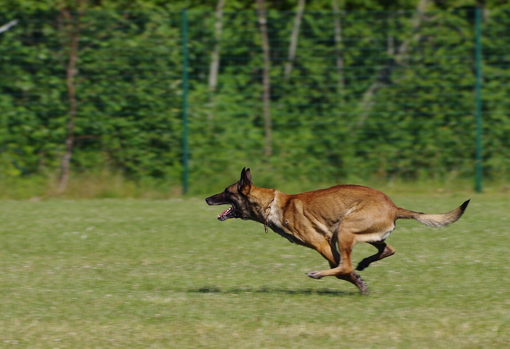

# Motion Magnitude

Motion Magnitude 量化生成视频包含的**内部运动量**，与运动是否正确无关。它检测保守生成——视觉稳定但近乎静止的输出——不评估方向、语义或物体行为。

对相邻帧 \((I_t, I_{t+1})\)，SEA-RAFT 给出光流幅值 \(F_t(x,y) = \sqrt{u_t^2 + v_t^2}\)。帧对统计量为像素中位数；原始得分对全部帧对取均值：

\[
S_{\mathrm{mag}}^{\mathrm{raw}} = \frac{1}{T-1}\sum_{t=0}^{T-2} \mathrm{median}_{x,y}\, F_t(x,y)
\tag{1}
\]

WorldArena 以 \(\mu = 3.2425\)、\(\sigma = 3.4505\) 做 z-score 校准，裁剪至 \([-0.8638, 2.7498]\)，映射至 \([0.25, 0.75]\)。归一化得分越高表示可见运动越强。计算成功时为 **official**。

<!-- metric-examples:start -->
## 人工精选的同 Case 对比

下列案例来自 `artifacts/reports` 生成的同-case比较索引。输入图、sample ID 与实际生成 prompt 完全一致；候选先按分位数和分差筛选，再逐帧人工复核。标签只表示该 metric 的相对高低，不代表模型整体优劣；为避免把单一案例误读成排行榜，卡片不展示模型名称。

Audit manifest: `docs/assets/metric_examples/curated_same_case_manifest.json`.

<article class="metric-case-exhibit metric-case-exhibit--curated">
  

    <figure class="metric-input-card">
      
      <figcaption>输入图像</figcaption>
    </figure>
    

      
人工复核 · 同一 case、输入与 prompt · gap 0.7604

      <h4><code>image_dynamic_photorealistic_articulated_0068</code></h4>
      
套件: image_dynamic场景: photorealistic / articulated

      

        实际生成 prompt
        
Camera fixed. The dog runs quickly across the grassy field, moving forward with alternating legs, open mouth, and perked ears while the fence and trees stay in place.

        <small>prompt source: prompt_target</small>
      

      
较高分结果中狗的姿态与位置变化更充分；较低分结果的姿态和位移范围明显更小。

    

  

  

    <figure class="metric-output-card metric-output-card--good">
      

        <video class="metric-output-video" controls muted loop playsinline preload="metadata" aria-label="较高指标分: image_dynamic_photorealistic_articulated_0068">
          <source src="../../../assets/metric_examples/curated_20260801/d473083aaa1b__image_dynamic_photorealistic_articulated_0068__high.mp4" type="video/mp4">
        </video>
        
较高指标分 · 分数 1.0000

      

      <figcaption class="metric-output-caption"><strong>较高指标分</strong>motion_magnitude</figcaption>
    </figure>
    <figure class="metric-output-card metric-output-card--bad">
      

        <video class="metric-output-video" controls muted loop playsinline preload="metadata" aria-label="较低指标分: image_dynamic_photorealistic_articulated_0068">
          <source src="../../../assets/metric_examples/aff317072a9d__matrix_game2_5s__image_dynamic_photorealistic_articulated_0068.mp4" type="video/mp4">
        </video>
        
较低指标分 · 分数 0.2396

      

      <figcaption class="metric-output-caption"><strong>较低指标分</strong>motion_magnitude</figcaption>
    </figure>
  

</article>

<!-- metric-examples:end -->

## 参考文献 {#reference}

!!! quote "SEA-RAFT: Simple, Efficient, Accurate RAFT for Optical Flow"

    Wang et al., ECCV 2024.
