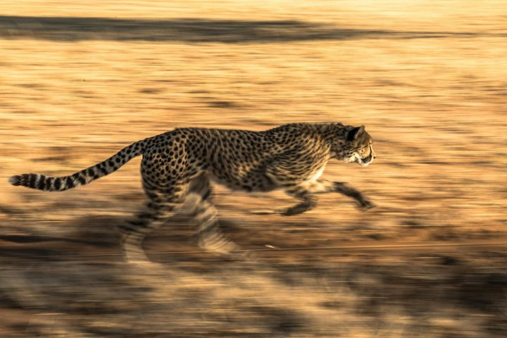
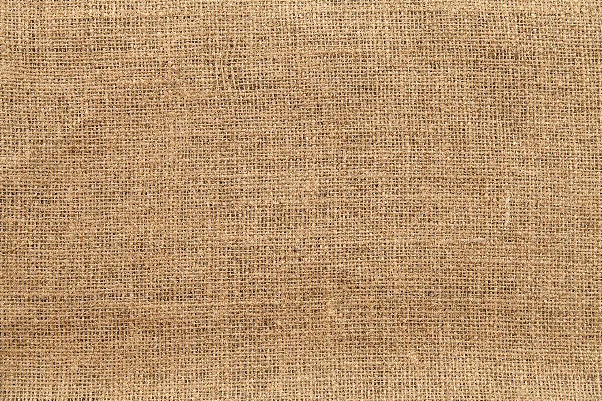
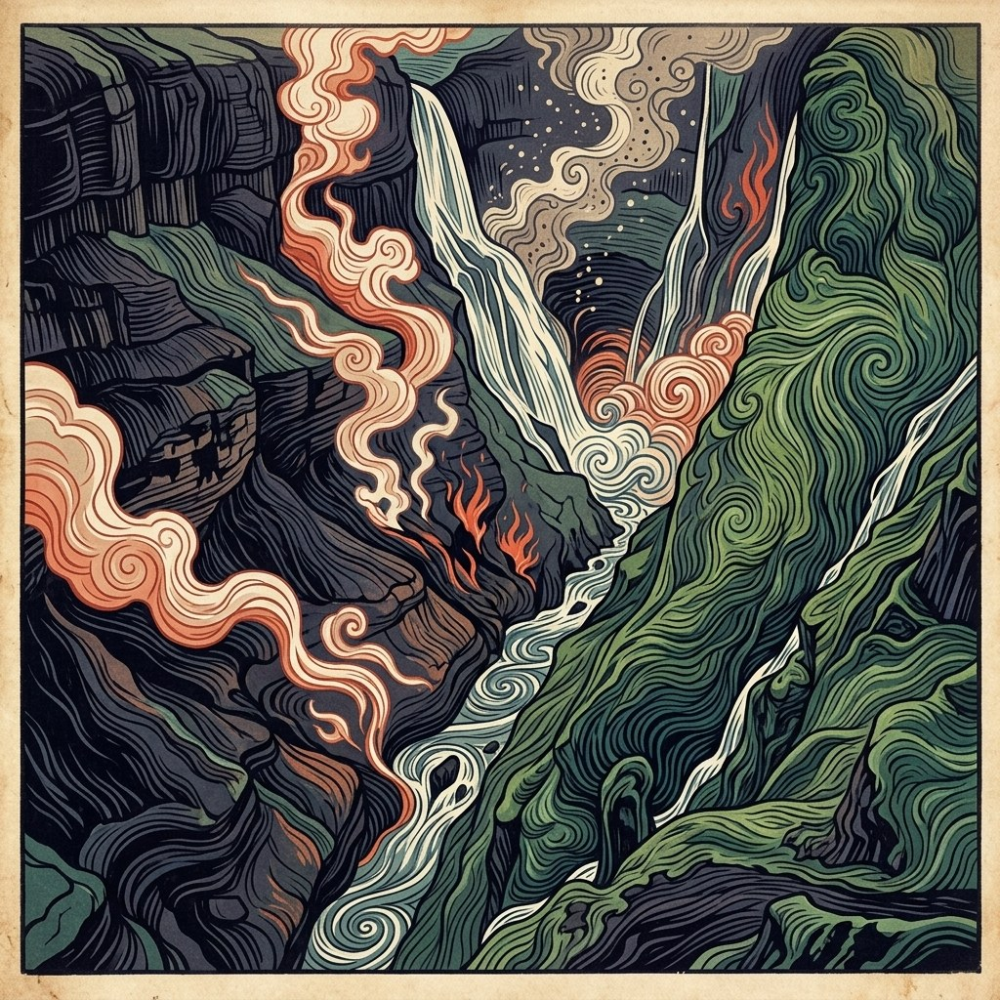
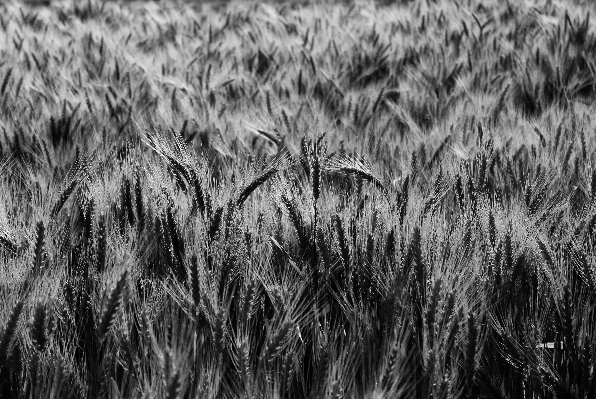
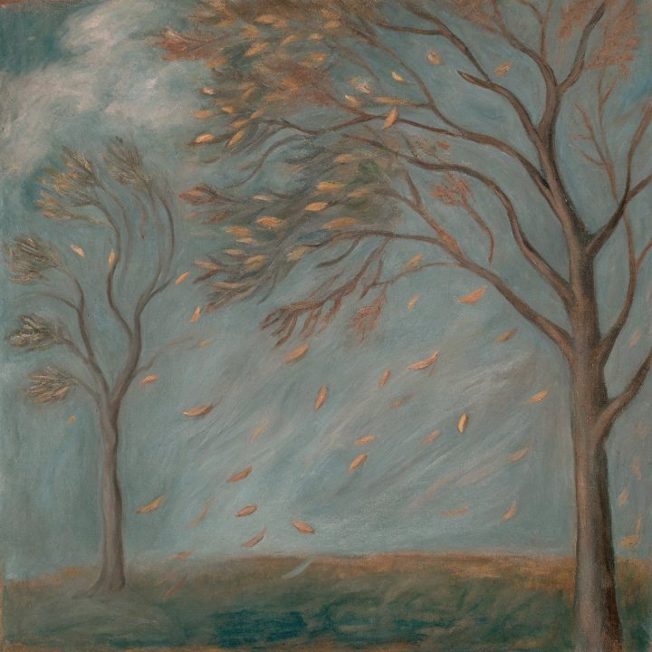

# Motion Smoothness

Motion Smoothness 在帧插值先验下衡量生成视频的**时序可插值性**。VFIMamba 由相邻偶数帧重建被丢弃的奇数帧；重建误差越低表示运动越平滑连续，而非语义或幅度正确。

对窗口 \(k\)，\(\hat{I}_{2k+1} = \Phi(I_{2k}, I_{2k+2})\) 与真实奇数帧 \(I_{2k+1}\) 通过 MSE、SSIM、LPIPS 比较。原始分量对 \(K\) 个窗口取均值：

\[
E_{\mathrm{mse}} = \frac{1}{K}\sum_k \mathrm{MSE}(\hat{I}_{2k+1}, I_{2k+1}),\quad
S_{\mathrm{ssim}} = \frac{1}{K}\sum_k \mathrm{SSIM}(\hat{I}_{2k+1}, I_{2k+1}),\quad
E_{\mathrm{lpips}} = \frac{1}{K}\sum_k \mathrm{LPIPS}(\hat{I}_{2k+1}, I_{2k+1})
\tag{1}
\]

各分量独立归一化后取算术均值。\(S_{\mathrm{smooth}}\) 越高表示生成运动越平滑。计算成功时为 **official**，无需参考视频。

<!-- metric-examples:start -->
## 代表性同 Case 对比
每个展示块先给出该 case 的 input image 和完全一致的展示 prompt，然后比较模型生成结果。paired 展示必须满足 input image 相同、prompt 文本相同，并且一个模型高分、一个模型低分。若当前正式快照中该 metric 没有这种跨模型同 case pair，则单独展示高分/低分极值样例，不把它们伪装成同 case 对比。
机器可读 paired 导出： `docs/assets/metric_examples/paired_manifest.csv`.
### `motion_smoothness`

<article class="metric-case-exhibit">
  

    <figure class="metric-input-card">
      
      <figcaption>输入图像</figcaption>
    </figure>
    

      
Case 1 · 同一输入图像 + 同一 prompt · 分差 0.9546

      <h4><code>image_dynamic_photorealistic_articulated_0136</code></h4>
      
Suite: image_dynamicScene: photorealistic

      

        目标 prompt
        
Camera fixed. A cheetah sprints across the dry grassy savannah, its legs cycling rapidly and body stretching low with each stride. Golden grass, sunlight, and shadows remain consistent around it.

        <small>prompt 来源: prompt_target</small>
      

    

  

  

<figure class="metric-output-card metric-output-card--good">
  

    <video class="metric-output-video" controls muted loop playsinline preload="metadata" aria-label="好结果: matrix-game-3-image-dynamic-5s image_dynamic_photorealistic_articulated_0136">
      <source src="../../../assets/metric_examples/b03e9f8572a3__matrix-game-3-image-dynamic-5s__image_dynamic_photorealistic_articulated_0136.mp4" type="video/mp4">
    </video>
    
好结果 · 分数 0.9557

  

</figure>
<figure class="metric-output-card metric-output-card--bad">
  

    <video class="metric-output-video" controls muted loop playsinline preload="metadata" aria-label="差结果: longcat-video-image-dynamic image_dynamic_photorealistic_articulated_0136">
      <source src="../../../assets/metric_examples/c079d2132671__longcat-video-image-dynamic__image_dynamic_photorealistic_articulated_0136.mp4" type="video/mp4">
    </video>
    
差结果 · 分数 0.0011

  

</figure>
  

</article>
<article class="metric-case-exhibit">
  

    <figure class="metric-input-card">
      
      <figcaption>输入图像</figcaption>
    </figure>
    

      
Case 2 · 同一输入图像 + 同一 prompt · 分差 0.9533

      <h4><code>image_dynamic_photorealistic_deformable_0088</code></h4>
      
Suite: image_dynamicScene: photorealistic

      

        目标 prompt
        
Camera fixed. Coarse burlap fabric fills the frame, showing interlaced brown fibers and a rough woven pattern. The textile remains completely still, with no folds or fibers shifting.

        <small>prompt 来源: prompt_target</small>
      

    

  

  

<figure class="metric-output-card metric-output-card--good">
  

    <video class="metric-output-video" controls muted loop playsinline preload="metadata" aria-label="好结果: ac3d-image-dynamic image_dynamic_photorealistic_deformable_0088">
      <source src="../../../assets/metric_examples/5baf7f981cca__ac3d-image-dynamic__image_dynamic_photorealistic_deformable_0088.mp4" type="video/mp4">
    </video>
    
好结果 · 分数 0.9533

  

</figure>
<figure class="metric-output-card metric-output-card--bad">
  

    <video class="metric-output-video" controls muted loop playsinline preload="metadata" aria-label="差结果: astra image_dynamic_photorealistic_deformable_0088">
      <source src="../../../assets/metric_examples/407c86893682__astra__image_dynamic_photorealistic_deformable_0088.mp4" type="video/mp4">
    </video>
    
差结果 · 分数 0.0000

  

</figure>
  

</article>
<article class="metric-case-exhibit">
  

    <figure class="metric-input-card">
      
      <figcaption>输入图像</figcaption>
    </figure>
    

      
Case 3 · 同一输入图像 + 同一 prompt · 分差 0.9450

      <h4><code>image_dynamic_stylized_fluid_0153</code></h4>
      
Suite: image_dynamicScene: stylized

      

        目标 prompt
        
Camera fixed. Water flows through the patterned canyon in wavy channels while smoke rises and curls from the canyon floor. Rock formations and green hills remain steady around the moving streams.

        <small>prompt 来源: prompt_target</small>
      

    

  

  

<figure class="metric-output-card metric-output-card--good">
  

    <video class="metric-output-video" controls muted loop playsinline preload="metadata" aria-label="好结果: matrix-game-3-image-dynamic-5s image_dynamic_stylized_fluid_0153">
      <source src="../../../assets/metric_examples/11d16fea29f8__matrix-game-3-image-dynamic-5s__image_dynamic_stylized_fluid_0153.mp4" type="video/mp4">
    </video>
    
好结果 · 分数 0.9450

  

</figure>
<figure class="metric-output-card metric-output-card--bad">
  

    <video class="metric-output-video" controls muted loop playsinline preload="metadata" aria-label="差结果: sana-wm-image-dynamic image_dynamic_stylized_fluid_0153">
      <source src="../../../assets/metric_examples/bc33c7917ae4__sana-wm-image-dynamic__image_dynamic_stylized_fluid_0153.mp4" type="video/mp4">
    </video>
    
差结果 · 分数 0.0000

  

</figure>
  

</article>
<article class="metric-case-exhibit">
  

    <figure class="metric-input-card">
      
      <figcaption>输入图像</figcaption>
    </figure>
    

      
Case 4 · 同一输入图像 + 同一 prompt · 分差 0.9402

      <h4><code>image_dynamic_stylized_fluid_0083</code></h4>
      
Suite: image_dynamicScene: stylized

      

        目标 prompt
        
Camera fixed. The stylized waterfall flows over forest rocks in energetic swirls, sending water downward while colorful trees, foliage, and the nearby path remain still.

        <small>prompt 来源: prompt_target</small>
      

    

  

  

<figure class="metric-output-card metric-output-card--good">
  

    <video class="metric-output-video" controls muted loop playsinline preload="metadata" aria-label="好结果: ac3d-image-dynamic image_dynamic_stylized_fluid_0083">
      <source src="../../../assets/metric_examples/d2cd8d49f61b__ac3d-image-dynamic__image_dynamic_stylized_fluid_0083.mp4" type="video/mp4">
    </video>
    
好结果 · 分数 0.9494

  

</figure>
<figure class="metric-output-card metric-output-card--bad">
  

    <video class="metric-output-video" controls muted loop playsinline preload="metadata" aria-label="差结果: astra image_dynamic_stylized_fluid_0083">
      <source src="../../../assets/metric_examples/5727ac3581d7__astra__image_dynamic_stylized_fluid_0083.mp4" type="video/mp4">
    </video>
    
差结果 · 分数 0.0092

  

</figure>
  

</article>
<article class="metric-case-exhibit">
  

    <figure class="metric-input-card">
      
      <figcaption>输入图像</figcaption>
    </figure>
    

      
Case 5 · 同一输入图像 + 同一 prompt · 分差 0.9360

      <h4><code>image_dynamic_photorealistic_deformable_0085</code></h4>
      
Suite: image_dynamicScene: photorealistic

      

        目标 prompt
        
Camera fixed. In monochrome, dense wheat heads with long awns sway slightly, leaning and returning among overlapping stalks. The tight field view remains filled entirely with textured grain.

        <small>prompt 来源: prompt_target</small>
      

    

  

  

<figure class="metric-output-card metric-output-card--good">
  

    <video class="metric-output-video" controls muted loop playsinline preload="metadata" aria-label="好结果: ltx23-image-dynamic-8gpu-full_20260702_233041 image_dynamic_photorealistic_deformable_0085">
      <source src="../../../assets/metric_examples/7264ef47efca__ltx23-image-dynamic-8gpu-full_20260702_233041__image_dynamic_photorealistic_deformable_0085.mp4" type="video/mp4">
    </video>
    
好结果 · 分数 0.9753

  

</figure>
<figure class="metric-output-card metric-output-card--bad">
  

    <video class="metric-output-video" controls muted loop playsinline preload="metadata" aria-label="差结果: astra image_dynamic_photorealistic_deformable_0085">
      <source src="../../../assets/metric_examples/0d06447fc8b1__astra__image_dynamic_photorealistic_deformable_0085.mp4" type="video/mp4">
    </video>
    
差结果 · 分数 0.0393

  

</figure>
  

</article>
<article class="metric-case-exhibit">
  

    <figure class="metric-input-card">
      
      <figcaption>输入图像</figcaption>
    </figure>
    

      
Case 6 · 同一输入图像 + 同一 prompt · 分差 0.8809

      <h4><code>image_dynamic_stylized_deformable_0018</code></h4>
      
Suite: image_dynamicScene: stylized

      

        目标 prompt
        
Camera fixed. Leaves blow across the windy landscape as the two trees bend slightly under the force of the air. The muted sky and earthy ground remain steady behind the motion.

        <small>prompt 来源: prompt_target</small>
      

    

  

  

<figure class="metric-output-card metric-output-card--good">
  

    <video class="metric-output-video" controls muted loop playsinline preload="metadata" aria-label="好结果: sana-wm-image-dynamic image_dynamic_stylized_deformable_0018">
      <source src="../../../assets/metric_examples/6e26739d6044__sana-wm-image-dynamic__image_dynamic_stylized_deformable_0018.mp4" type="video/mp4">
    </video>
    
好结果 · 分数 0.8809

  

</figure>
<figure class="metric-output-card metric-output-card--bad">
  

    <video class="metric-output-video" controls muted loop playsinline preload="metadata" aria-label="差结果: cogvideo-x1.5-5b-i2v-image-dynamic image_dynamic_stylized_deformable_0018">
      <source src="../../../assets/metric_examples/53df8db0b16b__cogvideo-x1.5-5b-i2v-image-dynamic__image_dynamic_stylized_deformable_0018.mp4" type="video/mp4">
    </video>
    
差结果 · 分数 0.0000

  

</figure>
  

</article>

<!-- metric-examples:end -->

## 参考文献 {#reference}

!!! quote "VFIMamba: Video Frame Interpolation with State Space Models"

    Zhang et al., NeurIPS 2024.

!!! quote "The Unreasonable Effectiveness of Deep Features as a Perceptual Metric"

    Zhang et al., CVPR 2018.
