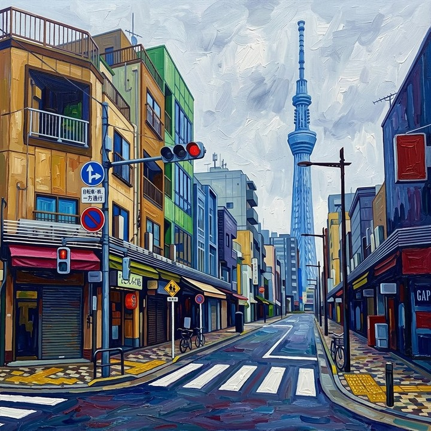

# Optical Flow AEPE

Optical Flow AEPE 通过正反向光流往返量化生成视频的**短时 photometric 一致**。它衡量局部外观在相邻帧间是否稳定，而非运动是否与 ground truth 一致。

对相邻帧 \(A\)、\(B\)，在中心裁剪区采样点 \(p_{A,i}\)。正向流 \(F_{A\to B}\) 将其跟踪至 \(p_{B,i} = p_{A,i} + F_{A\to B}(p_{A,i})\)；反向流返回 \(p'_{A,i} = p_{B,i} + F_{B\to A}(p_{B,i})\)。帧对平均端点误差为

\[
e_{\mathrm{AEPE}} = \frac{1}{N}\sum_{i=1}^{N} \left\| p_{A,i} - p'_{A,i} \right\|_2
\tag{1}
\]

原始得分对所有相邻帧对的 \(e_{\mathrm{AEPE}}\) 取均值。WorldArena 在经验范围 \([0, 1.192]\) 上反向归一化。误差越低（归一化得分越高）表示局部外观越稳定。SEA-RAFT 计算成功时为 **official**。

<!-- metric-examples:start -->
## 已核验的同输入案例

每个 metric 最多展示三个 case。每组中的两条视频必须属于同一 benchmark sample，且两侧首帧都通过与该组展示输入的 SIFT + RANSAC 几何匹配；不通过的候选不会发布。标签只表示当前 metric 的相对高低，不代表模型整体优劣。

Audit manifest: `docs/assets/metric_examples/curated_same_case_manifest.json`.

<article class="metric-case-exhibit metric-case-exhibit--curated">
  

    <figure class="metric-input-card">
      
      <figcaption>输入图像</figcaption>
    </figure>
    

      
输入已核验 · 同一 benchmark case · gap 0.9399

      <h4><code>image_static_stylized_city_0098</code></h4>
      
套件: image_static场景: stylized / outdoor / city

      

        基准 prompt target
        
Camera push in. An urban street with tall tower, building facades, and windows.

        <small>prompt source: prompt_target</small>
      

      
两条视频的首帧都已通过与展示输入的几何匹配核验；高低标签只比较当前 metric。

    

  

  

    <figure class="metric-output-card metric-output-card--good">
      

        <video class="metric-output-video" controls muted loop playsinline preload="metadata" aria-label="较高指标分: image_static_stylized_city_0098">
          <source src="../../../assets/metric_examples/curated_20260801/940d25c65988__image_static_stylized_city_0098__high.mp4" type="video/mp4">
        </video>
        
较高指标分 · 分数 0.9566

      

      <figcaption class="metric-output-caption"><strong>较高指标分</strong>optical_flow_aepe</figcaption>
    </figure>
    <figure class="metric-output-card metric-output-card--bad">
      

        <video class="metric-output-video" controls muted loop playsinline preload="metadata" aria-label="较低指标分: image_static_stylized_city_0098">
          <source src="../../../assets/metric_examples/curated_20260801/d93109cae860__image_static_stylized_city_0098__low.mp4" type="video/mp4">
        </video>
        
较低指标分 · 分数 0.0167

      

      <figcaption class="metric-output-caption"><strong>较低指标分</strong>optical_flow_aepe</figcaption>
    </figure>
  

</article>

<!-- metric-examples:end -->

## 参考文献 {#reference}

!!! quote "SEA-RAFT: Simple, Efficient, Accurate RAFT for Optical Flow"

    Wang et al., ECCV 2024.
    [https://arxiv.org/abs/2405.14793](https://arxiv.org/abs/2405.14793)
