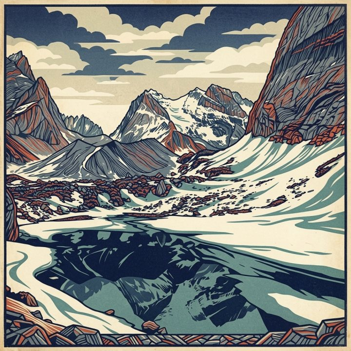

# Optical Flow AEPE

Optical Flow AEPE 通过正反向光流往返量化生成视频的**短时 photometric 一致**。它衡量局部外观在相邻帧间是否稳定，而非运动是否与 ground truth 一致。

对相邻帧 \(A\)、\(B\)，在中心裁剪区采样点 \(p_{A,i}\)。正向流 \(F_{A\to B}\) 将其跟踪至 \(p_{B,i} = p_{A,i} + F_{A\to B}(p_{A,i})\)；反向流返回 \(p'_{A,i} = p_{B,i} + F_{B\to A}(p_{B,i})\)。帧对平均端点误差为

\[
e_{\mathrm{AEPE}} = \frac{1}{N}\sum_{i=1}^{N} \left\| p_{A,i} - p'_{A,i} \right\|_2
\tag{1}
\]

原始得分对所有相邻帧对的 \(e_{\mathrm{AEPE}}\) 取均值。WorldArena 在经验范围 \([0, 1.192]\) 上反向归一化。误差越低（归一化得分越高）表示局部外观越稳定。SEA-RAFT 计算成功时为 **official**。

<!-- metric-examples:start -->
## 代表性同 Case 对比
每个展示块先给出该 case 的 input image 和完全一致的展示 prompt，然后比较模型生成结果。paired 展示必须满足 input image 相同、prompt 文本相同，并且一个模型高分、一个模型低分。若当前正式快照中该 metric 没有这种跨模型同 case pair，则单独展示高分/低分极值样例，不把它们伪装成同 case 对比。
机器可读 paired 导出： `docs/assets/metric_examples/paired_manifest.csv`.
### `optical_flow_aepe`

<article class="metric-case-exhibit metric-case-exhibit--fallback">
  

    <figure class="metric-input-card">
      
      <figcaption>输入图像</figcaption>
    </figure>
    

      
Case 1 · 同一输入图像 + 同一 prompt · 分差 0.0000

      <h4><code>image_static_stylized_terrestrial_landscape_0111</code></h4>
      
Suite: image_staticScene: stylized / outdoor / terrestrial_landscape

      

        Prompt target
        
Camera move left. A stylized mountain landscape with mountain slope, rocks, and vegetation.

        <small>prompt source: prompt_target</small>
      

  
当前正式快照中没有可用的跨模型同 case 配对；以下为各自极值样例，而非同一输入下的模型对比。

    

  

  

<figure class="metric-output-card metric-output-card--good">
  

    <video class="metric-output-video" controls muted loop playsinline preload="metadata" aria-label="好结果: image_static_stylized_terrestrial_landscape_0111">
      <source src="../../../assets/metric_examples/c396bdd2b691__ac3d-image-static__image_static_stylized_terrestrial_landscape_0111.mp4" type="video/mp4">
    </video>
    
好结果 · 分数 0.9841

  

</figure>
<figure class="metric-output-card metric-output-card--bad">
  

    <video class="metric-output-video" controls muted loop playsinline preload="metadata" aria-label="差结果: image_static_stylized_verdant_landscape_0023">
      <source src="../../../assets/metric_examples/ae8594b1468b__ac3d-image-static__image_static_stylized_verdant_landscape_0023.mp4" type="video/mp4">
    </video>
    
差结果 · 分数 0.0000

  

</figure>
  

</article>
<article class="metric-case-exhibit metric-case-exhibit--fallback">
  

    <figure class="metric-input-card">
      
      <figcaption>输入图像</figcaption>
    </figure>
    

      
Case 2 · 同一输入图像 + 同一 prompt · 分差 0.0000

      <h4><code>image_static_photorealistic_terrestrial_landscape_0016</code></h4>
      
Suite: image_staticScene: photorealistic / outdoor / terrestrial_landscape

      

        Prompt target
        
Camera pull out. An expansive valley with forest, distant mountains, and sky.

        <small>prompt source: prompt_target</small>
      

  
当前正式快照中没有可用的跨模型同 case 配对；以下为各自极值样例，而非同一输入下的模型对比。

    

  

  

<figure class="metric-output-card metric-output-card--good">
  

    <video class="metric-output-video" controls muted loop playsinline preload="metadata" aria-label="好结果: image_static_photorealistic_terrestrial_landscape_0016">
      <source src="../../../assets/metric_examples/438437dfd51c__ac3d-image-static__image_static_photorealistic_terrestrial_landscape_0016.mp4" type="video/mp4">
    </video>
    
好结果 · 分数 0.9830

  

</figure>
<figure class="metric-output-card metric-output-card--bad">
  

    <video class="metric-output-video" controls muted loop playsinline preload="metadata" aria-label="差结果: image_static_photorealistic_living_spaces_0071">
      <source src="../../../assets/metric_examples/3bf118bc044f__ac3d-image-static__image_static_photorealistic_living_spaces_0071.mp4" type="video/mp4">
    </video>
    
差结果 · 分数 0.0000

  

</figure>
  

</article>

<!-- metric-examples:end -->

## 参考文献 {#reference}

!!! quote "SEA-RAFT: Simple, Efficient, Accurate RAFT for Optical Flow"

    Wang et al., ECCV 2024.
    [https://arxiv.org/abs/2405.14793](https://arxiv.org/abs/2405.14793)
