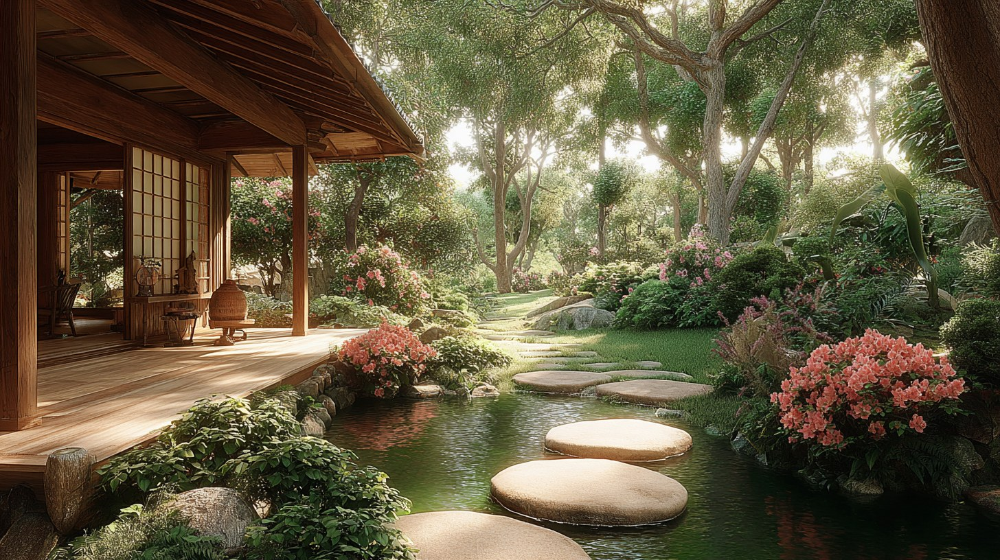
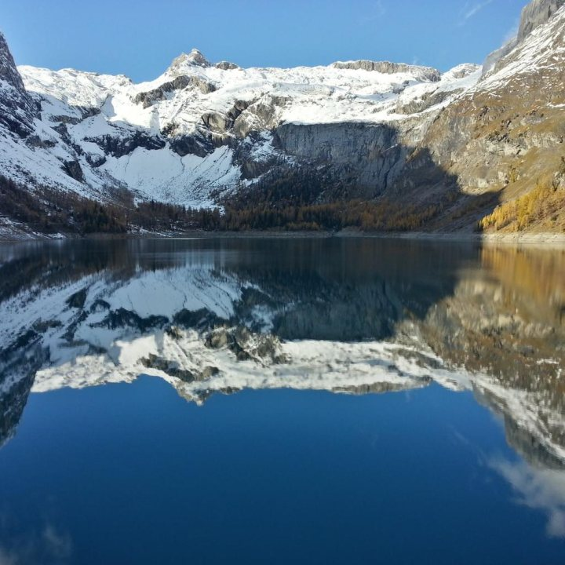
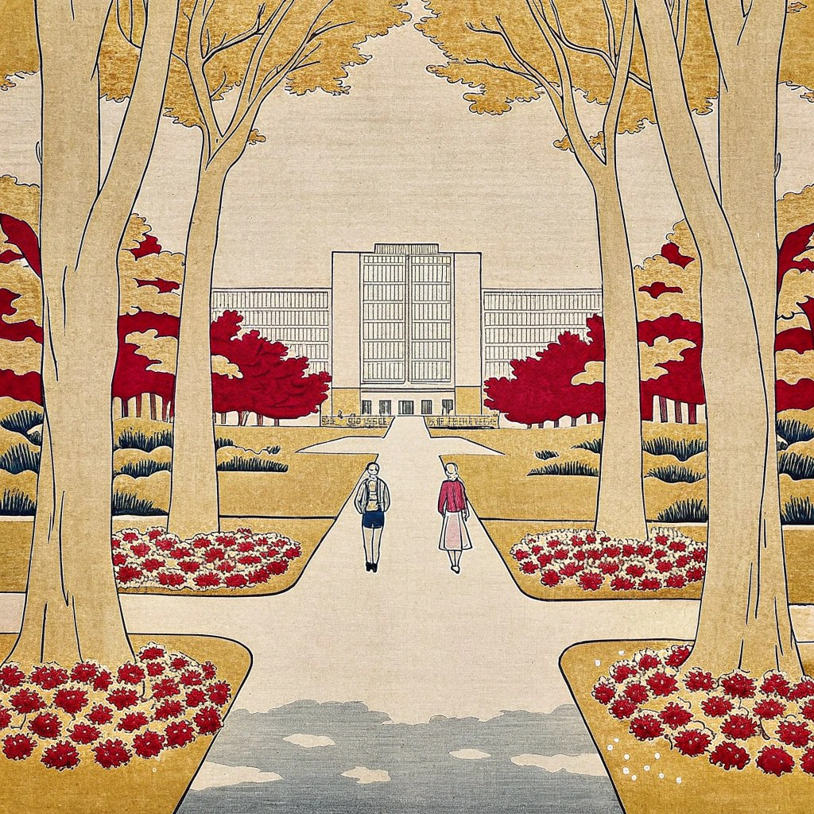
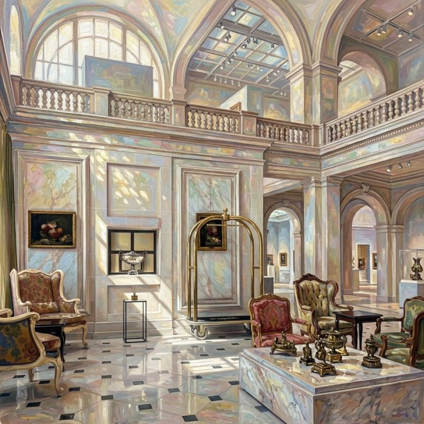
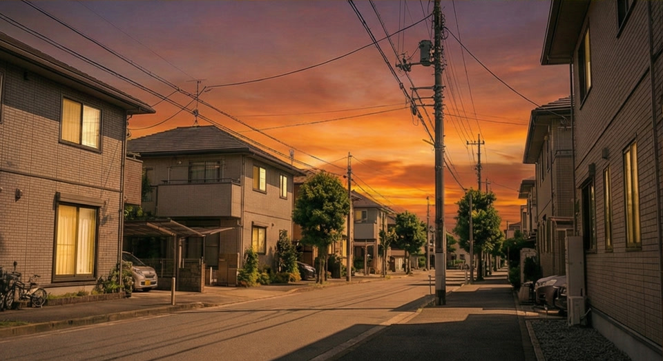
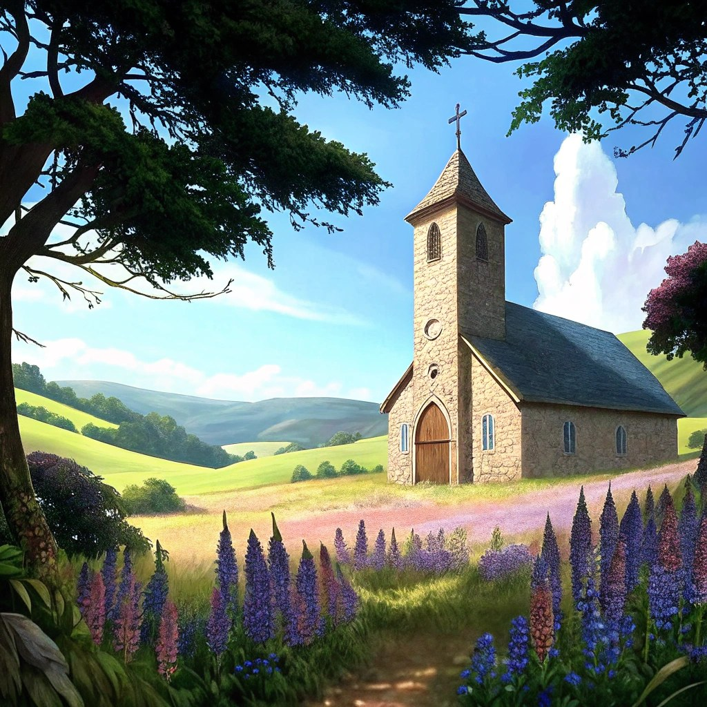
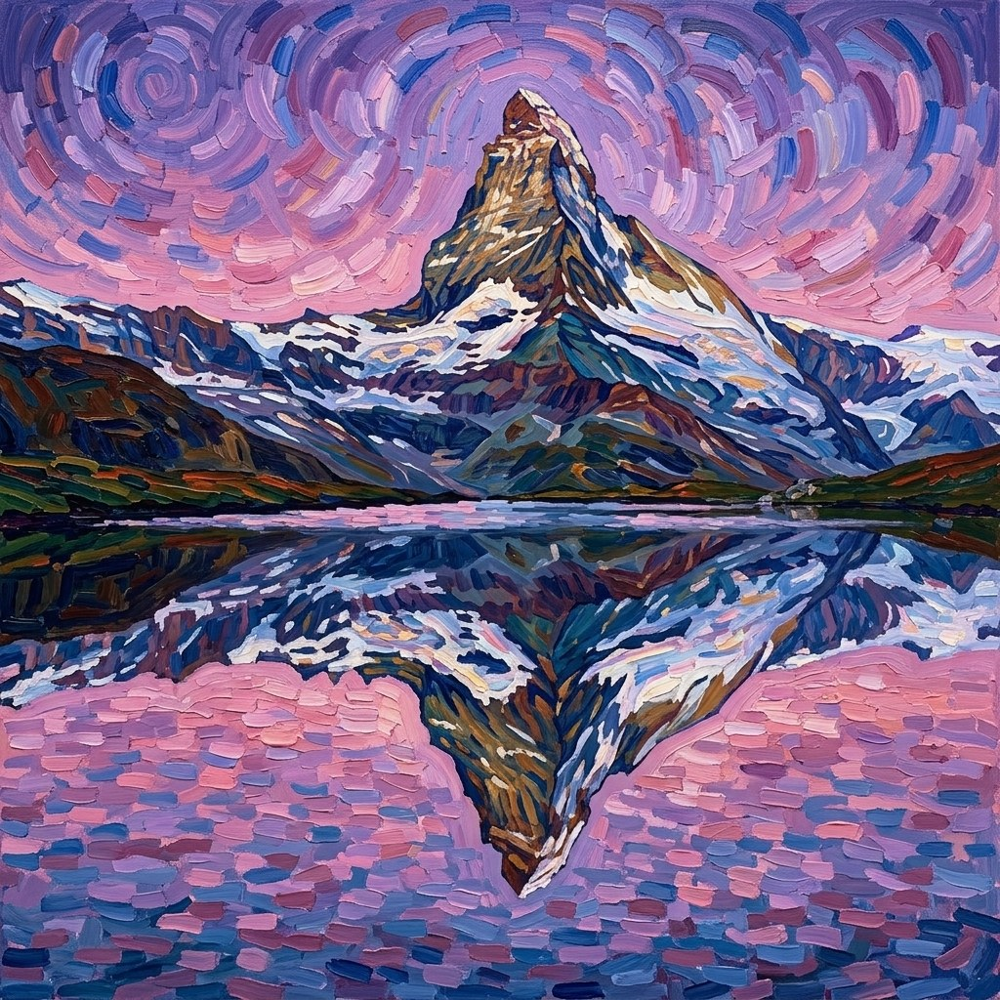
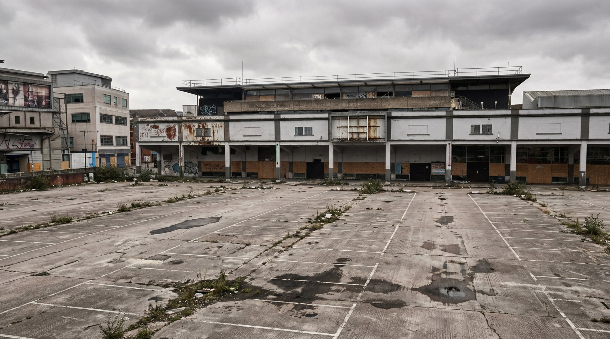

# Perceptual Quality

**perceptual_quality** 衡量预测结果**自身的无参考视觉质量**，不将 prediction 与 GT reference 做逐帧配对比较。它关注锚点帧层面的锐度、干净程度与审美合理性，**不**评估语义正确性、prompt 对齐或几何/物理合规性。

WorldArena 将两类互补的无参考 IQA 信号融合为单一感知质量分数：CLIP-IQA+ 刻画整体视觉自然度与感知协调性；LAION 美学预测器刻画审美吸引力。二者均在 prediction anchor 帧上独立打分后再聚合。

### CLIP-IQA+ 组件

CLIP-IQA+ 基于 CLIP 视觉—语言表征评估单帧图像的整体感知质量。对锚点帧 $I_i$，模型输出 native 分数 $q_i^{\mathrm{native}}$，归一化为：

\[
s_i^{\mathrm{iqa}}
=
\mathrm{clip}\!\left(\frac{q_i^{\mathrm{native}}}{1},\, 0,\, 1\right)
\tag{1}
\]

### 美学组件

美学分数沿用 CLIP ViT-L/14 特征与 LAION-Aesthetics 线性回归头（pyiqa `laion_aes`）。对锚点帧 $I_i$：

\[
s_i^{\mathrm{aes}}
=
\mathrm{clip}\!\left(\frac{g(\mathrm{norm}(\mathrm{CLIP}(I_i)))}{10},\, 0,\, 1\right)
\tag{2}
\]

### 帧级与视频级聚合

每帧感知质量取两组件的算术平均：

\[
s_i
=
\frac{s_i^{\mathrm{iqa}} + s_i^{\mathrm{aes}}}{2}
\tag{3}
\]

设协议选出 $N$ 个 prediction anchor 帧，指标 raw 值为：

\[
S_{\mathrm{pq}}
=
\frac{1}{N}\sum_{i=1}^{N} s_i
\tag{4}
\]

<!-- metric-examples:start -->
## 代表性同 Case 对比
每个展示块先给出该 case 的 input image 和完全一致的展示 prompt，然后比较模型生成结果。paired 展示必须满足 input image 相同、prompt 文本相同，并且一个模型高分、一个模型低分。若当前正式快照中该 metric 没有这种跨模型同 case pair，则单独展示高分/低分极值样例，不把它们伪装成同 case 对比。
机器可读 paired 导出： `docs/assets/metric_examples/paired_manifest.csv`.
### `perceptual_quality`
<div class="metric-case-stack">
<article class="metric-case-exhibit">
  <div class="metric-case-context">
    <figure class="metric-input-card">
      
      <figcaption>输入图像</figcaption>
    </figure>
    <div class="metric-case-copy">
      <div class="metric-case-kicker">Case 1 · 同一输入图像 + 同一 prompt · 分差 0.4311</div>
      <h4><code>image_static_photorealistic_verdant_landscape_0106</code></h4>
      <div class="metric-case-meta"><span>Suite: image_static</span><span>Scene: photorealistic / outdoor / verdant_landscape</span></div>
      <div class="metric-case-prompt">
        <span>目标 prompt</span>
        <p>Camera orbit left. A japanese garden with stone lantern, bamboo grove, and koi fish.</p>
        <small>prompt 来源: prompt_target</small>
      </div>
    </div>
  </div>
  <div class="metric-output-grid">
<figure class="metric-output-card metric-output-card--good">
  <div class="metric-output-media-wrap">
    <video class="metric-output-video" controls muted loop playsinline preload="metadata" aria-label="好结果: image_static_photorealistic_verdant_landscape_0106">
      <source src="../../../assets/metric_examples/d1b4ca3b2695__wan22-ti2v-5b-image-static-plan-missing__image_static_photorealistic_verdant_landscape_0106.mp4" type="video/mp4">
    </video>
    <div class="metric-score-pill metric-score-pill--good">好结果 · 分数 0.7091</div>
  </div>
</figure>
<figure class="metric-output-card metric-output-card--bad">
  <div class="metric-output-media-wrap">
    <video class="metric-output-video" controls muted loop playsinline preload="metadata" aria-label="差结果: image_static_photorealistic_verdant_landscape_0106">
      <source src="../../../assets/metric_examples/bb17307d3ff1__motionctrl__image_static_photorealistic_verdant_landscape_0106.mp4" type="video/mp4">
    </video>
    <div class="metric-score-pill metric-score-pill--bad">差结果 · 分数 0.2780</div>
  </div>
</figure>
  </div>
</article>
<article class="metric-case-exhibit">
  <div class="metric-case-context">
    <figure class="metric-input-card">
      
      <figcaption>输入图像</figcaption>
    </figure>
    <div class="metric-case-copy">
      <div class="metric-case-kicker">Case 2 · 同一输入图像 + 同一 prompt · 分差 0.3998</div>
      <h4><code>image_static_photorealistic_aquatic_landscape_0079</code></h4>
      <div class="metric-case-meta"><span>Suite: image_static</span><span>Scene: photorealistic / outdoor / aquatic_landscape</span></div>
      <div class="metric-case-prompt">
        <span>目标 prompt</span>
        <p>Camera move right. A stone archway with pathway, grassy area, and mountains.</p>
        <small>prompt 来源: prompt_target</small>
      </div>
    </div>
  </div>
  <div class="metric-output-grid">
<figure class="metric-output-card metric-output-card--good">
  <div class="metric-output-media-wrap">
    <video class="metric-output-video" controls muted loop playsinline preload="metadata" aria-label="好结果: image_static_photorealistic_aquatic_landscape_0079">
      <source src="../../../assets/metric_examples/f47c73e21fbd__ac3d-image-static__image_static_photorealistic_aquatic_landscape_0079.mp4" type="video/mp4">
    </video>
    <div class="metric-score-pill metric-score-pill--good">好结果 · 分数 0.7155</div>
  </div>
</figure>
<figure class="metric-output-card metric-output-card--bad">
  <div class="metric-output-media-wrap">
    <video class="metric-output-video" controls muted loop playsinline preload="metadata" aria-label="差结果: image_static_photorealistic_aquatic_landscape_0079">
      <source src="../../../assets/metric_examples/faeffc40fff5__matrix-game-1-image-static-worldarena-prompt-min5-lowmem-rmsnorm-v2__image_static_photorealistic_aquatic_landscape_0079.mp4" type="video/mp4">
    </video>
    <div class="metric-score-pill metric-score-pill--bad">差结果 · 分数 0.3157</div>
  </div>
</figure>
  </div>
</article>
<article class="metric-case-exhibit">
  <div class="metric-case-context">
    <figure class="metric-input-card">
      
      <figcaption>输入图像</figcaption>
    </figure>
    <div class="metric-case-copy">
      <div class="metric-case-kicker">Case 3 · 同一输入图像 + 同一 prompt · 分差 0.3910</div>
      <h4><code>image_static_stylized_aquatic_landscape_0110</code></h4>
      <div class="metric-case-meta"><span>Suite: image_static</span><span>Scene: stylized / outdoor / aquatic_landscape</span></div>
      <div class="metric-case-prompt">
        <span>目标 prompt</span>
        <p>Camera orbit right. An aquatic landscape with oil rig, industrial buildings, and rocky platform.</p>
        <small>prompt 来源: prompt_target</small>
      </div>
    </div>
  </div>
  <div class="metric-output-grid">
<figure class="metric-output-card metric-output-card--good">
  <div class="metric-output-media-wrap">
    <video class="metric-output-video" controls muted loop playsinline preload="metadata" aria-label="好结果: image_static_stylized_aquatic_landscape_0110">
      <source src="../../../assets/metric_examples/0476470e1b85__wan22-ti2v-5b-image-static-plan-missing__image_static_stylized_aquatic_landscape_0110.mp4" type="video/mp4">
    </video>
    <div class="metric-score-pill metric-score-pill--good">好结果 · 分数 0.6485</div>
  </div>
</figure>
<figure class="metric-output-card metric-output-card--bad">
  <div class="metric-output-media-wrap">
    <video class="metric-output-video" controls muted loop playsinline preload="metadata" aria-label="差结果: image_static_stylized_aquatic_landscape_0110">
      <source src="../../../assets/metric_examples/dc4ffb2550a8__matrix_game2_5s__image_static_stylized_aquatic_landscape_0110.mp4" type="video/mp4">
    </video>
    <div class="metric-score-pill metric-score-pill--bad">差结果 · 分数 0.2576</div>
  </div>
</figure>
  </div>
</article>
<article class="metric-case-exhibit">
  <div class="metric-case-context">
    <figure class="metric-input-card">
      
      <figcaption>输入图像</figcaption>
    </figure>
    <div class="metric-case-copy">
      <div class="metric-case-kicker">Case 4 · 同一输入图像 + 同一 prompt · 分差 0.3892</div>
      <h4><code>image_static_stylized_aquatic_landscape_0159</code></h4>
      <div class="metric-case-meta"><span>Suite: image_static</span><span>Scene: stylized / outdoor / aquatic_landscape</span></div>
      <div class="metric-case-prompt">
        <span>目标 prompt</span>
        <p>Camera move left. A river bend with cliffs and wooden walkway.</p>
        <small>prompt 来源: prompt_target</small>
      </div>
    </div>
  </div>
  <div class="metric-output-grid">
<figure class="metric-output-card metric-output-card--good">
  <div class="metric-output-media-wrap">
    <video class="metric-output-video" controls muted loop playsinline preload="metadata" aria-label="好结果: image_static_stylized_aquatic_landscape_0159">
      <source src="../../../assets/metric_examples/6163a4ccce16__wan22-ti2v-5b-image-static-plan-missing__image_static_stylized_aquatic_landscape_0159.mp4" type="video/mp4">
    </video>
    <div class="metric-score-pill metric-score-pill--good">好结果 · 分数 0.6969</div>
  </div>
</figure>
<figure class="metric-output-card metric-output-card--bad">
  <div class="metric-output-media-wrap">
    <video class="metric-output-video" controls muted loop playsinline preload="metadata" aria-label="差结果: image_static_stylized_aquatic_landscape_0159">
      <source src="../../../assets/metric_examples/93aadbcab64b__motionctrl__image_static_stylized_aquatic_landscape_0159.mp4" type="video/mp4">
    </video>
    <div class="metric-score-pill metric-score-pill--bad">差结果 · 分数 0.3076</div>
  </div>
</figure>
  </div>
</article>
<article class="metric-case-exhibit">
  <div class="metric-case-context">
    <figure class="metric-input-card">
      
      <figcaption>输入图像</figcaption>
    </figure>
    <div class="metric-case-copy">
      <div class="metric-case-kicker">Case 5 · 同一输入图像 + 同一 prompt · 分差 0.3814</div>
      <h4><code>image_static_photorealistic_aquatic_landscape_0019</code></h4>
      <div class="metric-case-meta"><span>Suite: image_static</span><span>Scene: photorealistic / outdoor / aquatic_landscape</span></div>
      <div class="metric-case-prompt">
        <span>目标 prompt</span>
        <p>Camera pull out. A mountain lake with peaks, snow, and trees. Camera move left. A mountain lake with rocky outcrop, trees, and snow. Camera pan left. A mountain lake with forested area, distant peaks, and trees.</p>
        <small>prompt 来源: prompt_target</small>
      </div>
    </div>
  </div>
  <div class="metric-output-grid">
<figure class="metric-output-card metric-output-card--good">
  <div class="metric-output-media-wrap">
    <video class="metric-output-video" controls muted loop playsinline preload="metadata" aria-label="好结果: image_static_photorealistic_aquatic_landscape_0019">
      <source src="../../../assets/metric_examples/d53862d95f4c__motionctrl__image_static_photorealistic_aquatic_landscape_0019.mp4" type="video/mp4">
    </video>
    <div class="metric-score-pill metric-score-pill--good">好结果 · 分数 0.6923</div>
  </div>
</figure>
<figure class="metric-output-card metric-output-card--bad">
  <div class="metric-output-media-wrap">
    <video class="metric-output-video" controls muted loop playsinline preload="metadata" aria-label="差结果: image_static_photorealistic_aquatic_landscape_0019">
      <source src="../../../assets/metric_examples/2a96e6da2a98__matrix_game2_5s__image_static_photorealistic_aquatic_landscape_0019.mp4" type="video/mp4">
    </video>
    <div class="metric-score-pill metric-score-pill--bad">差结果 · 分数 0.3109</div>
  </div>
</figure>
  </div>
</article>
<article class="metric-case-exhibit">
  <div class="metric-case-context">
    <figure class="metric-input-card">
      
      <figcaption>输入图像</figcaption>
    </figure>
    <div class="metric-case-copy">
      <div class="metric-case-kicker">Case 6 · 同一输入图像 + 同一 prompt · 分差 0.3805</div>
      <h4><code>image_static_stylized_suburb_0024</code></h4>
      <div class="metric-case-meta"><span>Suite: image_static</span><span>Scene: stylized / outdoor / suburb</span></div>
      <div class="metric-case-prompt">
        <span>目标 prompt</span>
        <p>Camera pull out. A suburban park with benches, trees, and path.</p>
        <small>prompt 来源: prompt_target</small>
      </div>
    </div>
  </div>
  <div class="metric-output-grid">
<figure class="metric-output-card metric-output-card--good">
  <div class="metric-output-media-wrap">
    <video class="metric-output-video" controls muted loop playsinline preload="metadata" aria-label="好结果: image_static_stylized_suburb_0024">
      <source src="../../../assets/metric_examples/46b43c5c9caf__wan22-ti2v-5b-image-static-plan-missing__image_static_stylized_suburb_0024.mp4" type="video/mp4">
    </video>
    <div class="metric-score-pill metric-score-pill--good">好结果 · 分数 0.6923</div>
  </div>
</figure>
<figure class="metric-output-card metric-output-card--bad">
  <div class="metric-output-media-wrap">
    <video class="metric-output-video" controls muted loop playsinline preload="metadata" aria-label="差结果: image_static_stylized_suburb_0024">
      <source src="../../../assets/metric_examples/93fbd626848b__motionctrl__image_static_stylized_suburb_0024.mp4" type="video/mp4">
    </video>
    <div class="metric-score-pill metric-score-pill--bad">差结果 · 分数 0.3119</div>
  </div>
</figure>
  </div>
</article>
</div>
### `rollout_visual_score`
<div class="metric-case-stack">
<article class="metric-case-exhibit">
  <div class="metric-case-context">
    <figure class="metric-input-card">
      
      <figcaption>输入图像</figcaption>
    </figure>
    <div class="metric-case-copy">
      <div class="metric-case-kicker">Case 1 · 同一输入图像 + 同一 prompt · 分差 0.4454</div>
      <h4><code>image_static_stylized_public_spaces_0133</code></h4>
      <div class="metric-case-meta"><span>Suite: image_static</span><span>Scene: stylized / indoor / public_spaces</span></div>
      <div class="metric-case-prompt">
        <span>目标 prompt</span>
        <p>Camera orbit left. A grand interior with artwork, seating, and decorative lighting.</p>
        <small>prompt 来源: prompt_target</small>
      </div>
    </div>
  </div>
  <div class="metric-output-grid">
<figure class="metric-output-card metric-output-card--good">
  <div class="metric-output-media-wrap">
    <video class="metric-output-video" controls muted loop playsinline preload="metadata" aria-label="好结果: image_static_stylized_public_spaces_0133">
      <source src="../../../assets/metric_examples/b91e9726b01d__yume-sample5b-missing-reverse-5s-target__image_static_stylized_public_spaces_0133.mp4" type="video/mp4">
    </video>
    <div class="metric-score-pill metric-score-pill--good">好结果 · 分数 0.8511</div>
  </div>
</figure>
<figure class="metric-output-card metric-output-card--bad">
  <div class="metric-output-media-wrap">
    <video class="metric-output-video" controls muted loop playsinline preload="metadata" aria-label="差结果: image_static_stylized_public_spaces_0133">
      <source src="../../../assets/metric_examples/a83e4016b584__stable_virtual_camera__image_static_stylized_public_spaces_0133.mp4" type="video/mp4">
    </video>
    <div class="metric-score-pill metric-score-pill--bad">差结果 · 分数 0.4057</div>
  </div>
</figure>
  </div>
</article>
<article class="metric-case-exhibit">
  <div class="metric-case-context">
    <figure class="metric-input-card">
      
      <figcaption>输入图像</figcaption>
    </figure>
    <div class="metric-case-copy">
      <div class="metric-case-kicker">Case 2 · 同一输入图像 + 同一 prompt · 分差 0.4277</div>
      <h4><code>image_static_photorealistic_suburb_0067</code></h4>
      <div class="metric-case-meta"><span>Suite: image_static</span><span>Scene: photorealistic / outdoor / suburb</span></div>
      <div class="metric-case-prompt">
        <span>目标 prompt</span>
        <p>Camera push in. A suburban street with house, front yard, and garden.</p>
        <small>prompt 来源: prompt_target</small>
      </div>
    </div>
  </div>
  <div class="metric-output-grid">
<figure class="metric-output-card metric-output-card--good">
  <div class="metric-output-media-wrap">
    <video class="metric-output-video" controls muted loop playsinline preload="metadata" aria-label="好结果: image_static_photorealistic_suburb_0067">
      <source src="../../../assets/metric_examples/41f4e3499573__ac3d-image-static__image_static_photorealistic_suburb_0067.mp4" type="video/mp4">
    </video>
    <div class="metric-score-pill metric-score-pill--good">好结果 · 分数 0.8223</div>
  </div>
</figure>
<figure class="metric-output-card metric-output-card--bad">
  <div class="metric-output-media-wrap">
    <video class="metric-output-video" controls muted loop playsinline preload="metadata" aria-label="差结果: image_static_photorealistic_suburb_0067">
      <source src="../../../assets/metric_examples/65b2958f9c9a__warp-as-history-image-static-8gpu-20260612_152000__image_static_photorealistic_suburb_0067.mp4" type="video/mp4">
    </video>
    <div class="metric-score-pill metric-score-pill--bad">差结果 · 分数 0.3946</div>
  </div>
</figure>
  </div>
</article>
<article class="metric-case-exhibit">
  <div class="metric-case-context">
    <figure class="metric-input-card">
      
      <figcaption>输入图像</figcaption>
    </figure>
    <div class="metric-case-copy">
      <div class="metric-case-kicker">Case 3 · 同一输入图像 + 同一 prompt · 分差 0.4214</div>
      <h4><code>image_static_stylized_terrestrial_landscape_0001</code></h4>
      <div class="metric-case-meta"><span>Suite: image_static</span><span>Scene: stylized / outdoor / terrestrial_landscape</span></div>
      <div class="metric-case-prompt">
        <span>目标 prompt</span>
        <p>Camera move right. A stone church with pathway, wildflowers, and distant hills.</p>
        <small>prompt 来源: prompt_target</small>
      </div>
    </div>
  </div>
  <div class="metric-output-grid">
<figure class="metric-output-card metric-output-card--good">
  <div class="metric-output-media-wrap">
    <video class="metric-output-video" controls muted loop playsinline preload="metadata" aria-label="好结果: image_static_stylized_terrestrial_landscape_0001">
      <source src="../../../assets/metric_examples/5a5135ed4314__wan22-ti2v-5b-image-static-plan-missing__image_static_stylized_terrestrial_landscape_0001.mp4" type="video/mp4">
    </video>
    <div class="metric-score-pill metric-score-pill--good">好结果 · 分数 0.8615</div>
  </div>
</figure>
<figure class="metric-output-card metric-output-card--bad">
  <div class="metric-output-media-wrap">
    <video class="metric-output-video" controls muted loop playsinline preload="metadata" aria-label="差结果: image_static_stylized_terrestrial_landscape_0001">
      <source src="../../../assets/metric_examples/c643ca835a4a__stable_virtual_camera__image_static_stylized_terrestrial_landscape_0001.mp4" type="video/mp4">
    </video>
    <div class="metric-score-pill metric-score-pill--bad">差结果 · 分数 0.4401</div>
  </div>
</figure>
  </div>
</article>
<article class="metric-case-exhibit">
  <div class="metric-case-context">
    <figure class="metric-input-card">
      
      <figcaption>输入图像</figcaption>
    </figure>
    <div class="metric-case-copy">
      <div class="metric-case-kicker">Case 4 · 同一输入图像 + 同一 prompt · 分差 0.4090</div>
      <h4><code>image_static_stylized_aquatic_landscape_0154</code></h4>
      <div class="metric-case-meta"><span>Suite: image_static</span><span>Scene: stylized / outdoor / aquatic_landscape</span></div>
      <div class="metric-case-prompt">
        <span>目标 prompt</span>
        <p>Camera pan left. A lakeside walkway with mountains, forest, and railings. Camera pull out. A lakeside walkway with forest, boat, and vegetation. Camera move left. A forest path with trees and sunlight.</p>
        <small>prompt 来源: prompt_target</small>
      </div>
    </div>
  </div>
  <div class="metric-output-grid">
<figure class="metric-output-card metric-output-card--good">
  <div class="metric-output-media-wrap">
    <video class="metric-output-video" controls muted loop playsinline preload="metadata" aria-label="好结果: image_static_stylized_aquatic_landscape_0154">
      <source src="../../../assets/metric_examples/3678bcdb9f33__ac3d-image-static__image_static_stylized_aquatic_landscape_0154.mp4" type="video/mp4">
    </video>
    <div class="metric-score-pill metric-score-pill--good">好结果 · 分数 0.8264</div>
  </div>
</figure>
<figure class="metric-output-card metric-output-card--bad">
  <div class="metric-output-media-wrap">
    <video class="metric-output-video" controls muted loop playsinline preload="metadata" aria-label="差结果: image_static_stylized_aquatic_landscape_0154">
      <source src="../../../assets/metric_examples/932f6930bab3__stable_virtual_camera__image_static_stylized_aquatic_landscape_0154.mp4" type="video/mp4">
    </video>
    <div class="metric-score-pill metric-score-pill--bad">差结果 · 分数 0.4174</div>
  </div>
</figure>
  </div>
</article>
<article class="metric-case-exhibit">
  <div class="metric-case-context">
    <figure class="metric-input-card">
      
      <figcaption>输入图像</figcaption>
    </figure>
    <div class="metric-case-copy">
      <div class="metric-case-kicker">Case 5 · 同一输入图像 + 同一 prompt · 分差 0.3895</div>
      <h4><code>image_static_stylized_terrestrial_landscape_0077</code></h4>
      <div class="metric-case-meta"><span>Suite: image_static</span><span>Scene: stylized / outdoor / terrestrial_landscape</span></div>
      <div class="metric-case-prompt">
        <span>目标 prompt</span>
        <p>Camera move right. A stylized mountain with grassy banks, lake, and distant hills.</p>
        <small>prompt 来源: prompt_target</small>
      </div>
    </div>
  </div>
  <div class="metric-output-grid">
<figure class="metric-output-card metric-output-card--good">
  <div class="metric-output-media-wrap">
    <video class="metric-output-video" controls muted loop playsinline preload="metadata" aria-label="好结果: image_static_stylized_terrestrial_landscape_0077">
      <source src="../../../assets/metric_examples/6b076bcdd0fb__ac3d-image-static__image_static_stylized_terrestrial_landscape_0077.mp4" type="video/mp4">
    </video>
    <div class="metric-score-pill metric-score-pill--good">好结果 · 分数 0.8581</div>
  </div>
</figure>
<figure class="metric-output-card metric-output-card--bad">
  <div class="metric-output-media-wrap">
    <video class="metric-output-video" controls muted loop playsinline preload="metadata" aria-label="差结果: image_static_stylized_terrestrial_landscape_0077">
      <source src="../../../assets/metric_examples/ebffbdf45283__motionctrl__image_static_stylized_terrestrial_landscape_0077.mp4" type="video/mp4">
    </video>
    <div class="metric-score-pill metric-score-pill--bad">差结果 · 分数 0.4687</div>
  </div>
</figure>
  </div>
</article>
<article class="metric-case-exhibit">
  <div class="metric-case-context">
    <figure class="metric-input-card">
      
      <figcaption>输入图像</figcaption>
    </figure>
    <div class="metric-case-copy">
      <div class="metric-case-kicker">Case 6 · 同一输入图像 + 同一 prompt · 分差 0.3887</div>
      <h4><code>image_static_photorealistic_city_0080</code></h4>
      <div class="metric-case-meta"><span>Suite: image_static</span><span>Scene: photorealistic / outdoor / city</span></div>
      <div class="metric-case-prompt">
        <span>目标 prompt</span>
        <p>Camera orbit left. An abandoned parking lot with weeds, derelict buildings, and side street.</p>
        <small>prompt 来源: prompt_target</small>
      </div>
    </div>
  </div>
  <div class="metric-output-grid">
<figure class="metric-output-card metric-output-card--good">
  <div class="metric-output-media-wrap">
    <video class="metric-output-video" controls muted loop playsinline preload="metadata" aria-label="好结果: image_static_photorealistic_city_0080">
      <source src="../../../assets/metric_examples/cb357d2cde00__wan22-image-static-8gpu-20260612_160808__image_static_photorealistic_city_0080.mp4" type="video/mp4">
    </video>
    <div class="metric-score-pill metric-score-pill--good">好结果 · 分数 0.8288</div>
  </div>
</figure>
<figure class="metric-output-card metric-output-card--bad">
  <div class="metric-output-media-wrap">
    <video class="metric-output-video" controls muted loop playsinline preload="metadata" aria-label="差结果: image_static_photorealistic_city_0080">
      <source src="../../../assets/metric_examples/da3e80c4c375__sana-wm-image-static__image_static_photorealistic_city_0080.mp4" type="video/mp4">
    </video>
    <div class="metric-score-pill metric-score-pill--bad">差结果 · 分数 0.4400</div>
  </div>
</figure>
  </div>
</article>
</div>
<!-- metric-examples:end -->

## 参考文献 {#reference}

!!! quote "Exploring CLIP for Assessing the Look and Feel of Images (CLIP-IQA+)"

    Jianyi Wang, Kelvin CK Chan, Chen Change Loy.
    AAAI 2023.
    [https://arxiv.org/abs/2207.12396](https://arxiv.org/abs/2207.12396)

!!! quote "LAION-Aesthetics Predictor"

    CLIP ViT-L/14 features with a linear head trained on human aesthetic ratings; exposed via pyiqa `laion_aes`.

??? note "BibTeX — CLIP-IQA+"

    ```bibtex
    @inproceedings{wang2022exploring,
        author = {Wang, Jianyi and Chan, Kelvin CK and Loy, Chen Change},
        title = {Exploring CLIP for Assessing the Look and Feel of Images},
        booktitle = {AAAI},
        year = {2023}
    }
    ```
