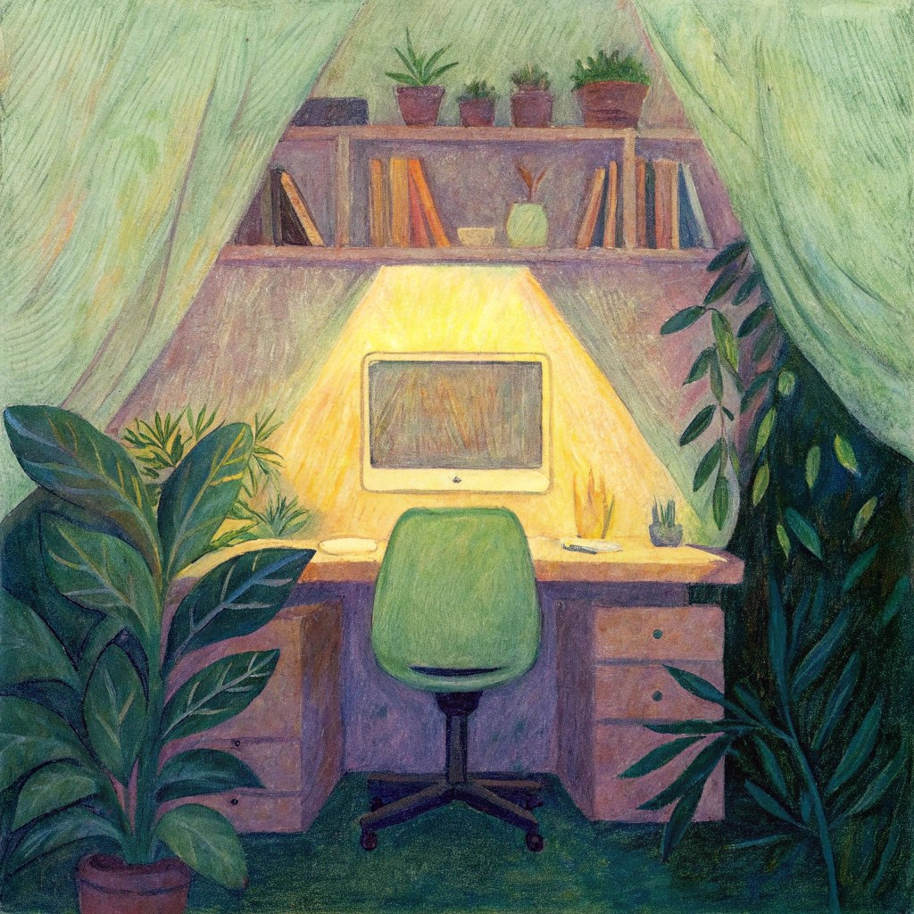
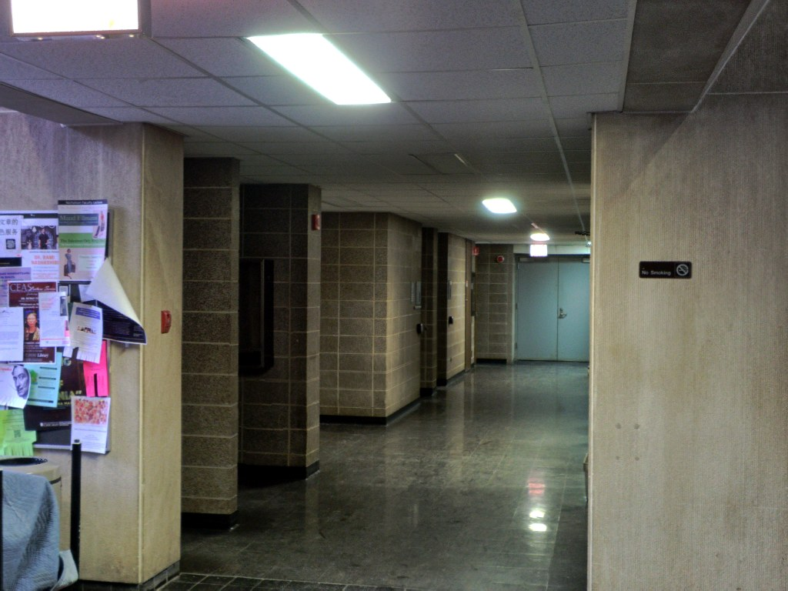
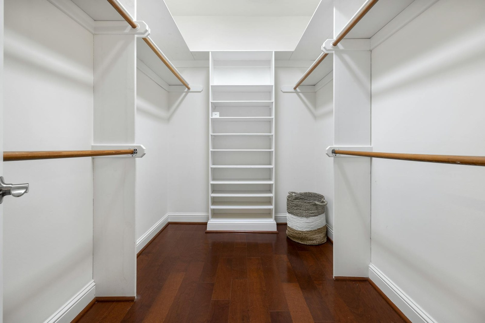
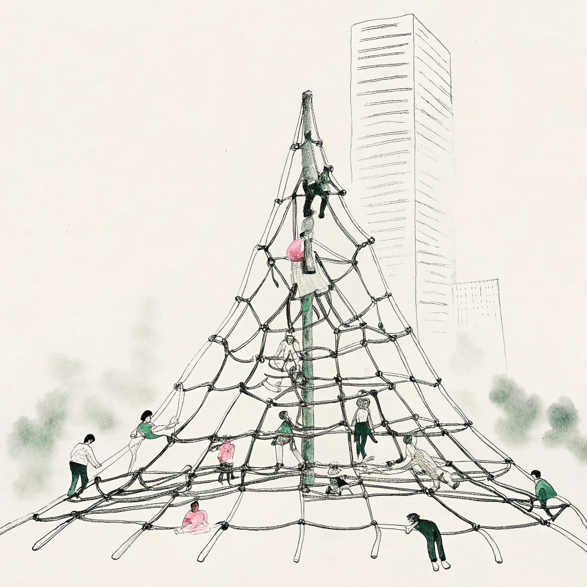
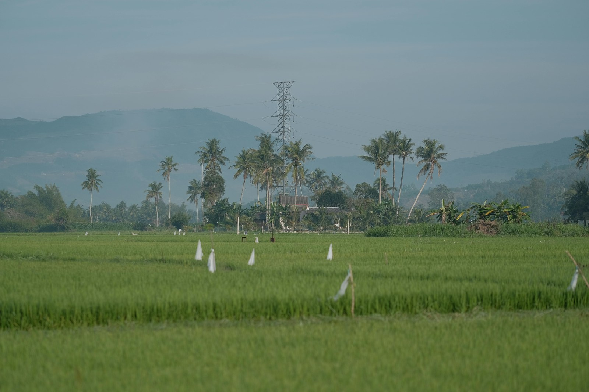

# Prompt Alignment

Prompt Alignment 衡量生成视频在 benchmark 协议锚点帧上与目标指令 \(T = \texttt{sample.prompt\_target}\) 的**语义一致程度**。它评估预测在采样时刻是否实现所请求的场景内容，而非整段 rollout 的时序连贯性或视觉真实性。

记 \(\mathcal{A} = \{f_i\}_{i=1}^{M}\) 为评测协议从解码预测中选取的锚点帧集合。设 CLIP ViT-B/16 图像编码器为 \(\phi_I\)、文本编码器为 \(\phi_T\)，L2 归一化嵌入为 \(\mathbf{e}_i = \phi_I(f_i)\)、\(\mathbf{t} = \phi_T(T)\)。帧 \(i\) 的原生 CLIPScore 为

\[
s_i = \max\!\left(100 \cdot \langle \mathbf{e}_i, \mathbf{t} \rangle,\, 0\right)
\tag{1}
\]

WorldArena 将各锚点得分映射至 \([0,1]\)：\(\tilde{s}_i = \mathrm{clamp}(s_i / 100,\, 0,\, 1)\)，并报告均值

\[
S_{\mathrm{prompt}} = \frac{1}{M}\sum_{i=1}^{M} \tilde{s}_i
\tag{2}
\]

\(S_{\mathrm{prompt}}\) 越高，表示协议锚点处的指令跟随越强。当存在显式指令监督且 conditioning 非自参照（`conditioning_strategy ≠ self`）时，该指标为 **official**。图像套件可以单帧图像为条件，但模型输出仍须为视频。

下方案例从完整的 2026-07-17 `image_static` 快照中人工筛选：20 个模型在相同的 3,372 个 case 上评测。每组左右视频都经过严格校验，sample ID、条件图像 SHA-256 和实际生成 prompt SHA-256 完全一致，且两条 generation record 都明确把该图作为 conditioning input；“好/差”仅描述 Prompt Alignment，不代表整体视频质量。每个分数均为四个 `segment_random` 协议锚点的平均值。

<!-- metric-examples:start -->
## 代表性同 Case 对比
每个展示块先给出该 case 的 input image 和实际生成 prompt，然后比较模型生成结果。paired 展示必须通过 sample_id、输入图像内容 SHA-256 和实际生成 prompt SHA-256 三重一致性校验。示例按写实/风格化、室内/室外、场景类别及分差层级进行均衡选择，而不是只挑最高分差。若当前正式快照中该 metric 没有这种跨模型同 case pair，则单独展示高分/低分极值样例，不把它们伪装成同 case 对比。Prompt Alignment 还要求两个模型的 generation record 都明确使用该输入图作为 conditioning input；标为 `.unused` 或 `no_image_conditioning` 的输出不会进入展示。
机器可读 paired 导出： `docs/assets/metric_examples/paired_manifest.csv`.
### `prompt_alignment`

<article class="metric-case-exhibit">
  

    <figure class="metric-input-card">
      
      <figcaption>输入图像</figcaption>
    </figure>
    

      
Case 1 · 实际同输入 + 同 prompt · 分差 0.1430

      <h4><code>image_static_stylized_workspaces_0016</code></h4>
      
Suite: image_staticScene: stylized / indoor / workspaces实际输入: 已核验

      

        实际生成 prompt
        
Camera pan right. A cozy workspace with desk, plants, and window. Everything in the scene remains completely motionless.

        <small>prompt 来源: generation_records</small>
      

  

  

<figure class="metric-output-card metric-output-card--good">
  

    <video class="metric-output-video" controls muted loop playsinline preload="metadata" aria-label="好结果: lyra-2-image-static-openenvision image_static_stylized_workspaces_0016">
      <source src="../../../assets/metric_examples/df6952a08217__lyra-2-image-static-openenvision__image_static_stylized_workspaces_0016.mp4" type="video/mp4">
    </video>
    
好结果 · 分数 0.3210

  

  <figcaption class="metric-output-caption">
    <strong>好结果</strong>
    指标: prompt_alignment · 协议: segment_random
  </figcaption>
</figure>
<figure class="metric-output-card metric-output-card--bad">
  

    <video class="metric-output-video" controls muted loop playsinline preload="metadata" aria-label="差结果: matrix_game2_5s_image_static image_static_stylized_workspaces_0016">
      <source src="../../../assets/metric_examples/cea803b80e21__matrix_game2_5s_image_static__image_static_stylized_workspaces_0016.mp4" type="video/mp4">
    </video>
    
差结果 · 分数 0.1781

  

  <figcaption class="metric-output-caption">
    <strong>差结果</strong>
    指标: prompt_alignment · 协议: segment_random
  </figcaption>
</figure>
  

</article>
<article class="metric-case-exhibit">
  

    <figure class="metric-input-card">
      
      <figcaption>输入图像</figcaption>
    </figure>
    

      
Case 2 · 实际同输入 + 同 prompt · 分差 0.1399

      <h4><code>image_static_photorealistic_passageways_0027</code></h4>
      
Suite: image_staticScene: photorealistic / indoor / passageways实际输入: 已核验

      

        实际生成 prompt
        
Camera pan right. A dimly lit hallway with bulletin boards, side corridor, and fluorescent lights. Everything in the scene remains completely motionless.

        <small>prompt 来源: generation_records</small>
      

  

  

<figure class="metric-output-card metric-output-card--good">
  

    <video class="metric-output-video" controls muted loop playsinline preload="metadata" aria-label="好结果: matrix-game-1-image-static-worldarena-prompt-min5-lowmem-rmsnorm-v2 image_static_photorealistic_passageways_0027">
      <source src="../../../assets/metric_examples/ff54cba4f8aa__matrix-game-1-image-static-worldarena-prompt-min5-lowmem-rmsnorm-v2__image_static_photorealistic_passageways_0027.mp4" type="video/mp4">
    </video>
    
好结果 · 分数 0.3307

  

  <figcaption class="metric-output-caption">
    <strong>好结果</strong>
    指标: prompt_alignment · 协议: segment_random
  </figcaption>
</figure>
<figure class="metric-output-card metric-output-card--bad">
  

    <video class="metric-output-video" controls muted loop playsinline preload="metadata" aria-label="差结果: matrix_game3_5s_image_static_dynamic image_static_photorealistic_passageways_0027">
      <source src="../../../assets/metric_examples/d4e2b61f96b4__matrix_game3_5s_image_static_dynamic__image_static_photorealistic_passageways_0027.mp4" type="video/mp4">
    </video>
    
差结果 · 分数 0.1908

  

  <figcaption class="metric-output-caption">
    <strong>差结果</strong>
    指标: prompt_alignment · 协议: segment_random
  </figcaption>
</figure>
  

</article>
<article class="metric-case-exhibit">
  

    <figure class="metric-input-card">
      
      <figcaption>输入图像</figcaption>
    </figure>
    

      
Case 3 · 实际同输入 + 同 prompt · 分差 0.1333

      <h4><code>image_static_stylized_living_spaces_0053</code></h4>
      
Suite: image_staticScene: stylized / indoor / living_spaces实际输入: 已核验

      

        实际生成 prompt
        
Camera push in. An attic bedroom with tree tops, sunlight, and large window. Everything in the scene remains completely motionless.

        <small>prompt 来源: generation_records</small>
      

  

  

<figure class="metric-output-card metric-output-card--good">
  

    <video class="metric-output-video" controls muted loop playsinline preload="metadata" aria-label="好结果: dreamx_world_image_static image_static_stylized_living_spaces_0053">
      <source src="../../../assets/metric_examples/82d6e3fe8cb2__dreamx_world_image_static__image_static_stylized_living_spaces_0053.mp4" type="video/mp4">
    </video>
    
好结果 · 分数 0.2906

  

  <figcaption class="metric-output-caption">
    <strong>好结果</strong>
    指标: prompt_alignment · 协议: segment_random
  </figcaption>
</figure>
<figure class="metric-output-card metric-output-card--bad">
  

    <video class="metric-output-video" controls muted loop playsinline preload="metadata" aria-label="差结果: astra_image_static image_static_stylized_living_spaces_0053">
      <source src="../../../assets/metric_examples/e1dae4a903b7__astra_image_static__image_static_stylized_living_spaces_0053.mp4" type="video/mp4">
    </video>
    
差结果 · 分数 0.1572

  

  <figcaption class="metric-output-caption">
    <strong>差结果</strong>
    指标: prompt_alignment · 协议: segment_random
  </figcaption>
</figure>
  

</article>
<article class="metric-case-exhibit">
  

    <figure class="metric-input-card">
      
      <figcaption>输入图像</figcaption>
    </figure>
    

      
Case 4 · 实际同输入 + 同 prompt · 分差 0.1237

      <h4><code>image_static_stylized_suburb_0052</code></h4>
      
Suite: image_staticScene: stylized / outdoor / suburb实际输入: 已核验

      

        实际生成 prompt
        
Camera move left. A rural landscape with hay bales, palm trees, and house. Everything in the scene remains completely motionless.

        <small>prompt 来源: generation_records</small>
      

  

  

<figure class="metric-output-card metric-output-card--good">
  

    <video class="metric-output-video" controls muted loop playsinline preload="metadata" aria-label="好结果: dreamx_world_image_static image_static_stylized_suburb_0052">
      <source src="../../../assets/metric_examples/8af8aa3e4606__dreamx_world_image_static__image_static_stylized_suburb_0052.mp4" type="video/mp4">
    </video>
    
好结果 · 分数 0.3403

  

  <figcaption class="metric-output-caption">
    <strong>好结果</strong>
    指标: prompt_alignment · 协议: segment_random
  </figcaption>
</figure>
<figure class="metric-output-card metric-output-card--bad">
  

    <video class="metric-output-video" controls muted loop playsinline preload="metadata" aria-label="差结果: matrix-game-1-image-static-worldarena-prompt-min5-lowmem-rmsnorm-v2 image_static_stylized_suburb_0052">
      <source src="../../../assets/metric_examples/cd8122a8662b__matrix-game-1-image-static-worldarena-prompt-min5-lowmem-rmsnorm-v2__image_static_stylized_suburb_0052.mp4" type="video/mp4">
    </video>
    
差结果 · 分数 0.2166

  

  <figcaption class="metric-output-caption">
    <strong>差结果</strong>
    指标: prompt_alignment · 协议: segment_random
  </figcaption>
</figure>
  

</article>
<article class="metric-case-exhibit">
  

    <figure class="metric-input-card">
      
      <figcaption>输入图像</figcaption>
    </figure>
    

      
Case 5 · 实际同输入 + 同 prompt · 分差 0.1167

      <h4><code>image_static_photorealistic_living_spaces_0044</code></h4>
      
Suite: image_staticScene: photorealistic / indoor / living_spaces实际输入: 已核验

      

        实际生成 prompt
        
Camera orbit right. A walk-in closet with wooden floor, white shelves, and wooden rods. Everything in the scene remains completely motionless.

        <small>prompt 来源: generation_records</small>
      

  

  

<figure class="metric-output-card metric-output-card--good">
  

    <video class="metric-output-video" controls muted loop playsinline preload="metadata" aria-label="好结果: dreamx_world_image_static image_static_photorealistic_living_spaces_0044">
      <source src="../../../assets/metric_examples/982b4dc1c557__dreamx_world_image_static__image_static_photorealistic_living_spaces_0044.mp4" type="video/mp4">
    </video>
    
好结果 · 分数 0.3310

  

  <figcaption class="metric-output-caption">
    <strong>好结果</strong>
    指标: prompt_alignment · 协议: segment_random
  </figcaption>
</figure>
<figure class="metric-output-card metric-output-card--bad">
  

    <video class="metric-output-video" controls muted loop playsinline preload="metadata" aria-label="差结果: matrix-game-1-image-static-worldarena-prompt-min5-lowmem-rmsnorm-v2 image_static_photorealistic_living_spaces_0044">
      <source src="../../../assets/metric_examples/4b35c758e320__matrix-game-1-image-static-worldarena-prompt-min5-lowmem-rmsnorm-v2__image_static_photorealistic_living_spaces_0044.mp4" type="video/mp4">
    </video>
    
差结果 · 分数 0.2143

  

  <figcaption class="metric-output-caption">
    <strong>差结果</strong>
    指标: prompt_alignment · 协议: segment_random
  </figcaption>
</figure>
  

</article>
<article class="metric-case-exhibit">
  

    <figure class="metric-input-card">
      
      <figcaption>输入图像</figcaption>
    </figure>
    

      
Case 6 · 实际同输入 + 同 prompt · 分差 0.1047

      <h4><code>image_static_stylized_city_0083</code></h4>
      
Suite: image_staticScene: stylized / outdoor / city实际输入: 已核验

      

        实际生成 prompt
        
Camera pan right. A city park with swings, children, and playground. Everything in the scene remains completely motionless.

        <small>prompt 来源: generation_records</small>
      

  

  

<figure class="metric-output-card metric-output-card--good">
  

    <video class="metric-output-video" controls muted loop playsinline preload="metadata" aria-label="好结果: matrix-game-1-image-static-worldarena-prompt-min5-lowmem-rmsnorm-v2 image_static_stylized_city_0083">
      <source src="../../../assets/metric_examples/0a2b92a949e9__matrix-game-1-image-static-worldarena-prompt-min5-lowmem-rmsnorm-v2__image_static_stylized_city_0083.mp4" type="video/mp4">
    </video>
    
好结果 · 分数 0.2856

  

  <figcaption class="metric-output-caption">
    <strong>好结果</strong>
    指标: prompt_alignment · 协议: segment_random
  </figcaption>
</figure>
<figure class="metric-output-card metric-output-card--bad">
  

    <video class="metric-output-video" controls muted loop playsinline preload="metadata" aria-label="差结果: astra_image_static image_static_stylized_city_0083">
      <source src="../../../assets/metric_examples/a0b221262c5e__astra_image_static__image_static_stylized_city_0083.mp4" type="video/mp4">
    </video>
    
差结果 · 分数 0.1809

  

  <figcaption class="metric-output-caption">
    <strong>差结果</strong>
    指标: prompt_alignment · 协议: segment_random
  </figcaption>
</figure>
  

</article>
<article class="metric-case-exhibit">
  

    <figure class="metric-input-card">
      
      <figcaption>输入图像</figcaption>
    </figure>
    

      
Case 7 · 实际同输入 + 同 prompt · 分差 0.0999

      <h4><code>image_static_photorealistic_verdant_landscape_0048</code></h4>
      
Suite: image_staticScene: photorealistic / outdoor / verdant_landscape实际输入: 已核验

      

        实际生成 prompt
        
Camera pan left. A rice field with palm trees, small farmhouse, and dirt path. Everything in the scene remains completely motionless.

        <small>prompt 来源: generation_records</small>
      

  

  

<figure class="metric-output-card metric-output-card--good">
  

    <video class="metric-output-video" controls muted loop playsinline preload="metadata" aria-label="好结果: matrix_game3_5s_image_static_dynamic image_static_photorealistic_verdant_landscape_0048">
      <source src="../../../assets/metric_examples/cb08f9578717__matrix_game3_5s_image_static_dynamic__image_static_photorealistic_verdant_landscape_0048.mp4" type="video/mp4">
    </video>
    
好结果 · 分数 0.3020

  

  <figcaption class="metric-output-caption">
    <strong>好结果</strong>
    指标: prompt_alignment · 协议: segment_random
  </figcaption>
</figure>
<figure class="metric-output-card metric-output-card--bad">
  

    <video class="metric-output-video" controls muted loop playsinline preload="metadata" aria-label="差结果: astra_image_static image_static_photorealistic_verdant_landscape_0048">
      <source src="../../../assets/metric_examples/e77772bf668f__astra_image_static__image_static_photorealistic_verdant_landscape_0048.mp4" type="video/mp4">
    </video>
    
差结果 · 分数 0.2021

  

  <figcaption class="metric-output-caption">
    <strong>差结果</strong>
    指标: prompt_alignment · 协议: segment_random
  </figcaption>
</figure>
  

</article>
<article class="metric-case-exhibit">
  

    <figure class="metric-input-card">
      
      <figcaption>输入图像</figcaption>
    </figure>
    

      
Case 8 · 实际同输入 + 同 prompt · 分差 0.0996

      <h4><code>image_static_photorealistic_suburb_0128</code></h4>
      
Suite: image_staticScene: photorealistic / outdoor / suburb实际输入: 已核验

      

        实际生成 prompt
        
Camera pull out. A suburban street with houses, streetlights, and parked cars.

        <small>prompt 来源: generation_records</small>
      

  

  

<figure class="metric-output-card metric-output-card--good">
  

    <video class="metric-output-video" controls muted loop playsinline preload="metadata" aria-label="好结果: ltx23-image-static-8gpu-full_official_default_20260613_031436 image_static_photorealistic_suburb_0128">
      <source src="../../../assets/metric_examples/1fe3f1c037ba__ltx23-image-static-8gpu-full_official_default_20260613_031436__image_static_photorealistic_suburb_0128.mp4" type="video/mp4">
    </video>
    
好结果 · 分数 0.2862

  

  <figcaption class="metric-output-caption">
    <strong>好结果</strong>
    指标: prompt_alignment · 协议: segment_random
  </figcaption>
</figure>
<figure class="metric-output-card metric-output-card--bad">
  

    <video class="metric-output-video" controls muted loop playsinline preload="metadata" aria-label="差结果: ac3d-image-static image_static_photorealistic_suburb_0128">
      <source src="../../../assets/metric_examples/2812bd119578__ac3d-image-static__image_static_photorealistic_suburb_0128.mp4" type="video/mp4">
    </video>
    
差结果 · 分数 0.1865

  

  <figcaption class="metric-output-caption">
    <strong>差结果</strong>
    指标: prompt_alignment · 协议: segment_random
  </figcaption>
</figure>
  

</article>

<!-- metric-examples:end -->

## 参考文献 {#reference}

!!! quote "CLIP — Learning Transferable Visual Models From Natural Language Supervision"

    Radford et al., ICML 2021.
    [https://arxiv.org/abs/2103.00020](https://arxiv.org/abs/2103.00020)
