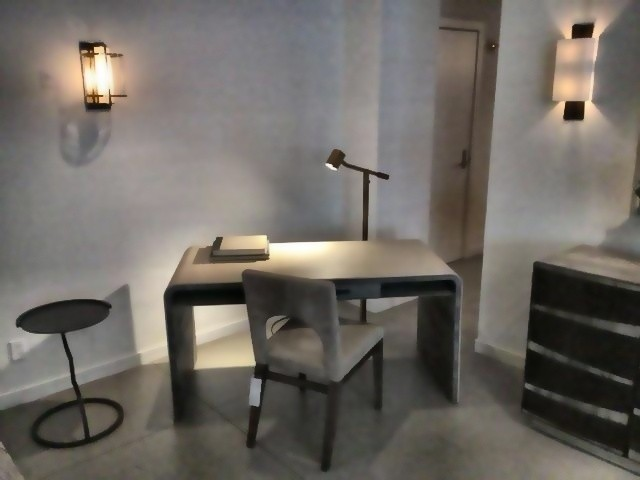

# PSNR

**psnr** 用来衡量预测帧相对参考帧的像素级信号保真度。
PSNR 是 Peak Signal-to-Noise Ratio（峰值信噪比），常用于图像压缩、重建和视频质量评估中，用来描述重建图像相对参考图像的数值误差大小。
在 WorldArena 中，它是一个 reference-based reconstruction 指标：预测帧越接近参考帧，均方误差越小，PSNR 越高。

## 它测什么

- 相对参考的像素级相似性。
- 重建保真度，而不是语义正确性。
- 生成帧在 RGB 数值上是否接近参考帧。
- 它不衡量 prompt following、3D consistency、运动合理性或感知真实性。

## 原理说明

PSNR 建立在 MSE（Mean Squared Error，均方误差）之上。
如果两张图像完全一致，MSE 为 0，理论上的 PSNR 为无穷大；如果两张图像差异越大，MSE 越大，PSNR 越低。
由于图像像素的动态范围有限，PSNR 会用最大可能像素值和噪声功率的比值来表示信号保真度，并使用对数尺度输出，单位通常是 dB。

对 8-bit RGB 图像，最大像素值为 \(255\)。
WorldArena 的实现会直接在 RGB 三通道上计算均方误差，因此 PSNR 对亮度、颜色和局部像素偏移都很敏感。
这也意味着它很适合衡量 reconstruction-style fidelity，但不适合单独评价生成视频的语义正确性或视觉自然度。

## 当前算法

1. WorldArena 按对齐时间索引配对预测帧和参考帧。
2. 如果分辨率不一致，会先把预测帧 resize 到参考帧分辨率。
3. 将预测帧和参考帧转换为 `float32`，在 RGB 三通道上计算 MSE。
4. 对每对帧计算 `PSNR = 20 * log10(255) - 10 * log10(MSE)`。
5. 完全一致的情况会被钳到 `100.0`，而不是无穷大。
6. 原始分数是所有帧 PSNR 的平均值。

## 误差公式

对第 \(i\) 对预测帧和参考帧，记预测图像为 \(P_i\)，参考图像为 \(R_i\)。
若图像大小为 \(H\times W\)，通道数为 \(C=3\)，当前实现的均方误差为：

!!! info "均方误差"

    \[
    \operatorname{MSE}_i
    =
    \frac{1}{HWC}
    \sum_{y=1}^{H}
    \sum_{x=1}^{W}
    \sum_{c=1}^{C}
    \left(
        P_i(x,y,c)-R_i(x,y,c)
    \right)^2
    \]

对应的帧级 PSNR 为：

!!! info "帧级 PSNR"

    \[
    \operatorname{PSNR}_i
    =
    20\log_{10}(255)
    -
    10\log_{10}(\operatorname{MSE}_i)
    \]

当 \(\operatorname{MSE}_i \le 10^{-12}\) 时，WorldArena 将该帧 PSNR 记为 `100.0`，避免无穷大破坏后续聚合。
最终视频或样本级 PSNR 为所有配对帧的平均值：

!!! info "最终分数"

    \[
    \operatorname{PSNR}
    =
    \frac{1}{N}
    \sum_{i=1}^{N}
    \operatorname{PSNR}_i
    \]

其中，\(N\) 是成功配对的帧数。
PSNR 越高，表示预测帧在像素值上越接近参考帧。

## 输入与输出

| 项目 | 当前实现 |
| --- | --- |
| 预测输入 | 预测的采样帧 |
| 参考输入 | 参考的采样帧 |
| 标注输入 | 无 |
| 原始输出 | 单个平均 PSNR 标量 |
| 归一化输出 | 按 `config/benchmark.yaml` 的 `[10,40]` 范围缩放后的分数，越高越好 |
| 细节字段 | `frame_scores`、帧索引元数据 |
| 失败方式 | 如果没有对齐帧可用，则返回空值和错误字符串 |

## 集成状态

| 项目 | 结论 |
| --- | --- |
| 当前聚合 | 仅 `diagnostic` |
| 论文可用性 | `仅作辅助` |

- 它的价值：简单、稳定、直观。
- 它的限制：会强烈奖励复制参考，对语义有效性几乎没有说明力。
- 对轻微空间错位、相机偏移、亮度变化和颜色变化都很敏感，因此低 PSNR 不一定代表生成质量差，也可能只是与参考不做像素对齐。
- 建议用法：只把它作为 reconstruction 风格的附录指标，并和 `ssim`、`style_consistency`、`perceptual_quality` 一起解读。

## 参考资料 {#reference}

!!! quote "峰值信噪比"

    PSNR 通常通过 MSE 定义，用最大像素值和均方误差的比值来表示重建信号相对于参考信号的保真度。  
    [https://zh.wikipedia.org/wiki/峰值信噪比](https://zh.wikipedia.org/wiki/%E5%B3%B0%E5%80%BC%E4%BF%A1%E5%99%AA%E6%AF%94)

<!-- metric-examples:start -->
## 人工精选的同 Case 对比

下列案例来自 `artifacts/reports` 生成的同-case比较索引。输入图、sample ID 与实际生成 prompt 完全一致；候选先按分位数和分差筛选，再逐帧人工复核。标签只表示该 metric 的相对高低，不代表模型整体优劣；为避免把单一案例误读成排行榜，卡片不展示模型名称。

Audit manifest: `docs/assets/metric_examples/curated_same_case_manifest.json`.

<article class="metric-case-exhibit metric-case-exhibit--curated">
  

    <figure class="metric-input-card">
      
      <figcaption>输入图像</figcaption>
    </figure>
    

      
人工复核 · 同一 case、输入与 prompt · gap 0.9382

      <h4><code>image_static_photorealistic_workspaces_0024</code></h4>
      
套件: image_static场景: photorealistic / indoor / workspaces

      

        实际生成 prompt
        
Camera pull out. A minimalist workspace with desk, chair, and lamp. Camera pan right. A minimalist workspace with hallway, door, and wall art. Camera move right. A minimalist workspace with hallway, wall art, and small table.

        <small>prompt source: prompt_target</small>
      

      
较高分结果在镜头移动中保留了输入工作区的结构与外观；较低分结果则切换成无关的局部特写。PSNR 衡量参考保真度，不等同于独立审美质量。

    

  

  

    <figure class="metric-output-card metric-output-card--good">
      

        <video class="metric-output-video" controls muted loop playsinline preload="metadata" aria-label="较高指标分: image_static_photorealistic_workspaces_0024">
          <source src="../../../assets/metric_examples/curated_20260801/5339bb13b9a3__image_static_photorealistic_workspaces_0024__high.mp4" type="video/mp4">
        </video>
        
较高指标分 · 分数 0.9449

      

      <figcaption class="metric-output-caption"><strong>较高指标分</strong>psnr</figcaption>
    </figure>
    <figure class="metric-output-card metric-output-card--bad">
      

        <video class="metric-output-video" controls muted loop playsinline preload="metadata" aria-label="较低指标分: image_static_photorealistic_workspaces_0024">
          <source src="../../../assets/metric_examples/curated_20260801/4b869c9aa35b__image_static_photorealistic_workspaces_0024__low.mp4" type="video/mp4">
        </video>
        
较低指标分 · 分数 0.0067

      

      <figcaption class="metric-output-caption"><strong>较低指标分</strong>psnr</figcaption>
    </figure>
  

</article>

<!-- metric-examples:end -->
