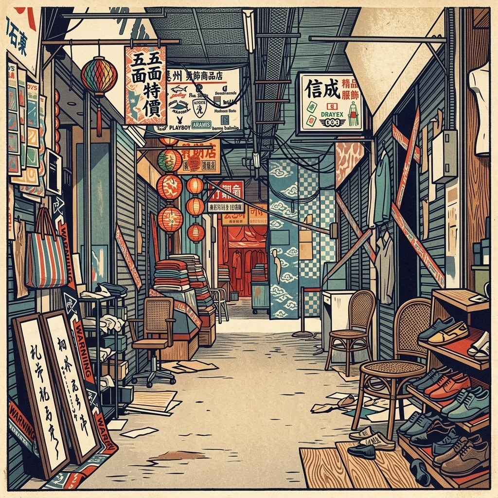
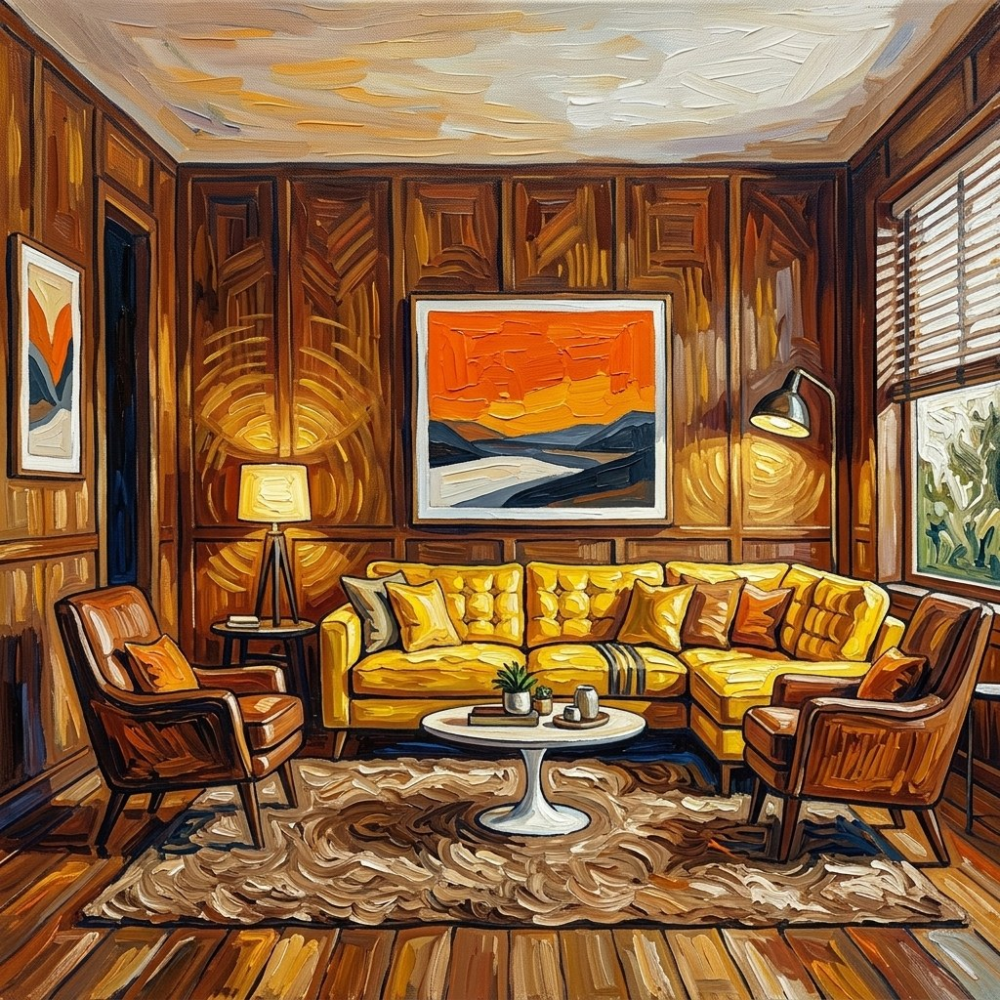
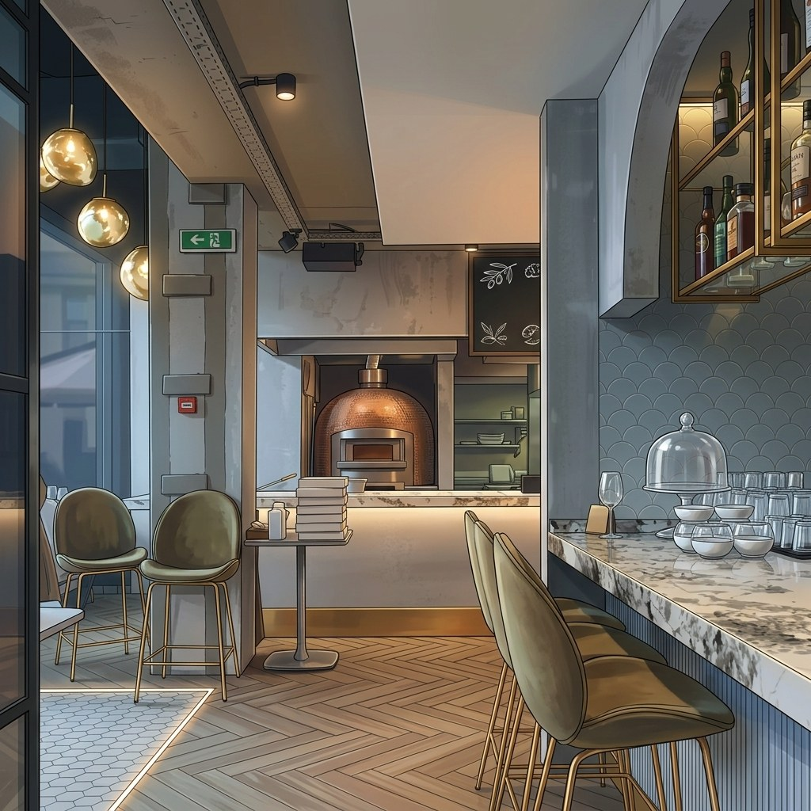

# Rollout Aesthetic Drift

**rollout_aesthetic_drift** 衡量 rollout 内的**美学时序退化**。逐帧 LAION 美学分数划分为 $N=10$ 个等长片段；漂移为最佳与最差片段均值之间的相对下降。

\[
D_{\mathrm{aes}} = \frac{\bar{s}_{\mathrm{best}} - \bar{s}_{\mathrm{worst}}}{|\bar{s}_{\mathrm{best}}|}
\tag{1}
\]

越低越好，结果钳位至 $[0,1]$。仅基于预测。后端：`quality_drift`（美学分量经 pyiqa `laion_aes`）。

<!-- metric-examples:start -->
## 代表性同 Case 对比
每个展示块先给出该 case 的 input image 和完全一致的展示 prompt，然后比较模型生成结果。paired 展示必须满足 input image 相同、prompt 文本相同，并且一个模型高分、一个模型低分。若当前正式快照中该 metric 没有这种跨模型同 case pair，则单独展示高分/低分极值样例，不把它们伪装成同 case 对比。
机器可读 paired 导出： `docs/assets/metric_examples/paired_manifest.csv`.
### `rollout_aesthetic_drift`

<article class="metric-case-exhibit">
  

    <figure class="metric-input-card">
      
      <figcaption>输入图像</figcaption>
    </figure>
    

      
Case 1 · 同一输入图像 + 同一 prompt · 分差 0.5320

      <h4><code>image_static_photorealistic_terrestrial_landscape_0100</code></h4>
      
Suite: image_staticScene: photorealistic / outdoor / terrestrial_landscape

      

        目标 prompt
        
Camera pan right. A mountain landscape with valley, river, and mountain peaks. Camera pull out. A mountain landscape with forest, wildlife, and deer. Camera move right. A mountain landscape with village, smoke, and chimneys.

        <small>prompt 来源: prompt_target</small>
      

    

  

  

<figure class="metric-output-card metric-output-card--good">
  

    <video class="metric-output-video" controls muted loop playsinline preload="metadata" aria-label="好结果: image_static_photorealistic_terrestrial_landscape_0100">
      <source src="../../../assets/metric_examples/3ef2096fbf6e__stable_virtual_camera__image_static_photorealistic_terrestrial_landscape_0100.mp4" type="video/mp4">
    </video>
    
好结果 · 分数 0.9854

  

</figure>
<figure class="metric-output-card metric-output-card--bad">
  

    <video class="metric-output-video" controls muted loop playsinline preload="metadata" aria-label="差结果: image_static_photorealistic_terrestrial_landscape_0100">
      <source src="../../../assets/metric_examples/1c7dbcf5ff29__wan22-ti2v-5b-image-static-plan-missing__image_static_photorealistic_terrestrial_landscape_0100.mp4" type="video/mp4">
    </video>
    
差结果 · 分数 0.4535

  

</figure>
  

</article>
<article class="metric-case-exhibit">
  

    <figure class="metric-input-card">
      
      <figcaption>输入图像</figcaption>
    </figure>
    

      
Case 2 · 同一输入图像 + 同一 prompt · 分差 0.5003

      <h4><code>image_static_stylized_passageways_0109</code></h4>
      
Suite: image_staticScene: stylized / indoor / passageways

      

        目标 prompt
        
Camera orbit right. An indoor market passageway with shops, signs, and decorative lanterns.

        <small>prompt 来源: prompt_target</small>
      

    

  

  

<figure class="metric-output-card metric-output-card--good">
  

    <video class="metric-output-video" controls muted loop playsinline preload="metadata" aria-label="好结果: image_static_stylized_passageways_0109">
      <source src="../../../assets/metric_examples/738ebf610853__ac3d-image-static__image_static_stylized_passageways_0109.mp4" type="video/mp4">
    </video>
    
好结果 · 分数 0.9768

  

</figure>
<figure class="metric-output-card metric-output-card--bad">
  

    <video class="metric-output-video" controls muted loop playsinline preload="metadata" aria-label="差结果: image_static_stylized_passageways_0109">
      <source src="../../../assets/metric_examples/a2ec606fa686__matrix_game3_5s__image_static_stylized_passageways_0109.mp4" type="video/mp4">
    </video>
    
差结果 · 分数 0.4766

  

</figure>
  

</article>
<article class="metric-case-exhibit">
  

    <figure class="metric-input-card">
      
      <figcaption>输入图像</figcaption>
    </figure>
    

      
Case 3 · 同一输入图像 + 同一 prompt · 分差 0.4898

      <h4><code>image_static_stylized_living_spaces_0080</code></h4>
      
Suite: image_staticScene: stylized / indoor / living_spaces

      

        目标 prompt
        
Camera pull out. A living room corner with bookshelf, potted plant, and yellow sectional sofa. Camera move left. A living room corner with framed photos, console table, and hallway. Camera pan left. A dining area with dining table, chairs, and wooden paneling.

        <small>prompt 来源: prompt_target</small>
      

    

  

  

<figure class="metric-output-card metric-output-card--good">
  

    <video class="metric-output-video" controls muted loop playsinline preload="metadata" aria-label="好结果: image_static_stylized_living_spaces_0080">
      <source src="../../../assets/metric_examples/7b9bb137b4d6__sana-wm-image-static__image_static_stylized_living_spaces_0080.mp4" type="video/mp4">
    </video>
    
好结果 · 分数 1.0000

  

</figure>
<figure class="metric-output-card metric-output-card--bad">
  

    <video class="metric-output-video" controls muted loop playsinline preload="metadata" aria-label="差结果: image_static_stylized_living_spaces_0080">
      <source src="../../../assets/metric_examples/f87734cf7816__wan22-ti2v-5b-image-static-plan-missing__image_static_stylized_living_spaces_0080.mp4" type="video/mp4">
    </video>
    
差结果 · 分数 0.5102

  

</figure>
  

</article>
<article class="metric-case-exhibit">
  

    <figure class="metric-input-card">
      
      <figcaption>输入图像</figcaption>
    </figure>
    

      
Case 4 · 同一输入图像 + 同一 prompt · 分差 0.4861

      <h4><code>image_static_stylized_terrestrial_landscape_0157</code></h4>
      
Suite: image_staticScene: stylized / outdoor / terrestrial_landscape

      

        目标 prompt
        
Camera orbit right. A stylized coastal landscape with lighthouse, cliff, and ocean.

        <small>prompt 来源: prompt_target</small>
      

    

  

  

<figure class="metric-output-card metric-output-card--good">
  

    <video class="metric-output-video" controls muted loop playsinline preload="metadata" aria-label="好结果: image_static_stylized_terrestrial_landscape_0157">
      <source src="../../../assets/metric_examples/5ad4100f15d0__ac3d-image-static__image_static_stylized_terrestrial_landscape_0157.mp4" type="video/mp4">
    </video>
    
好结果 · 分数 0.9780

  

</figure>
<figure class="metric-output-card metric-output-card--bad">
  

    <video class="metric-output-video" controls muted loop playsinline preload="metadata" aria-label="差结果: image_static_stylized_terrestrial_landscape_0157">
      <source src="../../../assets/metric_examples/68293d09e9b9__sana-wm-image-static__image_static_stylized_terrestrial_landscape_0157.mp4" type="video/mp4">
    </video>
    
差结果 · 分数 0.4919

  

</figure>
  

</article>
<article class="metric-case-exhibit">
  

    <figure class="metric-input-card">
      
      <figcaption>输入图像</figcaption>
    </figure>
    

      
Case 5 · 同一输入图像 + 同一 prompt · 分差 0.4699

      <h4><code>image_static_stylized_living_spaces_0139</code></h4>
      
Suite: image_staticScene: stylized / indoor / living_spaces

      

        目标 prompt
        
Camera pan right. A japanese living room with tatami mats, tea set, and low table.

        <small>prompt 来源: prompt_target</small>
      

    

  

  

<figure class="metric-output-card metric-output-card--good">
  

    <video class="metric-output-video" controls muted loop playsinline preload="metadata" aria-label="好结果: image_static_stylized_living_spaces_0139">
      <source src="../../../assets/metric_examples/2ef034707832__wan22-ti2v-5b-image-static-plan-missing__image_static_stylized_living_spaces_0139.mp4" type="video/mp4">
    </video>
    
好结果 · 分数 0.9885

  

</figure>
<figure class="metric-output-card metric-output-card--bad">
  

    <video class="metric-output-video" controls muted loop playsinline preload="metadata" aria-label="差结果: image_static_stylized_living_spaces_0139">
      <source src="../../../assets/metric_examples/835e8a94f624__sana-wm-image-static__image_static_stylized_living_spaces_0139.mp4" type="video/mp4">
    </video>
    
差结果 · 分数 0.5186

  

</figure>
  

</article>
<article class="metric-case-exhibit">
  

    <figure class="metric-input-card">
      
      <figcaption>输入图像</figcaption>
    </figure>
    

      
Case 6 · 同一输入图像 + 同一 prompt · 分差 0.4648

      <h4><code>image_static_stylized_dining_spaces_0152</code></h4>
      
Suite: image_staticScene: stylized / indoor / dining_spaces

      

        目标 prompt
        
Camera pan right. A modern dining area with tables, decorative plants, and high chairs.

        <small>prompt 来源: prompt_target</small>
      

    

  

  

<figure class="metric-output-card metric-output-card--good">
  

    <video class="metric-output-video" controls muted loop playsinline preload="metadata" aria-label="好结果: image_static_stylized_dining_spaces_0152">
      <source src="../../../assets/metric_examples/eea20d0a3659__motionctrl__image_static_stylized_dining_spaces_0152.mp4" type="video/mp4">
    </video>
    
好结果 · 分数 1.0000

  

</figure>
<figure class="metric-output-card metric-output-card--bad">
  

    <video class="metric-output-video" controls muted loop playsinline preload="metadata" aria-label="差结果: image_static_stylized_dining_spaces_0152">
      <source src="../../../assets/metric_examples/a8683614ef52__wan22-ti2v-5b-image-static-plan-missing__image_static_stylized_dining_spaces_0152.mp4" type="video/mp4">
    </video>
    
差结果 · 分数 0.5352

  

</figure>
  

</article>

<!-- metric-examples:end -->

## 参考文献 {#reference}

!!! quote "LAION-Aesthetics Predictor (CLIP-based linear aesthetic regressor)"

    Used via pyiqa `laion_aes`; CLIP ViT-L/14 features with a linear head trained on human aesthetic ratings.
