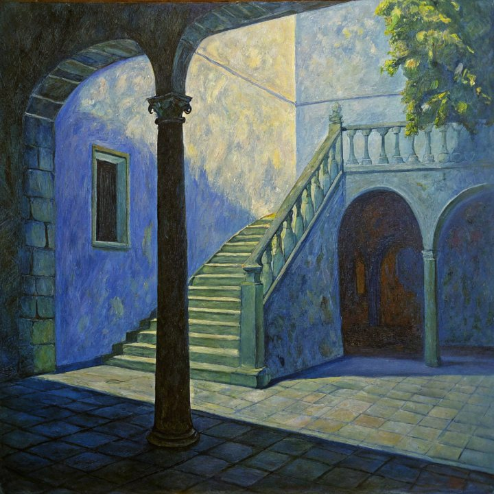
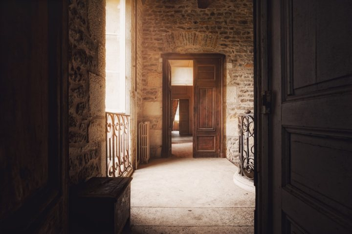
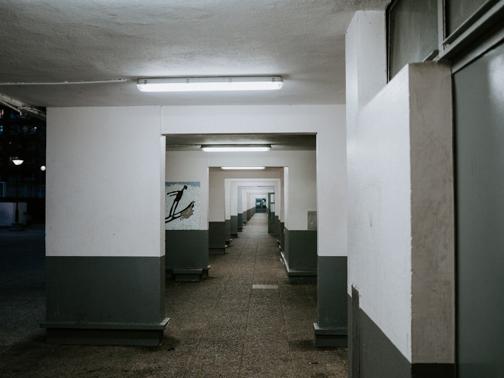
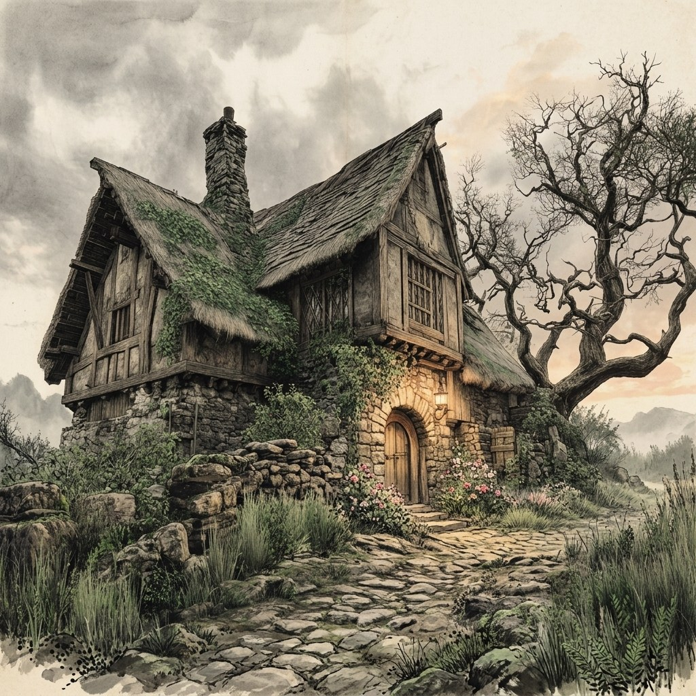

# Rollout Imaging Drift

**rollout_imaging_drift** 衡量 rollout 内的**成像质量时序退化**。逐帧 MUSIQ 分数划分为 $N=10$ 个等长片段；漂移为最佳与最差片段均值之间的相对下降。

\[
D_{\mathrm{img}} = \frac{\bar{s}_{\mathrm{best}} - \bar{s}_{\mathrm{worst}}}{|\bar{s}_{\mathrm{best}}|}
\tag{1}
\]

越低越好，结果钳位至 $[0,1]$。仅基于预测。后端：`quality_drift`（成像分量经 MUSIQ-SPAQ）。

<!-- metric-examples:start -->
## 代表性同 Case 对比
每个展示块先给出该 case 的 input image 和完全一致的展示 prompt，然后比较模型生成结果。paired 展示必须满足 input image 相同、prompt 文本相同，并且一个模型高分、一个模型低分。若当前正式快照中该 metric 没有这种跨模型同 case pair，则单独展示高分/低分极值样例，不把它们伪装成同 case 对比。
机器可读 paired 导出： `docs/assets/metric_examples/paired_manifest.csv`.
### `rollout_imaging_drift`

<article class="metric-case-exhibit">
  

    <figure class="metric-input-card">
      
      <figcaption>输入图像</figcaption>
    </figure>
    

      
Case 1 · 同一输入图像 + 同一 prompt · 分差 0.8269

      <h4><code>image_static_stylized_passageways_0014</code></h4>
      
Suite: image_staticScene: stylized / indoor / passageways

      

        目标 prompt
        
Camera orbit right. A passageways scene with staircase, column, and arched passageway.

        <small>prompt 来源: prompt_target</small>
      

    

  

  

<figure class="metric-output-card metric-output-card--good">
  

    <video class="metric-output-video" controls muted loop playsinline preload="metadata" aria-label="好结果: image_static_stylized_passageways_0014">
      <source src="../../../assets/metric_examples/0c627e2bd9b7__matrix-game-1-image-static-worldarena-prompt-min5-lowmem-rmsnorm-v2__image_static_stylized_passageways_0014.mp4" type="video/mp4">
    </video>
    
好结果 · 分数 0.9804

  

</figure>
<figure class="metric-output-card metric-output-card--bad">
  

    <video class="metric-output-video" controls muted loop playsinline preload="metadata" aria-label="差结果: image_static_stylized_passageways_0014">
      <source src="../../../assets/metric_examples/dacc3200ce74__matrix_game2_5s__image_static_stylized_passageways_0014.mp4" type="video/mp4">
    </video>
    
差结果 · 分数 0.1534

  

</figure>
  

</article>
<article class="metric-case-exhibit">
  

    <figure class="metric-input-card">
      
      <figcaption>输入图像</figcaption>
    </figure>
    

      
Case 2 · 同一输入图像 + 同一 prompt · 分差 0.8254

      <h4><code>image_static_stylized_public_spaces_0133</code></h4>
      
Suite: image_staticScene: stylized / indoor / public_spaces

      

        目标 prompt
        
Camera orbit left. A grand interior with artwork, seating, and decorative lighting.

        <small>prompt 来源: prompt_target</small>
      

    

  

  

<figure class="metric-output-card metric-output-card--good">
  

    <video class="metric-output-video" controls muted loop playsinline preload="metadata" aria-label="好结果: image_static_stylized_public_spaces_0133">
      <source src="../../../assets/metric_examples/b91e9726b01d__yume-sample5b-missing-reverse-5s-target__image_static_stylized_public_spaces_0133.mp4" type="video/mp4">
    </video>
    
好结果 · 分数 0.9929

  

</figure>
<figure class="metric-output-card metric-output-card--bad">
  

    <video class="metric-output-video" controls muted loop playsinline preload="metadata" aria-label="差结果: image_static_stylized_public_spaces_0133">
      <source src="../../../assets/metric_examples/a83e4016b584__stable_virtual_camera__image_static_stylized_public_spaces_0133.mp4" type="video/mp4">
    </video>
    
差结果 · 分数 0.1675

  

</figure>
  

</article>
<article class="metric-case-exhibit">
  

    <figure class="metric-input-card">
      
      <figcaption>输入图像</figcaption>
    </figure>
    

      
Case 3 · 同一输入图像 + 同一 prompt · 分差 0.8007

      <h4><code>image_static_photorealistic_passageways_0129</code></h4>
      
Suite: image_staticScene: photorealistic / indoor / passageways

      

        目标 prompt
        
Camera move right. A rustic hallway with wooden floor, window with curtains, and vintage furniture.

        <small>prompt 来源: prompt_target</small>
      

    

  

  

<figure class="metric-output-card metric-output-card--good">
  

    <video class="metric-output-video" controls muted loop playsinline preload="metadata" aria-label="好结果: image_static_photorealistic_passageways_0129">
      <source src="../../../assets/metric_examples/b11f8158de2a__matrix_game3_5s__image_static_photorealistic_passageways_0129.mp4" type="video/mp4">
    </video>
    
好结果 · 分数 1.0000

  

</figure>
<figure class="metric-output-card metric-output-card--bad">
  

    <video class="metric-output-video" controls muted loop playsinline preload="metadata" aria-label="差结果: image_static_photorealistic_passageways_0129">
      <source src="../../../assets/metric_examples/1ff5182f25cb__motionctrl__image_static_photorealistic_passageways_0129.mp4" type="video/mp4">
    </video>
    
差结果 · 分数 0.1993

  

</figure>
  

</article>
<article class="metric-case-exhibit">
  

    <figure class="metric-input-card">
      
      <figcaption>输入图像</figcaption>
    </figure>
    

      
Case 4 · 同一输入图像 + 同一 prompt · 分差 0.7934

      <h4><code>image_static_photorealistic_passageways_0081</code></h4>
      
Suite: image_staticScene: photorealistic / indoor / passageways

      

        目标 prompt
        
Camera move right. A long corridor with corridor extension, columns, and mural.

        <small>prompt 来源: prompt_target</small>
      

    

  

  

<figure class="metric-output-card metric-output-card--good">
  

    <video class="metric-output-video" controls muted loop playsinline preload="metadata" aria-label="好结果: image_static_photorealistic_passageways_0081">
      <source src="../../../assets/metric_examples/4300ac0093a0__wan22-ti2v-5b-image-static-plan-missing__image_static_photorealistic_passageways_0081.mp4" type="video/mp4">
    </video>
    
好结果 · 分数 0.9573

  

</figure>
<figure class="metric-output-card metric-output-card--bad">
  

    <video class="metric-output-video" controls muted loop playsinline preload="metadata" aria-label="差结果: image_static_photorealistic_passageways_0081">
      <source src="../../../assets/metric_examples/519973dc5747__matrix_game2_5s__image_static_photorealistic_passageways_0081.mp4" type="video/mp4">
    </video>
    
差结果 · 分数 0.1639

  

</figure>
  

</article>
<article class="metric-case-exhibit">
  

    <figure class="metric-input-card">
      
      <figcaption>输入图像</figcaption>
    </figure>
    

      
Case 5 · 同一输入图像 + 同一 prompt · 分差 0.7849

      <h4><code>image_static_stylized_verdant_landscape_0149</code></h4>
      
Suite: image_staticScene: stylized / outdoor / verdant_landscape

      

        目标 prompt
        
Camera move right. A rustic cottage with vegetable patch, wooden fence, and wildflowers.

        <small>prompt 来源: prompt_target</small>
      

    

  

  

<figure class="metric-output-card metric-output-card--good">
  

    <video class="metric-output-video" controls muted loop playsinline preload="metadata" aria-label="好结果: image_static_stylized_verdant_landscape_0149">
      <source src="../../../assets/metric_examples/acf2b9101520__yume-sample5b-missing-reverse-5s-target__image_static_stylized_verdant_landscape_0149.mp4" type="video/mp4">
    </video>
    
好结果 · 分数 0.9899

  

</figure>
<figure class="metric-output-card metric-output-card--bad">
  

    <video class="metric-output-video" controls muted loop playsinline preload="metadata" aria-label="差结果: image_static_stylized_verdant_landscape_0149">
      <source src="../../../assets/metric_examples/3b24374e91be__warp-as-history-image-static-8gpu-20260612_152000__image_static_stylized_verdant_landscape_0149.mp4" type="video/mp4">
    </video>
    
差结果 · 分数 0.2051

  

</figure>
  

</article>
<article class="metric-case-exhibit">
  

    <figure class="metric-input-card">
      
      <figcaption>输入图像</figcaption>
    </figure>
    

      
Case 6 · 同一输入图像 + 同一 prompt · 分差 0.7798

      <h4><code>image_static_photorealistic_aquatic_landscape_0071</code></h4>
      
Suite: image_staticScene: photorealistic / outdoor / aquatic_landscape

      

        目标 prompt
        
Camera move right. A castle on rocky cliff with rocky path and sea. Camera pan right. A castle on rocky cliff with castle entrance, drawbridge, and forest. Camera pull out. A forest edge with castle, twilight sky, and distant sea.

        <small>prompt 来源: prompt_target</small>
      

    

  

  

<figure class="metric-output-card metric-output-card--good">
  

    <video class="metric-output-video" controls muted loop playsinline preload="metadata" aria-label="好结果: image_static_photorealistic_aquatic_landscape_0071">
      <source src="../../../assets/metric_examples/468c4e319b29__yume_sample5b__image_static_photorealistic_aquatic_landscape_0071.mp4" type="video/mp4">
    </video>
    
好结果 · 分数 0.9751

  

</figure>
<figure class="metric-output-card metric-output-card--bad">
  

    <video class="metric-output-video" controls muted loop playsinline preload="metadata" aria-label="差结果: image_static_photorealistic_aquatic_landscape_0071">
      <source src="../../../assets/metric_examples/66ef97296842__warp-as-history-image-static-8gpu-20260612_152000__image_static_photorealistic_aquatic_landscape_0071.mp4" type="video/mp4">
    </video>
    
差结果 · 分数 0.1953

  

</figure>
  

</article>

<!-- metric-examples:end -->

## 参考文献 {#reference}

!!! quote "MUSIQ: Multi-scale Image Quality Transformer"

    Zejiang Hou, Hui Ren, Ming Sun, Jiahao Li, Weining Wang.  
    ICCV 2021.  
    [https://arxiv.org/abs/2108.05997](https://arxiv.org/abs/2108.05997)
