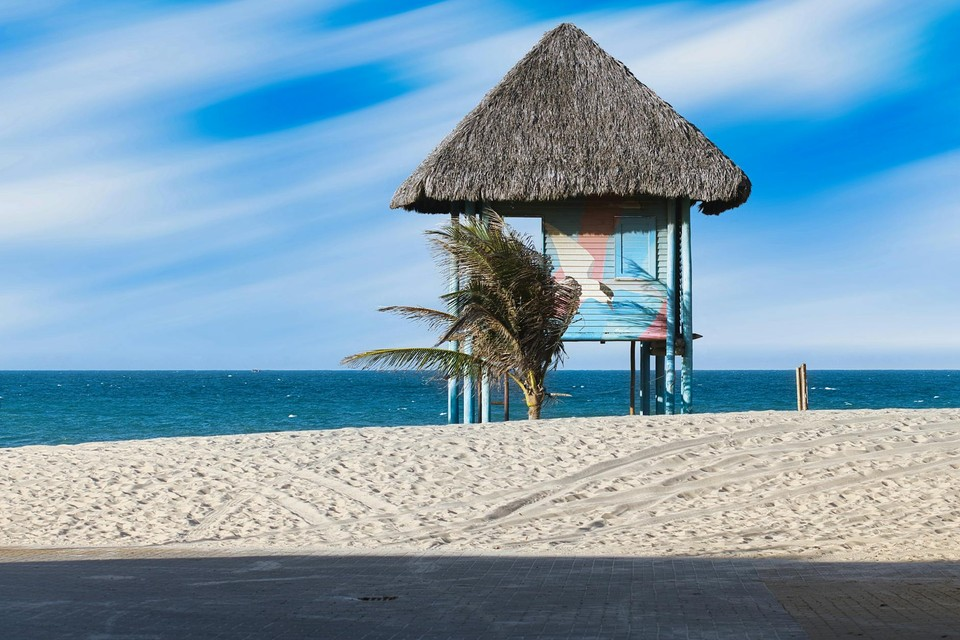

# 片段连续性（Segment Continuity）

片段连续性度量生成视频是否出现**检测到的场景切换**。非预期的硬切会破坏时序连贯性，反映片段不连续。

TransNetV2 为解码帧 $x_i$ 输出场景边界概率 $p_i$。当 $p_i > \theta$ 时标记为切点候选（默认 $\theta = 0.5$）。切点记录遵循 TransNetV2 的 0→1 跃迁解析：在帧索引 $i$ 处由 $0$ 升至 $1$ 即记为一次切换。

为抑制误检，切点候选需满足最小场景长度 $L$（默认 $L = 10$ 帧）：任一保留切点两侧的片段长度均不得短于 $L$。设单视频保留切点数为 $n_{\mathrm{cut}}$，则 per-video 得分为二值：

\[
S_{\mathrm{seg}}
=
\begin{cases}
1, & n_{\mathrm{cut}} = 0 \\
0, & n_{\mathrm{cut}} > 0
\end{cases}
\tag{1}
\]

对 $N$ 个视频，模型级聚合为

\[
\bar{S}_{\mathrm{seg}}
=
1 - \frac{n_{\mathrm{cut}}}{N}
\tag{2}
\]

其中 $n_{\mathrm{cut}}$ 统计至少含一个保留切点的视频数。WorldArena 将式 (1) 的二值结果存为 per-sample raw 分数。该指标**仅需 prediction**，且依赖 TransNetV2 推理代码与权重。

## 参考文献 {#reference}

!!! quote "TransNet V2 — Shot Boundary Detection"

    Sočik et al., ACM MM 2020.
    [https://arxiv.org/abs/2008.04838](https://arxiv.org/abs/2008.04838)

<!-- metric-examples:start -->
## 人工精选的同 Case 对比

下列案例来自 `artifacts/reports` 生成的同-case比较索引。输入图、sample ID 与实际生成 prompt 完全一致；候选先按分位数和分差筛选，再逐帧人工复核。标签只表示该 metric 的相对高低，不代表模型整体优劣；为避免把单一案例误读成排行榜，卡片不展示模型名称。

Audit manifest: `docs/assets/metric_examples/curated_same_case_manifest.json`.

<article class="metric-case-exhibit metric-case-exhibit--curated">
  

    <figure class="metric-input-card">
      
      <figcaption>输入图像</figcaption>
    </figure>
    

      
人工复核 · 同一 case、输入与 prompt · gap 1.0000

      <h4><code>image_static_photorealistic_aquatic_landscape_0044</code></h4>
      
套件: image_static场景: photorealistic / outdoor / aquatic_landscape

      

        实际生成 prompt
        
Camera pan left. An aquatic landscape with shoreline, seashells, and distant boat. Camera pull out. An aquatic landscape with sand dunes, beach grass, and seagulls. Camera move left. An aquatic landscape with boardwalk, beachgoers, and umbrellas.

        <small>prompt source: prompt_target</small>
      

      
较高分海滩结果始终处于同一连续场景；较低分结果从沙滩棚突然硬切到无关的港口场景，并被检测为一次 cut。

    

  

  

    <figure class="metric-output-card metric-output-card--good">
      

        <video class="metric-output-video" controls muted loop playsinline preload="metadata" aria-label="较高指标分: image_static_photorealistic_aquatic_landscape_0044">
          <source src="../../../assets/metric_examples/curated_20260801/b0f27193421a__image_static_photorealistic_aquatic_landscape_0044__high.mp4" type="video/mp4">
        </video>
        
较高指标分 · 分数 1.0000

      

      <figcaption class="metric-output-caption"><strong>较高指标分</strong>segment_continuity检测到的硬切次数: 0</figcaption>
    </figure>
    <figure class="metric-output-card metric-output-card--bad">
      

        <video class="metric-output-video" controls muted loop playsinline preload="metadata" aria-label="较低指标分: image_static_photorealistic_aquatic_landscape_0044">
          <source src="../../../assets/metric_examples/curated_20260801/665ac6c76204__image_static_photorealistic_aquatic_landscape_0044__low.mp4" type="video/mp4">
        </video>
        
较低指标分 · 分数 0.0000

      

      <figcaption class="metric-output-caption"><strong>较低指标分</strong>segment_continuity检测到的硬切次数: 1</figcaption>
    </figure>
  

</article>

<!-- metric-examples:end -->
