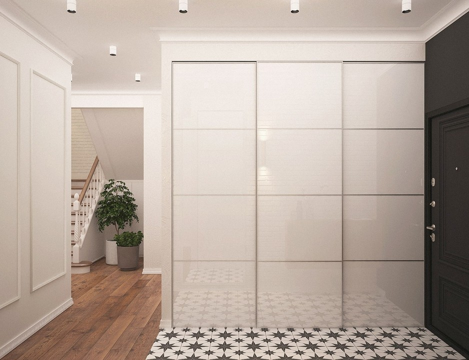
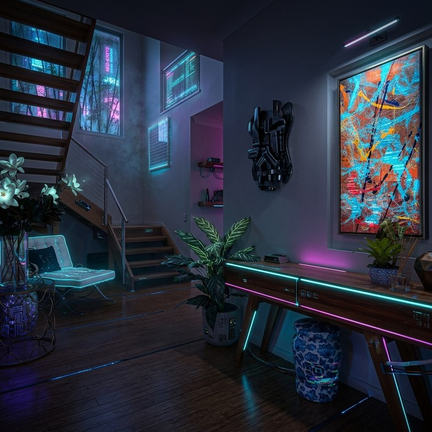

# Sharpness Retention

本指标通过监测边缘梯度的演化，评估生成视频中**细节稳定性**。成功产生的数值结果为 official：会进入 `quality` 维度和公开 leaderboard 向量。该实现采用向量化 Tenengrad 方法：分别计算水平方向（$G_x$）与竖直方向（$G_y$）Sobel 梯度的绝对值之和，构造二维清晰度向量以刻画纹理方向特征：

\[
\mathbf{g}_t
=
\begin{pmatrix}
\sum |G_x| \\
\sum |G_y|
\end{pmatrix}
\tag{6}
\]

其中 $G_x, G_y$ 为第 $t$ 帧灰度图经 $3\times3$ Sobel 算子得到的梯度响应。

引入**噪声感知熔断机制**以区分真实细节与高频伪影：记 $n_t$ 为第 $t$ 帧 BRISQUE 噪声分数，$\tau$ 为噪声阈值；当连续 $5$ 帧满足 $n_t > \tau$ 时，触发状态 $I_{\mathrm{trig}}=1$。融合惩罚逻辑 $M$ 将纹理相似度与熔断状态结合（相似度 $S(\cdot,\cdot)$ 采用余弦内积，定义同式 (3)）：

BRISQUE 对零方差帧没有定义。实现会给这类帧赋予配置中的最差值 `brisque_bad`，并继续把它计入聚合，因此纯色或黑帧坍缩会受到惩罚，而不会作为缺失分数被静默排除。

\[
M(x_t)
=
\begin{cases}
S(\mathbf{g}_t, \mathbf{g}_1), & I_{\mathrm{trig}} = 0 \;\wedge\; n_t < \tau \\[4pt]
\mathrm{clip}\!\bigl(1 - S(\mathbf{g}_t, \mathbf{g}_1),\, 0,\, 0.2\bigr), & \text{otherwise}
\end{cases}
\tag{11}
\]

对低–中分段细节增强，采用**上凸对数变换** $L(\cdot)$（$x \in [0,1]$，避免无意义对数并归一化）：

\[
L(x)
=
\frac{\ln(1 + k \cdot x)}{\ln(1 + k)},
\quad k > 0
\tag{10}
\]

其中 $k$ 控制上凸程度，视觉领域常用 $k \in [10, 20]$；分子保证 $x=0 \Rightarrow L(x)=0$，分母保证 $x=1 \Rightarrow L(x)=1$。

时序聚合采用归一化指数衰减权重 $\hat{w}(d)$（定义同亮度一致性指标式 (5)，$d \in [1, T-1]$ 为帧距）。综合得分为：

\[
S_{\mathrm{Sharpness}}
=
\sum_{d=1}^{T-1}
\hat{w}(d) \cdot L\!\left(M(x_{d+1})\right)
\tag{12}
\]

其中 $S(\mathbf{g}_t, \mathbf{g}_1)$ 为第 $t$ 帧与首帧清晰度向量的余弦相似度。该机制可在区分真实细节与高频噪声的同时，对系统性视觉崩塌施加惩罚。

<!-- metric-examples:start -->
## 已核验的同输入案例

每个 metric 最多展示三个 case。每组中的两条视频必须属于同一 benchmark sample，且两侧首帧都通过与该组展示输入的 SIFT + RANSAC 几何匹配；不通过的候选不会发布。标签只表示当前 metric 的相对高低，不代表模型整体优劣。

Audit manifest: `docs/assets/metric_examples/curated_same_case_manifest.json`.

<article class="metric-case-exhibit metric-case-exhibit--curated">
  

    <figure class="metric-input-card">
      
      <figcaption>输入图像</figcaption>
    </figure>
    

      
输入已核验 · 同一 benchmark case · gap 0.8467

      <h4><code>image_static_photorealistic_terrestrial_landscape_0152</code></h4>
      
套件: image_static场景: photorealistic / outdoor / terrestrial_landscape

      

        基准 prompt target
        
Camera pan right. A desert canyon with rock formations, distant horizon, and sand.

        <small>prompt source: prompt_target</small>
      

      
两条视频的首帧都已通过与展示输入的几何匹配核验；高低标签只比较当前 metric。

    

  

  

    <figure class="metric-output-card metric-output-card--good">
      

        <video class="metric-output-video" controls muted loop playsinline preload="metadata" aria-label="较高指标分: image_static_photorealistic_terrestrial_landscape_0152">
          <source src="../../../assets/metric_examples/curated_20260801/3b795be240b4__image_static_photorealistic_terrestrial_landscape_0152__high.mp4" type="video/mp4">
        </video>
        
较高指标分 · 分数 0.9725

      

      <figcaption class="metric-output-caption"><strong>较高指标分</strong>sharpness_retention</figcaption>
    </figure>
    <figure class="metric-output-card metric-output-card--bad">
      

        <video class="metric-output-video" controls muted loop playsinline preload="metadata" aria-label="较低指标分: image_static_photorealistic_terrestrial_landscape_0152">
          <source src="../../../assets/metric_examples/curated_20260801/33b0c6368136__image_static_photorealistic_terrestrial_landscape_0152__low.mp4" type="video/mp4">
        </video>
        
较低指标分 · 分数 0.1258

      

      <figcaption class="metric-output-caption"><strong>较低指标分</strong>sharpness_retention</figcaption>
    </figure>
  

</article>
<article class="metric-case-exhibit metric-case-exhibit--curated">
  

    <figure class="metric-input-card">
      
      <figcaption>输入图像</figcaption>
    </figure>
    

      
输入已核验 · 同一 benchmark case · gap 0.8771

      <h4><code>image_static_photorealistic_passageways_0128</code></h4>
      
套件: image_static场景: photorealistic / indoor / passageways

      

        基准 prompt target
        
Camera pan left. A modern hallway with potted plant, artwork, and hallway extension.

        <small>prompt source: prompt_target</small>
      

      
两条视频的首帧都已通过与展示输入的几何匹配核验；高低标签只比较当前 metric。

    

  

  

    <figure class="metric-output-card metric-output-card--good">
      

        <video class="metric-output-video" controls muted loop playsinline preload="metadata" aria-label="较高指标分: image_static_photorealistic_passageways_0128">
          <source src="../../../assets/metric_examples/curated_20260801/762e177654f7__image_static_photorealistic_passageways_0128__high.mp4" type="video/mp4">
        </video>
        
较高指标分 · 分数 0.9749

      

      <figcaption class="metric-output-caption"><strong>较高指标分</strong>sharpness_retention</figcaption>
    </figure>
    <figure class="metric-output-card metric-output-card--bad">
      

        <video class="metric-output-video" controls muted loop playsinline preload="metadata" aria-label="较低指标分: image_static_photorealistic_passageways_0128">
          <source src="../../../assets/metric_examples/curated_20260801/51080028fdfc__image_static_photorealistic_passageways_0128__low.mp4" type="video/mp4">
        </video>
        
较低指标分 · 分数 0.0978

      

      <figcaption class="metric-output-caption"><strong>较低指标分</strong>sharpness_retention</figcaption>
    </figure>
  

</article>
<article class="metric-case-exhibit metric-case-exhibit--curated">
  

    <figure class="metric-input-card">
      
      <figcaption>输入图像</figcaption>
    </figure>
    

      
输入已核验 · 同一 benchmark case · gap 0.8513

      <h4><code>image_static_stylized_living_spaces_0096</code></h4>
      
套件: image_static场景: stylized / indoor / living_spaces

      

        基准 prompt target
        
Camera pan right. A modern living space with hallway, neon lights, and artwork.

        <small>prompt source: prompt_target</small>
      

      
两条视频的首帧都已通过与展示输入的几何匹配核验；高低标签只比较当前 metric。

    

  

  

    <figure class="metric-output-card metric-output-card--good">
      

        <video class="metric-output-video" controls muted loop playsinline preload="metadata" aria-label="较高指标分: image_static_stylized_living_spaces_0096">
          <source src="../../../assets/metric_examples/curated_20260801/1e7a3127e127__image_static_stylized_living_spaces_0096__high.mp4" type="video/mp4">
        </video>
        
较高指标分 · 分数 0.9514

      

      <figcaption class="metric-output-caption"><strong>较高指标分</strong>sharpness_retention</figcaption>
    </figure>
    <figure class="metric-output-card metric-output-card--bad">
      

        <video class="metric-output-video" controls muted loop playsinline preload="metadata" aria-label="较低指标分: image_static_stylized_living_spaces_0096">
          <source src="../../../assets/metric_examples/curated_20260801/b8886f3dbd11__image_static_stylized_living_spaces_0096__low.mp4" type="video/mp4">
        </video>
        
较低指标分 · 分数 0.1001

      

      <figcaption class="metric-output-caption"><strong>较低指标分</strong>sharpness_retention</figcaption>
    </figure>
  

</article>

<!-- metric-examples:end -->
