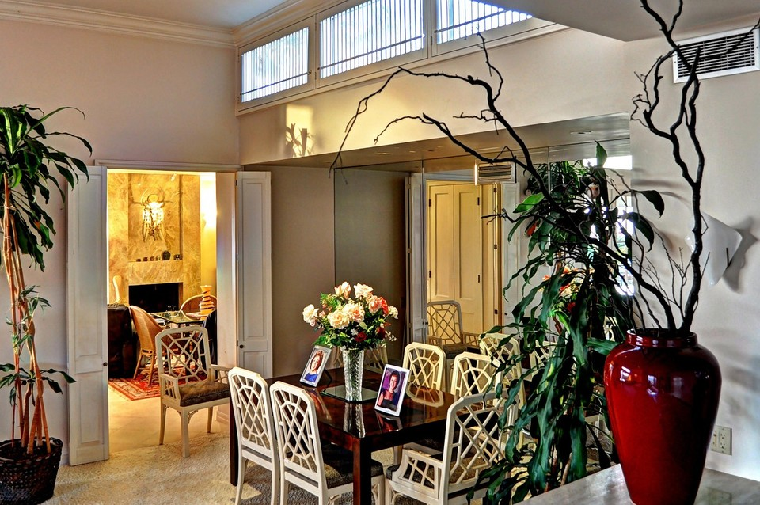
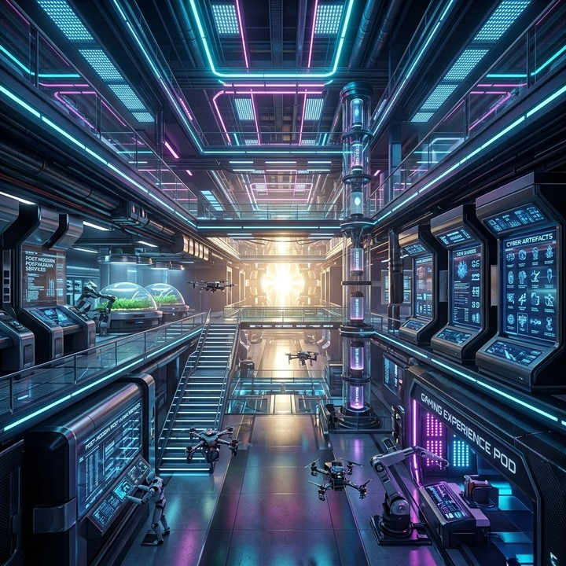

# Style Consistency

本指标用于评估生成 rollout 内视觉风格（色彩、纹理与粗粒度外观统计）的跨场景稳定性。给定按评测协议抽取的 anchor 帧序列 $\{I_t\}_{t=1}^{T}$（$T \geq 2$），以首帧 $I_1$ 为风格参考，将后续各幕 anchor $I_{d+1}$（$d \in [1, T-1]$）与 $I_1$ 在 VGG19 多层 Gram 表征上对齐比较；**不使用** ground-truth reference 参与打分。

对每帧 $I_t$，先经 resize（CUDA 上为 $512 \times 512$，CPU 上为 $128 \times 128$）、`ToTensor` 及 ImageNet 均值–方差归一化，再送入 VGG19 `features` 前向传播。在卷积层 $\mathrm{conv}_1, \ldots, \mathrm{conv}_5$ 的输出处（ReLU 之前）提取特征图 $F_{t,l} \in \mathbb{R}^{C \times H \times W}$。Gram 矩阵定义为

\[
G(F)
=
\frac{
    \mathrm{vec}(F)\,\mathrm{vec}(F)^{\top}
}{
    C \cdot H \cdot W
}
\tag{1}
\]

其中 $\mathrm{vec}(\cdot)$ 为向量化算子。帧 $d+1$ 在层 $l$ 上的风格距离为

\[
\delta_{d,l}
=
\mathrm{MSE}\!\left(
    G(F_{d+1,l}),\,
    G(F_{1,l})
\right)
\tag{2}
\]

单帧距离为五层距离之和：

\[
d_d
=
\sum_{l \in \{\mathrm{conv}_1, \ldots, \mathrm{conv}_5\}}
\delta_{d,l}
\tag{3}
\]

原始分数取后续 anchor 帧距离的算术平均（**越低越好**）：

\[
\mathrm{raw}
=
\frac{1}{T-1}
\sum_{d=1}^{T-1} d_d
\tag{4}
\]

归一化采用配置的经验界 $\varepsilon_{\min}=0$、$\varepsilon_{\max}=0.007$（`higher_is_better=false`）。先将 raw 钳位至经验区间，再映射为 $[0,1]$ 且**越高越好**的归一化分数：

\[
\mathrm{raw}'
=
\mathrm{clip}(\mathrm{raw},\, \varepsilon_{\min},\, \varepsilon_{\max})
\tag{5}
\]

\[
S_{\mathrm{style}}
=
1
-
\frac{
    \mathrm{raw}' - \varepsilon_{\min}
}{
    \varepsilon_{\max} - \varepsilon_{\min}
}
\tag{6}
\]

<!-- metric-examples:start -->
## 已核验的同输入案例

每个 metric 最多展示三个 case。每组中的两条视频必须属于同一 benchmark sample，且两侧首帧都通过与该组展示输入的 SIFT + RANSAC 几何匹配；不通过的候选不会发布。标签只表示当前 metric 的相对高低，不代表模型整体优劣。

Audit manifest: `docs/assets/metric_examples/curated_same_case_manifest.json`.

<article class="metric-case-exhibit metric-case-exhibit--curated">
  

    <figure class="metric-input-card">
      
      <figcaption>输入图像</figcaption>
    </figure>
    

      
输入已核验 · 同一 benchmark case · gap 1.0000

      <h4><code>image_static_photorealistic_dining_spaces_0150</code></h4>
      
套件: image_static场景: photorealistic / indoor / dining_spaces

      

        基准 prompt target
        
Camera pan left. A living area with fireplace, chairs, and wall sculpture.

        <small>prompt source: prompt_target</small>
      

      
两条视频的首帧都已通过与展示输入的几何匹配核验；高低标签只比较当前 metric。

    

  

  

    <figure class="metric-output-card metric-output-card--good">
      

        <video class="metric-output-video" controls muted loop playsinline preload="metadata" aria-label="较高指标分: image_static_photorealistic_dining_spaces_0150">
          <source src="../../../assets/metric_examples/0bcc7d417411__wan22-image-static-8gpu-20260612_160808__image_static_photorealistic_dining_spaces_0150.mp4" type="video/mp4">
        </video>
        
较高指标分 · 分数 1.0000

      

      <figcaption class="metric-output-caption"><strong>较高指标分</strong>style_consistency</figcaption>
    </figure>
    <figure class="metric-output-card metric-output-card--bad">
      

        <video class="metric-output-video" controls muted loop playsinline preload="metadata" aria-label="较低指标分: image_static_photorealistic_dining_spaces_0150">
          <source src="../../../assets/metric_examples/6122df6dd5c2__yume-sample5b-image-static-dynamic-5s__image_static_photorealistic_dining_spaces_0150.mp4" type="video/mp4">
        </video>
        
较低指标分 · 分数 0.0000

      

      <figcaption class="metric-output-caption"><strong>较低指标分</strong>style_consistency</figcaption>
    </figure>
  

</article>
<article class="metric-case-exhibit metric-case-exhibit--curated">
  

    <figure class="metric-input-card">
      
      <figcaption>输入图像</figcaption>
    </figure>
    

      
输入已核验 · 同一 benchmark case · gap 1.0000

      <h4><code>image_static_stylized_public_spaces_0146</code></h4>
      
套件: image_static场景: stylized / indoor / public_spaces

      

        基准 prompt target
        
Camera pan left. A futuristic facility with control panels, holographic displays, and neon lights. Camera move left. A futuristic facility with interactive kiosks, virtual reality stations, and holographic displays. Camera pull out. A futuristic facility with security checkpoint, automated doors, and interactive kiosks.

        <small>prompt source: prompt_target</small>
      

      
两条视频的首帧都已通过与展示输入的几何匹配核验；高低标签只比较当前 metric。

    

  

  

    <figure class="metric-output-card metric-output-card--good">
      

        <video class="metric-output-video" controls muted loop playsinline preload="metadata" aria-label="较高指标分: image_static_stylized_public_spaces_0146">
          <source src="../../../assets/metric_examples/5142ed71bc6a__lingbot_world__image_static_stylized_public_spaces_0146.mp4" type="video/mp4">
        </video>
        
较高指标分 · 分数 1.0000

      

      <figcaption class="metric-output-caption"><strong>较高指标分</strong>style_consistency</figcaption>
    </figure>
    <figure class="metric-output-card metric-output-card--bad">
      

        <video class="metric-output-video" controls muted loop playsinline preload="metadata" aria-label="较低指标分: image_static_stylized_public_spaces_0146">
          <source src="../../../assets/metric_examples/9f3e178a8bf5__wan22-ti2v-5b-image-static-plan-missing__image_static_stylized_public_spaces_0146.mp4" type="video/mp4">
        </video>
        
较低指标分 · 分数 0.0000

      

      <figcaption class="metric-output-caption"><strong>较低指标分</strong>style_consistency</figcaption>
    </figure>
  

</article>
<article class="metric-case-exhibit metric-case-exhibit--curated">
  

    <figure class="metric-input-card">
      
      <figcaption>输入图像</figcaption>
    </figure>
    

      
输入已核验 · 同一 benchmark case · gap 1.0000

      <h4><code>image_static_stylized_public_spaces_0059</code></h4>
      
套件: image_static场景: stylized / indoor / public_spaces

      

        基准 prompt target
        
Camera orbit right. A grand library hall with bookshelves, reading table, and chairs.

        <small>prompt source: prompt_target</small>
      

      
两条视频的首帧都已通过与展示输入的几何匹配核验；高低标签只比较当前 metric。

    

  

  

    <figure class="metric-output-card metric-output-card--good">
      

        <video class="metric-output-video" controls muted loop playsinline preload="metadata" aria-label="较高指标分: image_static_stylized_public_spaces_0059">
          <source src="../../../assets/metric_examples/f4a431310e49__wan22-ti2v-5b-image-static-plan-missing__image_static_stylized_public_spaces_0059.mp4" type="video/mp4">
        </video>
        
较高指标分 · 分数 1.0000

      

      <figcaption class="metric-output-caption"><strong>较高指标分</strong>style_consistency</figcaption>
    </figure>
    <figure class="metric-output-card metric-output-card--bad">
      

        <video class="metric-output-video" controls muted loop playsinline preload="metadata" aria-label="较低指标分: image_static_stylized_public_spaces_0059">
          <source src="../../../assets/metric_examples/2d56c790c720__yume-sample5b-missing-reverse-5s-target__image_static_stylized_public_spaces_0059.mp4" type="video/mp4">
        </video>
        
较低指标分 · 分数 0.0000

      

      <figcaption class="metric-output-caption"><strong>较低指标分</strong>style_consistency</figcaption>
    </figure>
  

</article>

<!-- metric-examples:end -->

## 参考文献 {#reference}

!!! quote "Very Deep Convolutional Networks for Large-Scale Image Recognition"

    Karen Simonyan and Andrew Zisserman.
    arXiv:1409.1556, 2014.
    [https://arxiv.org/pdf/1409.1556](https://arxiv.org/pdf/1409.1556)
