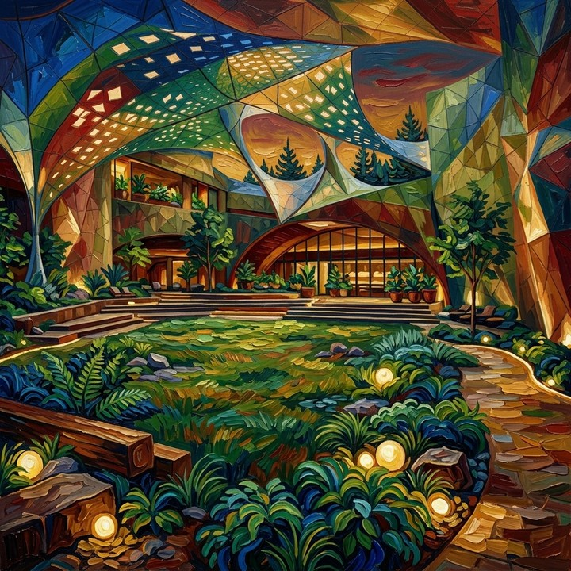
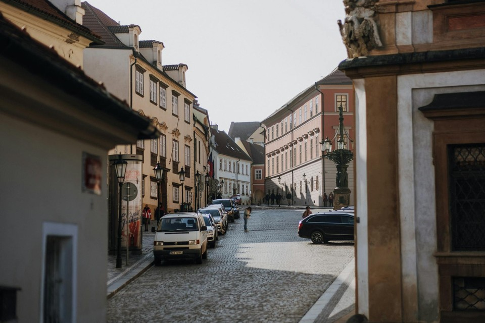
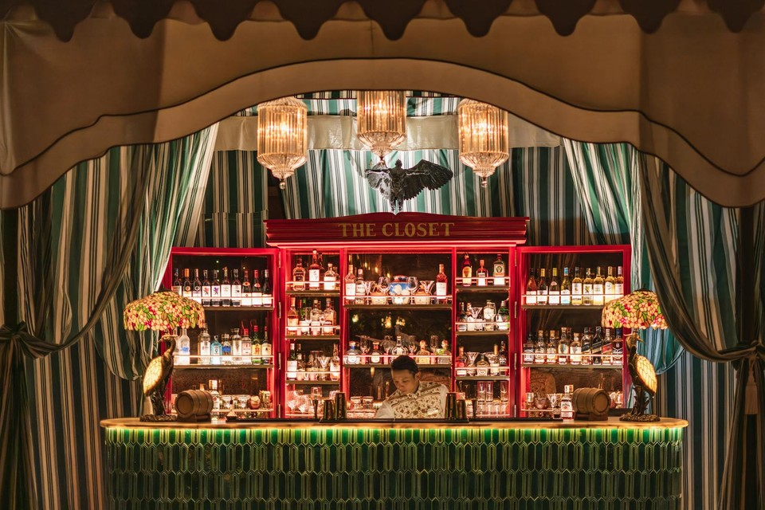
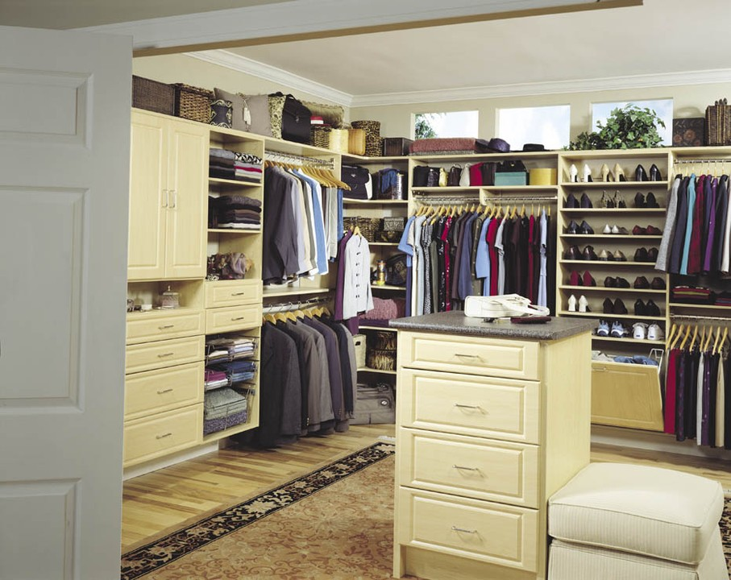
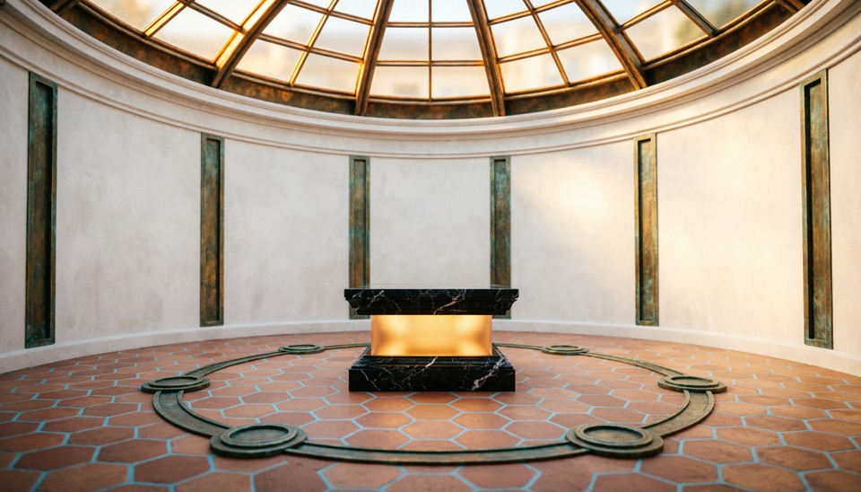
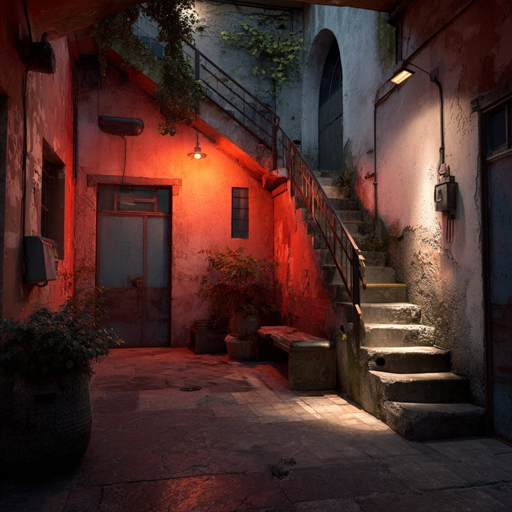

# Temporal Calibration

Temporal Calibration 度量生成视频是否维持**稳定的物理时钟**：当文件声明某个播放帧率时，画面中的运动是否对应相同的真实时间流逝？WorldArena 在 `real_time` 维度中以 output-only audit 形式调用被包装的 Pulse-of-Motion / Visual Chronometer 预测器 [[Gao et al., 2026](#reference-visual-chronometer)]。

这与 optical flow、motion magnitude 或 temporal smoothness 不同。一段 rollout 可以逐帧非常平滑，却在时间上仍然错误：坠落可能像被放慢的重力，快速周期性运动也可能显得不自然地迟缓。Visual Chronometer 将这类失败称为 **chronometric hallucination**——视觉连贯，但物理时间尺度模糊、不稳定或不可控。

预测器从重叠时间窗口估计 **Physical FPS**（`PhyFPS`），而不是单独相信容器元数据。WorldArena 将平均推断帧率与 nominal playback FPS $f_{\mathrm{meta}}$（OpenCV 读取的 container FPS，或 manifest 回退值）比较，并报告三个正式指标：`physical_fps_error`、`physical_fps_pct_error` 与 `physical_fps_intra_video_cv`。前两项刻画全局节奏偏差，第三项刻画单条视频内部的节奏漂移。

对每个 prediction，runtime 以默认参数 `clip_length = 30`、`stride = 4`、`resolution = 216` 提取重叠窗口，每个窗口得到一个片段估计 $\hat{f}_k$。平均推断物理 FPS 为

\[
\bar{f}_{\mathrm{phy}}
=
\frac{1}{K}\sum_{k=1}^{K} \hat{f}_k
\tag{1}
\]

绝对与相对标定误差分别为

\[
E_{\mathrm{abs}} = \left|\bar{f}_{\mathrm{phy}} - f_{\mathrm{meta}}\right|
\tag{2}
\]

\[
E_{\mathrm{pct}} = \frac{E_{\mathrm{abs}}}{f_{\mathrm{meta}}}
\tag{3}
\]

视频内部不稳定性由片段预测的变异系数表示：

\[
C_{\mathrm{intra}}
=
\frac{\operatorname{std}(\hat{f}_1,\ldots,\hat{f}_K)}{\operatorname{mean}(\hat{f}_1,\ldots,\hat{f}_K)}
\tag{4}
\]

WorldArena 将 `physical_fps_error`、`physical_fps_pct_error`、`physical_fps_intra_video_cv` 分别反向缩放到 $[0,1]$（`physical_fps_error` 使用 $[0,30]$，其余两项使用 $[0,1]$）。**归一化分数越高，表示时间标定越好。** 若 side runtime、checkpoint 或 FPS 元数据不可用，整组指标记为 `not_applicable`。

## 参考文献 {#reference-visual-chronometer}

!!! quote "The Pulse of Motion: Measuring Physical Frame Rate from Visual Dynamics"

    Xiangbo Gao, Mingyang Wu, Siyuan Yang, Jiongze Yu, Pardis Taghavi, Fangzhou Lin, and Zhengzhong Tu.  
    arXiv:2603.14375, 2026.

<!-- metric-examples:start -->
## 已核验的同输入案例

每个 metric 最多展示三个 case。每组中的两条视频必须属于同一 benchmark sample，且两侧首帧都通过与该组展示输入的 SIFT + RANSAC 几何匹配；不通过的候选不会发布。标签只表示当前 metric 的相对高低，不代表模型整体优劣。

Audit manifest: `docs/assets/metric_examples/curated_same_case_manifest.json`.

<article class="metric-case-exhibit metric-case-exhibit--curated">
  

    <figure class="metric-input-card">
      
      <figcaption>输入图像</figcaption>
    </figure>
    

      
输入已核验 · 同一 benchmark case · gap 0.9733

      <h4><code>image_static_stylized_verdant_landscape_0159</code></h4>
      
套件: image_static场景: stylized / outdoor / verdant_landscape

      

        基准 prompt target
        
Camera move right. A stylized courtyard with stone pathway, plants, and adjacent garden.

        <small>prompt source: prompt_target</small>
      

      
两条视频的首帧都已通过与展示输入的几何匹配核验；高低标签只比较当前 metric。

    

  

  

    <figure class="metric-output-card metric-output-card--good">
      

        <video class="metric-output-video" controls muted loop playsinline preload="metadata" aria-label="较高指标分: image_static_stylized_verdant_landscape_0159">
          <source src="../../../assets/metric_examples/curated_20260801/d10703dd2dfa__image_static_stylized_verdant_landscape_0159__high.mp4" type="video/mp4">
        </video>
        
较高指标分 · 分数 0.9867

      

      <figcaption class="metric-output-caption"><strong>较高指标分</strong>physical_fps_error估计物理 FPS 15.4 · 声明 FPS 15.0 · 绝对误差 0.4</figcaption>
    </figure>
    <figure class="metric-output-card metric-output-card--bad">
      

        <video class="metric-output-video" controls muted loop playsinline preload="metadata" aria-label="较低指标分: image_static_stylized_verdant_landscape_0159">
          <source src="../../../assets/metric_examples/curated_20260801/641547bfe52f__image_static_stylized_verdant_landscape_0159__low.mp4" type="video/mp4">
        </video>
        
较低指标分 · 分数 0.0133

      

      <figcaption class="metric-output-caption"><strong>较低指标分</strong>physical_fps_error估计物理 FPS 45.6 · 声明 FPS 16.0 · 绝对误差 29.6</figcaption>
    </figure>
  

</article>
<article class="metric-case-exhibit metric-case-exhibit--curated">
  

    <figure class="metric-input-card">
      
      <figcaption>输入图像</figcaption>
    </figure>
    

      
输入已核验 · 同一 benchmark case · gap 0.9700

      <h4><code>image_static_photorealistic_city_0047</code></h4>
      
套件: image_static场景: photorealistic / outdoor / city

      

        基准 prompt target
        
Camera pan left. A historic city street with adjacent street, historic buildings, and pedestrians.

        <small>prompt source: prompt_target</small>
      

      
两条视频的首帧都已通过与展示输入的几何匹配核验；高低标签只比较当前 metric。

    

  

  

    <figure class="metric-output-card metric-output-card--good">
      

        <video class="metric-output-video" controls muted loop playsinline preload="metadata" aria-label="较高指标分: image_static_photorealistic_city_0047">
          <source src="../../../assets/metric_examples/curated_20260801/616843ed9241__image_static_photorealistic_city_0047__high.mp4" type="video/mp4">
        </video>
        
较高指标分 · 分数 0.9733

      

      <figcaption class="metric-output-caption"><strong>较高指标分</strong>physical_fps_error估计物理 FPS 24.8 · 声明 FPS 24.0 · 绝对误差 0.8</figcaption>
    </figure>
    <figure class="metric-output-card metric-output-card--bad">
      

        <video class="metric-output-video" controls muted loop playsinline preload="metadata" aria-label="较低指标分: image_static_photorealistic_city_0047">
          <source src="../../../assets/metric_examples/curated_20260801/485cdc128fad__image_static_photorealistic_city_0047__low.mp4" type="video/mp4">
        </video>
        
较低指标分 · 分数 0.0033

      

      <figcaption class="metric-output-caption"><strong>较低指标分</strong>physical_fps_error估计物理 FPS 37.9 · 声明 FPS 8.0 · 绝对误差 29.9</figcaption>
    </figure>
  

</article>
<article class="metric-case-exhibit metric-case-exhibit--curated">
  

    <figure class="metric-input-card">
      
      <figcaption>输入图像</figcaption>
    </figure>
    

      
输入已核验 · 同一 benchmark case · gap 0.9800

      <h4><code>image_static_photorealistic_dining_spaces_0061</code></h4>
      
套件: image_static场景: photorealistic / indoor / dining_spaces

      

        基准 prompt target
        
Camera pull out. A bar interior with seating area, tables, and patrons.

        <small>prompt source: prompt_target</small>
      

      
两条视频的首帧都已通过与展示输入的几何匹配核验；高低标签只比较当前 metric。

    

  

  

    <figure class="metric-output-card metric-output-card--good">
      

        <video class="metric-output-video" controls muted loop playsinline preload="metadata" aria-label="较高指标分: image_static_photorealistic_dining_spaces_0061">
          <source src="../../../assets/metric_examples/curated_20260801/77d04c8a566c__image_static_photorealistic_dining_spaces_0061__high.mp4" type="video/mp4">
        </video>
        
较高指标分 · 分数 0.9867

      

      <figcaption class="metric-output-caption"><strong>较高指标分</strong>physical_fps_error估计物理 FPS 60.4 · 声明 FPS 60.0 · 绝对误差 0.4</figcaption>
    </figure>
    <figure class="metric-output-card metric-output-card--bad">
      

        <video class="metric-output-video" controls muted loop playsinline preload="metadata" aria-label="较低指标分: image_static_photorealistic_dining_spaces_0061">
          <source src="../../../assets/metric_examples/curated_20260801/d82b8808bafe__image_static_photorealistic_dining_spaces_0061__low.mp4" type="video/mp4">
        </video>
        
较低指标分 · 分数 0.0067

      

      <figcaption class="metric-output-caption"><strong>较低指标分</strong>physical_fps_error估计物理 FPS 44.8 · 声明 FPS 15.0 · 绝对误差 29.8</figcaption>
    </figure>
  

</article>
<article class="metric-case-exhibit metric-case-exhibit--curated">
  

    <figure class="metric-input-card">
      
      <figcaption>输入图像</figcaption>
    </figure>
    

      
输入已核验 · 同一 benchmark case · gap 0.6648

      <h4><code>image_static_stylized_city_0137</code></h4>
      
套件: image_static场景: stylized / outdoor / city

      

        基准 prompt target
        
Camera pan right. A japanese storefront with adjacent storefront, street vendor, and pedestrians.

        <small>prompt source: prompt_target</small>
      

      
两条视频的首帧都已通过与展示输入的几何匹配核验；高低标签只比较当前 metric。

    

  

  

    <figure class="metric-output-card metric-output-card--good">
      

        <video class="metric-output-video" controls muted loop playsinline preload="metadata" aria-label="较高指标分: image_static_stylized_city_0137">
          <source src="../../../assets/metric_examples/curated_20260801/acb2c2032abe__image_static_stylized_city_0137__high.mp4" type="video/mp4">
        </video>
        
较高指标分 · 分数 0.9840

      

      <figcaption class="metric-output-caption"><strong>较高指标分</strong>physical_fps_intra_video_cv段间物理 FPS 60.1–63.0 · 变异系数 0.016</figcaption>
    </figure>
    <figure class="metric-output-card metric-output-card--bad">
      

        <video class="metric-output-video" controls muted loop playsinline preload="metadata" aria-label="较低指标分: image_static_stylized_city_0137">
          <source src="../../../assets/metric_examples/curated_20260801/781bbd8a087a__image_static_stylized_city_0137__low.mp4" type="video/mp4">
        </video>
        
较低指标分 · 分数 0.3192

      

      <figcaption class="metric-output-caption"><strong>较低指标分</strong>physical_fps_intra_video_cv段间物理 FPS 12.8–55.8 · 变异系数 0.681</figcaption>
    </figure>
  

</article>
<article class="metric-case-exhibit metric-case-exhibit--curated">
  

    <figure class="metric-input-card">
      
      <figcaption>输入图像</figcaption>
    </figure>
    

      
输入已核验 · 同一 benchmark case · gap 0.6596

      <h4><code>image_static_stylized_aquatic_landscape_0148</code></h4>
      
套件: image_static场景: stylized / outdoor / aquatic_landscape

      

        基准 prompt target
        
Camera pan right. A coastal landscape with rocky outcrop, boats, and extended shoreline.

        <small>prompt source: prompt_target</small>
      

      
两条视频的首帧都已通过与展示输入的几何匹配核验；高低标签只比较当前 metric。

    

  

  

    <figure class="metric-output-card metric-output-card--good">
      

        <video class="metric-output-video" controls muted loop playsinline preload="metadata" aria-label="较高指标分: image_static_stylized_aquatic_landscape_0148">
          <source src="../../../assets/metric_examples/curated_20260801/de99760ac54c__image_static_stylized_aquatic_landscape_0148__high.mp4" type="video/mp4">
        </video>
        
较高指标分 · 分数 0.9788

      

      <figcaption class="metric-output-caption"><strong>较高指标分</strong>physical_fps_intra_video_cv段间物理 FPS 19.3–21.0 · 变异系数 0.021</figcaption>
    </figure>
    <figure class="metric-output-card metric-output-card--bad">
      

        <video class="metric-output-video" controls muted loop playsinline preload="metadata" aria-label="较低指标分: image_static_stylized_aquatic_landscape_0148">
          <source src="../../../assets/metric_examples/curated_20260801/4c25fd4af6e3__image_static_stylized_aquatic_landscape_0148__low.mp4" type="video/mp4">
        </video>
        
较低指标分 · 分数 0.3192

      

      <figcaption class="metric-output-caption"><strong>较低指标分</strong>physical_fps_intra_video_cv段间物理 FPS 11.6–47.6 · 变异系数 0.681</figcaption>
    </figure>
  

</article>
<article class="metric-case-exhibit metric-case-exhibit--curated">
  

    <figure class="metric-input-card">
      
      <figcaption>输入图像</figcaption>
    </figure>
    

      
输入已核验 · 同一 benchmark case · gap 0.7192

      <h4><code>image_static_photorealistic_workspaces_0144</code></h4>
      
套件: image_static场景: photorealistic / indoor / workspaces

      

        基准 prompt target
        
Camera move left. A modern conference room with side wall, whiteboard, and chairs. Camera pull out. A modern conference room with entrance door, coat rack, and chairs. Camera pan left. A modern conference room with hallway and artwork.

        <small>prompt source: prompt_target</small>
      

      
两条视频的首帧都已通过与展示输入的几何匹配核验；高低标签只比较当前 metric。

    

  

  

    <figure class="metric-output-card metric-output-card--good">
      

        <video class="metric-output-video" controls muted loop playsinline preload="metadata" aria-label="较高指标分: image_static_photorealistic_workspaces_0144">
          <source src="../../../assets/metric_examples/curated_20260801/61c84b8ed7cc__image_static_photorealistic_workspaces_0144__high.mp4" type="video/mp4">
        </video>
        
较高指标分 · 分数 0.9894

      

      <figcaption class="metric-output-caption"><strong>较高指标分</strong>physical_fps_intra_video_cv段间物理 FPS 69.1–71.7 · 变异系数 0.011</figcaption>
    </figure>
    <figure class="metric-output-card metric-output-card--bad">
      

        <video class="metric-output-video" controls muted loop playsinline preload="metadata" aria-label="较低指标分: image_static_photorealistic_workspaces_0144">
          <source src="../../../assets/metric_examples/curated_20260801/ed03c3e72ce1__image_static_photorealistic_workspaces_0144__low.mp4" type="video/mp4">
        </video>
        
较低指标分 · 分数 0.2702

      

      <figcaption class="metric-output-caption"><strong>较低指标分</strong>physical_fps_intra_video_cv段间物理 FPS 11.9–54.8 · 变异系数 0.730</figcaption>
    </figure>
  

</article>
<article class="metric-case-exhibit metric-case-exhibit--curated">
  

    <figure class="metric-input-card">
      
      <figcaption>输入图像</figcaption>
    </figure>
    

      
输入已核验 · 同一 benchmark case · gap 0.9983

      <h4><code>image_static_photorealistic_passageways_0139</code></h4>
      
套件: image_static场景: photorealistic / indoor / passageways

      

        基准 prompt target
        
Camera move left. A walk-in closet with shelves, clothing racks, and clothing.

        <small>prompt source: prompt_target</small>
      

      
两条视频的首帧都已通过与展示输入的几何匹配核验；高低标签只比较当前 metric。

    

  

  

    <figure class="metric-output-card metric-output-card--good">
      

        <video class="metric-output-video" controls muted loop playsinline preload="metadata" aria-label="较高指标分: image_static_photorealistic_passageways_0139">
          <source src="../../../assets/metric_examples/curated_20260801/564b831d08d3__image_static_photorealistic_passageways_0139__high.mp4" type="video/mp4">
        </video>
        
较高指标分 · 分数 0.9983

      

      <figcaption class="metric-output-caption"><strong>较高指标分</strong>physical_fps_pct_error估计物理 FPS 59.9 · 声明 FPS 60.0 · 相对误差 0.17%</figcaption>
    </figure>
    <figure class="metric-output-card metric-output-card--bad">
      

        <video class="metric-output-video" controls muted loop playsinline preload="metadata" aria-label="较低指标分: image_static_photorealistic_passageways_0139">
          <source src="../../../assets/metric_examples/curated_20260801/191ee5f9e93e__image_static_photorealistic_passageways_0139__low.mp4" type="video/mp4">
        </video>
        
较低指标分 · 分数 0.0000

      

      <figcaption class="metric-output-caption"><strong>较低指标分</strong>physical_fps_pct_error估计物理 FPS 40.0 · 声明 FPS 15.0 · 相对误差 166.67%</figcaption>
    </figure>
  

</article>
<article class="metric-case-exhibit metric-case-exhibit--curated">
  

    <figure class="metric-input-card">
      
      <figcaption>输入图像</figcaption>
    </figure>
    

      
输入已核验 · 同一 benchmark case · gap 0.9983

      <h4><code>image_static_photorealistic_public_spaces_0167</code></h4>
      
套件: image_static场景: photorealistic / indoor / public_spaces

      

        基准 prompt target
        
Camera push in. A circular room with marble pedestal, intricate floor pattern, and glowing base.

        <small>prompt source: prompt_target</small>
      

      
两条视频的首帧都已通过与展示输入的几何匹配核验；高低标签只比较当前 metric。

    

  

  

    <figure class="metric-output-card metric-output-card--good">
      

        <video class="metric-output-video" controls muted loop playsinline preload="metadata" aria-label="较高指标分: image_static_photorealistic_public_spaces_0167">
          <source src="../../../assets/metric_examples/curated_20260801/3c85cdec6032__image_static_photorealistic_public_spaces_0167__high.mp4" type="video/mp4">
        </video>
        
较高指标分 · 分数 0.9983

      

      <figcaption class="metric-output-caption"><strong>较高指标分</strong>physical_fps_pct_error估计物理 FPS 60.1 · 声明 FPS 60.0 · 相对误差 0.17%</figcaption>
    </figure>
    <figure class="metric-output-card metric-output-card--bad">
      

        <video class="metric-output-video" controls muted loop playsinline preload="metadata" aria-label="较低指标分: image_static_photorealistic_public_spaces_0167">
          <source src="../../../assets/metric_examples/curated_20260801/54a5bf98aaae__image_static_photorealistic_public_spaces_0167__low.mp4" type="video/mp4">
        </video>
        
较低指标分 · 分数 0.0000

      

      <figcaption class="metric-output-caption"><strong>较低指标分</strong>physical_fps_pct_error估计物理 FPS 50.4 · 声明 FPS 15.0 · 相对误差 236.00%</figcaption>
    </figure>
  

</article>
<article class="metric-case-exhibit metric-case-exhibit--curated">
  

    <figure class="metric-input-card">
      
      <figcaption>输入图像</figcaption>
    </figure>
    

      
输入已核验 · 同一 benchmark case · gap 0.9983

      <h4><code>image_static_photorealistic_passageways_0115</code></h4>
      
套件: image_static场景: photorealistic / indoor / passageways

      

        基准 prompt target
        
Camera orbit right. A dimly lit alleyway with upper landing, doorway, and railing.

        <small>prompt source: prompt_target</small>
      

      
两条视频的首帧都已通过与展示输入的几何匹配核验；高低标签只比较当前 metric。

    

  

  

    <figure class="metric-output-card metric-output-card--good">
      

        <video class="metric-output-video" controls muted loop playsinline preload="metadata" aria-label="较高指标分: image_static_photorealistic_passageways_0115">
          <source src="../../../assets/metric_examples/curated_20260801/48b996e1b9e0__image_static_photorealistic_passageways_0115__high.mp4" type="video/mp4">
        </video>
        
较高指标分 · 分数 0.9983

      

      <figcaption class="metric-output-caption"><strong>较高指标分</strong>physical_fps_pct_error估计物理 FPS 60.1 · 声明 FPS 60.0 · 相对误差 0.17%</figcaption>
    </figure>
    <figure class="metric-output-card metric-output-card--bad">
      

        <video class="metric-output-video" controls muted loop playsinline preload="metadata" aria-label="较低指标分: image_static_photorealistic_passageways_0115">
          <source src="../../../assets/metric_examples/curated_20260801/f32b8752d3c3__image_static_photorealistic_passageways_0115__low.mp4" type="video/mp4">
        </video>
        
较低指标分 · 分数 0.0000

      

      <figcaption class="metric-output-caption"><strong>较低指标分</strong>physical_fps_pct_error估计物理 FPS 41.0 · 声明 FPS 15.0 · 相对误差 173.33%</figcaption>
    </figure>
  

</article>

<!-- metric-examples:end -->
