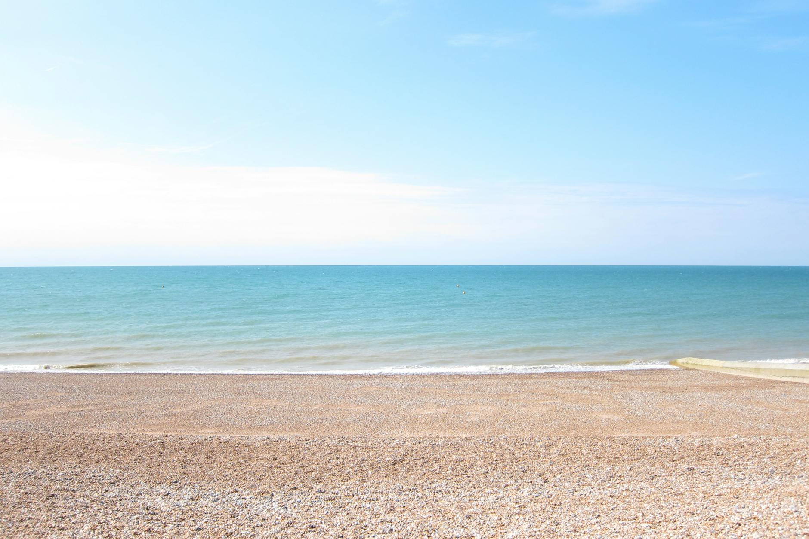
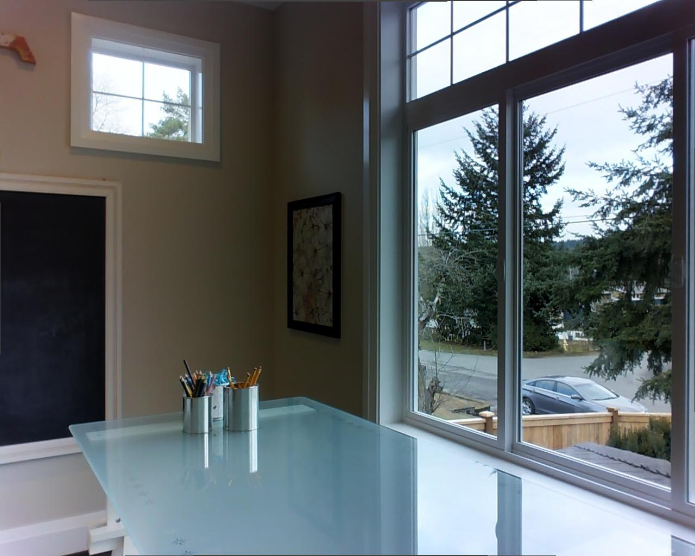

# 时序闪烁（Temporal Flickering）

时序闪烁度量生成视频**相邻帧之间的像素稳定性**。帧间高频亮度或颜色跳变会产生可见闪烁；本指标采用 RGB 像素平均绝对误差（MAE）加以惩罚。

设解码帧序列为 $\{x_i\}_{i=1}^{N}$，相邻帧像素 MAE 为

\[
\mathrm{MAE}(x_i, x_{i+1})
=
\frac{1}{HWC}\sum_{h,w,c}\left|x_i(h,w,c)-x_{i+1}(h,w,c)\right|
\tag{1}
\]

其中 $H$、$W$、$C$ 分别为高、宽与通道数。WorldArena 在 uint8 RGB 取值区间 $[0,255]$ 上计算 MAE；若分辨率不一致，则将后一帧缩放至与前一帧相同后再作差。

时序闪烁得分对相邻帧 MAE 取平均：

\[
S_{\mathrm{flick}}
=
\frac{255 - \frac{1}{N-1}\sum_{i=1}^{N-1}\mathrm{MAE}(x_i, x_{i+1})}{255}
\tag{2}
\]

$S_{\mathrm{flick}}$ 越高表示闪烁越少。该指标**仅需 prediction**，且至少需要两帧。

<!-- temporal-flickering-representative-cases:start -->
## Temporal Flickering 代表性对比

以下代表性对比从正式 `image_static` Temporal Flickering 结果中筛选，并经过 frame strip 人工复核。每个展示固定一个 benchmark case——相同的输入图像与 eval-plan prompt target——并比较两个 prediction 视频。Temporal Flickering 分数越高越好，mean pairwise pixel MAE 越低越好。

不同 adapter 的实际 conditioning 可能不同，因此这些是 metric 诊断案例，不是受控的模型排名对比。精确路径、哈希、frame-pair 统计及 report 来源见[机器可读 Temporal Flickering 清单](../../../assets/metric_examples/temporal_flickering_representative_manifest.csv)。

<article class="metric-case-exhibit">
  

    <figure class="metric-input-card">
      
      <figcaption>输入图像</figcaption>
    </figure>
    

      
Case 1 · 可见不稳定会增大相邻帧 MAE

      <h4><code>image_static_photorealistic_aquatic_landscape_0098</code></h4>
      
image_staticphotorealistic / outdoor / aquatic_landscape

      

        Benchmark prompt target
        
Camera pan right. An aquatic landscape with pebble beach, calm sea, and blue sky.

      

      
Output A 的变化平滑；Output B 出现大幅视角畸变和移动黑边，因此相邻帧像素差显著增大。

    

  

  

    <figure class="metric-output-card">
      

        <video class="metric-output-video" controls muted loop playsinline preload="metadata" aria-label="Output A: ac3d-image-static，水岸 case 0098">
          <source src="../../../assets/metric_examples/d6290f43f723__ac3d-image-static__image_static_photorealistic_aquatic_landscape_0098.mp4" type="video/mp4">
        </video>
      

      <figcaption class="metric-output-caption">
        <strong>Output A</strong>
        Temporal Flickering：<strong>0.9812</strong> · mean pairwise MAE 4.7833
      </figcaption>
    </figure>
    <figure class="metric-output-card">
      

        <video class="metric-output-video" controls muted loop playsinline preload="metadata" aria-label="Output B: LucidDreamer，水岸 case 0098">
          <source src="../../../assets/metric_examples/20dc16268a49__luciddreamer-image-static-8gpu-20260613_151844__image_static_photorealistic_aquatic_landscape_0098.mp4" type="video/mp4">
        </video>
      

      <figcaption class="metric-output-caption">
        <strong>Output B</strong>
        Temporal Flickering：<strong>0.7074</strong> · mean pairwise MAE 74.6172
      </figcaption>
    </figure>
  

</article>

<article class="metric-case-exhibit">
  

    <figure class="metric-input-card">
      
      <figcaption>输入图像</figcaption>
    </figure>
    

      
Case 2 · 近乎静止的输出可以得到很高分

      <h4><code>image_static_photorealistic_workspaces_0106</code></h4>
      
image_staticphotorealistic / indoor / workspaces

      

        Benchmark prompt target
        
Camera move left. A workspaces scene with bookshelf, indoor plants, and adjacent wall.

      

      
Output B 几乎静止，因此得到 0.9940；但它没有保留参考 workspace。Temporal Flickering 只衡量 prediction 侧的像素稳定性，不检查场景正确性或 conditioning fidelity。

    

  

  

    <figure class="metric-output-card">
      

        <video class="metric-output-video" controls muted loop playsinline preload="metadata" aria-label="Output A: ac3d-image-static，workspace case 0106">
          <source src="../../../assets/metric_examples/c0b5d552bebf__ac3d-image-static__image_static_photorealistic_workspaces_0106.mp4" type="video/mp4">
        </video>
      

      <figcaption class="metric-output-caption">
        <strong>Output A</strong>
        Temporal Flickering：<strong>0.9769</strong> · mean pairwise MAE 5.8888
      </figcaption>
    </figure>
    <figure class="metric-output-card">
      

        <video class="metric-output-video" controls muted loop playsinline preload="metadata" aria-label="Output B: CameraCtrl，workspace case 0106">
          <source src="../../../assets/metric_examples/5a90ac712030__cameractrl_image_static__image_static_photorealistic_workspaces_0106.mp4" type="video/mp4">
        </video>
      

      <figcaption class="metric-output-caption">
        <strong>Output B</strong>
        Temporal Flickering：<strong>0.9940</strong> · mean pairwise MAE 1.5278
      </figcaption>
    </figure>
  

</article>

<article class="metric-case-exhibit">
  

    <figure class="metric-input-card">
      
      <figcaption>输入图像</figcaption>
    </figure>
    

      
Case 3 · 相邻像素 MAE 对正常相机运动敏感

      <h4><code>image_static_photorealistic_living_spaces_0140</code></h4>
      
image_staticphotorealistic / indoor / living_spaces

      

        Benchmark prompt target
        
Camera push in. A living room with sofa, bookshelf, and books.

      

      
Output A 的运动较小；Output B 做了更大幅、平滑的相机运动并露出书架。Output B 的低分反映更大的像素变化；由于当前实现没有做 motion compensation，仅凭该分数不能断言存在肉眼可见的高频闪烁。

    

  

  

    <figure class="metric-output-card">
      

        <video class="metric-output-video" controls muted loop playsinline preload="metadata" aria-label="Output A: ac3d-image-static，living space case 0140">
          <source src="../../../assets/metric_examples/3a76d4fa805b__ac3d-image-static__image_static_photorealistic_living_spaces_0140.mp4" type="video/mp4">
        </video>
      

      <figcaption class="metric-output-caption">
        <strong>Output A</strong>
        Temporal Flickering：<strong>0.9634</strong> · mean pairwise MAE 9.3268
      </figcaption>
    </figure>
    <figure class="metric-output-card">
      

        <video class="metric-output-video" controls muted loop playsinline preload="metadata" aria-label="Output B: LongCat-Video，living space case 0140">
          <source src="../../../assets/metric_examples/d43209bc4d20__longcat-video-image-static-8gpu-20260612_133950__image_static_photorealistic_living_spaces_0140.mp4" type="video/mp4">
        </video>
      

      <figcaption class="metric-output-caption">
        <strong>Output B</strong>
        Temporal Flickering：<strong>0.7694</strong> · mean pairwise MAE 58.8134
      </figcaption>
    </figure>
  

</article>

<!-- temporal-flickering-representative-cases:end -->

## 参考文献 {#reference}

!!! quote "VBench — Temporal Flickering（附录 C.2.3）"

    相邻帧像素 MAE 经 $(255 - \overline{\mathrm{MAE}})/255$ 映射至 $[0,1]$ 稳定性得分。
